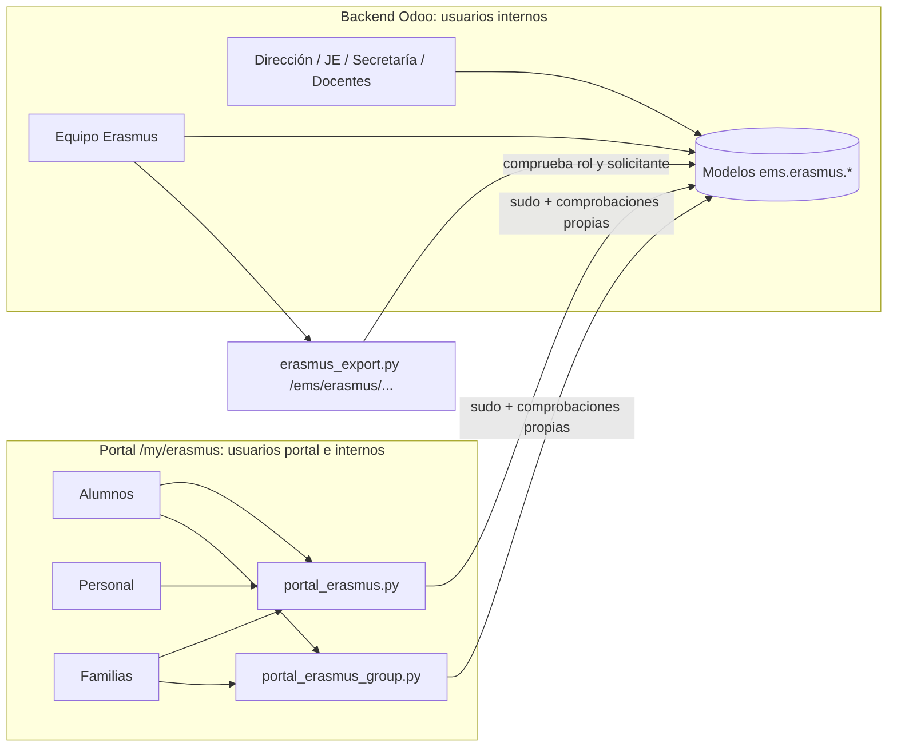

# 1. Arquitectura, modelos y relaciones

[← Índice](README.md)

## 1.1 Qué es EMS y dónde vive el módulo Erasmus+

EMS (*Educational Management System*) es un módulo de **Odoo 18** (Python 3, PostgreSQL, vistas XML y OWL) desarrollado por el profesorado del Institut Puig Castellar para gestionar el centro. El módulo Erasmus+ es una parte de EMS, no un módulo independiente: comparte usuarios, alumnos, familias, grupos, notas, amonestaciones (`ems.strike`), personal (`hr.employee`) y ausencias (`hr.leave`) con el resto de la aplicación.

| Capa | Ubicación | Contenido |
|---|---|---|
| Modelos (lógica) | `models/erasmus/*.py` (18 archivos, unas 6.500 líneas) | 38 modelos `ems.erasmus.*` y extensiones de `res.partner`, `res.users` |
| Controladores (portal y descargas) | `controllers/portal_erasmus.py`, `controllers/portal_erasmus_group.py`, `controllers/erasmus_export.py` | Rutas `/my/erasmus/...` (alumnos, personal, familias) y `/ems/erasmus/...` (descargas internas) |
| Vistas de gestión | `views/erasmus/*/views.xml`, `views/erasmus/menu.xml` | Menú *Erasmus+* del backend |
| Plantillas de portal | `views/portal/portal_erasmus.xml`, `views/portal/portal_erasmus_group.xml` | Páginas que ven alumnos, personal y familias |
| Seguridad | `security/groups.xml`, `security/ir.model.access.csv`, `security/rules/erasmus.xml` | Grupos, permisos por modelo y reglas por registro |
| Correos | `mails/erasmus/*.xml` | 13 plantillas de correo |
| Informes PDF | `reports/erasmus/report_erasmus_resolution.xml`, `report_erasmus_self_assessment.xml` | Lista publicada de una resolución; autoevaluaciones semanales |
| Tareas programadas | `data/main/ir.cron-erasmus.csv` | 4 crons (ver [12_automatizaciones_transiciones.md](12_automatizaciones_transiciones.md)) |
| Datos del centro | `data/custom/erasmus/ems.erasmus.project.csv` | Proyectos iniciales (solo se cargan una vez; después se mantienen en la aplicación) |
| Pruebas | `tests/test_erasmus*.py`, `tests/test_portal_erasmus.py`, `static/tests/tours/erasmus_*.js` | 42 clases, 299 pruebas Erasmus+ (ver [16_validacion_pruebas.md](16_validacion_pruebas.md)) |
| Documentación de desarrollador | `docs/en/developers/erasmus/erasmus.md`, `group_mobility.md`, `records.md` | Descripción técnica en inglés (contrastada en [17_verificacion_doc_codigo.md](17_verificacion_doc_codigo.md)) |

**Estado de publicación (verificado con git):** el código Erasmus+ **no está en la rama `main` ni en ninguna versión publicada** (la última etiqueta es `v18.0.0.39.1`). Vive en las ramas de fase `683`…`697`, `ems-carpetas`, `ems-movgrupo` y en la rama integrada `integration/erasmus-completo` (commit `7b99cfaf`), que es la auditada. La versión del manifiesto en esa rama es `18.0.0.38.1`.

## 1.2 Piezas comunes de las que depende

| Pieza | Dónde | Para qué la usa Erasmus+ |
|---|---|---|
| `ems.base` | `models/shared/base.py` | Mixin con `active` (archivado), chatter, actividades (tareas) y utilidades (`chatter()`, `build_html_list()`). Lo heredan convocatoria, solicitud, movilidad, resolución, oferta, reclamación, pagos, facturas y movilidades de grupo |
| `ems.datetime_utils` | `models/shared/` | Reloj del centro (zona horaria de la empresa, `Europe/Madrid`): todos los plazos se comparan con `EmsErasmusCall._ems_now()` (`models/erasmus/call.py:595`), nunca con el reloj del navegador |
| Notas (`ems.grade_subject_line`, `ems.student.year_record`) | `models/grades/` | Media del expediente (criterio A) |
| Amonestaciones (`ems.strike`) y umbral `res.company.strike_escalation_threshold` | `models/coexistence/` | Exclusión por conducta y criterio F |
| Familias (`_ems_family_contacts`, `get_portal_students`, `_ems_portal_can_act_for`) | `models/contacts/` | Firma de la carta por la familia, columnas de tutor legal del Excel |
| Ausencias (`hr.leave`, tipo `ems.leave_type_training`) | `models/employees/` | Ausencia por formación del personal en movilidad |
| Resumen diario de tareas | `docs/en/developers/shared/task_digest.md` | Las tareas (`mail.activity`) que crea Erasmus+ llegan al resumen diario de cada usuario |
| Guarda de correo de desarrollo | `docs/en/developers/shared/dev_mail_guard.md` | En una máquina de desarrollo ningún correo llega a destinatarios reales |

## 1.3 Mapa de modelos

Los 38 modelos se agrupan en cinco bloques. La columna «Archivo» da la clase concreta.

### Convocatorias, solicitudes y selección individual

| Modelo | Clase (archivo:línea) | Qué representa |
|---|---|---|
| `ems.erasmus.call` | `EmsErasmusCall` (`call.py:25`) | Una convocatoria (de alumnos o de personal): fechas, modalidades, documentos, carta de compromiso, checklist, panel, destinos |
| `ems.erasmus.call.modality` | `EmsErasmusCallModality` (`call.py:665`) | Una lista de selección con plazas propias (p. ej. GM y GS), su proyecto (KA121-VET / KA131-HED) y niveles |
| `ems.erasmus.call.document` | `EmsErasmusCallDocument` (`call.py:708`, extendida en `group_mobility.py:1365`) | Un documento exigido: etapa, requisito, firmantes, confidencialidad, categoría, plazo. **Es la única lista de requisitos** (de una convocatoria o de una movilidad de grupo) |
| `ems.erasmus.application` | `EmsErasmusApplication` (`application.py:69`) | La solicitud de una persona a una convocatoria (única por convocatoria y persona) con todos los criterios de puntuación |
| `ems.erasmus.application.document` | `EmsErasmusApplicationDocument` (`application.py:871`, extendida en `group_mobility.py:1382`) | **El motor documental**: una línea por documento exigido con sus archivos (todas las versiones), revisión y estado |
| `ems.erasmus.application.grade` | `interview.py` | Módulos usados para la media (copiados al cerrar la convocatoria) |
| `ems.erasmus.interview` | `EmsErasmusInterview` (`interview.py`) | La puntuación de un evaluador de la entrevista (rúbrica del anexo 4) |
| `ems.erasmus.evaluation` (abstracto) | `EmsErasmusEvaluation` (`evaluation.py:9`) | Flujo común de entrevistas y valoraciones de plan (enviar, reabrir, bloqueo) |
| `ems.erasmus.call.panel` / `ems.erasmus.plan_rating` / `ems.erasmus.application.merit` | `plan_rating.py` | Convocatoria de personal: miembros del tribunal, valoración del plan de movilidad, méritos |
| `ems.erasmus.resolution` / `.resolution.line` | `resolution.py:36`, `:219` | Listas de admisión, provisional, definitiva y rectificación; líneas congeladas |
| `ems.erasmus.offer` / `.offer.wizard` | `offer.py:10`, `:87` | Plaza ofrecida y respuesta; asistente para ofrecer una plaza libre a la siguiente reserva |
| `ems.erasmus.claim` | `claim.py` | Reclamación o recurso ante la dirección (registro manual) |

### Movilidades individuales (tras aceptar la plaza)

| Modelo | Clase | Qué representa |
|---|---|---|
| `ems.erasmus.mobility` | `EmsErasmusMobility` (`mobility.py:95`) | La movilidad de una solicitud aceptada (alumno o personal): destino, propuesta y su decisión, entidad de acogida, fechas, documentos, checklist, beca, pagos |
| `ems.erasmus.destination` | `mobility.py:26` | Destino ofrecido en una modalidad (plazas, niveles, fechas, entidades) |
| `ems.erasmus.call.task` / `ems.erasmus.mobility.task` | `mobility.py:73`, `:851` | Paso de checklist de la convocatoria y su instancia en cada movilidad |
| `ems.erasmus.call.question` / `.self_assessment` / `.self_assessment.answer` | `self_assessment.py` | Autoevaluación semanal durante la estancia |
| `ems.erasmus.commitment` (abstracto) / `ems.erasmus.commitment.version` | `commitment.py:13`, `:154` | Carta de compromiso aceptada en el portal y sus versiones anteriores |

### Movilidades de grupo (KA121-VET)

| Modelo | Clase | Qué representa |
|---|---|---|
| `ems.erasmus.group.mobility` | `group_mobility.py:42` | La movilidad de grupo: grupos elegibles, plazas, docente líder y acompañantes, inscripción, selección, destino, fechas, EU Survey, cierre |
| `ems.erasmus.group.registration` | `group_mobility.py:770` | Inscripción de un alumno: datos congelados al cerrar, ranking, resultado, sustituciones. **Evidencia de la selección** |
| `ems.erasmus.group.participant` | `group_mobility.py:1066` | Expediente de cada participante (alumno seleccionado, líder o acompañante) |
| `ems.erasmus.group.draw` / `.draw.line` | `group_mobility.py:1276`, `:1309` | Sorteo de un empate: quién, cuándo, empatados y orden. No modificable |
| `ems.erasmus.group.log` | `group_mobility.py:1336` | Seguimiento durante la estancia (asistencia, incidencias, cambios, evidencias, comunicaciones) |

### Proyectos, economía y expedientes

| Modelo | Clase | Qué representa |
|---|---|---|
| `ems.erasmus.project` | `project.py:15` (extendida en `group_mobility.py:1460`) | Proyecto (convenio con SEPIE): tipo, fechas, presupuesto, plazo de conservación, contadores de expedientes |
| `ems.erasmus.project.document` | `project.py:82` | Documento del proyecto que no tiene otro registro en EMS (convenio, seguimiento presupuestario, difusión, informe final…) |
| `ems.erasmus.provision` / `.invoice` / `.payment` / `.transfer.wizard` | `grant.py` | Servicios pagados por el centro, facturas, pagos de la beca y registro de transferencias |
| `ems.erasmus.export` | `export.py:28` | Registro de cada exportación ZIP (quién, cuándo, alcance, auditoría, motivo, hash) |

### Extensiones de modelos existentes

| Modelo | Dónde | Qué añade |
|---|---|---|
| `res.partner` | `partner.py`, `group_mobility.py:1495` | `is_erasmus_host`, `erasmus_oid` (entidad de acogida); qué convocatorias, movilidades de grupo y cartas ve cada persona en el portal |
| `res.users` | `evaluation.py:144`, `group_mobility.py:1481` | Sincronización de los grupos ocultos de evaluador y de docente de movilidad de grupo |

## 1.4 Relaciones principales

```mermaid
erDiagram
    ems_erasmus_project ||--o{ ems_erasmus_mobility : "project_id"
    ems_erasmus_project ||--o{ ems_erasmus_group_mobility : "project_id (KA121-VET)"
    ems_erasmus_project ||--o{ ems_erasmus_project_document : "document_ids"
    ems_erasmus_project ||--o{ ems_erasmus_export : "export_ids"
    ems_erasmus_call ||--o{ ems_erasmus_call_modality : "modality_ids"
    ems_erasmus_call ||--o{ ems_erasmus_call_document : "document_ids / preparation_document_ids"
    ems_erasmus_call ||--o{ ems_erasmus_application : "application_ids"
    ems_erasmus_call ||--o{ ems_erasmus_resolution : "resolution_ids"
    ems_erasmus_call ||--o{ ems_erasmus_destination : "destination_ids"
    ems_erasmus_application ||--o{ ems_erasmus_application_document : "document_ids"
    ems_erasmus_application ||--o{ ems_erasmus_interview : "interview_ids"
    ems_erasmus_application ||--o{ ems_erasmus_plan_rating : "plan_rating_ids"
    ems_erasmus_application ||--o{ ems_erasmus_offer : "offer_ids"
    ems_erasmus_application ||--o| ems_erasmus_mobility : "mobility_ids (una)"
    ems_erasmus_resolution ||--o{ ems_erasmus_resolution_line : "line_ids (congeladas)"
    ems_erasmus_mobility ||--o{ ems_erasmus_application_document : "document_ids (mobility_id)"
    ems_erasmus_mobility ||--o{ ems_erasmus_payment : "payment_ids"
    ems_erasmus_mobility ||--o{ ems_erasmus_provision : "provision_ids"
    ems_erasmus_group_mobility ||--o{ ems_erasmus_call_document : "requirement_ids"
    ems_erasmus_group_mobility ||--o{ ems_erasmus_group_registration : "registration_ids"
    ems_erasmus_group_mobility ||--o{ ems_erasmus_group_participant : "participant_ids"
    ems_erasmus_group_mobility ||--o{ ems_erasmus_application_document : "document_ids (compartidos)"
    ems_erasmus_group_participant ||--o{ ems_erasmus_application_document : "document_ids (propios)"
    ems_erasmus_application_document }o--|| ems_erasmus_call_document : "call_document_id"
    ems_erasmus_application_document }o--o{ ir_attachment : "attachment_ids (todas las versiones)"
```

**Un único motor documental.** Una línea de `ems.erasmus.application.document` pertenece a **una solicitud o a una movilidad de grupo** (restricción SQL `one_owner`, `group_mobility.py:1387`). Las líneas de una movilidad individual son líneas de su solicitud con `mobility_id`. Las de grupo tienen `group_mobility_id` y, si son de un participante, `group_participant_id`; sin participante son **documentos compartidos** del grupo (una sola línea por movilidad, nunca copiada). Del mismo modo, un `ems.erasmus.call.document` pertenece a una convocatoria **o** a una movilidad de grupo (restricción `one_owner`, `group_mobility.py:1369`).

## 1.5 Comportamiento ante borrado (`ondelete`)

Relevante para la integridad de las evidencias (ver riesgo R-01 en [15_riesgos_decisiones.md](15_riesgos_decisiones.md)):

| Relación | `ondelete` | Efecto |
|---|---|---|
| Línea documental → solicitud (`application_id`) | `cascade` | Borrar una solicitud borra sus líneas, pero la solicitud está protegida por `restrict` desde la movilidad, oferta, reclamación y línea de resolución |
| Línea documental → movilidad (`mobility_id`) | `cascade` | **Borrar una movilidad borra todas sus líneas documentales** |
| Línea → movilidad de grupo / participante | `cascade` | Borrar la movilidad de grupo o el expediente borra sus líneas |
| Inscripción, participante, sorteo, seguimiento → movilidad de grupo | `cascade` | Borrar la movilidad de grupo los borra a nivel de base de datos, **sin pasar por la guarda `unlink()` de los sorteos** |
| Pago → movilidad | `restrict` | Una movilidad con pagos no se puede borrar |
| Exportación → proyecto / movilidad / movilidad de grupo | `restrict` | Un registro ya exportado no se puede borrar |
| Movilidad → solicitud | `restrict` | Una solicitud con movilidad no se puede borrar |
| Línea de resolución → solicitud | `restrict` | Una solicitud incluida en una resolución preparada no se puede borrar |

## 1.6 Tres canales de acceso

- **Backend:** el acceso lo deciden los permisos de modelo, las reglas de registro y las comprobaciones en código (`write()`, `_ems_role()`…). Ver [02_roles_permisos.md](02_roles_permisos.md).
- **Portal:** los usuarios portal **no tienen ningún permiso** sobre los modelos Erasmus; los controladores trabajan con `sudo()` y comprueban ellos mismos que el usuario solo actúe sobre lo suyo. El solicitante es siempre `request.env.user.partner_id`: ningún identificador de persona o solicitud viaja en un formulario.
- **Descargas internas:** el Excel de participantes y los ZIP se construyen al vuelo y nunca se guardan.
