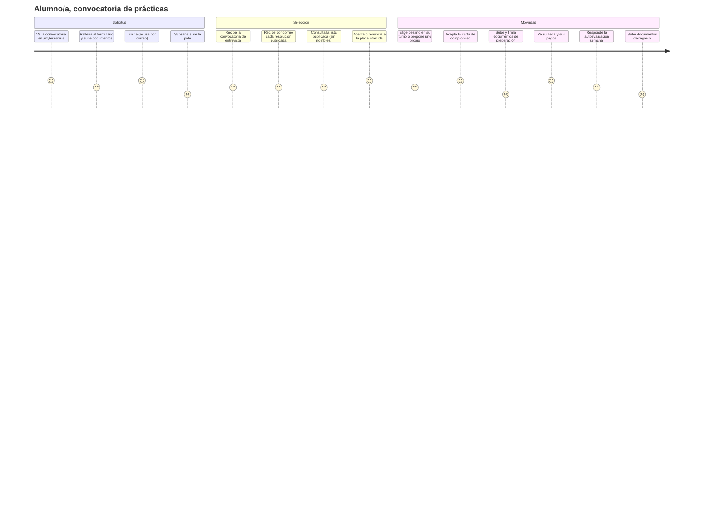
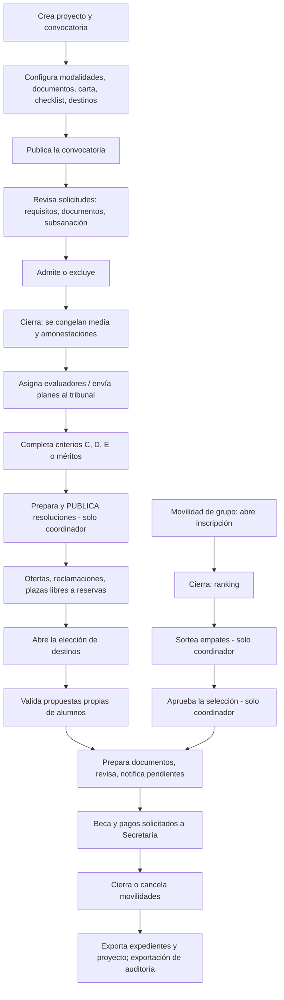

# 3. Recorrido completo de cada tipo de usuario

[← Índice](README.md)

Cada recorrido describe lo que la persona ve y hace, en orden, con la pantalla o ruta y el método que lo ejecuta. Los detalles de cada paso están en los capítulos temáticos.

## 3.1 Alumno/a de una convocatoria de prácticas (individual)

| # | Paso | Dónde | Método | Condiciones verificadas en código |
|---|---|---|---|---|
| 1 | Ve la tarjeta Erasmus+ y las convocatorias a las que puede optar | `GET /my/erasmus` | `res.partner._ems_erasmus_calls()` (`partner.py`) | Convocatoria publicada de alumnos cuya modalidad incluye el nivel de su grupo principal |
| 2 | Abre el formulario | `GET /my/erasmus/call/<id>` | `portal_erasmus_application` | Si tiene demasiadas amonestaciones este curso ve un aviso en lugar de *Solicitar* |
| 3 | Guarda respuestas y sube archivos (se crea la solicitud en borrador) | `POST /my/erasmus/call/<id>/save` | `_ems_portal_get_or_create`, `_ems_portal_save` (`application.py:717`, `:736`) | Solo mientras la convocatoria acepta solicitudes (`is_accepting`, reloj del centro) |
| 4 | Envía | mismo POST con `submit` | `action_submit` (`application.py:781`) | Todos los documentos obligatorios con archivo (los de menores solo si es menor); correo de acuse con la lista de archivos |
| 5 | Subsana | mismo formulario | `_ems_portal_correctable` | Solo los documentos marcados por el equipo y hasta el plazo de subsanación |
| 6 | Entrevista | correo | `action_send_interview_call` | Al menos 24 h antes |
| 7 | Resultados | correo y `GET /my/erasmus/call/<id>/resolution/<id>` (y `/pdf`) | `action_publish` de la resolución | La lista solo muestra el documento de identidad enmascarado |
| 8 | Acepta o renuncia | `POST /my/erasmus/call/<id>/offer` | `EmsErasmusOffer.action_accept` / `action_renounce` (`offer.py:49`) | Antes del plazo; aceptar crea la movilidad |
| 9 | Elige destino / propone uno | `POST /my/erasmus/call/<id>/mobility/choose` o `/propose` | `action_choose_destination`, `_ems_portal_propose` (`mobility.py:413`, `:478`) | En su turno; la propuesta propia exige el compromiso escrito de la entidad |
| 10 | Acepta la carta de compromiso | `POST …/mobility/commitment` | `action_sign_commitment` (`commitment.py:102`) | Se guarda texto, usuario, fecha e IP |
| 11 | Sube documentos | `POST …/mobility/upload` | `_ems_portal_upload` (`mobility.py:615`) | Solo líneas que no aporta el equipo y ya abiertas |
| 12 | Descarga lo que preparó el equipo | `GET …/mobility/file/<adjunto>` | `portal_erasmus_mobility_file` | Solo adjuntos de su propia movilidad |
| 13 | Autoevaluación semanal | `POST …/mobility/self_assessment` | `_ems_portal_self_assessment` (`mobility.py:656`) | Semanas ya empezadas, una vez cada una |
| 14 | Renuncia | `POST …/mobility/renounce` | `action_renounce` (`mobility.py:787`) | Mientras la movilidad esté abierta |

## 3.2 Familia de un alumno/a menor

| # | Paso | Dónde | Método |
|---|---|---|---|
| 1 | Recibe un correo cuando la movilidad pasa a preparación (y recordatorios semanales) | correo `email_template_erasmus_commitment_guardian` / `_group_commitment_guardian` | `_ems_remind_guardians` (`commitment.py:145`) |
| 2 | Ve en `/my/erasmus` las movilidades de los menores de los que es responsable | `GET /my/erasmus` | `_ems_erasmus_guardian_mobilities` (`partner.py`), `_ems_erasmus_guardian_group_participants` (`group_mobility.py:1511`) |
| 3 | Acepta la carta (individual) | `POST /my/erasmus/commitment/<movilidad>` | `action_sign_commitment(guardian=True)` |
| 3b | Acepta la carta (grupo) | `POST /my/erasmus/group/commitment/<participante>` | ídem |

La familia **no** ve los documentos del alumno ni su solicitud (verificado: «HTTP portal mobility file: health card» ❌ para la familia). No sube documentos: la autorización de viaje y la de menores al extranjero las sube el alumno.

## 3.3 Alumno/a de una movilidad de grupo

| # | Paso | Dónde | Método | Condiciones |
|---|---|---|---|---|
| 1 | Ve la tarjeta de la movilidad de su grupo | `GET /my/erasmus` | `_ems_erasmus_group_mobilities` (`group_mobility.py:1498`) | En inscripción y su grupo principal es elegible, o ya inscrito/participante |
| 2 | Se inscribe con un clic (opcional: declara menos oportunidades) | `POST /my/erasmus/group/<id>/enrol` | `_ems_portal_enrol` (`group_mobility.py:916`) | Grupo elegible, periodo abierto, sin bloqueo por conducta |
| 3 | Se retira | `POST …/withdraw` | `action_withdraw` | Solo con la inscripción abierta |
| 4 | Recibe su resultado (solo el suyo) | correo `email_template_erasmus_group_result` | `_ems_send_result` | Al aprobar el coordinador |
| 5 | Ve su expediente | `GET /my/erasmus/group/<id>` | `portal_erasmus_group` | Solo si es participante |
| 6 | Sube documentos, acepta la carta, renuncia | `POST /my/erasmus/group/<id>/<upload|commitment|renounce>` | `_ems_portal_upload`, `action_sign_commitment`, `action_renounce` | Expediente activo y movilidad en preparación/estancia/regreso |
| 7 | Descarga lo que aporta el equipo | `GET …/file/<adjunto>` | `portal_erasmus_group_file` | Sus documentos o los compartidos **no confidenciales** del grupo |

## 3.4 Personal (convocatoria de personal)

| # | Paso | Dónde | Método | Condiciones |
|---|---|---|---|---|
| 1 | Ve la convocatoria | `/my/erasmus` | `_ems_staff_can_apply` (`call.py:613`) | Docente con docencia activa en un grupo de los niveles de la convocatoria, o miembro de `validator_ids` |
| 2 | Rellena el plan de movilidad (anexo 1) y declaraciones | formulario | `_ems_portal_save` | Actividad, entidad, destino, fechas, motivo, objetivos y aplicación, todo obligatorio para enviar |
| 3 | Envía | | `action_submit` | Además: fecha de última movilidad (o «nunca») y antigüedad en el centro |
| 4 | Resultado, oferta, aceptación | igual que alumnos | | El portal nunca muestra la modalidad |
| 5 | Completa la propuesta con fechas exactas y la declaración responsable | `POST …/mobility/propose` | `_ems_portal_propose` | La valida la Dirección (`validator_ids`), nunca el propio solicitante |
| 6 | Cambia actividad o fechas antes de empezar | ídem | `_ems_can_change_proposal` (`mobility.py:471`) | La Dirección vuelve a validar |
| 7 | Ausencia por formación | automática | `_ems_sync_training_leave` (`mobility.py:687`) | EMS crea la `hr.leave` al validarse las fechas |
| 8 | Documentos, carta (si la convocatoria tiene), pagos | portal | | Igual que alumnos |

## 3.5 Coordinador/a Erasmus

Todo lo del técnico (3.6) más las acciones reservadas: publicar resoluciones, aprobar o devolver la selección de grupo, sortear empates, excepciones de resultado, aprobar o rechazar sustituciones, exportación de auditoría con documentos confidenciales.

## 3.6 Técnico/a de movilidad Erasmus

Mismo menú y mismas acciones que el coordinador salvo las reservadas. Entra por *Erasmus+* (Solicitudes, Ranking, Entrevistas, Valoraciones de plan, Resoluciones, Ofertas, Movilidades, Reclamaciones, Convocatorias, Movilidades de grupo, Proyectos, Entidades de acogida, Facturas, Pagos). Verificado: no puede publicar una resolución ni pedir una exportación de auditoría. **Problema detectado:** ve además *Comunidad educativa › Grupos*, cuyo formulario le da error (R-07).

## 3.7 Evaluador/a (entrevistas o tribunal de personal)

1. EMS le crea una tarea con fecha límite y le añade al grupo de evaluadores al asignarle una entrevista o una valoración de plan.
2. Ve solo *Erasmus+ › Mis evaluaciones* / *Mis valoraciones de plan*, y en ellas solo las suyas.
3. Puntúa la rúbrica (entrevista: 7 criterios de 0 a 5; plan: 2 criterios de 1, 0,5 o 0) y envía (`action_submit`, `evaluation.py:83`).
4. Puede reabrir hasta el plazo de corrección o la resolución provisional; después solo el equipo, con nota de rectificación.
5. En el tribunal de personal ve el plan escrito y los archivos `panel_visible`, nada más de la solicitud. Si es candidato en la convocatoria, se abstiene automáticamente.

## 3.8 Docente líder de una movilidad de grupo

1. EMS le añade al grupo oculto al nombrarle líder; ve *Erasmus+ › Mis movilidades de grupo*.
2. Al cerrarse la inscripción recibe la tarea de revisar la selección. Ve rango, media y si cumple requisitos; **nunca** amonestaciones, motivo de exclusión ni menos oportunidades.
3. Envía la propuesta (`action_submit_proposal`, `group_mobility.py:470`) o pide una excepción (`action_request_exception`), que llega como tarea al coordinador.
4. Durante la preparación revisa documentos (no confidenciales), edita programa y notas, propone sustitutos si alguien renuncia.
5. Inicia y finaliza la estancia (`action_start_stay`, `action_end_stay`), escribe el seguimiento, responde y marca el EU Survey con evidencias, propone el cierre.

## 3.9 Docente acompañante

Ve sus movilidades de grupo (lectura), su propio expediente y documentos (puede subir a sus líneas), escribe el seguimiento. No ve inscripciones ni ranking, no revisa documentos, no cambia nada más.

## 3.10 Jefatura de estudios y Director/a

- Lectura de convocatorias, solicitudes (sin campos confidenciales), ranking, resoluciones, ofertas, reclamaciones, movilidades (sin la pestaña de beca), movilidades de grupo, expedientes de grupo y documentos no confidenciales, proyectos.
- **Validan las propuestas de actividad del personal** si están en `validator_ids` (por defecto, el Director y la JE de FP: `_ems_staff_validators`, `call.py:184`), escribiendo la nota de decisión.
- No ven tarjetas sanitarias, documentación de inclusión ni evidencias de menos oportunidades (verificado).

## 3.11 Secretaría

- Menú *Erasmus+* con solo *Proyectos*, *Facturas* y *Pagos de beca*.
- Recibe una tarea por cada pago solicitado y cada factura creada (`_ask_transfer`, `grant.py:38`).
- Registra transferencias con su justificante (`EmsErasmusTransferWizard.action_confirm`, `grant.py:281`) o las deshace (`action_mark_unpaid`).
- Ve el IBAN y titular de cada pago. Crea y edita documentos de proyecto no confidenciales. Puede pedir exportaciones (no de auditoría) y solo ve las suyas.

## 3.12 Administrador/a

Todo lo anterior. Está siempre por encima de la dirección: valida cualquier propuesta, publica resoluciones, aprueba selecciones, pide exportaciones de auditoría.
