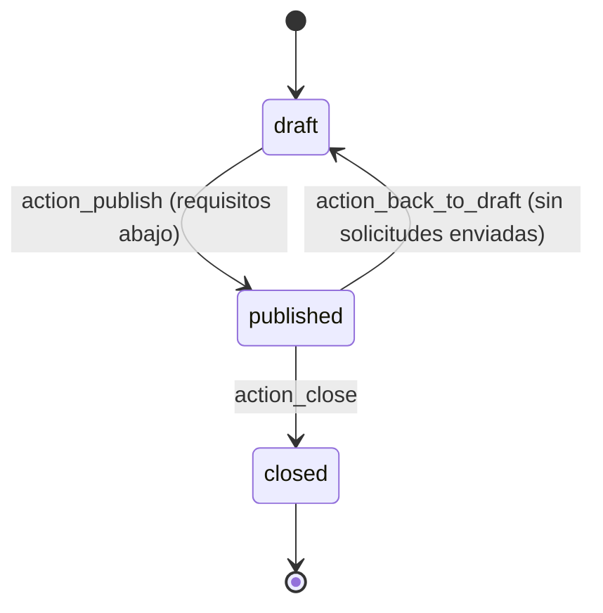
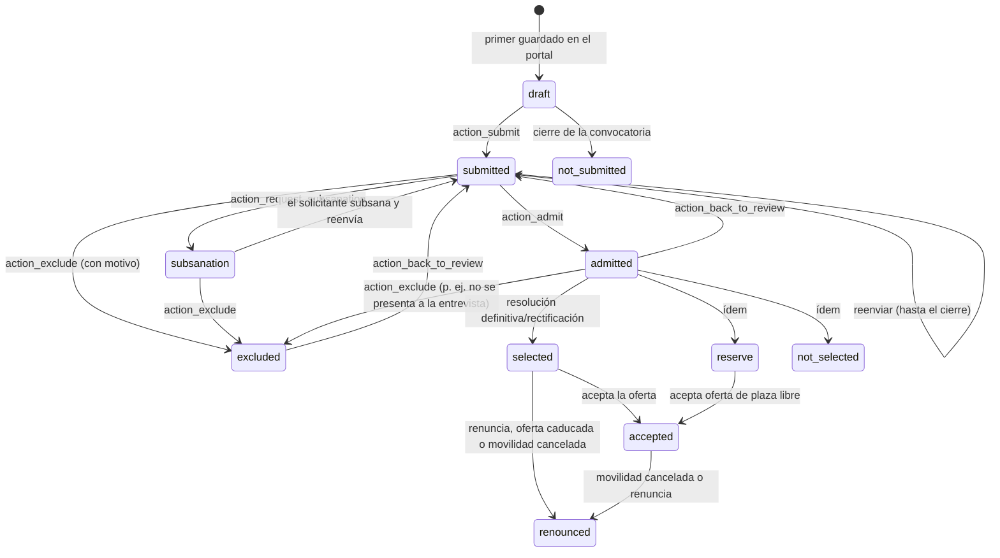

# 4. Proyectos KA121-VET y KA131-HED, convocatorias, inscripciones y candidaturas

[← Índice](README.md)

## 4.1 Proyectos (`ems.erasmus.project`, `models/erasmus/project.py:15`) — IMPLEMENTADO

Un proyecto es un convenio de subvención con SEPIE. El tipo (`kind`) es **KA121-VET** (FP de grado medio y movilidades de grupo) o **KA131-HED** (educación superior, CFGS). Pueden coexistir varios activos de cada tipo (uno por año de convocatoria).

| Campo | Uso |
|---|---|
| `name` | Número de convenio |
| `kind` | `ka121_vet` / `ka131_hed` (constante `PROJECTS`, `call.py:18`) |
| `date_start`, `date_end`, `active` | Vigencia |
| `budget` | Subvención concedida |
| `final_payment_date` | Cuándo SEPIE pagó el saldo |
| `keep_until` (calculado) | `final_payment_date` + 3 años, o + 5 si `budget` > 60.000 € (`_compute_keep_until`, `project.py:57`). Vacío mientras falte alguno de los dos datos. **Nada se borra automáticamente** |
| `retention_hold`, `retention_note` | Marca una auditoría o requerimiento abierto (informativo; no bloquea nada en código) |
| `record_count`, `record_complete_count`, `record_missing_count` | Expedientes de participantes y documentos pendientes (individuales no cancelados + participantes activos de grupos que no están en borrador ni cancelados) |

**Vínculo con las movilidades:**

- Cada movilidad individual tiene `project_id`, que debe ser del tipo del proyecto de su modalidad (`_check_project`, `mobility.py:304`). El campo **no es obligatorio**: una movilidad puede cerrarse sin proyecto asignado (ver [14_casos_excepcionales_pendientes.md](14_casos_excepcionales_pendientes.md)).
- Cada movilidad de grupo tiene `project_id` **obligatorio** y solo KA121-VET (`_check_project`, `group_mobility.py:225`).
- Pagos y facturas llevan el proyecto (el pago, heredado de la movilidad; la factura, opcional).

**Datos iniciales:** `data/custom/erasmus/ems.erasmus.project.csv` crea los proyectos del centro **una sola vez** al instalar; después se mantienen en la aplicación (regla general de `data/custom/`, ver `CLAUDE.md`).

## 4.2 Convocatorias (`ems.erasmus.call`, `models/erasmus/call.py:25`) — IMPLEMENTADO

Una convocatoria es para **alumnos** o para **personal** (`audience`, no modificable si ya tiene solicitudes: `write()`, `call.py:402`).

### Estados

| Transición | Método | Comprobaciones |
|---|---|---|
| Publicar | `action_publish` (`call.py:432`) | Alumnos: al menos una modalidad y todas con niveles. Personal: niveles del profesorado (`staff_level_ids`) y validadores (`validator_ids`). Ambos: al menos un documento **obligatorio** de solicitud |
| Volver a borrador | `action_back_to_draft` (`call.py:446`) | Ninguna solicitud fuera de borrador |
| Cerrar | `action_close` (`call.py:451`) | Las solicitudes en borrador pasan a *No presentada*; en convocatorias de alumnos se congelan media y amonestaciones de las enviadas (`_ems_freeze_scoring_data`) |

**Aceptación de solicitudes:** `is_accepting` = publicada y `date_open ≤ ahora < date_close`, con «ahora» del reloj del centro (`_compute_is_accepting`, `call.py:143`). El cierre **no es automático**: pasada `date_close` el portal deja de aceptar envíos, pero el estado sigue en *publicada* hasta que el equipo pulsa *Cerrar* (no hay cron de cierre para convocatorias individuales, a diferencia de las movilidades de grupo).

### Valores que crea una convocatoria nueva (`create()`, `call.py:199`)

| Alumnos | Personal |
|---|---|
| Documentos de preparación y regreso del art. 17 (`_ems_preparation_documents('student')`) | Documentos del art. 8 de solicitud (DNI, Europass CV, certificados) y de preparación y regreso del art. 15 |
| Checklist (sesiones de preparación, EU Survey, difusión) | Checklist (reuniones, actividades para los grupos, EU Survey, noticia web, compartir en reunión) |
| 4 preguntas de autoevaluación semanal | Ninguna |
| Carta de compromiso (anexo 3, `_ems_commitment_text`) | Ninguna |
| Puntuación mínima 50 | Puntuación mínima 0; plazo de corrección = cierre + 14 días (`STAFF_RATING_DAYS`) |
| — | Dos modalidades: FP (KA121-VET) y educación superior (KA131-HED), sin periodo |
| — | Niveles: CFGB, CFGM, CFGS, EFPS, PFI; validadores: Director + JE de FP más frecuente entre esos docentes (`_ems_staff_validators`, `call.py:184`) |

La matriz completa de documentos por defecto está en [anexos/A_matriz_documental.md](anexos/A_matriz_documental.md). Todo es editable por convocatoria. Al duplicar una convocatoria se copian modalidades, documentos, checklist, preguntas y panel, pero no los destinos.

### Modalidades (`ems.erasmus.call.modality`, `call.py:665`)

Cada modalidad tiene plazas, periodo, destinos (texto), proyecto (`project`) y niveles (`level_ids`). **Quién puede solicitar lo deciden las modalidades, no el código:** un alumno compite en la modalidad que contiene el nivel de su grupo principal (`_ems_modality_for`, `call.py:622`), en cualquier curso del ciclo. Un nivel solo puede estar en una modalidad de la convocatoria (`_check_one_modality_per_level`, `call.py:700`).

Convención del centro reflejada en el código: **CFGM en KA121-VET, CFGS en KA131-HED** (comentario de `PROJECTS`); el código no lo impone, depende de cómo se configuren las modalidades.

## 4.3 Candidaturas individuales (`ems.erasmus.application`) — IMPLEMENTADO

### Estados de la solicitud

- El estado solo cambia con las acciones: `write()` rechaza un cambio directo (`application.py:454`).
- **Requisitos de admisión** (`action_admit`, `application.py:483`): `requirements_check = met` (registrado a mano por el equipo con autor y fecha), sin bloqueo por conducta, y **todos los documentos obligatorios en estado *Válido***.
- **Bloqueo por conducta** (art. 6, solo alumnos): tantas amonestaciones (`ems.strike`) desde el 1 de septiembre del curso de la convocatoria como el umbral de escalado de convivencia (`res.company.strike_escalation_threshold`, 3 por defecto) o más (`_ems_conduct_blocked`, `call.py:655`). Bloquea crear la solicitud en el portal, enviarla y admitirla. Umbral 0 = desactivado.
- **Subsanación** (`action_request_subsanation`, `application.py:470`): exige al menos un documento *Necesita cambios* u obligatorio sin archivo; marca `correction_requested` en esas líneas, envía la lista y el plazo; el solicitante solo puede subir a esas líneas. Al reenviar, se crea una tarea para cada miembro del equipo (`_ems_ask_review`).

### Formulario del portal

| Convocatoria | Respuestas guardadas (`ANSWER_FIELDS`, `application.py:50`) |
|---|---|
| Alumnos | Movilidad previa y detalle, disponibilidad, declara menos oportunidades, consentimiento de imagen, notas |
| Personal | Actividad (`job_shadowing`, `course`, `teaching`), entidad o curso, destino, fechas preferidas, última movilidad de personal (mes) o «nunca», antigüedad en el centro (mes), proyectos del centro, certificado de idioma declarado, necesidades de apoyo (confidencial), consentimiento, notas y el plan (motivo, objetivos, aplicación) |

El controlador solo guarda las respuestas de la audiencia de la convocatoria, recorta textos a 2.000 caracteres y valida las opciones de selección. Los archivos pasan por `check_upload` (`records.py`): se guarda solo el nombre del archivo y se rechazan programas, scripts y HTML/SVG (`FORBIDDEN_EXTENSIONS`).

## 4.4 Inscripciones de grupo (`ems.erasmus.group.registration`) — IMPLEMENTADO

Ver [07_movilidades_grupo.md](07_movilidades_grupo.md). Resumen: un clic en el portal, única por movilidad y alumno, se conserva al retirarse (estado *withdrawn*), comprobaciones en servidor de grupo elegible, periodo abierto (`is_enrolling`), sin duplicado y misma regla de conducta que la convocatoria individual (`_ems_portal_enrol`, `group_mobility.py:916`). La declaración de menos oportunidades es una casilla sin archivo, visible solo para el equipo.
