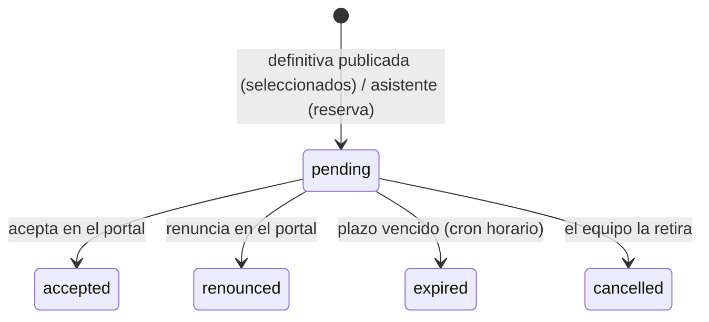

# 5. Selección: puntuaciones, entrevistas, desempates, resoluciones y ofertas

[← Índice](README.md)

## 5.1 Convocatoria de alumnos: baremo del art. 12 — IMPLEMENTADO

Máximo 100 puntos; para ser elegible hace falta la puntuación mínima de la convocatoria (`min_score`, 50 por defecto). Cálculo en `EmsErasmusApplication._compute_scores` (`application.py:325`).

| | Criterio | Origen | Quién | Puntos |
|---|---|---|---|---|
| A | Media del expediente × 4 | `grade_average_ems`, congelada al cerrar | **EMS** (nunca a mano) | máx. 40 |
| B | Entrevista: parte general + inglés | media de las entrevistas enviadas | Evaluadores | máx. 20 + 15 |
| C | Certificado de idioma | `language_level` | Equipo | B1 2,5 · B2 5 · C1 7,5 · C2 10 |
| D | Menos oportunidades | `fewer_opportunities_check` (confidencial) | Equipo | 10 o 0 |
| E | Primera movilidad | `first_mobility` | Equipo | 5 o 0 |
| F | Amonestaciones | `strike_count`, congelado al cerrar | **EMS** | −3 cada una, máx. −9 |

- `score_total = A + B + C + D + E + F`, sin mínimo de cero.
- **Un criterio pendiente nunca cuenta como cero:** `score_complete` exige media encontrada, entrevista completa y C, D y E respondidos; sin puntuación completa la solicitud no entra en el ranking.
- Los criterios manuales guardan quién y cuándo (`STAMPED_FIELDS`, `application.py:23`; sellado en `write()`).

### Congelación al cerrar (`_ems_freeze_scoring_data`, `application.py:635`)

Al cerrar la convocatoria, para cada solicitud enviada (enviada, en subsanación, admitida o excluida):

- **Media (A)** (`_ems_partner_grade_values`, `application.py:669`): todos los módulos del ciclo actual del alumno (estudio de su grupo principal), de todos los cursos. Cursos pasados: fichas anuales no provisionales (nota final, o nota interna si hay resultados evaluados). Curso actual: líneas de nota vivas (nota calculada o nota interna provisional). Se excluyen convalidados y reconocidos; un módulo repetido cuenta una vez con su nota más reciente. Media ponderada por horas, dos decimales. Los módulos usados se copian a `grade_line_ids`.
- **Sin ningún módulo evaluado no hay media** (`score_a_pending`): la solicitud queda sin puntuación completa. No existe media manual en la convocatoria individual (decisión documentada del 22-10-2026).
- **Amonestaciones (F):** las `ems.strike` hasta `date_close` cuyo grupo pertenece al mismo estudio.
- Cambios posteriores de notas o amonestaciones **no** modifican lo congelado.

## 5.2 Entrevistas (`ems.erasmus.interview`) — IMPLEMENTADO

```mermaid
stateDiagram-v2
    [*] --> draft: el equipo asigna (tarea al evaluador)
    draft --> submitted: action_submit (todos los criterios)
    submitted --> draft: action_reopen (evaluador antes del plazo; equipo siempre, tras el plazo con nota)
```

- El equipo fija fecha y lugar en la solicitud y asigna evaluadores (normalmente dos; cualquier usuario interno). *Enviar convocatoria de entrevista* exige 24 h de antelación (`action_send_interview_call`, `application.py:511`).
- Rúbrica (anexo 4), 0-5 por criterio: general = motivación, madurez/autonomía, gestión de dificultades, adaptación (máx. 20); inglés = comprensión, fluidez, corrección/vocabulario/pronunciación (máx. 15).
- **Cada evaluador solo ve sus entrevistas** (regla de registro), nunca la otra puntuación ni el resto de la solicitud.
- Bloqueo (`_compute_is_locked`, `evaluation.py:40`): al pasar el plazo de corrección (`interview_deadline`) o al publicarse una resolución que no sea la de admisión. Después solo el equipo reabre, escribiendo `rectification_note`, que queda en el chatter.
- Entrevista completa (`_compute_interview`, `application.py:294`): todas las asignadas enviadas y al menos dos, o una con motivo registrado (`single_interview_reason`).
- No presentarse es una exclusión (`action_exclude` funciona también sobre admitidas).

## 5.3 Convocatoria de personal: art. 11 — IMPLEMENTADO

| | Criterio | Origen | Puntos |
|---|---|---|---|
| 1 | Plan de movilidad | media de las valoraciones del tribunal no abstenidas | máx. 2 |
| 2 | Última movilidad de personal | corrección del equipo, si no lo declarado | nunca / hace más de dos cursos 1,5 · hace dos cursos 0,5 · reciente 0 |
| 3 | Proyectos del centro | méritos (colaboración 0,5, coordinación 1) | máx. 1,5 |
| 4 | Idiomas | nivel comprobado por el equipo, si no el declarado | B2 1 · C1 1,5 · C2 2 |
| 5 | Antigüedad | corrección del equipo, si no lo declarado (meses hasta el cierre) | <1 año 0 · 1-2 1 · 2-5 1,5 · ≥5 2 |
| 6 | Internacionalización | méritos (0,5 cada uno) | máx. 1 |

- Completa (`_ems_staff_scores`, `application.py:349`): plan completo, criterios 2 y 5 conocidos y `merits_checked` marcado («sin méritos» es una respuesta explícita). El criterio 4 nunca bloquea.
- **Tribunal** (`action_send_to_panel`, `call.py:460`): convocatoria cerrada, con panel y con plazo. Crea una valoración por solicitud admitida y miembro. Un miembro que es candidato en la convocatoria queda abstenido automáticamente (sin evaluador). Para otro conflicto el equipo escribe el motivo de abstención. Sin sustitutos.
- Rúbrica del anexo 2: relevancia y aplicación al puesto, 1 / 0,5 / 0 cada una.
- Lo que ve el tribunal: el plan escrito y los archivos de documentos `panel_visible` no confidenciales.

## 5.4 Ranking y desempates (individual) — IMPLEMENTADO

`_compute_rank` (`application.py:411`) y `_ems_rank_key` (`application.py:430`):

| Convocatoria | Ámbito | Orden |
|---|---|---|
| Alumnos | Por modalidad | Total ↓, D (menos oportunidades) ↓, E (primera movilidad) ↓, inglés de la entrevista ↓, media ↓, `draw_order` ↑ |
| Personal | Una sola lista | Total ↓, plan ↓, antigüedad ↓, `draw_order` ↑ |

- El ranking de una modalidad **solo se calcula cuando todas** las solicitudes admitidas tienen puntuación completa; hasta entonces todos los rangos son 0.
- Cuentan como admitidas también las que ya tienen resultado (`RANKED_STATES`): publicar resultados no cambia los rangos.
- Si tras todo sigue habiendo empate, comparten rango y se marca `needs_draw`. **El sorteo individual es manual:** el equipo escribe `draw_order` en la solicitud (campo con seguimiento en el chatter). EMS **no** realiza ni registra el sorteo como en las movilidades de grupo (ver 5.8 y R-12).
- `is_eligible`: puntuación completa y total ≥ mínimo.

## 5.5 Resoluciones (`ems.erasmus.resolution`, `resolution.py:36`) — IMPLEMENTADO

```mermaid
stateDiagram-v2
    [*] --> draft
    draft --> draft: action_prepare (congela líneas; repetible)
    draft --> published: action_publish (solo coordinador o admin)
    published --> [*]
```

| Orden | Tipo | Requiere publicada |
|---|---|---|
| 1 | Admisión | — |
| 2 | Provisional | Admisión |
| 3 | Definitiva | Provisional |
| 4+ | Rectificaciones (ilimitadas) | Definitiva |

- **Preparar** (`action_prepare`, `:80`; comprobaciones `_ems_check_can_prepare`, `:131`): convocatoria cerrada; ninguna solicitud por decidir; salvo en admisión, todas las admitidas con puntuación completa y sin sorteo pendiente; documento de identidad de todos. Las líneas copian rango, criterios, total y resultado.
- **Resultado** (`_ems_ranking_result`, `application.py:525`): excluida → *excluded* (motivo solo para el interesado); no elegible → *not_selected*; elegible y rango ≤ plazas → *selected*; después → *reserve*.
- **Publicar** = aprobación del coordinador (`published_by_id`, `publish_date`). Rectificación exige notas; definitiva y rectificación exigen un plazo de aceptación futuro.
- Una resolución publicada **no se puede modificar ni borrar** (`write`/`unlink`, `:69`, `:75`; verificado en [anexos/C_integridad_evidencias.md](anexos/C_integridad_evidencias.md)). Las líneas no tienen permiso de escritura para nadie.
- Al publicar: correo a cada solicitante con su resultado; la provisional bloquea las entrevistas; la definitiva o una rectificación fija el estado de cada solicitud (salvo las que ya aceptaron o renunciaron) y crea una oferta para cada seleccionada sin oferta.
- **Las listas publicadas nunca muestran nombres:** portal y PDF muestran rango, documento de identidad enmascarado (`mask_document_id`, `resolution.py:23`: DNI `***4567**`, NIE `****4567*`, otros del 4.º al 7.º carácter), total y resultado.
- El PDF de una resolución publicada se guarda la primera vez que se imprime (`_ems_stored_pdf`, `:119`) y entra en la exportación del proyecto.

## 5.6 Reclamaciones (`ems.erasmus.claim`) — IMPLEMENTADO (registro manual)

Registro que el equipo crea a partir del correo recibido (art. 14): solicitud, resolución contra la que se reclama, tipo (reclamación / recurso ante la dirección), fecha, texto, archivos y respuesta. *Resolver* exige respuesta y fecha la resolución; *Reabrir* la vuelve a abrir. Estimar una reclamación = corregir datos y publicar la siguiente resolución. **No hay presentación de reclamaciones desde el portal** ni plazo controlado en código (el `claims_deadline` solo se muestra).

## 5.7 Ofertas de plaza (`ems.erasmus.offer`) — IMPLEMENTADO

- Aceptar crea la movilidad (`action_accept`, `offer.py:49`). Sin respuesta en plazo = renuncia (`_cron_expire_offers`, `offer.py:77`).
- **Una plaza libre nunca se ofrece sola:** la modalidad (o la convocatoria de personal) calcula plazas libres y siguiente reserva; el equipo confirma con el asistente *Ofrecer una plaza libre* (`EmsErasmusOfferWizard.action_confirm`, `offer.py:127`) y un plazo nuevo.

## 5.8 Selección de movilidades de grupo — IMPLEMENTADO

Descrita en [07_movilidades_grupo.md](07_movilidades_grupo.md). Diferencias clave con la individual:

| | Individual | Grupo |
|---|---|---|
| Criterio | Baremo de 100 puntos | Media del expediente ↓, luego menos oportunidades acreditadas, luego sorteo |
| Media sin notas | Criterio A pendiente; sin vía manual | **Incidencia** que bloquea propuesta y aprobación; el equipo puede introducir la media a mano con motivo (`grade_manual`) o el coordinador excluir |
| Sorteo | `draw_order` escrito a mano por el equipo | **Ejecutado por EMS** con `secrets.SystemRandom` y guardado como evidencia inmutable (`ems.erasmus.group.draw`) |
| Aprobación | Publicar resoluciones (coordinador) | Aprobar la selección (coordinador) |
| Publicación | Listas con documento enmascarado | Cada alumno recibe solo su resultado por correo; no hay lista publicada |
| Reclamaciones | Registro de reclamaciones | No hay modelo de reclamación para grupos |
