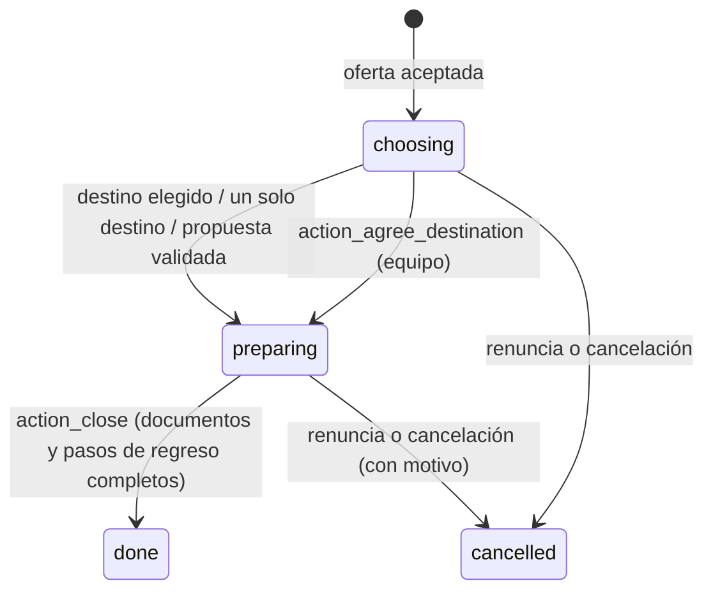
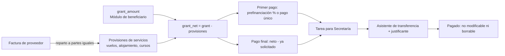

# 6. Movilidades individuales de alumnos y de profesorado

[← Índice](README.md)

Modelo `ems.erasmus.mobility` (`models/erasmus/mobility.py:95`). Se crea **una por solicitud aceptada** (restricción `application_unique`) al aceptar la oferta (`_ems_create_for`, `mobility.py:367`). La solicitud conserva la selección; la movilidad todo lo posterior. El mismo modelo sirve para alumnos (prácticas) y para personal; las diferencias se resuelven por `audience`.

## 6.1 Estados — IMPLEMENTADO

| Transición | Método | Comprobaciones |
|---|---|---|
| A preparación | `_ems_assign` / `action_validate_proposal` / `action_agree_destination` (`mobility.py:431`, `:522`, `:441`) | Fija `destination_date` (hoy, reloj del centro) si no la tenía; avisa a la familia de un menor |
| Cerrar | `action_close` (`mobility.py:766`) | Solo en preparación y con `return_complete`; libera al antiguo alumno graduado si ya no tiene movilidades abiertas |
| Cancelar (equipo) | `action_cancel` (`mobility.py:779`) | Motivo obligatorio |
| Renunciar (participante) | `action_renounce` (`mobility.py:787`) | Desde el portal |
| Efecto de cancelar o renunciar | `_ems_cancel` (`mobility.py:791`) | La oferta aceptada y la solicitud pasan a *renounced*; la plaza queda libre para el asistente (nunca se ofrece sola) |

**Observación (R-06):** cerrar exige solo los documentos y pasos **de regreso** (`return_complete`). Un documento obligatorio de preparación (convenio de subvención, acuerdo de aprendizaje, tarjeta sanitaria…) que no esté completo **no impide cerrar** la movilidad. La movilidad de grupo, en cambio, exige todos los documentos obligatorios para cerrar.

## 6.2 Destino de los alumnos (art. 15) — IMPLEMENTADO

- **Destinos** (`ems.erasmus.destination`, `mobility.py:26`): por modalidad, con país, ciudad, plazas, niveles a los que se adecúa, fechas, entidades de acogida y notas. `free_places` = plazas − movilidades no canceladas.
- **Elección por turnos** (`action_open_destination_choice`, `call.py:507`; `_ems_advance_choice`, `call.py:517`): solo tras la resolución definitiva. Por modalidad:
  - Un solo destino: se asigna directamente a todos a los que se adecúa.
  - Varios: el mejor clasificado que aún elige recibe un turno de `choice_turn_hours` (72 h por defecto) y un correo. Un turno a la vez.
  - Sin respuesta (cron horario `_cron_expire_turns`, `mobility.py:459`): pierde el turno y conserva la plaza; cuando ya no queda nadie en orden, los que perdieron turno eligen libremente entre lo que quede (`free_choice`).
- **Destino propio** (alumno): propuesta desde el portal con el compromiso escrito de la entidad (archivo obligatorio). La valida el equipo. Si ningún destino le encaja, el equipo puede acordar uno y fijarlo con *Fijar el destino acordado* (requiere país).
- Al asignar se copian país, ciudad, fechas y, si el destino tiene una sola entidad, la entidad y su tutor si tiene un único contacto.

## 6.3 Propuesta de actividad del personal — IMPLEMENTADO

| | Alumno (destino propio) | Personal (actividad) |
|---|---|---|
| Origen | Portal, mientras elige | Se crea con los datos de la solicitud; el docente añade las fechas exactas y la declaración responsable de la ausencia y la envía |
| Valida (`_ems_can_validate`, `mobility.py:557`) | Equipo Erasmus | **Dirección**: `validator_ids` de la convocatoria, nunca el propio solicitante; si no hay nadie, los administradores. El equipo Erasmus **no** puede |
| Al validar | Preparación con país, ciudad y fechas de la propuesta | Ídem; además se crea la ausencia por formación |
| Al rechazar (nota obligatoria) | Vuelve a los destinos del centro | Propone otra actividad |
| Cambio posterior | — | Antes de la fecha de inicio el docente envía una nueva propuesta o el equipo pide revalidación (`action_request_revalidation`, `mobility.py:511`); se conserva lo validado hasta la nueva decisión |

Cada propuesta pendiente crea una tarea para cada validador, que se marca como hecha al decidir. Quién decidió y cuándo queda en `decided_by_id` y `decision_date`.

**Ausencia por formación** (`_ems_sync_training_leave`, `mobility.py:687`): con la propuesta validada y las fechas, EMS crea una `hr.leave` del tipo `ems.leave_type_training` por días completos, presentada con la declaración responsable, que sigue la aprobación habitual de ausencias de ese empleado. Una ausencia aún no decidida sigue las fechas y se retira si se cancela la movilidad; una ya decidida no se toca y se deja una nota en el chatter.

## 6.4 Preparación, documentos y checklist — IMPLEMENTADO

- Al crearse la movilidad, `_ems_sync_requirements` (`mobility.py:383`) añade las líneas de preparación y regreso de la convocatoria que aplican a su modalidad y proyecto, y los pasos de checklist. Nunca elimina líneas; se puede repetir con *Actualizar documentos y checklist*.
- Documentos, requisitos condicionales, firmantes, plazos, apertura y estados: [08_expedientes_documentos.md](08_expedientes_documentos.md).
- `preparation_complete` / `return_complete` (`_compute_complete`, `mobility.py:272`): todas las líneas obligatorias de esa etapa en estado *completo* y todos los pasos obligatorios hechos; en preparación, además, la carta firmada por el participante y, si es menor, por la familia.
- Checklist (`ems.erasmus.mobility.task`): el equipo marca cada paso; se guarda quién y cuándo.
- *Notificar documentos pendientes* y el recordatorio semanal (ver [12_automatizaciones_transiciones.md](12_automatizaciones_transiciones.md)).

**Tipo de estancia** (`placement_type`): *curricular* (FCT gestionada en sBID, por defecto para alumnos), *extracurricular* o *recién titulado*; decide si los documentos sBID y el reconocimiento ECTS son obligatorios. **Movilidad corta combinada** (`is_short_blended`): KA131-HED y estancia de 30 días o menos (`SHORT_BLENDED_MAX_DAYS`); exige el componente virtual.

## 6.5 Autoevaluación semanal durante la estancia — IMPLEMENTADO

- Preguntas de la convocatoria (`ems.erasmus.call.question`): cuatro por defecto en convocatorias de alumnos, ninguna en las de personal.
- La estancia se divide en semanas desde `date_start` (`_ems_self_assessment_weeks`, `mobility.py:629`). El participante responde cada semana ya empezada una sola vez (`unique(mobility_id, week)`); la respuesta guarda el texto de la pregunta tal como se formuló.
- El equipo la ve en la movilidad (*respondidas / semanas*), la imprime (`ems.action_report_erasmus_self_assessment`) y la exportación la añade al expediente (categoría 03). El equipo puede borrar una semana para que se responda de nuevo.

## 6.6 Beca, servicios y pagos — IMPLEMENTADO

| Elemento | Dónde | Reglas |
|---|---|---|
| Beca | `grant_amount`, `prefinancing_percent` (80 % por defecto, >0 y ≤100) | Solo el equipo; pestaña oculta a JE/Director (`groups=`) |
| Provisión de servicios | `ems.erasmus.provision` | A mano o creada por una factura |
| Factura | `ems.erasmus.invoice` (`grant.py:73`) | Al crearla o cambiar importe/participantes se reparte de nuevo a partes iguales (céntimos sobrantes en la primera parte); una factura pagada no se puede borrar |
| Pago | `ems.erasmus.payment` (`grant.py:168`) | Primer pago una vez, pago final una vez, nunca por cero o menos; uno sin pagar se puede borrar y volver a pedir **[Desde `e73bd746`: un índice único lo garantiza también ante dos peticiones simultáneas (R-29); deshacer un pago deja traza (R-24)]** |
| Pagar | `EmsErasmusTransferWizard.action_confirm` (`grant.py:281`) | Solo Secretaría o administrador; un justificante enlazado a todos los pagos y facturas de esa transferencia |
| Deshacer | `action_mark_unpaid` | Solo Secretaría o administrador; quita los justificantes del pago y crea otra vez la tarea |
| Portal | `_ems_portal_grant` (`mobility.py:807`) | El participante ve beca, servicios, importe que recibe y cada pago con su estado |

**Observación (R-13):** el botón de pedir pagos solo aparece en preparación o cerrada, pero el método `action_request_prefinancing` (`mobility.py:728`) no comprueba el estado en el servidor: por RPC se podría pedir un pago de una movilidad cancelada. **[Desde `e73bd746`: corregido: el servidor también exige preparación o cerrada]**

## 6.7 Antiguos alumnos graduados — IMPLEMENTADO

La transición de curso no da de baja a un graduado con movilidad abierta (`_ems_erasmus_open_mobility`); al cerrarse o cancelarse su última movilidad, `_ems_erasmus_release_graduate` lo retira como lo habría hecho la transición.
