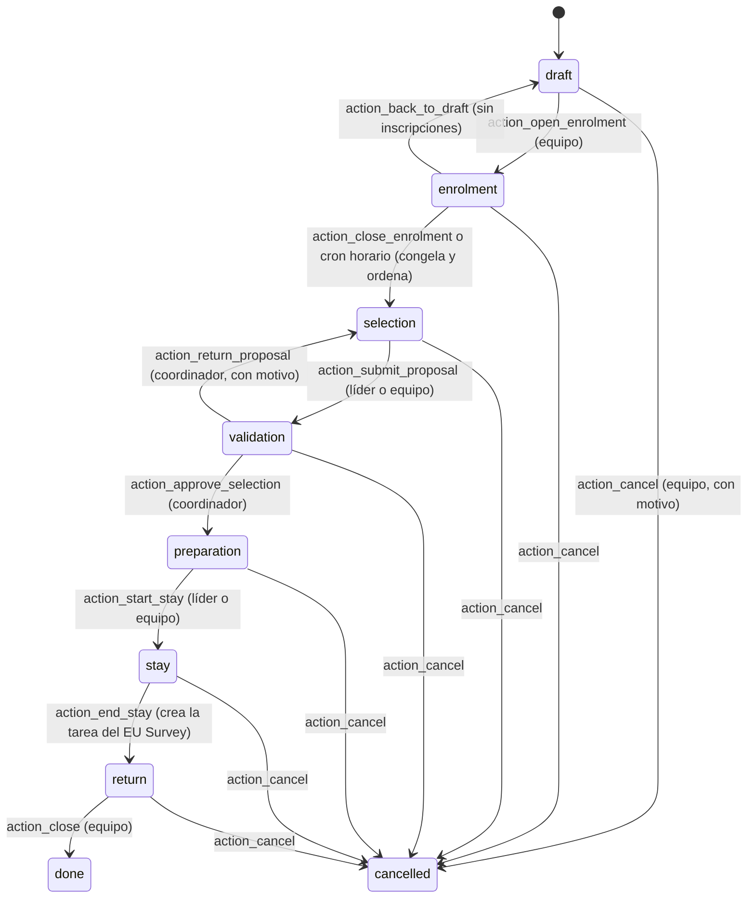
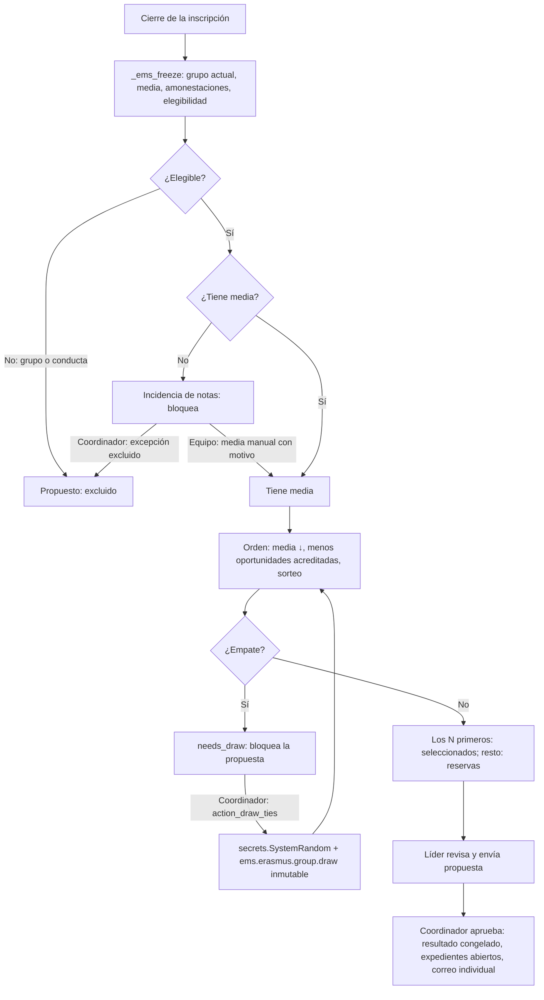

# 7. Movilidades de grupo y acompañantes (KA121-VET)

[← Índice](README.md)

Modelo `ems.erasmus.group.mobility` (`models/erasmus/group_mobility.py:42`). Un grupo de alumnos de uno o varios grupos reales de EMS viaja con sus docentes acompañantes, uno de ellos **líder**. Procedimiento más sencillo que la convocatoria individual: inscripción con un clic, sin CV, carta de motivación ni entrevista. Las cuatro movilidades iniciales del centro son configuración, no código.

## 7.1 Estados — IMPLEMENTADO

| Transición | Método (línea) | Quién | Comprobaciones |
|---|---|---|---|
| Abrir inscripción | `action_open_enrolment` (`:382`) | Equipo | Grupos elegibles, periodo y criterios de selección publicados |
| Cerrar inscripción | `action_close_enrolment` (`:400`), `_cron_close_enrolments` (`:407`) | Equipo o cron | Congela datos (`_ems_freeze`), ordena (`_ems_rank`), tarea al líder |
| Enviar propuesta | `action_submit_proposal` (`:470`) | Líder o equipo | `_ems_check_selection_ready`: sin menos oportunidades pendientes de comprobar, sin incidencias de notas, sin empates |
| Sortear empates | `action_draw_ties` (`:484`) | **Coordinador** | Solo en selección o validación; solo los empatados |
| Devolver propuesta | `action_return_proposal` (`:520`) | **Coordinador** | Motivo obligatorio |
| Aprobar selección | `action_approve_selection` (`:533`) | **Coordinador** | Mismas comprobaciones; seleccionados ≤ plazas |
| Iniciar / terminar estancia | `action_start_stay`, `action_end_stay` (`:661`, `:666`) | Líder o equipo | Estado previo correcto |
| EU Survey respondido / validado | `action_eu_survey_done` (`:682`), `action_eu_survey_validate` (`:695`) | Responsable o líder / equipo | — |
| Proponer cierre | `action_propose_closure` (`:703`) | Líder o equipo | En regreso |
| Cerrar | `action_close` (`:712`) | Equipo | **Todos** los documentos obligatorios (compartidos y de participantes activos) completos y EU Survey validado |
| Cancelar | `action_cancel` (`:727`) | Equipo | Motivo obligatorio |

## 7.2 Inscripción — IMPLEMENTADO

- El coordinador crea la movilidad (proyecto KA121-VET obligatorio), los grupos elegibles (`group_ids`, grupos reales; `shift` solo filtra la elección), plazas de alumnos (8 por defecto) y de docentes (2, líder incluido), periodo y criterios de selección (texto por defecto con la regla acordada).
- Portal: tarjeta por cada movilidad visible para el alumno, botón de inscripción y de retirada mientras el periodo esté abierto. Casilla opcional «declaro menos oportunidades», sin archivo: el documento, si hace falta, va a la «Documentación de inclusión del grupo» (confidencial) o lo comprueba el equipo fuera de EMS. Motivo documentado en el código: un archivo confidencial en la inscripción sería legible por el líder a través de su adjunto.
- Comprobaciones en servidor (`_ems_portal_enrol`): alumno de un grupo elegible, periodo abierto, sin duplicado, regla de conducta de la convocatoria individual.

## 7.3 Ranking, desempates y aprobación — IMPLEMENTADO

- **Congelación** (`_ems_freeze`, `:951`): grupo principal en ese momento, media (la misma función que la convocatoria individual), amonestaciones del curso y motivo de no elegibilidad (`group` o `conduct`). No se recalculan.
- **Sin notas = incidencia, nunca 0** (`grade_incident`): bloquea propuesta y aprobación. Se resuelve con media manual del equipo (`grade_manual`, `grade_average_manual` 0-10, `grade_manual_reason` obligatorio, con seguimiento) o con exclusión del coordinador (`result_override`, motivo obligatorio).
- **Orden** (`_ems_rank`, `:425`; `_ems_tie_key`, `:975`): media descendente, menos oportunidades acreditadas por el equipo, posición del sorteo. Una declaración pendiente de comprobar también bloquea la propuesta.
- **Sorteo** (`action_draw_ties`, `:484`): ordena al azar cada grupo empatado con un generador criptográficamente seguro (`secrets.SystemRandom`), guarda la posición en `draw_order` (solo lectura) y un registro `ems.erasmus.group.draw` por empate con quién, cuándo, valores empatados, alumnos exactos y orden. **No se puede modificar ni borrar** (`write`/`unlink`, `:1300`-`:1333`; verificado: crear a mano también se rechaza). Si alguien se incorpora después a un empate ya sorteado, el empate se reabre y se registra un nuevo sorteo.
- **El líder** ve rango, media y si cumple requisitos, nunca amonestaciones, motivo de exclusión ni menos oportunidades (campos con `groups=`). No cambia notas, rangos ni resultados; solo puede escribir una petición de excepción.
- **Aprobación del coordinador**: congela `result` (excepción o propuesto), abre los expedientes, crea las líneas documentales, envía a cada alumno **solo su** resultado.

## 7.4 Renuncias y sustituciones — IMPLEMENTADO

- Un seleccionado renuncia (portal, o líder/equipo en su nombre con motivo) en preparación o durante la estancia: su expediente pasa a *retirado* y **se conservan todos sus documentos**.
- Con plaza libre, `next_reserve` muestra la primera reserva; el líder la propone (`action_propose_substitution`, `:570`) y el coordinador aprueba o rechaza (`action_approve_substitution`, `:1040`; `action_reject_substitution`, `:1055`).
- El ranking congelado nunca se reescribe; el historial queda en la inscripción (`substitute_for_id`, quién propuso y aprobó, cuándo) y en el chatter.

## 7.5 Acompañantes y docente líder — IMPLEMENTADO

- Cada docente (líder y acompañantes) tiene su expediente de participante (`role = leader / companion`), creado por `_ems_sync_teachers` (`:325`) sin necesidad de convocatoria de personal. Un docente retirado de la movilidad conserva su expediente como *retirado*.
- `teacher_places` limita líder + acompañantes; el líder no puede figurar también como acompañante (`_check_teachers`, `:231`).
- El grupo oculto `ems.group_erasmus_group_teacher` se sincroniza automáticamente; las reglas de registro les limitan a sus movilidades.
- Documentos por defecto de cada docente: convenio de subvención (preparado por el equipo, firma), certificado de estancia (firma la entidad) y documentos de viaje y alojamiento (opcional). Sin acuerdo de aprendizaje ni Europass.
- **Los docentes no firman carta de compromiso.**

## 7.6 Documentos del grupo — IMPLEMENTADO

Mismo motor documental que las movilidades individuales (ver [08_expedientes_documentos.md](08_expedientes_documentos.md)). Lo particular:

- La lista de requisitos es de la movilidad (`requirement_ids`), con `group_audience`: compartido por el grupo, cada alumno, cada docente o todos los participantes.
- **El acuerdo de aprendizaje de grupo existe una sola vez** para todo el grupo (no hay acuerdo individual).
- Las líneas se crean al aprobar la selección (`_ems_sync_documents`, `_ems_sync_collective_documents`) y nunca se duplican ni eliminan al actualizar.
- Plazos contados desde la movilidad de grupo: *tras fijar destino* = día de aprobación de la selección (`destination_date`); *antes de salir / tras regresar* = sus fechas finales.
- Revisión (`review_state`): solo equipo o líder (`write()`, `:1428`), y el líder solo en líneas no confidenciales.

## 7.7 Excel de participantes — IMPLEMENTADO

*Acciones › Exportar participantes (Excel)* (solo equipo) descarga, desde `/ems/erasmus/group/participants`, **el mismo libro que las convocatorias** (hoja *Participantes*, cabeceras fijas en castellano `PARTICIPANT_HEADERS`) con los participantes activos: alumnos primero, después docentes. Las columnas bancarias quedan **vacías para todos** (una movilidad de grupo paga colectivamente). Los docentes se distinguen porque sus columnas de ciclo, curso y tutor legal están vacías. Se genera al vuelo y no se guarda.

## 7.8 Gastos colectivos — IMPLEMENTADO

Facturas normales (`ems.erasmus.invoice`) vinculadas a la movilidad de grupo (`group_mobility_id`), imputadas a su proyecto y **nunca repartidas** entre participantes.
