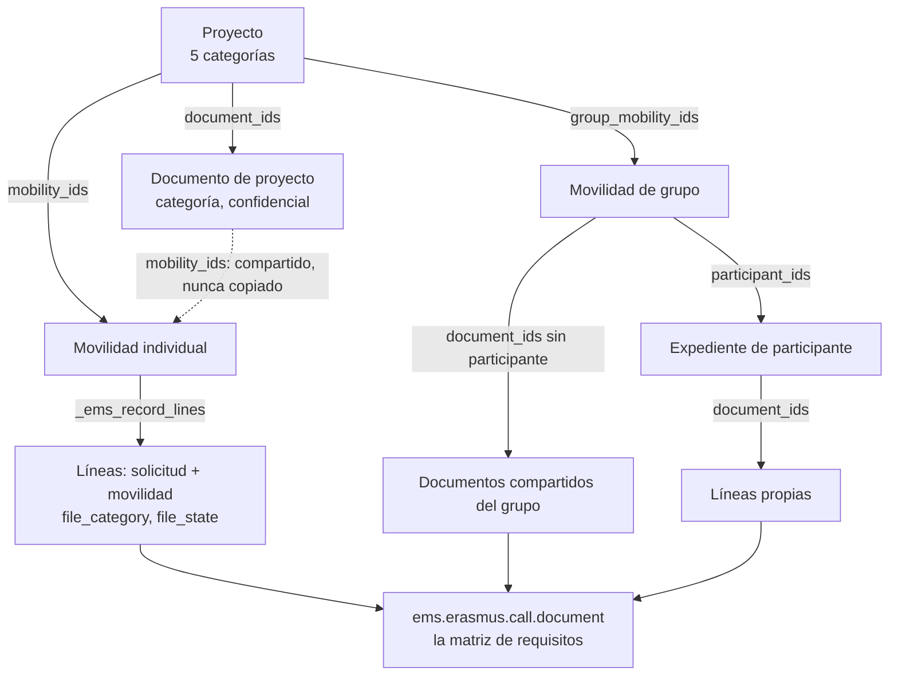
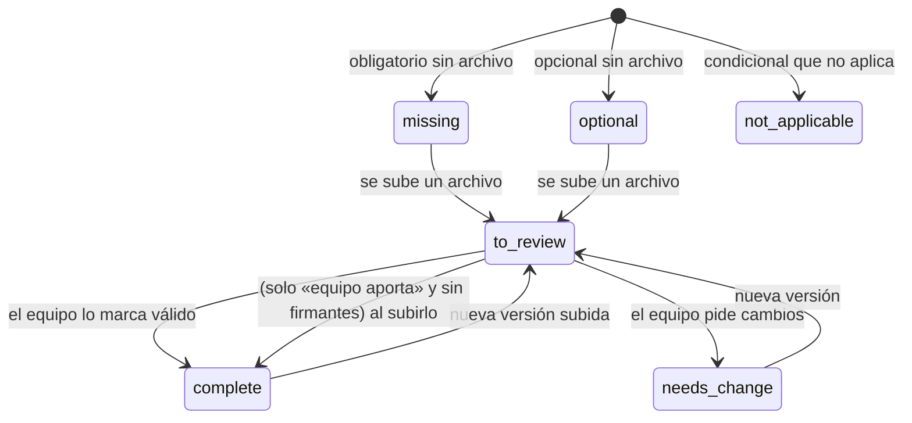

# 8. Expedientes individuales, documentación compartida, matriz documental, firmantes y estados

[← Índice](README.md)

## 8.1 Principio: un único motor y una única lista de requisitos — IMPLEMENTADO

EMS no tiene un gestor documental aparte. Los **expedientes** son una vista, organizada en categorías, de documentos que EMS ya guarda:

- La **lista de lo exigible** es siempre `ems.erasmus.call.document` (de una convocatoria o de una movilidad de grupo): requisito, proyecto, modalidades, firmantes, quién lo gestiona, confidencialidad, categoría, plazo.
- Cada documento exigido genera una **línea** `ems.erasmus.application.document` con sus archivos y su revisión.
- Las condiciones de cada participante (`is_minor`, `placement_type`, `is_short_blended`) deciden qué líneas son obligatorias.

## 8.2 Tres niveles y sus categorías — IMPLEMENTADO

| Nivel | Categorías (= carpetas del ZIP) | Constante |
|---|---|---|
| Proyecto | `01_Projecte`, `02_Mobilitats`, `03_Economia`, `04_Impacte_i_difusio`, `05_Informe_final_i_auditoria` | `PROJECT_CATEGORIES` (`records.py`) |
| Movilidad | Dentro de `02_Mobilitats`: `00_Documentacio_comuna` (documentos de proyecto de categoría 02 compartidos), una carpeta por expediente individual (`ALU…`/`PROF…`) y una por movilidad de grupo (`GRUP…`) | — |
| Participante | `01_Dades_i_autoritzacions`, `02_Abans_de_la_mobilitat`, `03_Durant_la_mobilitat`, `04_Despres_de_la_mobilitat` | `PARTICIPANT_CATEGORIES` |

Un documento sin categoría va por su etapa (`STAGE_CATEGORIES`): solicitud → 01, antes de salir → 02, al regreso → 04. Las categorías sustituyeron a las 13 carpetas SEPIE de una versión anterior no publicada (decisión del coordinador del 24-10-2026); `EmsErasmusCallDocument._auto_init` (`call.py:773`) migra la columna antigua `sepie_folder` si existe.

**Expediente de un participante en una movilidad individual** (`_ems_record_lines`, `mobility.py:297`): los documentos de su solicitud (etapa *solicitud*) más los de la movilidad; nunca los de otra movilidad, ni siquiera de la misma persona. Más: la carta de compromiso aceptada (y sus versiones), las autoevaluaciones semanales en PDF, los documentos de proyecto vinculados y los justificantes de transferencia de sus pagos.

**Documentación compartida:**

- *Movilidad de grupo*: líneas con `group_mobility_id` y sin participante. Una sola línea por documento y movilidad. En el ZIP se escribe una vez (`00_Documentacio_comuna/`) y el índice de cada participante apunta a su ruta («Shared document: …»).
- *Proyecto*: un `ems.erasmus.project.document` vinculado a varias movilidades (`mobility_ids`, restringido al mismo proyecto) aparece en todos esos expedientes en su `participant_category`, como un único archivo.

## 8.3 Matriz documental por proyecto y modalidad

La matriz completa de documentos **por defecto**, generada ejecutando el código, está en [anexos/A_matriz_documental.md](anexos/A_matriz_documental.md). Resumen de qué se exige según proyecto y modalidad:

| Documento | Alumno KA121-VET (GM) | Alumno KA131-HED (GS) | Personal KA121-VET | Personal KA131-HED | Grupo (alumno) | Grupo (docente) |
|---|---|---|---|---|---|---|
| Tarjeta sanitaria europea (**confidencial**) | Obl. | Obl. | Obl. | Obl. | Obl. | — |
| Certificado OLS | Obl. | Obl. | — | — | — | — |
| Documentación de inclusión (**confidencial**) | Opc. | Opc. | — | — | Compartida, opc. (**confidencial**) | — |
| Autorización familiar de viaje | Si menor | Si menor | — | — | — (sustituida por la carta aceptada en el portal) | — |
| Autorización de menores al extranjero (Mossos) | Si menor | Si menor | — | — | Si menor | — |
| Convenio de subvención | Obl. (firma) | Obl. (firma) | Obl. (firma) | Obl. (firma) | Obl. (firma) | Obl. (firma) |
| Acuerdo de aprendizaje | Obl. (firma) | Obl. (*for Traineeships*) | Obl. (lo sube el participante) | — | — (uno compartido de grupo) | — |
| Acuerdo de movilidad de personal | — | — | — | Obl. | — | — |
| Acuerdo de aprendizaje de grupo | — | — | — | — | Compartido, obl. | Compartido, obl. |
| Convenio sBID (REF5) y plan de actividades (REF6) | Si FCT curricular | Si FCT curricular | — | — | — | — |
| Póliza de seguro | Obl. (equipo) | Obl. (equipo) | Obl. (equipo) | Obl. (equipo) | Obl. (equipo) | — |
| Componente virtual | — | Solo corta combinada (≤30 días) | — | — | — | — |
| Certificado de estancia | Obl. (firma la entidad) | Obl. | Opc. | Obl. («estancia o asistencia») | — | Obl. |
| Documento de movilidad Europass | Obl. (equipo) | — | Obl. (equipo) | — | Obl. (equipo) | — |
| Reconocimiento de créditos ECTS | — | Si FCT curricular | — | — | — | — |
| Informe con evidencias | — | — | Obl. | Obl. | — | — |
| Billetes / tarjetas de embarque | Opc. | Opc. | Opc. | Opc. | — (compartidos «documentos de viaje del grupo», opc.) | Opc. («viaje y alojamiento») |
| Lista final de participantes y acompañantes | — | — | — | — | Compartida, obl. (equipo) | Compartida |
| Acuerdos con la entidad / evidencias comunes | — | — | — | — | Compartidos, opc. | Compartidos |
| Documentos de solicitud | Los que configure cada convocatoria (ninguno por defecto) | ídem | DNI, CV Europass en inglés, certificados (opc.) | ídem | — | — |

Notas: «Obl.» = obligatorio por defecto; el filtro por proyecto lo aplica `_ems_sync_requirements` comparando `call.document.project` con el proyecto de la modalidad (`mobility.py:391`). La correspondencia GM↔KA121-VET y GS↔KA131-HED es la configuración del centro, no una regla del código.

## 8.4 Requisitos condicionales y apertura — IMPLEMENTADO

`requirement` (`call.py:719`) y `is_required` (`application.py:919`, extendido en `group_mobility.py:1405`):

| Valor | Obligatorio cuando |
|---|---|
| `required` | Siempre |
| `optional` | Nunca (se puede adjuntar) |
| `minor` | La solicitud o el participante de grupo es menor (`is_minor`, calculado en vivo desde la fecha de nacimiento) |
| `curricular` | La movilidad es FCT curricular en sBID |
| `short_blended` | La movilidad es corta combinada; además, no se muestra en el portal en otro caso |

**Apertura** (`open_days`): un documento de antes de salir puede estar cerrado hasta N días antes de la salida (`_ems_is_open`, `application.py:975`). Cerrado: se muestra con la fecha de apertura y sin campo de subida, el portal ignora la subida y el recordatorio no lo pide; sigue contando para `preparation_complete`.

**Plazo** (`_compute_deadline`, `application.py:956`): `due_basis` (*tras fijar destino*, *antes de salir*, *tras regresar*) + `due_days`. El plazo es **informativo**: se muestra, pero ningún proceso automático actúa al vencer (no cancela ni bloquea).

## 8.5 Quién gestiona cada documento (`handled_by`) — IMPLEMENTADO

| Valor | Flujo | Cuándo se pide al participante |
|---|---|---|
| `participant` | El participante lo sube | Desde que la línea está abierta |
| `team_to_sign` | El equipo sube el documento rellenado en `prepared_attachment_ids`; el participante lo descarga, lo firma y lo sube firmado | Solo cuando el equipo ya lo ha subido |
| `team` | El equipo lo aporta (p. ej. la póliza); el participante solo lo descarga, no puede subir | Nunca |

## 8.6 Documentos obligatorios, firmantes y estados — IMPLEMENTADO / PARCIAL

**Firmantes** (`sign_participant`, `sign_guardian` —solo menores—, `sign_director`, `sign_coordinator`, `sign_tutor` —tutor del centro en sBID—, `sign_host`): se configuran por documento y se muestran en la línea, el portal y el índice del ZIP (`signers`). **EMS no recoge firmas**: indica quién debe firmar fuera de EMS.

**Estados de una línea:**

| Campo | Valores | Quién lo cambia |
|---|---|---|
| `review_state` | `pending` → `valid` / `needs_change` (+ `review_comment` visible para el participante) | Equipo (y líder en grupo); una subida nueva lo devuelve a `pending` (`_ems_add_files`, `application.py:1020`) |
| `file_state` (calculado, `_compute_file_state`, `application.py:933`) | `missing`, `to_review`, `needs_change`, `complete`, `optional`, `not_applicable` | — |

**Regla clave:** un documento es *completo* cuando el equipo lo marca válido. La única excepción es un documento que aporta el equipo **y que nadie firma** (p. ej. la póliza), completo en cuanto se sube. **Un documento con firmantes nunca es completo solo por estar subido**, lo suba quien lo suba: el equipo debe comprobar las firmas y marcarlo válido.

**Limitación (R-08):** hay **un único estado de revisión por documento**: EMS no sabe cuál de varios firmantes ya firmó. No hay firma electrónica ni decisión sobre su valor legal (ver [14_casos_excepcionales_pendientes.md](14_casos_excepcionales_pendientes.md)).

## 8.7 Historial y conservación de versiones — IMPLEMENTADO / PARCIAL

| Garantía | Estado | Dónde |
|---|---|---|
| Cada subida es un adjunto nuevo; las versiones anteriores no se sustituyen | IMPLEMENTADO | `_ems_add_files` |
| No se puede quitar un archivo de una línea **válida** ni de una movilidad (individual o de grupo) cerrada o cancelada, tampoco como superusuario | IMPLEMENTADO (verificado) | `write()` (`application.py:982`), `_ems_record_closed` |
| Se **puede** quitar un archivo de una línea *pendiente* o *con cambios* de una movilidad abierta (el widget del formulario lo permite al equipo) | **PARCIAL (R-03)** | La guarda solo cubre líneas válidas o cerradas |
| Se puede borrar el `ir.attachment` de una línea válida directamente, o la línea entera | **PARCIAL (R-01, verificado)** | Sin guarda de `unlink` |
| Cada cambio de revisión queda en el chatter de la movilidad o movilidad de grupo, con autor | IMPLEMENTADO para líneas de movilidad y de grupo | `write()` + `_ems_record_owner` |
| Cambios de revisión de líneas de **la solicitud** (etapa de solicitud) | **No se registran** en ningún chatter (`_ems_record_owner` devuelve la movilidad, vacía en esa etapa) (R-09) | `application.py:1007` |
| El adjunto guarda quién y cuándo lo subió (`create_uid`, `create_date`) | IMPLEMENTADO | Odoo |
| Nombres de archivo: solo el nombre, sin rutas; se rechazan programas, scripts, HTML y SVG | IMPLEMENTADO en solicitudes, movilidades y grupos; **no** en los archivos de propuesta de destino/actividad (R-11) | `check_upload` (`records.py`); `_ems_portal_propose` (`mobility.py:502`) no lo usa |
| Cierre de la movilidad = cierre del expediente: sin subidas en el portal, archivos conservados | IMPLEMENTADO | |

## 8.8 Plazo de conservación — IMPLEMENTADO (informativo)

`keep_until` del proyecto (3 o 5 años desde el pago final según presupuesto) y la marca de auditoría pendiente. **No hay borrado automático** ni bloqueo de borrado basado en estas fechas.
