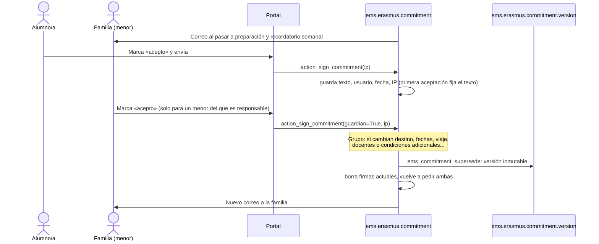

# 9. Cartas de compromiso y aceptación familiar

[← Índice](README.md)

## 9.1 Mecanismo común (`ems.erasmus.commitment`, `models/erasmus/commitment.py:13`) — IMPLEMENTADO

Modelo abstracto que heredan la movilidad individual (`ems.erasmus.mobility`) y el expediente de participante de grupo (`ems.erasmus.group.participant`). El participante —y, si es menor, su familia desde su propio portal— **acepta** la carta en EMS, en cualquier orden.

| Dato guardado | Campo |
|---|---|
| Texto exacto aceptado | `commitment_signed_text` (HTML saneado). Lo fija la **primera** aceptación; la segunda acepta esa misma copia (`_ems_commitment_text`, `:97`) |
| Participante: usuario, fecha, IP | `commitment_signed_by_id`, `commitment_signed_date`, `commitment_signed_ip` |
| Familia: usuario, fecha, IP | `commitment_guardian_signed_by_id`, `commitment_guardian_signed_date`, `commitment_guardian_signed_ip` |
| Pendiente | `commitment_pending`, `commitment_guardian_pending` (calculados) |
| Provisional | `commitment_provisional`: aceptada cuando el destino o las fechas aún no estaban confirmados (solo grupo) |
| Versiones anteriores | `commitment_version_ids` → `ems.erasmus.commitment.version` |

Aceptar (`action_sign_commitment`, `:102`) exige que la carta esté abierta (`_ems_commitment_open`), pendiente para quien acepta y la casilla de aceptación marcada; deja un mensaje en el chatter. La IP es `request.httprequest.remote_addr` (ver nota en 9.5).

## 9.2 Carta de las movilidades individuales — IMPLEMENTADO

- El texto es el `commitment_text` de la convocatoria (anexo 3; `_ems_commitment_text`, `call.py:367`), rellenado por defecto en convocatorias de alumnos y vacío en las de personal (sin texto no se pide carta).
- Se puede aceptar mientras la movilidad está en *definiendo* o *preparando*.
- Sin la carta del participante y, si es menor, de la familia, `preparation_complete` es falso (`mobility.py:285`).
- **No hay versiones** en las movilidades individuales: el `commitment_text` de la convocatoria sigue siendo editable después de publicada y de que algunos participantes hayan aceptado. Cada aceptación conserva su copia, pero no se pide nueva aceptación ni se avisa de que el texto cambió (observación, R-21).

## 9.3 Carta de las movilidades de grupo — IMPLEMENTADO

- Plantilla común construida en `EmsErasmusGroupParticipant._ems_commitment_letter` (`group_mobility.py:1148`), con frases completas traducibles en el idioma de quien lee: participación (o autorización de la familia) con destino, entidad y fechas si están confirmados («por confirmar» si no), fechas de viaje, docentes acompañantes, cumplimiento del programa, normas de convivencia del centro y de la entidad, medidas ante incumplimiento grave según las normas del centro, comunicación y colaboración; más las **condiciones adicionales** de la movilidad (`commitment_extra`).
- Para menores incluye la advertencia de que **no sustituye** la autorización oficial de menores al extranjero, que sigue siendo un documento del expediente.
- Solo alumnos; los docentes no firman carta. Se acepta en preparación y con el expediente activo.
- **Versiones** (`write()` de la movilidad de grupo, `group_mobility.py:263`; `COMMITMENT_TERMS`, `:35`): si cambian ciudad, país, entidad, fechas, fechas de viaje, líder, acompañantes o condiciones adicionales después de alguna aceptación, cada aceptación se guarda como `ems.erasmus.commitment.version` (texto, firmas, IP, si era provisional, cuándo y por qué se sustituyó) y se borran las firmas actuales para que ambos acepten la nueva carta; la familia recibe un nuevo correo.
- Las versiones son **inmutables** (`write`/`unlink` rechazan, `commitment.py:181`; verificado en las pruebas de integridad) y solo las leen el equipo y el administrador.
- Una aceptación provisional (destino o fecha de inicio por confirmar) no permite salir: `preparation_complete` exige carta no provisional (`group_mobility.py:1133`).

## 9.4 La familia en el portal — IMPLEMENTADO

- Qué ve (`_ems_erasmus_guardian_mobilities`, `partner.py`; `_ems_erasmus_guardian_group_participants`, `group_mobility.py:1511`): las movilidades en preparación, o los expedientes de grupo activos, de los menores **de los que puede actuar** (`get_portal_students().filtered(_ems_portal_can_act_for)`), con carta pendiente o ya aceptada. Eso hace visible la tarjeta Erasmus+ en su portal.
- Qué hace: aceptar la carta. Las rutas solo aceptan un identificador que esté en esa lista; verificado que otro alumno no puede aceptar por un menor y que la familia sí (anexo B).
- Qué no ve: la solicitud, los documentos ni la puntuación del alumno.
- Correos: plantillas `email_template_erasmus_commitment_guardian` (individual) y `email_template_erasmus_group_commitment_guardian` (grupo), a **cada** contacto familiar con correo, al pasar a preparación, al reabrirse por cambio de condiciones y en el recordatorio semanal (solo individual: `_cron_remind_documents` llama a `_ems_remind_guardians` de movilidades individuales).

## 9.5 Valor y límites de la aceptación — PARCIAL / NO VERIFICADO

| Aspecto | Estado |
|---|---|
| Aceptación con usuario autenticado, fecha, IP y texto exacto | IMPLEMENTADO |
| Exportación como página HTML con todas las versiones y firmas | IMPLEMENTADO (`_ems_commitment_html`, `export.py:413`) |
| Valor legal de la aceptación por clic como firma | **PENDIENTE de decisión** de la coordinación (D-1) |
| IP real del firmante detrás del proxy inverso de producción | **NO VERIFICADO**: depende de que Odoo funcione con `proxy_mode` y el proxy envíe `X-Forwarded-For`; si no, se guarda la IP del proxy (R-14) |
| Qué familiar firma cuando hay varios | El primero que acepta; el resto ya no la ve pendiente. No se exige la aceptación de ambos progenitores (decisión no documentada) |
| Recordatorio semanal a familias de movilidades de grupo | **No existe**: solo correo al abrir el expediente y al cambiar condiciones |
