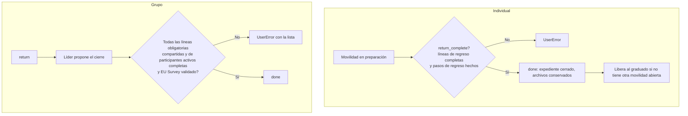

# 10. Seguimiento, incidencias, EU Survey y cierre

[← Índice](README.md)

## 10.1 Seguimiento

| | Movilidad individual | Movilidad de grupo |
|---|---|---|
| Registro de seguimiento | **No hay modelo específico.** Chatter de la movilidad (mensajes, cambios con seguimiento) y autoevaluación semanal del participante | `ems.erasmus.group.log` (`group_mobility.py:1336`): asistencia (quién faltó), incidencia, cambio, evidencia, comunicación, con archivos y participantes afectados |
| Quién escribe | Equipo (chatter); participante (autoevaluación) | Líder, acompañantes y equipo (`create()` comprueba el rol) |
| Estado | IMPLEMENTADO (autoevaluación) / PENDIENTE (diario de seguimiento individual) | IMPLEMENTADO |

**Observación (R-19):** las entradas de seguimiento de grupo no tienen guarda de escritura ni historial: cualquier docente de la movilidad puede editar las entradas de otro (la regla de registro solo limita a «sus movilidades»), y el autor (`author_id`) es de solo lectura únicamente en la vista. No tienen permiso de borrado salvo el equipo.

## 10.2 Incidencias

| Tipo | Dónde | Estado |
|---|---|---|
| Incidencia durante la estancia (grupo) | `ems.erasmus.group.log` tipo *incident* | IMPLEMENTADO |
| Amonestación académica | `ems.strike` (módulo de convivencia), separada del seguimiento Erasmus | IMPLEMENTADO (fuera de Erasmus) |
| Alumno sin notas en una selección de grupo | `grade_incident` de la inscripción: bloquea la selección hasta resolverla | IMPLEMENTADO |
| Documento sobre un incidente de un participante individual | Documento de proyecto vinculado a su movilidad (`participant_category`) | IMPLEMENTADO |
| Regreso anticipado, interrupción, fuerza mayor | Solo cancelación con motivo o cambio manual de fechas; la carta recoge las consecuencias económicas, pero **no hay flujo específico** ni cálculo de devolución | PENDIENTE |

## 10.3 EU Survey

| | Movilidad individual | Movilidad de grupo |
|---|---|---|
| Representación | Paso de checklist «Final report (EU Survey)» que marca el equipo (quién y cuándo) | Estado propio `eu_survey_state` (*pendiente → respondido → validado*), responsable (`eu_survey_user_id`, por defecto el líder), plazo y evidencias (`eu_survey_attachment_ids`) |
| Tarea automática | No | Al terminar la estancia, tarea para el responsable con plazo (30 días si no se fijó) (`action_end_stay`, `group_mobility.py:666`) |
| Quién responde | El participante (fuera de EMS) | **Solo el líder** (decisión del coordinador del 24-10-2026): alumnos y otros docentes no tienen tarea |
| Validación | Implícita al marcar el paso | El equipo valida (`action_eu_survey_validate`) |
| Integración con la plataforma EU Survey | No | No |
| Estado | PARCIAL (sin evidencia; incoherente con grupo, R-16) | IMPLEMENTADO |

## 10.4 Cierre

| Comprobación al cerrar | Individual (`action_close`, `mobility.py:766`) | Grupo (`action_close`, `group_mobility.py:712`) |
|---|---|---|
| Documentos de regreso obligatorios completos | Sí | Sí |
| Documentos de **preparación** obligatorios completos | **No** (R-06) | Sí |
| Pasos de checklist de regreso | Sí | — (no tiene checklist) |
| EU Survey | Como paso de checklist | Validado por el equipo |
| Proyecto asignado | **No** se exige | Obligatorio desde la creación |
| Pagos pendientes | **No** se comprueban | — |
| Efecto | `state = done`; no se puede quitar ningún archivo; no hay subidas en el portal | Ídem |

Una movilidad cerrada o cancelada **no se puede reabrir** (no hay acción para ello).
