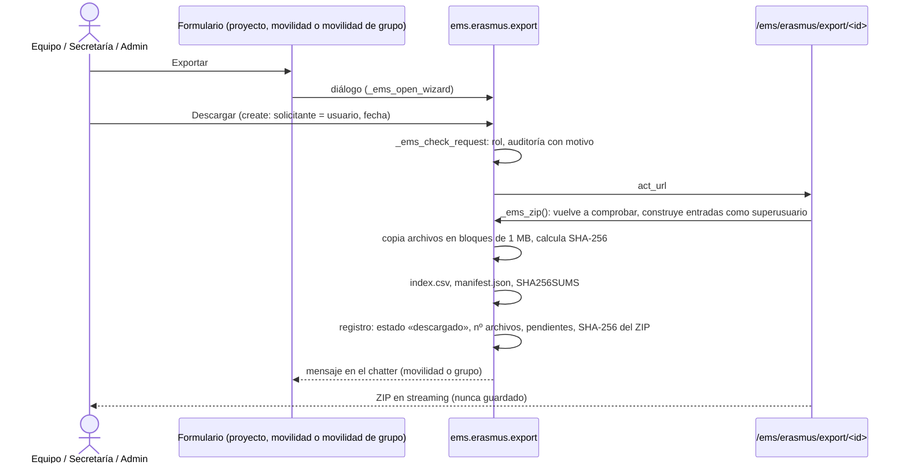

# 11. Exportación Excel, ZIP y evidencias de auditoría

[← Índice](README.md)

## 11.1 Excel de participantes — IMPLEMENTADO

| | Convocatorias | Movilidades de grupo |
|---|---|---|
| Acción | *Exportar a hoja de cálculo* (lista de solicitudes, solicitud aceptada, convocatoria con definitiva publicada) | *Exportar participantes (Excel)* |
| Ruta | `GET /ems/erasmus/participants?application_ids=…` | `GET /ems/erasmus/group/participants?participant_ids=…` |
| Quién | Solo `ems.group_erasmus` (`_ems_participants`, `application.py:545`; el resto recibe 404) | Solo equipo (`_ems_check_role('team')`) |
| Contenido | Una fila por solicitud **aceptada** | Participantes activos: alumnos y después docentes |
| Formato | Hoja *Participantes*, 18 cabeceras fijas en castellano (`PARTICIPANT_HEADERS`, `application.py:46`), nunca traducidas, para importarlo en una herramienta externa | El mismo libro |
| Datos bancarios | Primer `res.partner.bank` del alumno; `bank_account_id` del empleado | **Vacíos** (pago colectivo) |
| Tutor legal | Solo menores: **todos** los contactos familiares, unidos por «, » | Ídem |
| Almacenamiento | Generado al vuelo, **nunca se guarda** | Ídem |
| Registro | **No queda registro** de quién lo descargó (no pasa por `ems.erasmus.export`) | Ídem |

Columnas: Nombre, Apellidos, DNI, Email, Teléfono, Dirección, Fecha de nacimiento (celda de fecha), Nacionalidad, Género (siempre vacío: EMS no guarda el género del alumnado), Ciclo formativo, Curso, Titular de la cuenta, Banco, BIC, IBAN, Tutor legal, Email del tutor legal, Teléfono del tutor legal.

**Observación:** el Excel contiene datos personales y bancarios y su descarga no queda registrada, a diferencia de los ZIP (ver R-23 en [15_riesgos_decisiones.md](15_riesgos_decisiones.md)).

## 11.2 Exportación ZIP de expedientes (`ems.erasmus.export`, `models/erasmus/export.py:28`) — IMPLEMENTADO



### Alcances

| `scope` | Contenido |
|---|---|
| `record` | El expediente de un participante en una movilidad: las cuatro categorías |
| `group` | Una movilidad de grupo: documentación común una vez, evidencia de selección, seguimiento, EU Survey y el expediente de cada participante **activo** |
| `project` | Las cinco categorías del proyecto; las convocatorias de las movilidades del proyecto (PDF de la convocatoria y de las resoluciones publicadas en `01_Projecte/Calls/`); el expediente de cada movilidad **no cancelada** (`02_Mobilitats/ALU|PROF<id>_<nombre>/`); cada movilidad de grupo que no esté en borrador ni cancelada (`GRUP<id>_<nombre>/`); facturas con su archivo y justificantes (`03_Economia/Invoices/`); justificantes de pagos (`03_Economia/Transfers/`) |

### Estructura de una movilidad de grupo en el ZIP

```
GRUP<id>_<nombre>/
├── 00_Documentacio_comuna/
│   ├── 01_Dades_i_autoritzacions/   documentos compartidos (p. ej. inclusión, solo en auditoría), Selection.csv, Draws.csv
│   ├── 02_Abans_de_la_mobilitat/    acuerdo de aprendizaje de grupo, lista final, acuerdos con la entidad
│   ├── 03_Durant_la_mobilitat/      documentos de viaje, evidencias comunes, Follow-up/ y Follow-up.csv
│   └── 04_Despres_de_la_mobilitat/  EU Survey/ (evidencias)
├── ALU<participante>_<nombre>/      cada alumno activo: sus líneas y la carta de compromiso
└── PROF<participante>_<nombre>/     líder y acompañantes: sus líneas
```

### Contenido de cada expediente

- Cada archivo de cada línea, numerado por versión (`v1_`, `v2_`… y `team_v1_` para lo que sube el equipo), **sin modificar** (PDF firmados incluidos).
- La carta de compromiso aceptada como página HTML con quién, cuándo e IP, y todas las versiones anteriores.
- Las autoevaluaciones semanales en PDF (categoría 03).
- Documentos de proyecto vinculados (en un ZIP de proyecto, un documento compartido se escribe una vez y los expedientes apuntan a su ruta).
- `index.csv` (UTF-8 con BOM): una fila por documento, **también los que faltan o no aplican**, con participante, movilidad, categoría, obligatorio, estado, firmantes, versión, ruta, fecha y autor de la subida, tamaño, SHA-256 y notas.
- `manifest.json`: exportación (id, alcance, solicitante, fecha, auditoría, motivo), cada archivo con su hash y la lista de obligatorios no completos.
- `SHA256SUMS`: formato `sha256sum -c` para verificar la copia archivada en Drive.
- Nombres saneados con `safe_name()` (`records.py`): sin separadores, caracteres de control o reservados ni `..`; ninguna ruta puede salir de la raíz del ZIP.
- ZIP sin compresión (`ZIP_STORED`, ZIP64), construido en un archivo temporal: un proyecto grande no necesita caber en memoria.

### Confidencialidad en la exportación

| Exportación | Documentos confidenciales (tarjeta sanitaria, inclusión, menos oportunidades, documentos de proyecto confidenciales) | Datos de selección de grupo (menos oportunidades, amonestaciones, motivo de exclusión) |
|---|---|---|
| Normal | **No salen**: un obligatorio aparece en el índice sin archivo, con la nota «Confidential: only in an audit export» | No salen (columnas omitidas en `Selection.csv` y `Draws.csv`) |
| Auditoría (`include_confidential`) | Salen | Salen |

Verificado en las pruebas: una exportación normal pedida por Secretaría o por el técnico no contiene **ningún** marcador confidencial; una de auditoría del coordinador sí; `Selection.csv` solo tiene la columna de amonestaciones en auditoría (anexo B).

### Quién exporta

| | Técnico | Coordinador | Secretaría | Admin | Otros |
|---|---|---|---|---|---|
| Exportar proyecto, expediente o grupo | Sí | Sí | Sí (el botón de expediente y de grupo solo está en el formulario para el equipo; por modelo puede) | Sí | No (`AccessError`) |
| Exportación de auditoría (motivo obligatorio) | **No** | Sí | No | Sí | No |
| Ver el registro de exportaciones | Todas | Todas | Las suyas | Todas | No |
| Descargar | Solo quien la pidió, **una vez** | | | | |

El registro es de solo creación y lectura (sin escritura ni borrado para nadie; verificado). Un expediente o grupo exportado anota la exportación en su chatter.

**Observaciones:**

- El registro pasa a *descargado* en cuanto el ZIP se construye, antes de enviarlo; si la descarga se interrumpe hay que pedir otra exportación (queda registrada aparte).
- El ZIP de proyecto **no incluye**: movilidades archivadas o canceladas, movilidades de grupo archivadas, en borrador o canceladas, expedientes de participantes de grupo retirados, facturas sin proyecto asignado, ni convocatorias que no tengan ninguna movilidad en ese proyecto (sus resoluciones solo entran a través de las movilidades). Ver R-02 y R-18.

## 11.3 Evidencias de auditoría disponibles

| Evidencia | Dónde se conserva | Inmutable |
|---|---|---|
| Resoluciones publicadas y sus líneas congeladas | `ems.erasmus.resolution(.line)` + PDF guardado | Sí (verificado) |
| Media, módulos y amonestaciones usados en la selección individual | `grade_line_ids`, `grade_average_ems`, `strike_ids`, `scoring_frozen_date` | Las líneas de módulos sí (el equipo solo tiene lectura). La media y las amonestaciones congeladas son de solo lectura en la vista, pero el equipo podría escribirlas por RPC (NO VERIFICADO con prueba) |
| Entrevistas y valoraciones de plan | `ems.erasmus.interview`, `ems.erasmus.plan_rating` con seguimiento | **No**: el equipo puede borrarlas (R-10) |
| Ranking congelado de grupo, propuesta, aprobación, sustituciones | `ems.erasmus.group.registration`, campos de la movilidad, chatter | Solo cambian por las acciones |
| Sorteos de grupo | `ems.erasmus.group.draw` | Sí (verificado), salvo borrado en cascada de la movilidad (R-01) |
| Cartas aceptadas y versiones | campos `commitment_*`, `ems.erasmus.commitment.version` | Versiones sí (verificado) |
| Revisión de documentos | chatter de la movilidad / movilidad de grupo | Chatter (no editable por usuarios normales) |
| Pagos pagados y justificantes | `ems.erasmus.payment`, `receipt_ids` | No se pueden cambiar ni borrar, pero Secretaría puede «deshacer» el pago: se borran fecha, autor y vínculo con el justificante, sin registro en el chatter (el campo de estado no tiene seguimiento) (R-24) |
| Exportaciones | `ems.erasmus.export` con SHA-256 | Sí (verificado) |
| Cambios de campos con seguimiento | chatter (`tracking=True`) | Chatter |
