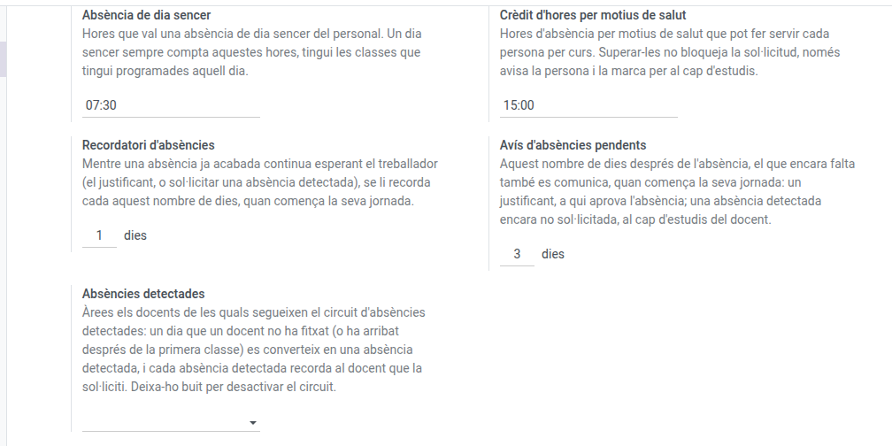

[Català](absences.md) | [Castellano](../../es/admin/absences.md) | [English](../../en/admin/absences.md)

---

# Configurar les absències del personal

**Rol necessari:** Administrador/a

---

## Els paràmetres

**Ajustos > EMS > Configuració d'absències del personal**:

| Paràmetre | Per defecte | Què fa |
|---|---|---|
| Absència de dia sencer | 7:30 | Hores que val una absència de dia sencer. Sempre compta aquestes hores, tingui la persona les classes que tingui programades aquell dia |
| Crèdit d'hores per motius de salut | 15:00 | Hores d'absència per motius de salut que pot fer servir cada persona per curs |
| Recordatori d'absències | 1 dia | Un cop passada una absència que encara espera la persona (el justificant, o sol·licitar una absència detectada que el seu cap d'estudis li ha demanat que justifiqui), se li recorda cada aquest nombre de dies |
| Avís d'absències pendents | 3 dies | El que encara falta també es comunica passats aquests dies des de l'absència (un justificant, a qui aprova l'absència) o des que el cap d'estudis va demanar la justificació (una absència detectada encara no sol·licitada, al cap d'estudis del docent) |
| Absències detectades | (buit) | Les àrees els docents de les quals segueixen el circuit d'absències detectades: un dia que un docent no ha fitxat (o ha fitxat després de la primera classe) es converteix en una absència detectada, i el cap d'estudis del docent revisa cada absència detectada abans que se li recordi al docent. Buit, el circuit està desactivat. Per començar, tria només l'àrea d'FP |

El crèdit **avisa, no bloqueja**: qui el supera rep un avís i la sol·licitud queda marcada per al cap d'estudis, però es tramita igual.

Cada recordatori i cada avís espera l'inici de la jornada de qui el rep, de manera que ningú no en rep fora del seu horari. Qui no té cap horari es regeix pel marc horari per defecte del centre.

Un docent pertany a una àrea pel seu departament. Les absències detectades s'expliquen al [manual del cap d'estudis](../head_of_studies/absences.md#absències-detectades).

### Canvis d'horari al quadre de guàrdies

**Ajustos > EMS > Configuració del quadre de guàrdies** decideix quins canvis pot proposar el quadre de guàrdies quan falta un docent. Tots tres estan **desactivats per defecte**: amb tots desactivats, les classes sense docent sempre es cobreixen amb una guàrdia.

| Paràmetre | Què proposa el quadre quan està activat |
|---|---|
| Entrar més tard | Si les primeres classes del dia d'un grup no tenen docent, avisar l'alumnat i les famílies que poden entrar més tard (o que no tenen classe, si cap classe té docent) |
| Sortir abans | Si les últimes classes del dia no tenen docent, avisar l'alumnat i les famílies que poden sortir abans |
| Pati més llarg | Si les classes just abans o després d'un pati no tenen docent, allargar el pati. Només s'avisa l'alumnat, i els menors de 18 anys continuen sense poder sortir del centre, de manera que aquestes classes continuen necessitant un professor de guàrdia |

Desactivar-ne un no desfà el que ja s'ha comunicat: si l'absència canvia després, el quadre continua oferint la correcció.

---

## El catàleg de tipus d'absència

**Absències > Configuració > Tipus d'absència**. N'hi ha nou, i el nom de cadascun és el text complet del permís que es concedeix.

Cada tipus porta quatre indicadors que decideixen com surten proposades les sol·licituds noves:

| Indicador | Marcat a |
|---|---|
| Suma les hores a l'informe mensual | Tots menys `Baixa laboral` |
| Consumeix el crèdit de salut | Només `Salut` |
| Dia sencer per defecte | `Salut` i `Prova mèdica invasiva` |
| Es tramita per ATRI | Només `ATRI` |

Són **valors proposats**: el gestor de les absències els pot canviar sol·licitud a sol·licitud. **Es tramita per ATRI** n'és l'excepció: només decideix si el formulari de sol·licitud mostra a l'empleat els enllaços al portal ATRI, i sempre segueix el tipus.

L'indicador natiu **Document de suport** de cada tipus decideix si les seves sol·licituds esperen un justificant després que el cap les doni per rebudes. Està marcat a tots els tipus menys `Salut` i `ATRI`. Ve de les dades del mateix mòdul, així que un canvi fet aquí es desfà a la següent actualització: demana-ho a l'equip de l'EMS.

---

## Festius i dies de tancament

**Absències > Configuració > Festius públics**. L'EMS no porta cap calendari de festius: s'han d'entrar tots a mà, un cop per curs:

- Els **nacionals** (1 de novembre, 6 i 8 de desembre, Nadal, Cap d'Any, Reis, Divendres Sant, 1 de maig...).
- Els **de Catalunya** (Dilluns de Pasqua, Sant Joan, l'11 de setembre, Sant Esteve...).
- Els **dos locals del municipi del centre**: els de la població on és l'institut, no els de Barcelona.
- Els **dies que el centre és tancat** encara que no siguin festius oficials: dies de lliure disposició, vacances de Nadal i de Setmana Santa, agost... Un període de diversos dies es pot entrar en una sola línia.

Cada festiu s'aplica **a tot el personal**, sigui quin sigui el seu horari. Cal posar-hi el nom i les dates d'inici i de fi (per a un dia sencer, de les 00:00 a les 23:59).

Entra'ls **abans** que arribin. Cada nit, l'EMS registra una absència sense justificar (un fitxatge en vermell, que compta com a hores en negatiu) a qui no va fitxar el dia anterior, tret que aquell dia no tingués hores previstes. Si un festiu s'entra tard, en desar-lo s'esborren sols els fitxatges en vermell d'aquells dies i les hores en negatiu corresponents. El mateix passa quan s'aprova tard una absència de dia sencer.

---

## Qui aprova

No es configura aquí. Surt de l'organigrama: l'aprovador de cada persona és **el responsable del seu departament de nivell superior**, que es defineix al formulari del departament (camp *Responsable d'àrea*).

Si les absències d'una àrea es queden sense aprovador, comprova que aquesta persona **tingui usuari a l'EMS**: l'aprovador ha de ser un usuari, no només una fitxa d'empleat.
