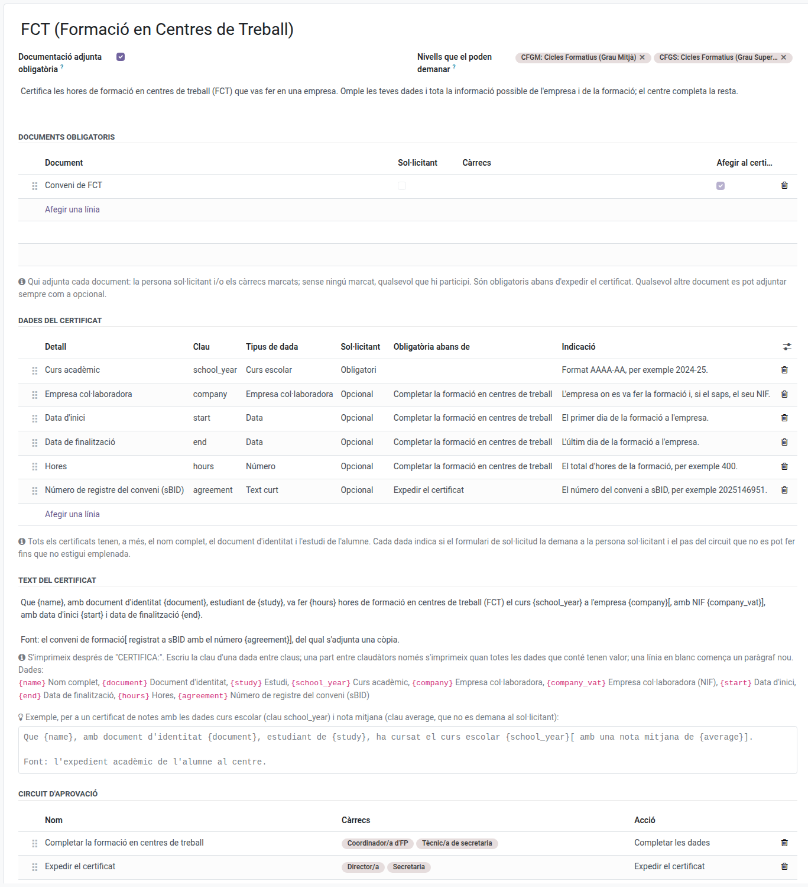

[Català](certificate-types.md) | [Castellano](../../es/admin/certificate-types.md) | [English](../../en/admin/certificate-types.md)

---

# Tipus de certificat i circuits d'aprovació

Configura quins certificats pot demanar l'alumnat, quina documentació exigeixen i qui fa cada pas fins que s'expedeixen.

**Rol necessari:** Administrador.

---

## Accés

Navega a: **Gestió acadèmica → Configuració → Certificats → Tipus de certificat**.

EMS ja inclou el tipus **FCT (Formació en Centres de Treball)**. Els canvis que hi facis es mantenen en actualitzar EMS.

---

## Camps del tipus

- **Nivells que el poden demanar** — l'alumnat actual d'aquests nivells el pot demanar des del portal, i la sol·licitud només admet estudis d'aquests nivells. Si es deixa buit, el tipus no surt al portal i les sol·licituds només es registren des de secretaria.
- **Descripció** — el text que llegeix la persona sol·licitant a sobre del formulari.

---

## Dades del certificat

Tots els certificats ja tenen el **nom complet**, el **document d'identitat** i l'**estudi** de l'alumne. A **Dades del certificat**, afegeix una línia per cada altra dada que necessiti el certificat:

- **Detall** — el nom de la dada, tal com el llegeixen la persona sol·licitant i el personal (per exemple, *Hores*).
- **Clau** — com l'escriu el text del certificat, entre claus: lletres minúscules, dígits i `_` (per exemple, `hores`). No pot ser `name`, `document` ni `study`, que ja estan agafades. Si la canvieu, el text s'actualitza en tots els idiomes.
- **Tipus de dada** — **Text curt**, **Text llarg**, **Número** (pot tenir decimals, com una nota mitjana de 7,45), **Data**, **Sí/No**, **Curs escolar** (s'escriu 2024-25 o 2024-2025, amb anys consecutius, i es desa com a 2024-25; el formulari suggereix els cursos que té EMS) o **Empresa col·laboradora** (la persona sol·licitant n'escriu el nom i el NIF, i el centre vincula l'empresa).
- **Sol·licitant** — **Obligatori**: el formulari la demana i cal emplenar-la per enviar la sol·licitud; **Opcional**: el formulari la demana; **No es demana**: només l'emplena el centre.
- **Obligatòria abans de** — el pas del circuit que no es pot fer fins que no estigui emplenada (ni cap de posterior). Deixa-ho buit si el circuit no l'exigeix mai. Per triar un pas, desa primer el circuit.
- **Indicació** — què cal escriure i com, amb un exemple (per exemple, *Format AAAA-AA, per exemple 2024-25.*). La persona sol·licitant la llegeix sota la dada, i el personal del centre, al seu costat a la sol·licitud.
- **No anterior a** (columna opcional, només per a dates) — una altra data del tipus de la qual no pot ser anterior: a la FCT, la data de finalització no pot ser anterior a la d'inici.

En una sol·licitud, el personal emplena aquestes dades a la pestanya **Dades del certificat**. Les que encara estan buides i que exigeix el pas actual surten ressaltades.

---

## Text del certificat

**Text del certificat** és el que diu el certificat després de "CERTIFICA:". L'encapçalament amb el nom del secretari o la secretària, el tancament, el lloc, la data i els segells són iguals per a tots els certificats.

- Escriu la clau d'una dada entre claus on ha d'anar el seu valor: `{hores}`. Sota el text hi ha totes les claus que pots fer servir. Una dada **Empresa col·laboradora** també té el NIF: `{empresa_vat}` si la clau és `empresa`.
- Una part entre claudàtors només s'imprimeix quan totes les dades que conté tenen valor: `[, amb NIF {empresa_vat}]`.
- Una línia en blanc comença un paràgraf nou.

El text es tradueix com els altres noms: escriu-lo en cada idioma amb el selector d'idioma del camp. EMS no deixa desar un text que faci servir una clau que el tipus no té.

Per exemple, el text de FCT:

> Que {name}, amb document d'identitat {document}, estudiant de {study}, va fer {hours} hores de formació en centres de treball (FCT) el curs {school_year} a l'empresa {company}[, amb NIF {company_vat}], amb data d'inici {start} i data de finalització {end}.

---

## Documentació adjunta obligatòria

Marca **Documentació adjunta obligatòria** i afegeix una línia per cada document que s'ha d'adjuntar abans d'expedir el certificat:

- **Document** — el nom del document (per exemple, *Conveni de FCT*).
- **Sol·licitant** — la persona sol·licitant el pot adjuntar des del portal o des de l'enllaç.
- **Càrrecs** — qui ocupa aquests càrrecs el pot adjuntar (només es poden triar càrrecs del circuit).
- **Afegir al certificat** — les pàgines del document s'afegeixen al final del PDF del certificat.

Si no es marca ni **Sol·licitant** ni cap càrrec, el pot adjuntar qualsevol que hi participi. L'administrador sempre el pot adjuntar.

A més dels documents obligatoris, qualsevol sol·licitud admet **Altra documentació** opcional, que no s'afegeix al certificat.

---

## Circuit d'aprovació

Cada línia és un pas, per ordre:

- **Nom** — el que veu qui ha de fer el pas.
- **Càrrecs** — un o més càrrecs. Qui ocupa algun d'aquests càrrecs rep la tasca i pot fer el pas; quan un d'ells el fa, la tasca dels altres es tanca. Els càrrecs i qui els ocupa es configuren a [Càrrecs](teacher-roles.md).

Per donar un pas al personal de secretaria, afegiu-hi el càrrec **Tècnic/a de secretaria** i assigneu aquest càrrec a cadascuna d'aquestes persones. Qui l'ocupa també té accés a la secretaria. El primer pas del tipus FCT ja el porta, juntament amb el coordinador d'FP.
- **Acció**:
  - **Completar les dades** — completa la informació i passa la sol·licitud al pas següent.
  - **Expedir el certificat** — dona el número al certificat i hi posa el segell d'expedició.
  - **Aprovar** — hi posa el segell de vistiplau.

El circuit ha de tenir exactament un pas **Expedir el certificat**, i els passos **Aprovar** van després d'aquest. L'últim pas genera el PDF i l'envia a la persona sol·licitant.

L'administrador pot fer qualsevol pas de qualsevol sol·licitud.
