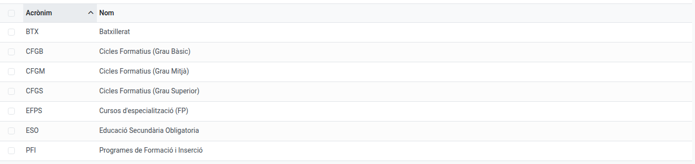

[Català](curriculum-levels.md) | [Castellano](../../es/admin/curriculum-levels.md) | [English](../../en/admin/curriculum-levels.md)

---

# Nivells

Els nivells representen les **etapes educatives** o **cicles d'estudi** de la institució (p. ex., Educació Secundària Obligatòria, Formació Professional, Batxillerat). Formen la part superior de la jerarquia curricular: cada nivell agrupa estudis relacionats, que al seu torn agrupen grups classe.

**Rol necessari:** Administrador

---

## Accés

Navega a: **Comunitat Educativa → Configuració → Currículum → Nivells**

---

## Consultar tots els nivells

En obrir el menú es mostra una llista de tots els nivells ordenada alfabèticament per acrònim. Cada fila mostra l'acrònim i el nom complet.

---

## Crear un nivell

1. Fes clic a **Nou**.
2. Omple els camps obligatoris:
   - **Acrònim** *(obligatori)*: Codi curt que s'utilitza a tot el sistema (p. ex., `BTX`, `CFGM`).
   - **Nom** *(obligatori)*: Nom descriptiu complet (p. ex., `Batxillerat`, `Cicles Formatius Grau Mitjà`).
3. L'**Etapa educativa** (educació obligatòria o postobligatòria) és de només lectura: la fixa la normativa, i l'EMS la manté per als nivells oficials. Quins nivells admeten convalidacions es configura a [Configuració de convalidacions](convalidation-settings.md#nivells-que-admeten-convalidacions).
4. Opcionalment, afegeix notes lliures a la pestanya **Notes**.
5. Fes clic a **Desa** (o usa les engrunes de navegació per anar a una altra pàgina — Odoo desa automàticament).

> La pestanya **Estudis** mostra tots els estudis vinculats a aquest nivell. Els estudis es gestionen des del seu propi menú (**Configuració → Currículum → Estudis**) i no es poden afegir directament des del formulari del nivell.

---

## Editar un nivell

1. Obre el nivell des de la llista.
2. Fes clic sobre qualsevol camp per editar-lo en línia, o fes clic a **Edita** si és necessari.
3. Fes els canvis necessaris.
4. Fes clic a **Desa**.

---

## Arxivar o eliminar un nivell

Un nivell que ja no s'ofereix s'arxiva, no s'elimina: els seus estudis, grups i alumnes el conserven.

1. Obre el nivell (o selecciona'l a la llista).
2. Fes clic al menú **Acció** (⚙) i selecciona **Arxiva**.

Un nivell arxivat ja no apareix a les llistes ni als desplegables, però tot el que ja el fa servir el continua mostrant. Per tornar-lo a veure, obre les opcions de cerca (▾ a la dreta del quadre de cerca) i tria el filtre **Arxivat**; obre'l i fes servir **Acció** (⚙) → **Desarxiva** per recuperar-lo.

Només pots **Suprimir** un nivell que encara no faci servir res (per exemple, un de creat per error). Si alguna cosa el fa servir, l'EMS no ho permet i t'indica què el fa servir.

---

[← Tornar a l'índex d'Administrador](index.md)
