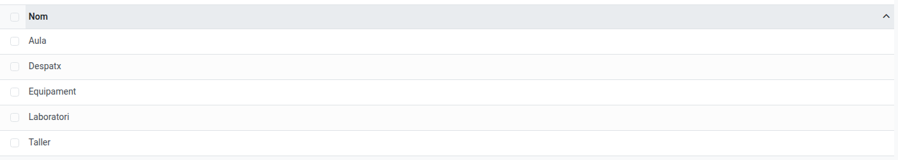
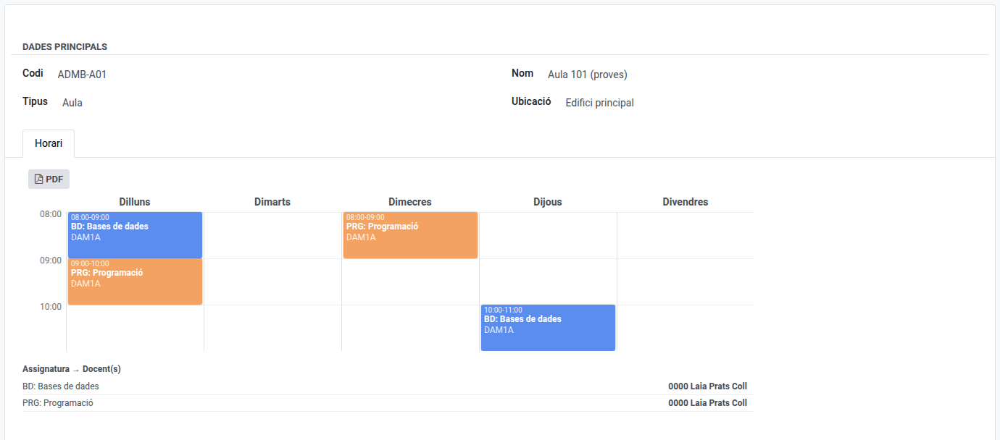

[Català](facilities.md) | [Castellano](../../es/admin/facilities.md) | [English](../../en/admin/facilities.md)

---

# Espais i tipus d'espai

Els espais són les aules físiques del centre (aules, laboratoris, tallers...), cadascun assignat a un **Tipus** i una **Ubicació** (seu/edifici). S'utilitzen a tota l'aplicació allà on una sessió, grup, acta o horari necessita una sala. Cada espai té també el seu propi **horari d'ocupació** setmanal — vegeu [L'horari d'ocupació d'una aula](space-schedule.md).

**Rol necessari:** Administrador (Professorat i Secretaria poden veure un espai, però no crear-lo, editar-lo ni eliminar-lo).

---

## Accés

- **Tipus d'espai**: **Comunitat Educativa → Configuració → Espais → Tipus**
- **Espais**: **Comunitat Educativa → Espais → Llistat d'espais**

---

## Crear un tipus d'espai

1. Fes clic a **Nou**.
2. Omple el **Nom** (p. ex., "Aula", "Laboratori d'informàtica").
3. Fes clic a **Desa**.

---

## Crear un espai

1. Fes clic a **Nou**. El **Tipus** i la **Ubicació** ja venen preomplerts amb "Aula" i "Edifici principal" — canvia'ls si aquest espai és diferent.
2. Omple:
   - **Codi** *(obligatori)*: ha de ser únic dins la seva Ubicació — el mateix codi es pot reutilitzar en seus diferents.
   - **Nom** *(obligatori)*.
   - **Tipus** *(obligatori)*: tria un Tipus d'espai.
   - **Ubicació** *(obligatori)*: a quina seu/edifici pertany aquest espai.
3. Fes clic a **Desa**.

Un cop creat l'espai, hi ha disponibles una pestanya **Horari** i un xat (per a notes internes, missatges i activitats).

---

## Editar, arxivar o eliminar

Obre el registre des de la llista, edita qualsevol camp i desa. Un espai (o tipus d'espai) que ja no existeix s'arxiva, no s'elimina: les seves sessions, horaris i reserves passades el conserven, i un espai arxivat ja no s'ofereix quan es busca una aula lliure.

1. Obre l'espai o el tipus d'espai (o selecciona'l a la llista).
2. Fes clic al menú **Acció** (⚙) i selecciona **Arxiva**.

Un espai arxivat ja no apareix a les llistes ni als desplegables, però tot el que ja el fa servir el continua mostrant. Per tornar-lo a veure, obre les opcions de cerca (▾ a la dreta del quadre de cerca) i tria el filtre **Arxivat**; obre'l i fes servir **Acció** (⚙) → **Desarxiva** per recuperar-lo.

Només pots **Suprimir** un espai o un tipus d'espai que encara no faci servir res (per exemple, un de creat per error). Si alguna cosa el fa servir, l'EMS no ho permet i t'indica què el fa servir.

---

[← Tornar a l'índex d'Administrador](index.md)
