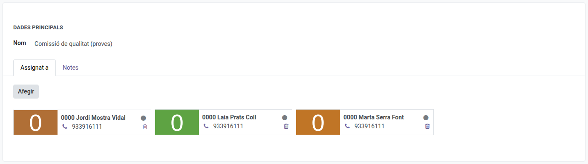

[Català](workgroups.md) | [Castellano](../../es/admin/workgroups.md) | [English](../../en/admin/workgroups.md)

---

# Grups de treball

Els grups de treball són agrupacions lliures d'empleats — un equip de projecte, una comissió interdepartamental, o qualsevol grup de professors, proveïdors o personal PAS que necessitis seguir conjuntament. Un d'ells, **Comissió de Qualitat**, és la comissió de qualitat: els seus membres veuen el menú **Qualitat**, i el deixen de veure quan surten del grup de treball. Li pots canviar el nom: continua sent la comissió de qualitat i les actualitzacions d'EMS respecten el nom nou.

**Rol necessari:** Administrador

---

## Accés

Navega a: **Comunitat Educativa → Configuració → Professorat → Grups de treball**

---

## Crear un grup de treball

1. Fes clic a **Nou**.
2. Omple el **Nom**.
3. A la pestanya **Assignat a**, afegeix els professors que pertanyen a aquest grup.
4. Opcionalment, afegeix notes lliures a la pestanya **Notes**.
5. Fes clic a **Desa**.

---

## Editar, arxivar o eliminar un grup de treball

Obre'l des de la llista, edita qualsevol camp i desa. Un grup de treball que ja no es reuneix s'arxiva, no s'elimina: les seves actes, assistències a reunions i accions de qualitat el conserven.

1. Obre el grup de treball (o selecciona'l a la llista).
2. Fes clic al menú **Acció** (⚙) i selecciona **Arxiva**.

Un grup de treball arxivat ja no apareix a les llistes ni als desplegables, però tot el que ja el fa servir el continua mostrant. Per tornar-lo a veure, obre les opcions de cerca (▾ a la dreta del quadre de cerca) i tria el filtre **Arxivat**; obre'l i fes servir **Acció** (⚙) → **Desarxiva** per recuperar-lo.

Només pots **Suprimir** un grup de treball que encara no faci servir res (per exemple, un de creat per error). Si alguna cosa el fa servir, l'EMS no ho permet i t'indica què el fa servir.

---

[← Tornar a l'índex d'Administrador](index.md)
