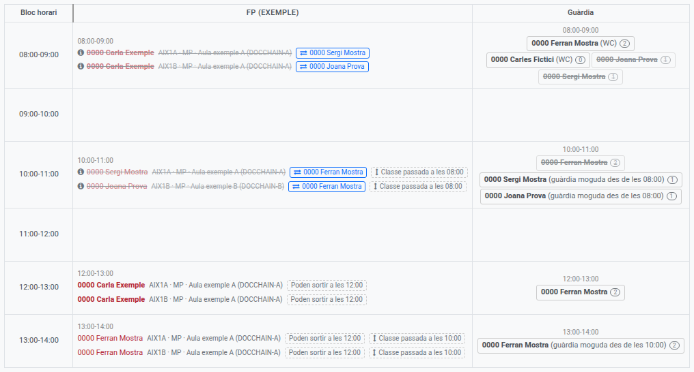
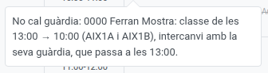
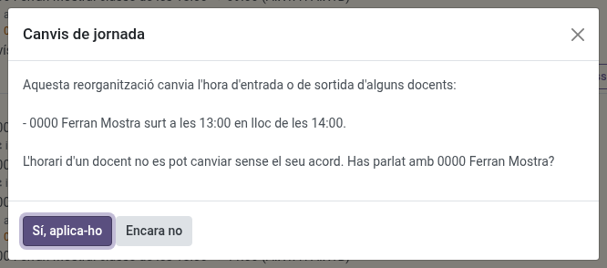
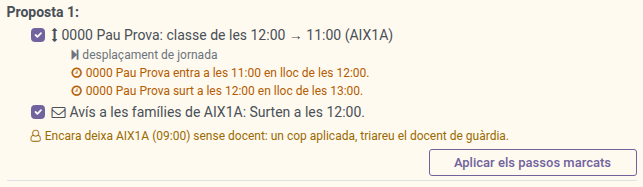
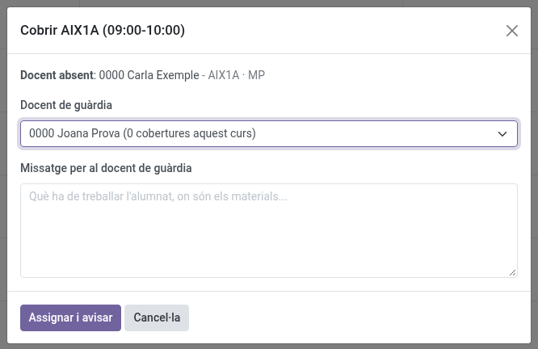

[Català](absences.md) | [Castellano](../../es/department_chiefs/absences.md) | [English](../../en/department_chiefs/absences.md)

---

# Organitzar les absències

Quan falta un docent del teu departament, decideixes des de l'horari de guàrdies com es cobreix cadascuna de les seves classes: amb un docent de guàrdia, reorganitzant les classes o amb un canvi d'horari del grup que s'avisa a les famílies.

**Rol necessari:** cap de departament o cap de seminari, i els qui són per sobre seu (cap d'estudis o cap d'estudis adjunt, director o directora) i l'administrador. Com es llegeix l'horari (les franges, la Taula d'absències, el filtre d'àrea) s'explica a [Horari de guàrdies](../teachers/guard-duty-schedule.md).

**Accés:** **Assistència d'empleats → Horari de guàrdies**, a la **Taula d'absències**.

---

## Introduir una absència detectada

Qui ho pot fer: els **caps de seminari** i els **caps de departament**, per als docents del seu propi departament, a més del cap d'estudis o cap d'estudis adjunt, Direcció i l'administrador. També ho poden fer per a un docent d'un altre departament que fa classe a un grup que gestiona el seu departament, o que té el seu departament al camp **També gestionat pels departaments** (consulta [Organitzar una absència](#organitzar-una-absencia)).

La via normal sempre és que el docent sol·liciti l'absència ell mateix. Fes servir això només en el cas excepcional d'un docent que truca o escriu per avisar que faltarà i no pot entrar a l'EMS: en introduir-la, les seves classes surten al quadre de seguida i en pots organitzar la cobertura.

1. Ves a **Assistència del personal > Absències > Administració > Absències detectades** i fes clic a **Nou**.
2. Tria el **Professor/a**. Només surten els docents del teu departament.
3. Indica **De** i **A**, amb data i hora. Per defecte, avui de 08:00 a 15:00. Una absència pot abastar diversos dies.
4. Si vols, afegeix-hi **Notes** per a tu. El docent pot obrir l'entrada, però no veu mai les notes.
5. Desa.

L'absència surt llavors al quadre com a pendent d'aprovar (vermell clar en cursiva), i la pots organitzar tal com s'explica a continuació. Després la revisa el cap d'estudis del docent (vegeu [Absències detectades](../head_of_studies/absences.md#absències-detectades)): només es demana al docent que la sol·liciti si el cap d'estudis ho decideix. Quan el docent sol·licita l'absència, l'absència detectada s'hi vincula sola i el que hagis organitzat es manté tal com estava. Si finalment el docent no falta, el cap d'estudis la descarta en revisar-la; només els administradors la poden esborrar del tot.

---

## Organitzar una absència

Qui ho pot fer: el **cap de seminari** o el **cap de departament** del docent absent, i els qui són per sobre seu a la jerarquia (cap d'estudis o cap d'estudis adjunt, i Direcció), a més de l'administrador. El que compta és el departament on fa classe el docent: els seus caps i el responsable de l'àrea a què pertany organitzen les absències de tothom qui en forma part, inclosos els membres de l'equip directiu (com el secretari). La resta de docents en veuen el resultat, però no el poden canviar, i el docent absent no pot organitzar la seva pròpia absència. És igual si l'absència l'ha sol·licitada el docent o l'ha introduïda el seu cap o el cap d'estudis com a absència detectada: totes dues es gestionen igual. Quan més endavant el docent sol·licita una absència detectada, el que ja s'havia organitzat es manté tal com estava, i només els dies o les hores de més de la sol·licitud apareixen com a línies noves per decidir. **Docents compartits entre departaments:** a més dels responsables del docent, també pot organitzar una classe qui respon dels alumnes que es queden sense: quan els estudis del grup tenen indicat un departament que els gestiona (camp **Gestionat pel departament** de la fitxa dels estudis), el Cap de departament i el Cap de seminari d'aquell departament, i els qui tenen per sobre, poden organitzar les classes dels seus grups, sigui quin sigui el departament del docent. Per exemple, si una docent del departament de Llengües estrangeres falta a una hora amb un grup d'Informàtica, la guàrdia la poden assignar els caps d'Informàtica; si falta a una hora amb un grup d'Administració, els d'Administració; i en tots dos casos, també la seva pròpia cap de departament. Un grup de reforç segueix els estudis dels seus grups principals. Per a un docent que a la pràctica treballa per a un altre departament o àrea que no és el seu, la seva fitxa permet indicar-ho al camp **També gestionat pels departaments** (sota **Gestor**): els caps d'aquells departaments, i els qui tenen per sobre, poden organitzar tot el que és seu, incloses les guàrdies fixes (lavabos, pati), que no tenen alumnes.

> Els camps **Gestionat pel departament** i **També gestionat pels departaments** es van introduir a la versió 18.0.0.36.2. Ningú que ja pogués organitzar una absència ha deixat de poder fer-ho.

**Docents d'una altra àrea.** Alguns docents treballen en més d'una àrea (per exemple, un docent d'ESO / BTX amb classes en grups d'FP). Només algú de la seva àrea li pot canviar l'horari o encarregar-li cobrir una classe: l'àrea del seu departament, o la dels departaments indicats al camp **També gestionat pels departaments** de la seva fitxa. Per això, a un cap de departament d'FP no se li proposen reorganitzacions que moguin classes d'un docent d'ESO / BTX, no el pot indicar en una reorganització descrita a mà i no el veu entre els docents de guàrdia que pot enviar, i a l'inrevés passa el mateix. Perquè una altra àrea pugui comptar amb un docent compartit, indica un dels seus departaments en aquest camp de la fitxa del docent. Direcció i l'administrador sempre ho poden fer, i un docent de guàrdia sempre pot cobrir ell mateix una classe lliure.

Tot es fa des de la **Taula d'absències**, i res no passa sol: cada pas espera que en premis el botó. Un dia que ja ha passat no es pot canviar.

### Enviar un docent de guàrdia a una classe

1. Fes clic a la línia de la classe que cal cobrir (les línies que pots organitzar mostren el cursor de mà).
2. Si el diàleg ofereix reorganitzacions possibles (vegeu [Reorganitzar les classes en lloc d'enviar una guàrdia](#reorganitzar-les-classes-en-lloc-denviar-una-guàrdia)), tria **Enviar un docent de guàrdia**. Després tria el **Docent de guàrdia**. Només s'ofereixen els docents de guàrdia ordinària durant la classe (mai els de guàrdia de WC o de pati, que són necessaris al seu lloc), excepte els que també estan absents. Primer surten els que poden cobrir tota la classe i després els que només en poden cobrir una part, amb el tram que cobririen (consulta [Cobrir una classe entre diversos docents de guàrdia](#cobrir-una-classe-entre-diversos-docents-de-guardia)). Al costat de cada nom es veu quantes classes ha cobert aquest curs, per poder triar qui n'ha cobert menys.
3. Opcionalment, escriu un **missatge**: què ha de treballar l'alumnat, on són els materials...
4. Fes clic a **Assignar i avisar**.

El docent de guàrdia rep un missatge d'Odoo (a la safata d'entrada o per correu, segons la seva preferència de notificacions) amb la data, l'hora, el grup, l'assignatura, l'aula, el docent absent i el teu missatge. Si respon a aquest correu, la resposta t'arriba a tu.

Aleshores la classe queda ratllada, hi apareix el nom del docent de guàrdia, i la línia i la casella del docent a la columna Guàrdia comparteixen el mateix color. El color és de la classe coberta: quan diversos docents de guàrdia cobreixen classes diferents a la mateixa hora, cada classe té el seu color, de manera que es veu d'un cop d'ull qui cobreix què. Un docent de guàrdia pot cobrir més d'una classe: totes prenen el mateix color. La seva casella només el pren a les hores en què cobreix una classe: si està de guàrdia de 10 a 12 i cobreix una classe de 10 a 11, la casella d'11 a 12 queda sense color.

Per canviar el docent de guàrdia, fes clic a la línia i després a **Canviar o treure el docent de guàrdia** (només ho veu qui organitza l'absència), i tria'n un altre: a l'anterior se li comunica que ja no cal. Per enviar un missatge nou al mateix docent, torna'l a triar i fes clic a **Assignar i avisar**. Per treure un docent de la classe, fes clic a **Treure l'assignació** al costat del seu nom, a la part de dalt del diàleg: se l'avisa.

### Cobrir una classe entre diversos docents de guàrdia

Quan les àrees tenen horaris diferents, pot ser que cap docent de guàrdia coincideixi amb tota una classe. Per exemple, una classe d'ESO de 10:25 a 11:25 i dos docents de guàrdia d'FP, un de 10:00 a 11:00 i l'altre d'11:00 a 12:00. Aleshores el diàleg també ofereix els que coincideixen amb una part de la classe, amb el tram que cobririen (*"… - 10:25-11:00, part de la classe"*), i cada docent cobreix exactament aquest tram.

Mentre falti una part per cobrir, la línia no es ratlla: mostra el docent amb el seu tram i una etiqueta vermella discontínua amb el que falta (*"Falta 11:00-11:25"*), perquè hi enviïs un altre docent. Quan entre tots cobreixen tota la classe, la línia es ratlla.

Tots els docents que cobreixen la mateixa classe comparteixen el seu color. Una vora de puntets (a la línia, a l'etiqueta i a la casella del docent) indica una cobertura parcial; una vora contínua, una classe coberta sencera.

### Cobrir una guàrdia de WC o de pati

Quan falta el docent d'una guàrdia de WC o de pati, la seva guàrdia apareix com una línia a la columna **Guàrdia** de la taula d'absències, sota els docents de guàrdia del seu bloc, amb el nom de la guàrdia en lloc d'un grup. Es cobreix exactament com una classe: fes-hi clic, tria un dels docents de guàrdia ordinària d'aquella franja i fes clic a **Assignar i avisar**. El missatge que rep indica que és una guàrdia el que ha de cobrir. Si després l'absència s'anul·la, se t'ofereix alliberar el docent de guàrdia com qualsevol altre.

### Reorganitzar les classes en lloc d'enviar una guàrdia

Sovint no cal cap guàrdia, perquè els docents poden reorganitzar les seves classes d'aquell dia. El quadrant ho calcula per a cada classe que encara no té ningú i ho proposa al quadre **Propostes per a les absències**, damunt la taula (només el veu qui pot organitzar l'absència); aquestes línies també mostren una etiqueta com ara **3 reorganitzacions possibles**.

El quadre té una secció per grup, encapçalada pel seu nom. Els grups que comparteixen una classe aquell dia (dos grups que fan classe junts) comparteixen secció, perquè reorganitzar una classe compartida canvia el dia de tots dos. A cada secció surt primer el que està pendent (una reorganització que espera el seu comunicat), després les propostes, numerades a partir de la millor, i al final **Només avisar les famílies** (vegeu [Entrada tard, sortida abans d'hora o sense classes](#entrada-tard-sortida-abans-dhora-o-sense-classes)). Una proposta només surt si millora el fet de no fer res: no s'ofereix la que només passa la classe lliure a una altra hora, on continua calent una guàrdia, ni la que canvia entrar més tard per sortir abans.

Un grup a les famílies del qual s'ha de rectificar alguna cosa no surt en aquest quadre sinó en un de vermell, a sobre: **Correcció d'absències prèviament assignades** (vegeu **Quan l'absència canvia després**).

Cada proposta és una llista de passos, un per línia, sempre entre docents d'aquells grups i dins el mateix dia. Un pas es llegeix com una línia curta, per exemple *"Ferran: classe de les 13:00 → 10:00 (AIX1A i AIX1B)"*, i a sota, en gris, quin tipus de moviment és per al docent: *intercanvi amb la seva guàrdia, que passa a les 13:00*, *intercanvi amb la seva hora no lectiva (…)*, *a una hora lliure*, *desplaçament de jornada* (entra i surt més tard, o més d'hora) o *grups units amb AIX1B*. Els tipus de pas són:

- **Classe moguda**: un docent que està lliure en aquella hora hi fa una classe seva amb el grup d'una altra hora. La classe que deixa es converteix en un buit, que un altre pas pot omplir alhora: un docent avança una classe, un altre omple el buit que deixa, i així successivament, fins que el que queda lliure és al principi o al final del dia (o al costat d'un pati).
- **Intercanvi**: un altre docent del grup fa classe aleshores, i el docent absent, que és al centre en una altra hora, fa la classe d'aquest docent amb el grup.
- **Grups units**: per a les dues meitats d'un grup desdoblat. El docent que fa la mateixa matèria a l'altra meitat en aquella hora fa classe a les dues meitats alhora, a l'aula de l'altra meitat, i la classe que tenia amb aquesta meitat en una altra hora queda lliure, com en una classe moguda. Sovint serveix perquè les dues meitats surtin una hora abans. Dos grups són meitats quan ho diu el camp **S'uneix amb** de la seva fitxa (consulta [Grups](../admin/groups.md)): no n'hi ha prou que comparteixin una classe, perquè dos grups sencers també en poden compartir alguna. Si la classe la fan diversos docents, els que en aquella hora no són amb l'altra meitat es queden de guàrdia a l'hora habitual de la classe.
- **Avís a les famílies**: el grup entra més tard, surt abans o té un pati més llarg, per les classes que queden lliures al principi o al final del dia. Un avís que només allarga el pati el rep únicament l'alumnat.

Una classe compartida per diversos grups es mou per a tots, sempre que tots tinguin el mateix buit, i aleshores l'avís va a cada grup.

Una classe que fan dos docents junts (codocència) es mou amb tots dos: tots dos la fan a la nova hora. Si un no pot (té classe o una altra guàrdia en aquella hora, està absent, se li allargaria la jornada o és d'una altra àrea), la proposta s'ofereix igualment, després de les que mouen tots dos, amb un avís com ara **⚠ Anna no pot moure's amb la classe (ocupat en aquella hora): es queda de guàrdia a les 11:00.** Si l'apliques, aquest docent no té classe a l'hora habitual: surt a la columna **Guàrdia** d'aquella hora amb l'etiqueta **(classe moguda)** i el pots enviar a cobrir una classe com qualsevol altre docent de guàrdia. Si treus la reorganització, torna a la seva classe i s'allibera el que li hagis encarregat de cobrir. **Una altra reorganització (descrita a mà)** serveix per separar els dos docents expressament (un cobreix una guàrdia mentre l'altre es queda amb el grup).

Les propostes surten en aquest ordre: primer les que fan perdre menys classes a l'alumnat; entre aquestes, les que li fan passar menys hores al centre sense classe (amb una guàrdia o en un pati més llarg); després les que necessiten menys comunicats i menys docents que moguin classes, les que mantenen juntes dues hores de la mateixa matèria i les que canvien menys hores d'entrada o de sortida. Se'n mostren fins a tres per grup.

**La jornada de ningú no s'allarga.** Una proposta només inclou un pas si cap docent implicat acaba amb una jornada més llarga (comptada des de la seva primera franja fins a l'última, tant classes com guàrdies i qualsevol altra tasca): qui hagi d'entrar abans ha de sortir abans, i qui hagi de sortir més tard ha d'entrar més tard. Quan un pas canvia l'hora d'entrada o de sortida d'algú, una línia taronja a sota diu exactament de qui i com (*"… surt a les 20:20 en lloc de les 21:20"*).

Una classe que es porta a una hora en què el docent té una guàrdia, una coordinació o qualsevol altra tasca no lectiva s'intercanvia amb aquesta tasca: la tasca passa a l'hora que deixa la classe, de manera que el docent entra i surt a l'hora de sempre i no apareix cap línia taronja. Només canvia l'hora d'entrada o de sortida una classe que es porta a una hora en què el docent no és al centre. Si la tasca és una guàrdia normal, l'horari també la mou: a l'hora de la guàrdia el docent surt ratllat a la columna **Guàrdia** (és amb el grup), i a l'hora de la classe hi apareix amb l'etiqueta **(guàrdia moguda des de les 10:00)**, de manera que el pots enviar a cobrir una classe com qualsevol altre docent de guàrdia. Una reunió, una coordinació o qualsevol altra tasca no surt enlloc.

**L'horari d'un docent no es pot canviar sense ell.** Quan els passos que apliques canvien l'hora d'entrada o de sortida d'algú, l'horari t'ho pregunta abans i et mostra els canvis: *"Has parlat amb …?"*. Fes clic a **Sí, aplica-ho** quan hi hagi estat d'acord. Amb **Encara no**, no s'aplica res i la proposta queda com estava.

**Aplicar una proposta.** Fes clic a **Aplicar els passos marcats**, a la seva dreta, o fes clic a la classe i tria la proposta al diàleg, on les propostes que resolen aquella classe surten primer, per sobre d'enviar una guàrdia. Tots els passos surten marcats: desmarca els que no vulguis. Un pas que en necessita un altre es desmarca amb ell (una classe moguda al buit que en deixa una altra, un avís que només té sentit per una classe moguda), i marcar un pas marca el que necessita.

Si una proposta no resol totes les classes, ho diu sota els seus passos, en taronja ("Encara deixa 1A (09:00) sense docent..."). Quan l'apliquis, s'obre l'assignació de guàrdia de cadascuna d'aquestes classes, una darrere l'altra, per triar qui hi va (només s'hi pot enviar una guàrdia: la proposta ja ha decidit com s'organitza el dia); també la pots tancar i fer-ho més tard des de la taula. Passa el mateix amb les classes que queden sense ningú perquè has desmarcat un pas.

- Un **intercanvi**, i una **classe moguda** que no depèn de cap avís, tenen efecte immediatament: la classe queda ratllada amb el docent que és amb el grup, i els docents implicats reben un missatge d'Odoo amb el canvi (i la seva nova hora d'entrada o de sortida, si canvia).
- Els **avisos** s'envien de seguida: marcar el pas ja és la confirmació, no hi ha cap esborrany per revisar. Cada grup rep **un sol comunicat** per a tot el dia, amb tots els canvis que la proposta hi porta (per exemple, que entra més tard *i* surt abans), de manera que les seves famílies reben un sol correu en lloc d'un per canvi. Les classes mogudes que depenen del comunicat tenen efecte tan bon punt s'envia, i és llavors quan els docents implicats reben el seu missatge d'Odoo. Un cop enviat, la classe mostra totes dues etiquetes: qui és amb el grup i, en verd, el que s'ha comunicat a les famílies (*"Surten a les 12:25"*).
- **Si un comunicat no es pot enviar** (per exemple, perquè el grup no té ningú a qui enviar-lo), queda com a esborrany i s'obre amb un missatge que n'explica el motiu. Revisa'l i envia'l des d'aquell formulari. Fins aleshores, **les classes mogudes que en depenen no compten**: aquelles classes no queden ratllades, i la secció del grup les mostra pendents del comunicat, amb **Obrir esborrany** per tornar-lo a obrir. Els docents reben l'avís quan s'envia. Si esborres l'esborrany, aquelles classes mogudes es descarten i pots tornar a aplicar la proposta.
- **Si deixes fora l'avís**, les classes mogudes s'apliquen sense ell, i la classe que deixa lliure una classe moguda apareix com una línia més de la taula, amb l'etiqueta **Classe passada a les 15:00**: cobreix-la com qualsevol altra (amb una guàrdia, una altra reorganització o una de descrita a mà), o envia el comunicat més tard des de **Només avisar les famílies**. L'organitza qui organitza l'absència original.

**S'avisa l'alumnat de quines classes canvien d'hora.** Un intercanvi o una classe moguda canvia l'hora en què el grup fa una matèria, cosa que el comunicat a les famílies no diu (només diu quan comença o acaba el grup). Per això, aplicar-ne un també envia un comunicat **només a l'alumnat del grup** (mai a les famílies), un per grup i dia, amb totes les classes que canvien d'hora aquell dia: *"Matemàtiques: ara 08:00-09:00 (hora habitual: 11:00-12:00)"*. També s'envia de seguida, i si no es pot enviar queda com a esborrany i s'obre perquè el revisis i l'enviïs (també el trobes a **Comunicacions → Comunicats**); la reorganització no l'espera, ja té efecte. Mentre no s'envia, el quadrant manté aquest esborrany al dia: aplicar una altra reorganització per al mateix grup i dia hi afegeix les seves classes, i treure'n una les en treu (o esborra l'esborrany, si no en queda cap). Si el comunicat ja s'havia enviat i després treus una reorganització, un esborrany nou que comença per **Rectificació:** llista les classes tal com queden ara i les que tornen a la seva hora habitual. Aquesta rectificació no s'envia sola: revisa-la i envia-la des del seu formulari.

**El tutor o tutora del grup en rep una còpia.** Quan s'envia un comunicat des del quadrant, a les famílies (entrada més tard, sortida més d'hora, esbarjo més llarg, sense classes) o a l'alumnat (classes que canvien d'hora), el tutor o tutora del grup rep un missatge d'Odoo amb una còpia, perquè sàpiga com canvia el dia del seu grup. En un grup de reforç, que no té tutor, el reben els tutors dels seus grups principals. Si es cancel·la un comunicat programat abans que surti, també se'ls avisa.

Quan una reorganització té efecte, l'**Horari de guàrdies** mostra qui fa realment cada classe implicada, i un docent que estava de guàrdia en una hora en què ara fa classe surt ratllat a la columna **Guàrdia** en aquella franja: no se'l pot enviar a cobrir res més aleshores, i ningú no pot agafar aquella classe pel seu compte. En uns grups units, les dues meitats mostren **Juntament amb** i el nom de l'altra.

**Una altra reorganització (descrita a mà)**, l'última opció del diàleg, serveix per a tot allò que el quadrant no pot deduir, perquè en quedi constància: dos grups que s'ajunten per fer la mateixa matèria, un docent d'un altre grup... Descriu-la i, si hi ha un docent implicat, tria'l (rep un missatge). Aquella classe ja no necessita guàrdia.

Per canviar d'idea, fes clic a la línia i després a **Canviar o treure la reorganització**: **Treure la reorganització** la desfà (s'avisa els docents), i triar una guàrdia o una altra reorganització la substitueix. Una classe moguda per a diversos grups es desfà per a tots.

### Entrada tard, sortida abans d'hora o sense classes

El quadre només proposa aquests canvis, i el d'allargar el pati que ve després, si l'administrador els ha activat (cadascun per separat, consulta [Configurar les absències del personal](../admin/absences.md#canvis-dhorari-al-quadre-de-guàrdies)). Si estan desactivats, les classes sense docent es cobreixen amb una guàrdia, com qualsevol altra. A més, entrar més tard i sortir abans només es proposen per als grups dels nivells que l'administrador ha indicat (per exemple, mai per a l'educació obligatòria); els altres grups sempre tenen una guàrdia.

Quan les classes sense docent són les primeres del dia del grup (una, dues o més seguides), l'alumnat podria entrar més tard; quan són les últimes, podria sortir abans; quan totes les classes del dia queden sense docent, el grup podria no tenir classes. Una classe on hi ha algú amb l'alumnat (un altre docent que no és absent, l'altra meitat d'un grup desdoblat, una optativa o un docent de guàrdia ja enviat) talla la seqüència.

Aquestes línies mostren una etiqueta discontínua com ara **Poden entrar a les 10:00**, i la secció del grup al quadre **Propostes per a les absències**, damunt la taula (només el veu qui pot organitzar l'absència), ofereix aquest canvi com a última proposta, **Només avisar les famílies**. Enviar el comunicat ratlla aquestes classes de la taula, perquè cap docent de guàrdia les hagi de cobrir.

L'hora de la frase de cada pas és un selector que et permet comunicar a les famílies menys del que permeten les absències: amb dues classes sense docent, *Poden entrar a les 10:00* es pot canviar per *Poden entrar a les 09:00*. Quan les opcions són de mena diferent (entrar més tard o no tenir classe, per exemple), el selector ocupa el lloc de tot el canvi. Aleshores només es ratlla la primera classe; la segona encara necessita un docent de guàrdia, que envies com sempre. Triar el canvi més curt és decisió teva: res no et demanarà que el rectifiquis.

El mateix dia, el quadrant només proposa canvis que encara no han arribat: a partir de les 09:00 ja no ofereix **Entren a les 09:00** (les famílies ho sabrien massa tard), i una proposta o una rectificació l'hora de la qual ja ha passat desapareix. Si fa estona que tens el quadrant obert, recarrega'l per veure les propostes actuals.

Cada canvi és un pas amb la seva casella, marcat per defecte, com els d'una reorganització: desmarca els que no vulguis i fes clic a **Aplicar els passos marcats**. S'envia de seguida **un sol comunicat per grup** a l'alumnat i les famílies, amb el text que proposa el quadrant: aplicar els passos ja és la confirmació. Si no es pot enviar (per exemple, perquè el grup no té ningú a qui enviar-lo), queda com a esborrany i s'obre amb un missatge que n'explica el motiu: revisa'l i envia'l des d'aquell formulari com qualsevol altre comunicat (els grups d'un comunicat de canvi d'horari no es poden canviar). Mentre queda en esborrany, el pas mostra el botó **Obrir esborrany**.

Un cop enviat (o programat) el comunicat, aquestes línies queden ratllades amb una etiqueta com ara **Entren a les 10:00**: no cal enviar-hi ningú.

### Allargar el pati

Quan les classes sense docent són just abans o just després d'un pati (o a banda i banda) del nivell del grup, i més enllà hi ha classe, l'alumnat podria allargar el pati. Per exemple, amb el pati de 18:00 a 18:20 i la classe de les 17:00 buida, el pati podria començar a les 17:00; amb la de les 18:20 buida, podria acabar a les 19:20. El selector ofereix totes les combinacions (abans, després o totes dues, hora a hora), i el comunicat diu *"…el grup X allargarà el pati de 17:00 a 19:20 el dia …"*. Només el rep l'**alumnat** (mai les famílies), i recorda que els menors de 18 anys no poden sortir del centre durant el pati. Per això, a diferència dels altres canvis, **no** ratlla aquestes classes: mostren el pati com a etiqueta (*"Pati de 17:00 a 19:20"*) i continuen necessitant un docent de guàrdia, que s'ocupa de l'alumnat al centre. Si el mateix comunicat també canvia l'hora d'entrada o de sortida del grup, també el reben les famílies, pati inclòs. Al quadre de propostes, un grup que només pot allargar el pati ho mostra com a **Només avisar l'alumnat**.

No es confon mai amb entrar o sortir: si les classes buides arriben a l'inici del dia, és una entrada tard (per exemple, entrar després del pati, a les 18:20); si arriben al final, una sortida abans d'hora (per exemple, marxar a casa a l'hora del pati, a les 18:00).

### Canviar una proposta ja enviada

Un comunicat ja enviat no es pot desfer, però sí que es pot canviar mentre no hagi arribat la seva hora: per exemple, si es va avisar que el grup entra a les 10:00 i finalment hi ha un docent de guàrdia per a la primera hora, o si preferiu reorganitzar les classes en lloc d'allargar el pati.

1. A la **Taula d'absències**, a la línia ratllada pel comunicat, fes clic a **Canviar la proposta** (al costat de l'etiqueta verda amb el que es va comunicar). Només ho veu qui organitza l'absència.
2. Tria per què el vols canviar:
   - **Canviar-ho per**: un altre canvi que permeten les absències (una altra hora d'entrada, un pati més curt...) o l'**Horari habitual**, que és l'opció marcada per defecte.
   - **O bé reorganitzar les classes**: les reorganitzacions possibles del dia del grup, calculades com si no s'hagués comunicat res, amb els seus passos marcats (pots desmarcar-ne). Cada una inclou el pas de rectificació a les famílies.
3. Fes clic a **Enviar rectificació**.

Sigui quina sigui l'opció, les famílies i l'alumnat del grup reben **un sol comunicat de rectificació** amb la nova situació, mai una anul·lació i un comunicat nou per separat. Les classes que tornen a fer-se deixen d'estar ratllades i les pots cobrir amb un docent de guàrdia com sempre.

### Quan l'absència canvia després

Si una absència es rebutja, s'anul·la o s'escurça, o resulta que un altre docent sí que hi és, el que s'havia organitzat pot deixar de caldre. Res no es desfà automàticament: els quadres de damunt la taula t'ho indiquen, i tu decideixes.

- **Un docent de guàrdia que ja no cal** (quadre **Guàrdies que ja no calen**): fes clic a **Alliberar la guàrdia**. Se li comunica que ja no cal que cobreixi la classe.
- **Una reorganització que ja no és vàlida** (mateix quadre): la classe ja no s'ha de cobrir, o un dels docents de qui depèn ara és absent en aquella hora. Fes clic a **Treure la reorganització**; s'avisa els docents.
- **Un comunicat que ja no coincideix** (es va comunicar més del que ara permeten les absències): un comunicat ja enviat no es pot desfer, així que el grup passa al quadre vermell **Correcció d'absències prèviament assignades**, a sobre del de propostes, perquè és urgent. Totes les propostes del grup hi inclouen el pas de rectificació, i també a **Només avisar les famílies**. El que apliquis surt en **un sol comunicat per grup**: per exemple, que surt a les 11:00 i entra a l'hora habitual. Per enviar només la rectificació, desmarca la resta de passos.

---

[← Tornar a l'índex principal](index.md)
