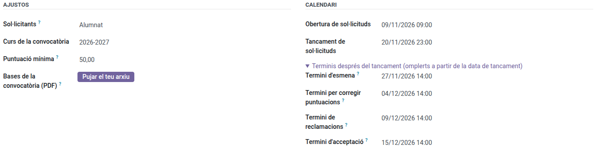
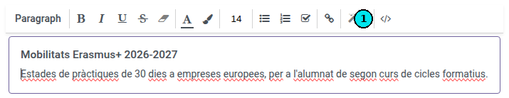
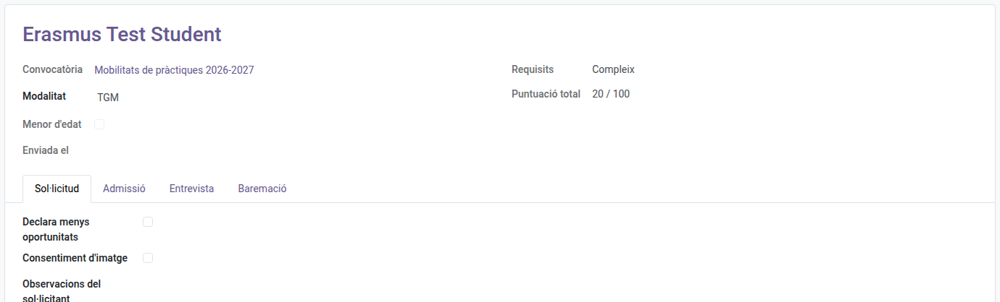

[Català](calls-and-applications.md) | [Castellano](../../es/erasmus/calls-and-applications.md) | [English](../../en/erasmus/calls-and-applications.md)

---

# Convocatòries i sol·licituds Erasmus+

Crea i publica una convocatòria Erasmus+, revisa les sol·licituds que l'alumnat envia des del portal, demana esmenes i admet o exclou cada sol·licitud.

**Rol necessari:** *Coordinador/a Erasmus* o *Tècnic/a de mobilitat Erasmus* (Erasmus+ > Gestor/a).

---

## 1. Crear la convocatòria

Ves a **Erasmus+ > Convocatòries > Convocatòries** i fes clic a **Nou**:

> **Dates i hores:** les llistes i les dates que no es poden editar mostren només el dia. Un termini que pots editar conserva l'hora, perquè és l'hora el que decideix quan s'acaba: *20/11/2026 23:59* tanca al final d'aquell dia. També la conserven la data d'una entrevista, el torn per escollir destinació i el termini per respondre una oferta.

| Camp | Què cal posar-hi |
|---|---|
| Nom | Per exemple, *Pràctiques Erasmus+ 2026-27* |
| Curs | El curs escolar de la convocatòria |
| Convocatòria publicada | El PDF de la convocatòria, que l'alumnat pot descarregar des del portal |
| Obertura / Tancament de sol·licituds | Quan pot sol·licitar l'alumnat. Després de la data de tancament ningú no pot modificar la seva sol·licitud |

La part de dalt de la convocatòria té dos blocs: **Ajustos** (per a qui és, el curs, la puntuació mínima i el PDF de la convocatòria) i **Calendari** (les dates, en l'ordre del procés). L'EMS omple els quatre terminis posteriors al tancament a partir de la data de tancament, a les 14:00, i els mostra plegats a **Terminis després del tancament**: fes-hi clic per veure'ls o canviar-los.

| Termini | Quan el posa l'EMS | Convocatòria 2026-27 (tanca el divendres 20/11) |
|---|---|---|
| Termini d'esmena | 7 dies després del tancament | Divendres 27/11, 14:00 |
| Termini per corregir puntuacions | 14 dies després del tancament | Divendres 04/12, 14:00 |
| Termini de reclamacions | 19 dies després del tancament | Dimecres 09/12, 14:00 |
| Termini d'acceptació | 25 dies després del tancament | Dimarts 15/12, 14:00 |

Un termini que cau en cap de setmana, festiu o vacances escolars passa al següent dia lectiu. Si canvies la data de tancament, els terminis la segueixen, tret dels que hagis canviat a mà. Si les dates no segueixen l'ordre del procés (per exemple, un termini de reclamacions anterior al tancament de sol·licituds), la convocatòria t'avisa a dalt; et deixa desar-la igualment.

> Les respostes als correus que l'EMS envia sense que ningú de l'equip els enviï (acusaments de recepció i recordatoris) arriben a la bústia d'Erasmus+ que hi ha a **Configuració > Gestió de l'EMS > Dades del centre > Erasmus+** (erasmus@elpuig.xeill.net), la mateixa per a totes les convocatòries. L'EMS escriu a l'alumnat a la seva adreça del centre (la del Puig), no a la personal (només hi va la petició de signatura electrònica, vegeu [Preparar les mobilitats](mobility-preparation.md)): qui no en té no rep cap correu d'Erasmus+, i la sol·licitud ho indica al seu historial. La família rep les seves còpies a la seva adreça.

Les pestanyes de la convocatòria estan en dos blocs: **Selecció** (modalitats, documents, informació per a les persones sol·licitants, comissió i resolucions) i **Mobilitat** (destinacions, documents de la mobilitat, carta de compromís, llista de passos i autoavaluació setmanal). El bloc **Mobilitat** només apareix un cop publicada la resolució definitiva: és per a les persones seleccionades, i una convocatòria nova ja porta el que cal, de manera que per obrir una convocatòria només veus **Selecció**. Els botons de dalt segueixen la fase de la convocatòria, la més recent primer: abans de la resolució definitiva, la classificació i les entrevistes (o les valoracions dels plans); després, les mobilitats i les ofertes de plaça; les reclamacions, a partir de la resolució provisional. Un empat per sortejar s'avisa a dalt de tot de la convocatòria.

Pestanya **Modalitats**: una línia per a cada llista de selecció amb places pròpies, per exemple *GM* i *GS*. A **Nivells** tria els nivells de l'alumnat que sol·licita en aquesta modalitat (per exemple *CFGM* per a GM, i *CFGS* i els cursos d'especialització per a GS, perquè aquest alumnat va al projecte d'educació superior). Qualsevol alumne el grup principal del qual sigui d'un d'aquests nivells pot sol·licitar, sigui del curs que sigui. Omple també les places. L'EMS posa el projecte a partir dels nivells (CFGM al KA121-VET; CFGS i els cursos d'especialització al KA131-HED); el projecte concret de cada persona es tria a la seva mobilitat. Les destinacions reals, amb les dates i les places, van a la pestanya **Destinacions** del bloc **Mobilitat**, abans d'obrir l'elecció de destinació.

Pestanya **Documents**: una línia per a cada document que demana la convocatòria, amb el seu **Caràcter**:

- *Obligatori*: la sol·licitud no es pot enviar sense aquest document.
- *Opcional*.
- *Obligatori per a menors d'edat*: només es demana a l'alumnat menor de 18 anys (per exemple, l'autorització familiar).
- *Obligatori si es declaren menys oportunitats*: el portal el mostra just a sota de la casella de menys oportunitats, només quan l'alumne la marca, i llavors és obligatori.

**Es lliura com a**: *Fitxers* (qualsevol), *Només PDF* (el currículum: es rebutgen els altres fitxers) o *Un enllaç* (el vídeo de presentació: l'alumne enganxa l'enllaç de Google Drive en lloc de pujar-lo). Les **Instruccions** i l'**Enllaç de les instruccions** (per exemple, l'editor d'Europass) es mostren a l'alumne amb el document. Una convocatòria d'alumnat nova ja porta el currículum (PDF), el vídeo (enllaç), els certificats de llengües i l'acreditació de menys oportunitats, amb les instruccions. Per sol·licitar no es demana autorització familiar: el justificant de la sol·licitud d'un menor també arriba a la família, i la família accepta la carta de compromís quan s'accepta la plaça, i amb això n'autoritza la participació.

Marca **Confidencial** per als documents que només pot veure l'equip Erasmus, com l'acreditació de menys oportunitats.

**Un sol fitxer** (marcat per defecte): només compta el fitxer més recent que puja l'alumne; els anteriors es conserven i es mostren com a *Versió anterior*, i el justificant només mostra el més recent. Desmarca-ho per a un document amb diversos fitxers, com els certificats de llengües (un per idioma). **Model per descarregar**: un fitxer que l'alumne (i la família d'un menor) descarrega des del portal, emplena i lliura, per exemple l'autorització familiar.

Els documents per defecte, la llista de comprovació i les preguntes ja surten en una convocatòria nova abans de desar-la; si canvies **Sol·licitants**, canvien pels de la convocatòria de personal (o d'alumnat). Aquests textos per defecte (documents, passos, preguntes, carta de compromís) es desen en català, castellà i anglès, sigui qui sigui qui crea la convocatòria: cada alumne, família o docent els llegeix en la seva llengua. Les convocatòries creades abans mantenen els textos com eren.

> **Compte:** quan editis un d'aquests textos, revisa també les altres llengües amb el botó de llengua del camp (per exemple, **CA**). Si no, qui llegeix en castellà o en anglès continuarà veient el text antic.

Pestanya **Informació per als sol·licitants**: el text que es mostra al portal a sobre del formulari. Fes clic dins del text i apareix la barra de l'editor. Per enganxar-hi una fitxa informativa preparada en un altre lloc (per exemple, amb els colors i els requadres del portal), fes servir el botó **`</>`** (vista de codi) del final de la barra (1), enganxa-hi el codi HTML i torna a prémer el botó per tornar a l'editor: la fitxa conserva el disseny. Si l'enganxes directament a l'editor, el perd.

> **Consell:** l'any vinent, obre aquesta convocatòria i fes servir **Duplica**: es copien les modalitats i els documents.

## 2. Publicar-la

A **Accions**, fes clic a **Publica**. La convocatòria apareix al portal de tot l'alumnat que pot sol·licitar-la. Mentre no s'hagi enviat cap sol·licitud, encara pots fer **Torna a esborrany**.

## Avisar qui s'hi pot presentar

Publicar no avisa ningú. Per avisar tothom qui s'hi pot presentar, fes clic a **Accions > Avisa qui s'hi pot presentar**: l'EMS et mostra quantes persones el rebran i l'envia quan fas clic a **Envia l'avís**. És la mateixa regla que el portal: en una convocatòria d'alumnat, l'alumnat dels nivells de les seves modalitats; en una de personal, el professorat dels seus nivells i la direcció que valida les activitats.

- **Convocatòria d'alumnat:** cada alumne rep el seu propi correu, amb les dates de la convocatòria i l'enllaç per sol·licitar-la, a la seva adreça del centre (la del Puig), mai a la personal. Qui no té adreça del centre no el rep: l'assistent et diu quants n'hi ha. La família no el rep.
- **Convocatòria de personal:** no s'envia cap correu a part. L'avís va al proper [resum diari](../teachers/daily-summary.md) de cada persona, a l'hora que ha triat al seu perfil (per defecte, a l'inici de la seva jornada), amb la data de tancament i on presentar la sol·licitud.

El pots enviar abans que s'obri la convocatòria; si el tornes a enviar (per exemple després d'afegir un nivell), tothom el torna a rebre: l'assistent t'ho avisa.

**Recordatori abans del tancament:** a **Recordatori (dies abans del tancament)** (3 per defecte), l'EMS ho recorda a qui es pot presentar i encara no ha enviat la sol·licitud (un esborrany no compta), tants dies abans del tancament i a partir de les 9:00, de la mateixa manera que l'avís. S'envia una sola vegada, i només si l'avís s'ha enviat des de l'EMS. Posa-hi 0 perquè no n'hi hagi. La convocatòria mostra quan s'ha enviat cadascun i a quantes persones.

## 3. Revisar les sol·licituds

Ves a **Erasmus+ > Convocatòries > Sol·licituds**, agrupades per convocatòria, amb la puntuació i la posició de cada sol·licitud quan ja n'hi ha (o al botó **Sol·licituds** de la convocatòria, que les agrupa per modalitat). Filtres: *Per revisar*, *Esmena requerida*, *Admesa*, *Exclosa*. **Documents per revisar** compta els fitxers que esperen la vostra comprovació (un esborrany encara no enviat no compta).

Obre una sol·licitud. A dalt hi ha el que la decideix: els **Requisits**, la **Puntuació total** i la **Posició** (quan ja n'hi ha); el botó **Fitxa de personal** obre la fitxa del docent en una sol·licitud de personal.

- Pestanya **Sol·licitud**: el que ha enviat l'alumne, primer les respostes del formulari i a sota els documents, cada document amb el seu **Estat** (*Per lliurar*, *Pendent de revisió*, *Cal corregir*, *Completa*; en gris, els opcionals i els que no s'apliquen, com l'autorització familiar d'un adult), els seus **Fitxers** (els que compten) i, si és un enllaç, l'**Enllaç** mateix. Es conserven tots els fitxers que ha pujat l'alumne: la columna opcional **Totes les versions** mostra també els anteriors. Marca'ls com a **Vàlid** (✓) o **Cal corregir** (✗), i escriu un **Comentari per al sol·licitant** quan calgui corregir-lo. Un document sense cap fitxer no es pot marcar com a vàlid.
- Mentre la sol·licitud és un esborrany, l'alumne pot treure des del portal un fitxer pujat per error. Un cop enviada, només el treus tu, amb **Treure un fitxer** i el motiu.
- Pestanya **Admissió**:
    - **Requisits**: matriculat en un nivell de la convocatòria i cap pràctica Erasmus+ anterior en aquest cicle (per sol·licitar, un menor no necessita autorització familiar). EMS registra qui ho ha comprovat i quan.
    - **Conducta aquest curs**: les **amonestacions** que l'alumne té a l'EMS durant el curs de la convocatòria. Si en té tantes com les que fan saltar l'avís a convivència (3, l'ajust de l'EMS) o més, es marca **Conducta per revisar** i la fitxa ho avisa a dalt. No l'exclou: escoltats l'equip docent i l'equip de convivència, pots **excloure** la sol·licitud indicant-ne el motiu (article 6 de la convocatòria). Si continua, cada amonestació resta punts (criteri F).
    - **Motiu d'exclusió**, si la sol·licitud queda exclosa. També surt a dalt de la fitxa (*Exclosa: …*) i en una columna de la llista de sol·licituds.

## 4. Demanar esmenes

Quan un document s'ha de corregir o en falta un d'obligatori, marca'l i fes clic a **Accions > Demana l'esmena**. La convocatòria ha de tenir un **Termini d'esmena** encara per arribar: sense aquest termini, EMS no et deixa demanar-la. L'alumne rep un correu amb la llista i aquest termini, i només pot pujar aquests documents. Quan torna a enviar la sol·licitud, aquesta torna a *Enviada*, els fitxers nous queden pendents de revisió i cada membre de l'equip Erasmus rep una tasca per revisar-la (també al seu resum diari de tasques pendents). La tasca es tanca sola en admetre-la, excloure-la o demanar una altra esmena.

## 5. Admetre o excloure

- **Admet**: els requisits han de ser *Compleix* i tots els documents obligatoris, *Vàlid*.
- **Exclou**: primer escriu el motiu d'exclusió. També funciona amb una sol·licitud admesa, per exemple quan l'alumne no es presenta a l'entrevista.
- **Torna a revisió** desfà qualsevol de les dues decisions.

## 6. Tancar la convocatòria

Quan s'acabi el termini de sol·licitud, fes clic a **Accions > Tanca les sol·licituds**. Les sol·licituds que no s'han enviat mai queden com a *No presentada*, i l'EMS desa la mitjana de l'expedient i els avisos de conducta de la resta per a la baremació: vegeu [Baremació i entrevistes](scoring-and-interviews.md).

A partir d'aquí la barra de dalt de la convocatòria i la llista de convocatòries mostren en quina fase és: *Baremació* (fins que es publica la resolució provisional; la llista d'admesos en forma part), *Resolució* (fins a la definitiva), *Ofertes* (mentre alguna oferta de plaça espera resposta) i *Finalitzada*. Si més endavant oferiu una plaça a una persona de reserva, torna a *Ofertes*.

---

[← Tornar als manuals de l'equip Erasmus+](index.md)
