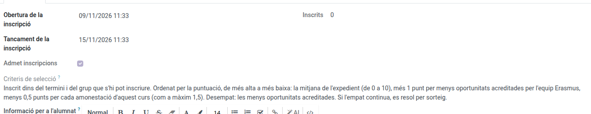

[Català](group-mobilities.md) | [Castellano](../../es/erasmus/group-mobilities.md) | [English](../../en/erasmus/group-mobilities.md)

---

# Mobilitats de grup

Les mobilitats de grup (KA121-VET) són estades d'un grup d'alumnes d'un o més grups del centre, amb dos docents acompanyants, un dels quals és el **docent responsable**. L'alumnat s'hi inscriu des del portal amb un sol clic, l'EMS fa la classificació en tancar la inscripció, el docent responsable prepara la proposta i la coordinació Erasmus l'aprova.

**Rol necessari:** *Coordinador/a Erasmus* o *Tècnic/a de mobilitat Erasmus*. Només la coordinació aprova la selecció, les excepcions i les substitucions.

---

## Crear una mobilitat de grup

1. Ves a **Erasmus+ > Mobilitats > Mobilitats de grup** i fes clic a **Nou**.
2. Omple el nom (p. ex. *SMX2 matí*), el **projecte** KA121-VET, el **torn** (només serveix per trobar els grups) i els **grups que s'hi poden inscriure** (els grups reals del centre, p. ex. SMX2A i SMX2B).
3. Indica les places d'alumnat (8 per defecte), els docents acompanyants (2), el **docent responsable** i l'altre docent acompanyant.
4. A la pestanya **Inscripció**, posa el període d'inscripció, revisa els **criteris de selecció** (es publiquen al portal, en la llengua de cada família: una mobilitat de grup nova els porta, com els seus documents, en català, castellà i anglès) i, si cal, la informació per a l'alumnat (per enganxar-hi una fitxa preparada en un altre lloc, fes servir el botó **`</>`**, com a la informació per als sol·licitants de la convocatòria).

   

5. La destinació, l'entitat d'acollida i les dates poden quedar pendents fins que estiguin confirmades.
6. A **Accions**, fes clic a **Obre la inscripció**.

Els docents no passen per cap convocatòria de personal: en desar-los, ja veuen la mobilitat a **Erasmus+ > La meva participació > Les meves mobilitats de grup**.

## Classificació i selecció

La pestanya **Selecció** comença per la taula de l'alumnat: ordre, nom, grup, la **Mitjana** utilitzada i el resultat proposat i el definitiu. Les altres columnes (mitjana de l'expedient, amonestacions, menys oportunitats, excepció, mitjana introduïda a mà, posició de reserva...) s'afegeixen des del selector de columnes, a l'extrem dret de la capçalera de la taula. Les dates de cada pas, les notes i les llistes publicades són al final de la pestanya.

- Durant la inscripció, la pestanya **Selecció** ja mostra qui s'hi ha inscrit (només ho veu l'equip Erasmus).
- En acabar el període d'inscripció (o amb **Tanca la inscripció ara**), l'EMS congela les dades de cada inscripció: el grup, la **mitjana de l'expedient** (la mateixa fórmula que la convocatòria de pràctiques) i les amonestacions d'aquest curs. Queda exclòs qui no és d'un grup que s'hi pot inscriure. Les amonestacions no exclouen ningú per si soles: amb incidències greus de convivència, la coordinació pot excloure l'alumne amb una **Excepció**, indicant-ne el motiu, escoltats l'equip docent i l'equip de convivència.
- Si un alumne té tantes amonestacions aquest curs com el nombre que porta el cas a l'equip de convivència, o més, la mobilitat mostra un avís i la columna *Conducta per revisar* el marca. És un avís, no una exclusió: ho decideix la coordinació.
- L'ordre és per mitjana i, en cas d'empat, per les menys oportunitats acreditades. Si alguna persona ha declarat menys oportunitats, revisa-ho a la pestanya **Selecció** (columna *Menys oportunitats acreditades*). Si encara hi ha un empat, es resol per **sorteig**: l'EMS l'assenyala i no deixa enviar la proposta fins que el coordinador Erasmus, a **Accions**, fa clic a **Sorteja els empats**. L'EMS ordena a l'atzar només els alumnes empatats. Cada sorteig queda a la pestanya **Selecció**, a **Sortejos**: qui l'ha fet, quan, en què estaven empatats i l'ordre sortejat. Ningú no el pot modificar ni eliminar. Si un altre alumne s'afegeix a un empat ja sortejat (per exemple, en introduir-ne la mitjana), cal tornar a sortejar-lo, i es conserven tots dos sortejos.
- **Alumnes sense notes:** si un alumne que s'hi pot inscriure no té cap mòdul avaluat, l'EMS no li posa un 0: queda fora de la classificació i la mobilitat mostra un avís vermell. No es pot enviar ni aprovar la proposta fins que es resol, a la pestanya **Selecció**: marca *Mitjana introduïda a mà* i escriu la mitjana i *D'on surt la mitjana* (per exemple, de l'expedient acadèmic), o bé el coordinador exclou l'alumne amb una *Excepció* i el seu motiu.
- El docent responsable revisa la classificació i envia la proposta. Si demana una excepció, la coordinació rep una tasca que queda pendent fins que posa l'excepció o aprova la selecció. Rebràs una tasca: publicar les llistes o, a **Accions**, **Retorna la proposta** amb el motiu.
- **Llista provisional:** a la pestanya **Selecció**, posa el *Termini de reclamacions*. Després, a **Accions**, **Publica la llista provisional**: cada alumne rep el seu resultat provisional per correu i pot reclamar des del portal fins a aquest termini. Cada reclamació arriba amb els fitxers, tot l'equip Erasmus rep una tasca per respondre-la, i surt a la pestanya **Selecció** (*Reclamacions*) i a **Erasmus+ > Convocatòries > Reclamacions**: escriu-hi la *Resposta* i fes clic a **Resol**; l'alumne la rep per correu. La llista només mostra quatre xifres del document d'identitat de cada alumne, amb la posició, la mitjana de l'expedient i el resultat (seleccionat, reserva o exclòs). L'EMS no la publica mentre algun alumne no tingui el document d'identitat registrat.
- Per fer una excepció a la classificació (per exemple, després d'acceptar una reclamació), a la pestanya **Selecció** posa l'*Excepció* i el *Motiu de l'excepció* (afegeix les dues columnes des del selector de columnes) abans d'aprovar. Si una reclamació mostra que una mitjana era errònia, corregeix-la amb *Mitjana introduïda a mà* i *D'on surt la mitjana*, també per a un alumne que té notes: la classificació fa servir la columna *Mitjana aplicada*. Un alumne exclòs amb una excepció surt de la classificació i la seva plaça passa al següent. Si, en canvi, selecciones algú amb una excepció, has de passar algú altre a reserva: l'EMS no deixa aprovar més seleccionats que places, i la mobilitat t'avisa mentre n'hi hagi més.
- **Llista definitiva:** a **Accions**, **Aprova i publica la selecció** publica la llista definitiva, envia a cada alumne el seu resultat per correu i obre els expedients. No es pot fer fins que la llista provisional està publicada, el seu termini de reclamacions ha acabat i totes les reclamacions estan respostes. Totes dues llistes queden a la pestanya **Selecció** (*Llistes publicades*), al portal de l'alumnat que s'hi va inscriure, en PDF i a l'exportació dels documents.

## Renúncies i substitucions

Si un alumne seleccionat renuncia (des del portal, o dient-ho al docent responsable o a tu, que ho registreu amb el botó **Renuncia** de la seva inscripció a la pestanya **Selecció**, amb el motiu), la plaça queda lliure i la mobilitat mostra la reserva següent. El docent responsable la proposa i tu l'aproves o la rebutges a la pestanya **Selecció**; si la rebutges, el docent responsable rep una tasca per tornar a proposar un substitut. Si aquesta reserva no vol la plaça, registra-ho de la mateixa manera, amb **Renuncia** a la seva inscripció: surt de la llista de reserva i la mobilitat mostra la següent. La classificació fixada no canvia i els documents ja lliurats es conserven.

## Expedients i documents

En aprovar la selecció s'obre l'expedient de cada alumne seleccionat i dels dos docents. A la pestanya **Documents** hi ha els **documents compartits** del grup (l'acord d'aprenentatge del grup, previst i executat; acords, viatge, la pòlissa d'assegurança col·lectiva, inclusió —confidencial—, Green Travel i evidències) i la llista dels **documents demanats**, que pots adaptar a cada mobilitat: per a qui és cada document (el grup, cada alumne, cada docent o tothom), si és obligatori o només per a menors, qui el signa i el termini. Si canvies la llista, fes clic a **Actualitza els documents**.

Un document complet ofereix **Reobrir** en lloc de **Cal corregir**: fa el mateix, el torna perquè es corregeixi.

Cada document té una **categoria de l'expedient** (01 Dades i autoritzacions, 02 Abans de la mobilitat, 03 Durant la mobilitat, 04 Després de la mobilitat), igual que a les mobilitats individuals, i un **estat**: falta, pendent de revisió, cal corregir, complet, opcional o no aplicable. Un document que algú ha de signar (per exemple l'acord d'aprenentatge del grup, que signen la coordinació i l'entitat d'acollida) **no queda complet només per haver-lo pujat**, encara que el pugi l'equip: cal revisar-ne les signatures i marcar-lo com a **Vàlid**. Els documents que l'equip proporciona i que no signa ningú (per exemple la pòlissa d'assegurança) queden complets en pujar-los.

Tots els documents Erasmus+ es preparen fora de l'EMS: l'EMS en guarda els fitxers, les signatures, la revisió i l'expedient. Un document amb **plantilla de signatura** es pot enviar a signar electrònicament des de l'EMS, com a les mobilitats individuals (vegeu [Preparar les mobilitats](mobility-preparation.md)). Per defecte, una mobilitat de grup demana:

- **Acord d'aprenentatge del grup**, en dues versions signades pels dos centres (la coordinació i l'entitat d'acollida). La **prevista**, abans de marxar: objectius, resultats d'aprenentatge, calendari, activitats i participants. L'**executada**, després de l'estada: les dates reals, les activitats fetes, les metodologies i la llista definitiva de participants (alumnes i docents acompanyants de tots els centres). Si no ha canviat res, ratifica la prevista amb les dates i els participants reals. No hi ha acord d'aprenentatge individual ni una llista de participants a part.
- **Pòlissa d'assegurança** de cada alumne i de cada docent acompanyant. Si una **pòlissa col·lectiva** cobreix tots els participants o una part, puja-la a la *Pòlissa d'assegurança col·lectiva* del grup i marca *Cobert per la pòlissa col·lectiva* a cada participant que cobreixi (fitxa del participant): ja no se li demana la seva.
- **Conveni de subvenció** de cada participant: l'equip el prepara fora de l'EMS (amb els serveis que paga el centre, si n'hi ha) i el puja perquè el signin. Per pujar-los tots des d'una sola pantalla, fes servir el botó **Documents pendents** de la mobilitat: els documents de tots els participants en una llista, agrupats per document.
- **Green Travel: declaració jurada i evidències**, opcional: només quan es declara Green Travel.
- **Documentació d'inclusió del grup**, opcional i confidencial: l'acreditació de les menys oportunitats i, quan hi ha costos reals d'inclusió, per què calia l'ajuda. Les seves factures van a la pestanya **Despeses col·lectives**.
- **Document de mobilitat Europass** (alumnes) i **Certificat d'estada** (docents): opcionals, mai no impedeixen tancar la mobilitat.
- Els **drets d'imatge** no es tornen a demanar: la columna *Drets d'imatge* de la pestanya **Participants** (selector de columnes) mostra l'autorització del curs de cada alumne, la mateixa que ja fa servir l'EMS. La **targeta sanitària europea** és confidencial, com a les convocatòries: només la veu l'equip Erasmus. Els fitxers d'un document vàlid o d'una mobilitat tancada no es poden eliminar (se'n puja una versió nova), i cada revisió queda escrita al xat de la mobilitat.

La pestanya **Participants** mostra el rol, el nom, el grup, si és menor d'edat, els **Docs. pendents**, si està **A punt** per marxar i l'estat de cada persona; qui s'ha retirat surt en gris, sense res en vermell. El correu, el telèfon, els drets d'imatge, l'assegurança col·lectiva i les cartes de compromís són al selector de columnes.

## Carta de compromís

Cada alumne seleccionat accepta la **carta de compromís** de la mobilitat al portal i, si és menor d'edat, també la família, des del seu portal (l'EMS avisa la família per correu quan s'obre l'expedient). És el mateix procediment que a les pràctiques: la persona marca que l'accepta i l'EMS guarda qui l'ha acceptada, quan i des d'on, juntament amb el text exacte acceptat. La carta és comuna a totes les mobilitats de grup i l'EMS l'omple amb les dades de cadascuna (destinació, entitat d'acollida i dates quan estan confirmades; mentrestant indica que s'han de confirmar). Inclou l'autorització per participar-hi, la participació en el programa, les normes de convivència del centre i les instruccions dels docents, les mesures davant d'incompliments greus segons les normes i protocols del centre, i la comunicació amb el centre.

Per afegir-hi condicions pròpies, escriu-les a *Condicions addicionals* (pestanya **Participants**). Una carta ja acceptada conserva el text amb què es va acceptar. Si després canvien la destinació, l'entitat d'acollida, les dates, els viatges, els docents o les condicions addicionals, l'acceptació anterior es guarda tal com era (a l'expedient del participant, a *Versions anteriors*) i l'alumne i, si és menor, la família han d'acceptar la carta nova; la família en rep un correu. Una carta acceptada mentre la destinació o les dates encara s'han de confirmar és **provisional** i no permet marxar. La mobilitat mostra quantes cartes queden pendents, i un participant no està preparat per marxar fins que no s'accepta la seva. La carta **no substitueix** l'autorització oficial de viatge a l'estranger per a menors: aquesta continua sent un document de l'expedient de cada menor.

## Exportar els documents

A **Accions**, **Exporta els documents** descarrega un ZIP amb els documents comuns del grup una sola vegada (carpeta *00_Documentacio_comuna*: documents compartits, la classificació i els sortejos, el seguiment i l'EU Survey) i l'expedient de cada participant en les quatre categories, amb un índex del que falta i les empremtes SHA-256 de cada fitxer. L'expedient de cada participant remet als documents compartits, sense copiar-los. Les dades confidencials (targeta sanitària, inclusió, menys oportunitats i amonestacions) només hi surten en una **exportació d'auditoria**, que només pot demanar la coordinació Erasmus indicant-ne el motiu. L'exportació del projecte també inclou totes les mobilitats de grup.

## Full de càlcul de participants

A **Accions**, **Exporta els participants (Excel)** descarrega els alumnes seleccionats i els docents acompanyants amb el mateix full de càlcul que les convocatòries (les mateixes columnes). Els docents tenen buides les columnes de cicle, curs i tutor legal; les columnes bancàries són buides per a tothom: el compte que cada participant indica per als diners de butxaca és als pagaments de beques.

## Estada, EU Survey i tancament

Abans de marxar, la mobilitat mostra qui encara no està a punt (falta un document obligatori o la carta de compromís), i **Comença l'estada** demana confirmació. El docent responsable indica quan comença l'estada i quan tornen. Aleshores l'EMS crea la tasca de l'**EU Survey** per al docent responsable (o la persona indicada) amb el termini. Quan diu que està resposta, la valides. Les despeses del grup (vols, allotjament...) es registren com a factures a la pestanya **Despeses col·lectives** (vegeu *Beques i diners de butxaca* més avall). En tornar, el docent responsable també rep la tasca de dir si **el programa s'ha fet tal com estava previst** (pestanya **Retorn i tancament**): sí, o no i què ha canviat. Sense aquesta resposta no es pot proposar ni fer el tancament. Quan el docent responsable proposa el tancament, tots els documents obligatoris són vàlids (entre ells, l'acord d'aprenentatge del grup executat) i els diners de butxaca de cada participant i totes les factures col·lectives estan pagats, fes clic a **Tanca la mobilitat**.

## Beques i diners de butxaca

A la pestanya **Despeses col·lectives** introduïu la **beca** de cada participant (alumnes i docents acompanyants), tal com la calcula el Beneficiary Module. El centre acostuma a pagar els vols i l'allotjament de tot el grup: registreu-los com a **factures col·lectives**. L'EMS reparteix cada factura col·lectiva **a parts iguals entre els participants que hi van** i mostra, per a cadascun, la seva part i els seus **diners de butxaca**: la seva beca menys la seva part. És el que la Secretaria els transfereix. Una factura és o bé del grup o bé d'uns participants concrets, mai de totes dues coses, perquè comptaria dues vegades: l'EMS no us deixa desar-la si ompliu totes dues.

*Exemple:* 8 alumnes amb una beca de 1.200 € i 2 docents amb 1.500 €. Els vols costen 2.000 € i l'hotel 5.000 €: 700 € per persona. Cada alumne rep 500 € i cada docent 800 €.

- **Diners de butxaca abans de marxar (%)**: 100 per defecte, un sol pagament. Amb un percentatge menor, aquesta part es paga abans de marxar i la resta en tornar.
- **El centre no paga res directament**: marqueu-ho quan el centre no paga ni vols ni hotel; cada participant rep aleshores tota la seva beca. Un grup amb aquesta opció no pot tenir factures col·lectives (l'EMS ho impedeix, i no es pot marcar mentre el grup en tingui).
- Un cop aprovada la selecció, a **Accions**, **Demana els diners de butxaca** crea un pagament per a cada participant que tingui res a rebre. La Secretaria rep **una sola tasca per a tot el grup** i els paga des de **Gestió econòmica > Pagaments de beques**, tots alhora amb un sol justificant. Amb un percentatge inferior a 100, en tornar feu servir **Demana la resta dels diners de butxaca** per a la resta.
- Cada participant necessita un **compte bancari**: els alumnes l'indiquen al portal (si no ho fan, s'usa el de la seva matrícula), els docents amb **El meu compte bancari** a la mobilitat de grup, i també podeu escriure'l a la seva fitxa. Si algú no en té, l'EMS el nomena i no demana res.
- Si un participant es dona de baixa després d'haver cobrat, l'economia del projecte mostra un avís: registreu el que retorna a *Retornat pel participant* del grup. També surt un avís si les factures col·lectives superen la beca d'algú.

El docent responsable també veu aquesta pestanya (les factures, les beques, els diners de butxaca i si està pagat), però mai els comptes bancaris.

La vista kanban i la llista de **Mobilitats de grup** mostren l'estat de totes: inscrits, seleccionats, documents que falten o per revisar, empats i tasques endarrerides.
