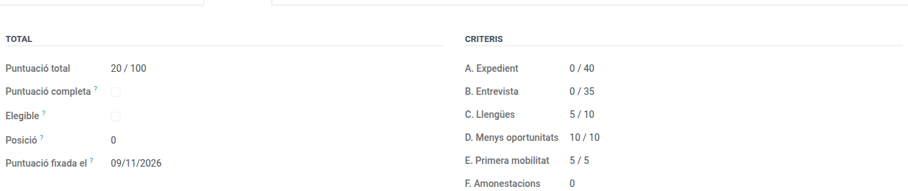
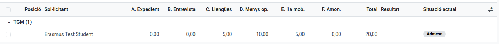

[Català](scoring-and-interviews.md) | [Castellano](../../es/erasmus/scoring-and-interviews.md) | [English](../../en/erasmus/scoring-and-interviews.md)

---

# Baremació i entrevistes Erasmus+

Puntua les sol·licituds admeses amb els criteris de l'article 12 de la convocatòria, organitza les entrevistes amb dues persones avaluadores i obtén la classificació de cada modalitat.

**Rol necessari:** *Coordinador/a Erasmus* o *Tècnic/a de mobilitat Erasmus* (Erasmus+ > Gestor/a).

---

## 1. Tancar la convocatòria: l'EMS congela les dades

Quan s'acabi el termini de sol·licitud, fes clic a **Accions > Tanca les sol·licituds** a la convocatòria. En aquell moment, l'EMS desa per a cada sol·licitud presentada:

- **A. Mitjana de l'expedient:** tots els mòduls del cicle que cursa l'alumne, de tots els seus cursos. Els cursos anteriors compten amb la nota final; els mòduls d'aquest curs, amb la nota provisional dels resultats d'aprenentatge avaluats fins al moment. Un mòdul repetit compta una sola vegada, amb la nota més recent. Els mòduls convalidats i els que encara no tenen res avaluat queden fora. La mitjana es pondera per les hores de cada mòdul.
- **F. Amonestacions:** els avisos de l'alumne en aquest cicle fins a la data de tancament. L'EMS només té els avisos registrats des que es fa servir.

Els canvis posteriors de notes o d'avisos no modifiquen aquests valors. Els veuràs a la pestanya **Baremació** de cada sol·licitud, amb la llista de mòduls utilitzats.

Cada criteri mostra els punts sobre el màxim (*36 / 40*), i la data és a **Puntuació fixada el**.

> **Consell:** tanca la convocatòria just després de la data de tancament, perquè les dades siguin les que tenia l'EMS aquell dia.

Un alumne que s'ha incorporat al centre aquest curs només té els mòduls d'aquest curs: la seva mitjana és la nota provisional dels resultats d'aprenentatge que ja tenen nota. Si un alumne no té cap resultat d'aprenentatge amb nota, la mitjana queda *pendent* i la sol·licitud no té la puntuació completa.

## 2. Omplir els criteris que comprova l'equip

A la pestanya **Baremació** de cada sol·licitud admesa:

| Criteri | Camp | Punts |
|---|---|---|
| C. Llengües | **Certificat de llengua**: el nivell més alt que ha aportat l'alumne | B1 2,5; B2 5; C1 7,5; C2 10 |
| D. Menys oportunitats | **Menys oportunitats acreditades** (només el veu l'equip Erasmus) | 10 o 0 |
| E. Primera mobilitat | **Primera mobilitat** | 5 o 0 |

A l'alumnat no se li pregunta per la **Primera mobilitat**: la marqueu vosaltres. Sota els criteris, la sol·licitud mostra les **Participacions Erasmus+ a l'EMS** de l'alumne, si en té. Només coneix les mobilitats gestionades amb l'EMS, a partir de la convocatòria 2026-2027: per als anys anteriors, consulteu els vostres registres.

Tots els criteris comencen buits. **Un criteri buit no és mai un zero:** la sol·licitud queda sense puntuació completa i fora de la classificació fins que s'omple. L'EMS registra qui ha omplert cada criteri i quan.

## 3. Organitzar les entrevistes

**Moltes alhora:** a la convocatòria, fes clic a **Accions > Programa les entrevistes**. Tria la modalitat (o cap, per a totes), la **Primera entrevista**, els **Minuts per entrevista**, el **Lloc** i les **Persones avaluadores**. L'EMS proposa les persones admeses que encara no tenen data d'entrevista, per modalitat i nom: treu o reordena qui calgui. **Programa** dona a cadascuna la franja següent, li assigna les persones avaluadores i, amb **Envia les convocatòries d'entrevista** marcat, envia per correu a cada persona la data i el lloc (com a mínim 24 hores abans). Cada persona avaluadora rep una tasca per entrevista, que queda feta quan n'envia la puntuació, i tota la llista (dia i hora, lloc i candidat) al seu pròxim resum diari, no un correu per entrevista.

**Una per una**, a la pestanya **Entrevista** de cada sol·licitud admesa:

1. Omple la **Data de l'entrevista** i el **Lloc de l'entrevista**.
2. A la llista, afegeix les **dues persones avaluadores** (qualsevol membre del personal). Cadascuna rep una tasca a l'EMS i veu l'entrevista a **Erasmus+ > La meva participació > Entrevistes per puntuar**. Només veuen la seva entrevista: ni la puntuació de l'altra persona avaluadora ni la resta de la sol·licitud.
3. Fes clic a **Accions > Enviar la convocatòria a l'entrevista**. L'alumne rep un correu amb la data i el lloc. S'ha d'enviar com a mínim 24 hores abans de l'entrevista.

Cada persona avaluadora puntua els 7 criteris de la rúbrica (annex 4) de 0 a 5, amb els descriptors escrits al formulari, i l'envia. La puntuació de l'entrevista és la mitjana de les dues. Si per una causa justificada només l'ha pogut valorar una persona, escriu-ho a **Motiu d'una sola valoració**.

A la convocatòria, el **Termini per corregir puntuacions** fixa fins quan les persones avaluadores poden reobrir i canviar la seva valoració. Després, només l'equip Erasmus pot reobrir una entrevista, des del botó **Entrevistes** de la convocatòria, escrivint una **Nota de rectificació**.

Si un alumne no es presenta a l'entrevista, escriu-ne el motiu i fes clic a **Accions > Exclou**.

## 4. La classificació

Fes clic a **Classificació** a la convocatòria: les sol·licituds admeses, agrupades per modalitat i per ordre, amb la puntuació de cada criteri. **Erasmus+ > Convocatòries > Classificació** mostra totes les convocatòries agrupades, només amb el que tenen totes: posició, sol·licitant, total, resultat i situació actual.

 **Resultat** marca el tall: en verd les sol·licituds que entren a les places de la modalitat (*Seleccionada*) i, després, les de *Reserva*.

- Una modalitat només es classifica quan **totes** les seves sol·licituds admeses tenen la puntuació completa. Fins llavors la posició és 0.
- Els empats es desfan, per aquest ordre, amb menys oportunitats, primera mobilitat, la part en anglès de l'entrevista i la mitjana de l'expedient.
- Si dues sol·licituds continuen empatades, queden marcades amb **Cal un sorteig**. La coordinació Erasmus fa clic a **Accions > Sorteja els empats** a la convocatòria (pestanya Resolucions): l'EMS ordena a l'atzar cada grup empatat i en guarda el sorteig (qui, quan, les sol·licituds empatades i l'ordre sortit), que ningú no pot canviar. L'ordre queda a **Sorteig** (el número més baix va primer). Si una correcció (per exemple, una reclamació acceptada) fa que algú empati amb sol·licituds ja sortejades, tornen a quedar marcades amb **Cal un sorteig** i es torna a sortejar tot l'empat; es conserven tots dos sortejos.
- Les sol·licituds per sota de la **Puntuació mínima** de la convocatòria (50 per defecte) surten en vermell: no són elegibles.

---

[← Tornar als manuals de l'equip Erasmus+](index.md)
