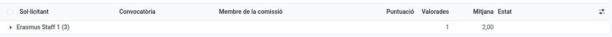
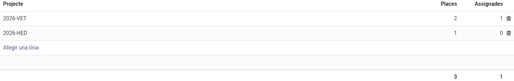

[Català](staff-call.md) | [Castellano](../../es/erasmus/staff-call.md) | [English](../../en/erasmus/staff-call.md)

---

# La convocatòria Erasmus+ del personal

Gestiona la convocatòria per al personal de formació professional (job shadowing, cursos estructurats i estades de docència): el personal sol·licita des de l'EMS (**Erasmus+ > La meva participació**), la comissió valora els plans de mobilitat, i tu revises la resta, publiques les resolucions i ofereixes les places.

**Rol necessari:** *Coordinador/a Erasmus* o *Tècnic/a de mobilitat Erasmus* (Erasmus+ > Gestor/a).

La convocatòria del personal funciona com la de l'alumnat (vegeu [Convocatòries i sol·licituds](calls-and-applications.md) i [Resolucions, reclamacions i ofertes de plaça](resolutions-and-offers.md)). Aquest manual només explica el que és diferent.

---

## 1. Obrir la convocatòria

A **Erasmus+ > Convocatòries > Convocatòries**, crea la convocatòria, posa *Personal* a **Sol·licitants**, omple les dates, adjunta la convocatòria publicada i publica-la. Res més:

- Els **documents** de l'article 8 s'afegeixen sols: només els certificats de llengües, opcionals (cap currículum; el document d'identitat es demana a qui hi va, amb els documents de la mobilitat). El **pla de mobilitat i transferència** no és un document: les persones sol·licitants l'escriuen al formulari (annex 1), i és l'única part de la sol·licitud que veu la comissió. Els pots canviar abans de publicar.
- No hi ha **Puntuació mínima**: la convocatòria del personal no en té, així que l'EMS la posa a 0 i l'amaga.
- El **Termini de valoració de la comissió** s'omple a partir de la data de tancament, com a la convocatòria d'alumnat (14 dies després, a les 14:00, en un dia lectiu): aquell dia vencen les tasques de la comissió, i després els membres ja no poden canviar les seves valoracions. Si canvies la data de tancament, el termini la segueix, tret que l'hagis canviat a mà. Els altres terminis s'omplen igual.
- Per obrir la convocatòria només calen els ajustos i el calendari: **Poden sol·licitar** i **Valida les activitats** ja venen omplerts. La pestanya **Documents** no apareix (l'únic document que es demana és el formulari, i els certificats d'idiomes ja hi són), la pestanya **Comissió** apareix quan la convocatòria és tancada i el bloc **Mobilitat** quan es publica la resolució definitiva.
- **Poden sol·licitar:** els nivells del professorat que pot sol·licitar. Una convocatòria del personal nova té tots els nivells de formació professional (cicles de grau bàsic, mitjà i superior, cursos d'especialització i PFI). L'EMS només mostra la convocatòria al professorat que fa classe en algun grup d'aquests nivells i a les persones de **Valida les activitats**: ni al personal d'administració ni al professorat que només fa classe a l'ESO o al batxillerat.
- **Valida les activitats:** la direcció que valida l'activitat de cada persona seleccionada i els canvis posteriors. Ve omplert amb la directora o el director i el cap d'estudis d'FP (el que hi ha per sobre de la majoria del professorat d'FP), i només ells reben la tasca, encara que un professor depengui d'un altre cap d'estudis a l'organigrama.
- Per obrir-la no cal indicar les **places**: la convocatòria publicada ja dona les orientatives, i poden canviar segons els projectes. Les afegeixes més endavant (pas 5); si la publiques sense places, EMS t'ho avisa perquè no te n'oblidis.

Un cop publicada, tot el personal amb fitxa d'empleat veu la convocatòria a l'EMS, a **Erasmus+ > La meva participació > Convocatòries de personal**. Per avisar-los a tots, fes servir **Accions > Avisa qui s'hi pot presentar**: ho reben al seu resum diari, no en un correu a part (vegeu [Convocatòries i sol·licituds](calls-and-applications.md)).

## 2. Què omple el personal

A més de les seves dues propostes (A, la principal, i B, la de reserva) i de què vol aprendre i com ho aplicarà, escrits amb les seves paraules, cada persona sol·licitant declara:

- Si **no ha fet mai cap mobilitat Erasmus+ de personal al Puig**. Si no, poseu vosaltres quan va ser l'última (**Correcció**, criteri 2) amb els registres del centre. Els acompanyaments d'alumnat i altres programes no compten.
- El **mes i l'any des que treballa al centre** de manera continuada.
- El seu **certificat de llengua** més alt (B2 o superior), que també adjunta.
- Els **projectes del centre** en què participa i, opcionalment, les seves **necessitats de suport** (confidencials: només les veu l'equip Erasmus).

No pot enviar la sol·licitud sense la data d'incorporació al centre, les dues propostes i el pla.

## 3. Revisar, admetre i enviar els plans a la comissió

Revisa els documents i admet o exclou com a la convocatòria de l'alumnat (les amonestacions no hi compten).

Després de **Tanca les sol·licituds**, omple la pestanya **Comissió** de la convocatòria: les persones que valoren els plans de mobilitat (la direcció i els caps de departament i de seminari). Després fes clic a **Accions > Envia els plans a la comissió**. Cada membre rep una tasca per valorar tots els plans des d'**Erasmus+ > La meva participació > Plans per valorar**, que venç el **Termini de valoració de la comissió** (el botó te'l demana si és buit; si el canvies després, les tasques obertes el segueixen). Hi pots tornar a fer clic després d'admetre més sol·licituds: només crea les valoracions que falten. El botó només surt fins que es publica la resolució provisional, que fixa les puntuacions.

**Erasmus+ > Convocatòries > Valoracions del pla de mobilitat** s'obre amb una fila per sol·licitant: quants han valorat i la mitjana del pla. Fes clic en una fila per veure la valoració de cada membre.

**Abstencions:** un membre de la comissió que es presenta a la convocatòria no valora (art. 10): les seves valoracions es creen com a abstencions, amb el motiu *Candidat en aquesta convocatòria*. Per a un altre conflicte d'interessos, obre la valoració des del botó **Valoracions de plans** de la convocatòria i escriu el **Motiu de l'abstenció**. No hi ha persones substitutes: la puntuació del pla (criteri 1) és la mitjana dels membres que el valoren. **Una valoració pendent la bloqueja** fins que s'envia. A **Valoracions de plans**, una abstenció surt com a *Abstenció*, i la vista de taula dinàmica (persones candidates × estat) mostra d'un cop d'ull quins plans encara tenen valoracions per enviar.

**La direcció no veu els punts mentre la comissió valora:** el cap d'estudis i la directora poden obrir les sol·licituds del personal, però fins que no s'han valorat tots els plans de la convocatòria en veuen la puntuació del pla, els criteris i el total a 0, també si són a la comissió. Així cap membre no veu la mitjana dels altres abans de valorar. Quan s'envia l'última valoració, ho veuen tot.

## 4. Revisar la resta de criteris

A la pestanya **Baremació** de la sol·licitud, l'EMS mostra el que ha declarat la persona i els punts que li corresponen. Només ho corregeixes si no és correcte:

| Criteri | Surt de | Es corregeix a | Punts |
|---|---|---|---|
| 1. Pla de mobilitat | La mitjana de la comissió | - | Fins a 2 |
| 2. Última mobilitat de personal | **Última mobilitat de personal declarada** (el curs del mes indicat) | **Correcció** | Mai o fa més de dos cursos 1,5; fa dos cursos 0,5; el curs passat o l'actual 0 |
| 3. Projectes del centre | Els **Mèrits** que registres: cada col·laboració 0,5, cada coordinació 1 | - | Fins a 1,5 |
| 4. Llengües | **Certificat de llengua declarat** | **Correcció** | B2 1; C1 1,5; C2 2 |
| 5. Antiguitat | **Antiguitat declarada** (a la data de tancament) | **Correcció** | Menys d'1 any 0; d'1 a 2 anys 1; de 2 a 5 anys 1,5; 5 anys o més 2 |
| 6. Internacionalització | Els **Mèrits** que registres: cada activitat 0,5 | - | Fins a 1 |

Cada camp **Correcció** diu *Correcte, com ha declarat* mentre és buit: deixa'l així quan el que ha declarat la persona és correcte, i tria un valor només quan no ho és. Cada criteri mostra els punts sobre el màxim (*1,5 / 2*). La taula **Valoracions de la comissió** mostra què ha donat al pla cada membre.

Registra cada mèrit amb la seva justificació, a partir del que la persona ha escrit a projectes del centre. Marca **Mèrits revisats** quan tots els mèrits estiguin registrats, també si no n'hi ha cap: fins llavors la puntuació no és completa.

## 5. Places, classificació i resolucions

Una convocatòria del personal no té modalitats: el professorat competeix en una sola llista i només veu el total de places de la convocatòria. A la pestanya **Selecció**, **Places per projecte** és la vostra planificació: una línia per cada projecte actiu que paga places, amb les seves places (per exemple, 6 a *2025-VET*, 2 a *2026-VET* i 2 a *2026-HED*). Les places de la convocatòria en són la suma; la columna **Assignades** compta les mobilitats que ja són a cada projecte. Omple-la abans de preparar la resolució provisional. Aquesta taula només la veu l'equip Erasmus+.

El personal es classifica **en una sola llista** per a tota la convocatòria (botó **Classificació** de la convocatòria). Les columnes dels criteris porten un nom curt (*1. Pla*, *2. Última mob.*, *3. Projectes*, *4. Llengües*, *5. Antiguitat*, *6. Internac.*); en passar-hi el ratolí en veus el nom sencer. Les llistes de les resolucions del personal no tenen columna de modalitat. Els empats es desfan per la puntuació del pla de mobilitat, després per qui fa més temps que és al centre (el mes i l'any d'incorporació declarats al formulari, no els punts del criteri 5: qui s'hi va incorporar el 2000 va abans que qui s'hi va incorporar fa sis anys, encara que tots dos tinguin 2 punts) i, finalment, pel sorteig que fa la coordinació Erasmus des de la convocatòria (**Sorteja els empats**).

Les resolucions es publiquen com a la convocatòria de l'alumnat: les llistes només mostren quatre xifres del document d'identitat, mai noms. Per al personal es treu de la seva **fitxa d'empleat** (DNI o NIE; si no, el passaport); si algú no en té, demana a la secretaria que l'afegeixi. EMS ja t'ho avisa quan n'admets la sol·licitud, i les llistes no es poden preparar fins que hi sigui. Si la puntuació d'algú no és completa quan prepares una resolució, EMS diu què falta a cada persona (per exemple, *Mèrits revisats* o *Antiguitat al centre*).

Són seleccionades les persones que entren dins de les places de la convocatòria (la suma de les places per projecte); cada persona obté com a màxim una plaça. Quan una persona accepta, tria el **Projecte** a la seva mobilitat: l'EMS només ofereix els projectes de la taula de la convocatòria i, al costat, mostra quantes places en queden (per exemple, *2026-VET: queden 1 de 2 places*). Pots triar un projecte sense places lliures, però la mobilitat mostra un avís fins que hi afegeixis una plaça o en triïs un altre. El projecte porta els documents del seu tipus (KA121-VET o KA131-HED). El professorat no veu mai quin projecte paga la seva mobilitat. Mentre una plaça acceptada no té projecte, la convocatòria t'ho avisa (*N places acceptades sense projecte*), i les **Sol·licituds** de la convocatòria mostren el **Projecte** de cada persona.

## 6. Ofertes i full de càlcul

Les persones seleccionades responen l'oferta des de la seva sol·licitud a l'EMS (**Accions > Accepta la plaça** o **Renuncia a la plaça**). Una plaça lliure s'ofereix a la següent persona de reserva de tota la convocatòria (**Accions > Ofereix una plaça lliure**, sense triar modalitat).

**Exporta a full de càlcul** treu les dades del personal de la seva fitxa d'empleat. Les columnes del cicle, el curs i el tutor legal queden buides.

---

[← Tornar als manuals de l'equip Erasmus+](index.md)
