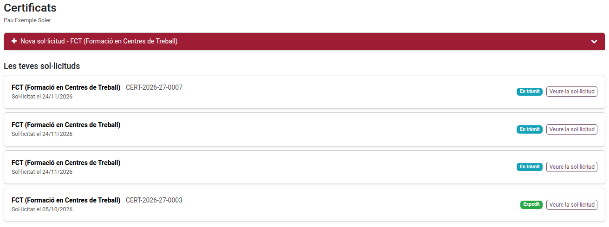
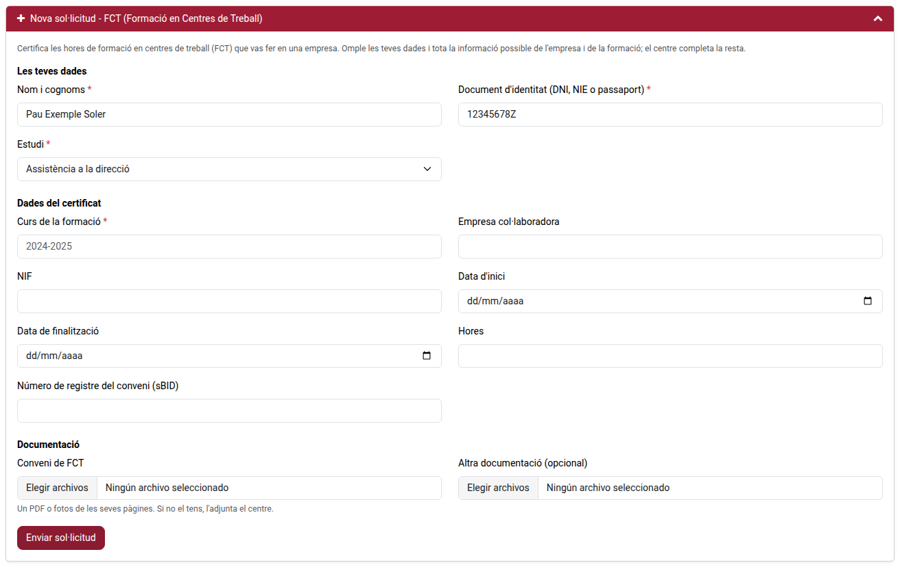
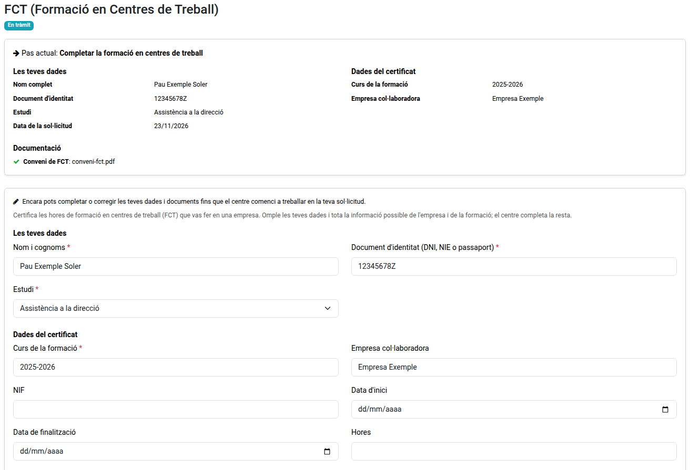

[Català](manual-certificats.md) | [Castellano](../../es/families/manual-certificats.md) | [English](../../en/families/manual-certificats.md)

---

# Sol·licitar un certificat

Demana al centre un certificat (per exemple, el de les hores de formació en centres de treball, FCT), segueix-ne la tramitació i descarrega'l quan estigui expedit.

Al portal, els certificats de FCT els pot demanar l'alumnat de cicles formatius (CFGM i CFGS) o la seva família.

---

## Demanar un certificat des del portal

1. Entra al portal i fes clic a la targeta **Certificats**.
2. Fes clic a **Nova sol·licitud** seguit del certificat que necessites (per exemple, **Nova sol·licitud - FCT (Formació en Centres de Treball)**) per desplegar-ne el formulari. Cada certificat té el seu formulari.
3. Comprova **Les teves dades**.
4. A **Dades del certificat**, emplena el que demana el certificat. Les que tenen asterisc són obligatòries; la resta, emplena-les tant com puguis i el centre les completa. Per a la FCT: el **Curs acadèmic** (en pots triar un de la llista o escriure'l amb el format 2024-25) i, si els tens, l'empresa i el NIF, les dates, les hores i el número de registre del conveni.
5. A **Documentació**, adjunta el **Conveni de FCT** si en tens una còpia (un PDF o fotos de les pàgines). Si no el tens, l'adjunta el centre. També pots afegir **Altra documentació**.
6. Fes clic a **Enviar sol·licitud**.

---

## Seguir la sol·licitud

A **Les teves sol·licituds**, fes clic a **Veure la sol·licitud** per consultar:

- l'estat i el **Pas actual**;
- les teves dades i les del certificat, incloses les que hi afegeix el centre;
- la documentació adjunta.

Fins que el centre comenci a treballar en la sol·licitud, encara pots completar o corregir les teves dades i documents des d'aquesta mateixa pàgina, amb **Desar els canvis**.

Si el centre necessita més informació, rebràs un correu: fes clic a **Respondre al centre**, escriu la resposta, adjunta el que et demanin i envia-ho.

Mentre no s'hagi expedit, pots anul·lar la sol·licitud amb **Anul·la la sol·licitud**.

---

## Rebre el certificat

Quan el certificat està expedit, el reps per correu en PDF i també el pots descarregar amb **Descarregar el certificat** des de la sol·licitud. En alguns casos el centre no t'envia un certificat sinó un **document acreditatiu**, que fa constar el mateix; el descarregues amb **Descarregar el document acreditatiu**.

---

## Si ja no ets alumne del centre

Demana el certificat a secretaria. Rebràs un correu amb un enllaç al formulari: obre'l (no cal iniciar sessió), omple les teves dades, adjunta el conveni si en tens una còpia i envia-ho. Amb el mateix enllaç podràs seguir la sol·licitud, respondre al centre i descarregar el certificat.
