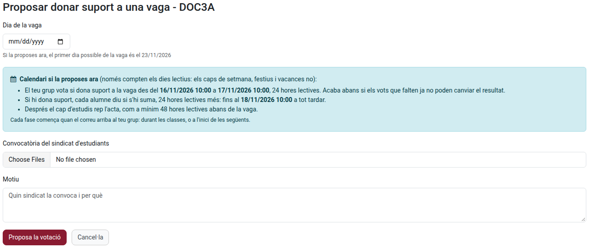
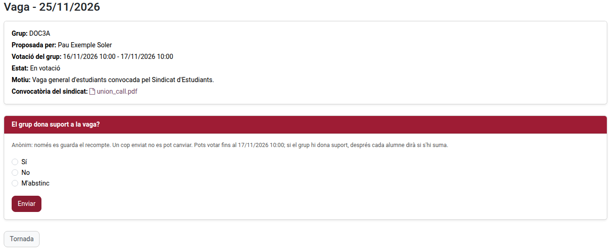
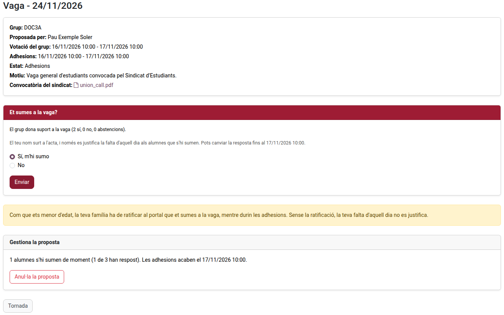
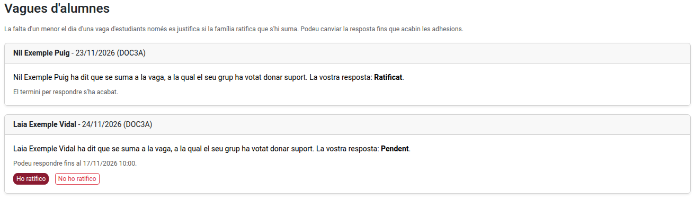

[Català](manual-vagues.md) | [Castellano](../../es/families/manual-vagues.md) | [English](../../en/families/manual-vagues.md)

---

# Vagues d'estudiants

Quan un sindicat d'estudiants convoca una vaga, el teu grup pot decidir al portal si hi dona suport, i cada alumne diu si s'hi suma. Si la vaga es valida, la falta dels alumnes que s'hi sumen queda justificada aquell dia.

Decidir col·lectivament no assistir a classe és un dret de l'alumnat a partir de 3r d'ESO, quan es comunica prèviament a la direcció del centre (LODE, article 8). A Catalunya, un alumne menor d'edat també necessita l'autorització de la seva família (Decret 102/2010, article 24.2): la família la ratifica al portal.

---

## Qui fa què

| Qui | Què fa |
|-----|--------|
| El delegat o el sotsdelegat del grup | Proposa la votació i hi adjunta la convocatòria del sindicat |
| Cada alumne del grup amb accés al portal | Vota si el grup dona suport a la vaga i, si hi dona suport, diu si s'hi suma |
| La família d'un alumne menor que s'hi suma | Ho ratifica, o no, al portal |
| El tutor del grup | Rep un avís de cada pas i pot aturar la proposta si té un defecte de forma |
| El cap d'estudis | Rep l'acta i valida la vaga (justifica les faltes) o no |

Només poden proposar donar suport a una vaga els grups que el centre permet (a partir de 3r d'ESO, batxillerat i formació professional).

---

## El calendari

La proposta té dues fases: primer el grup vota si dona suport a la vaga i després cada alumne diu si s'hi suma. Cada fase dura **24 hores lectives** per defecte, i el cap d'estudis ha de rebre l'acta com a mínim **48 hores lectives** abans de la vaga. Per tant, **una vaga només es pot proposar amb quatre dies lectius d'antelació com a mínim**.

- Només compten els dies lectius: els caps de setmana, els festius i les vacances no. Una fase que comença divendres a les 13:00 acaba dilluns a les 13:00 (durant el cap de setmana també pots respondre).
- Cada fase comença quan el correu arriba al teu grup: durant les classes o, si s'envia fora de l'horari, a l'inici de les següents.
- La votació acaba abans si els vots que falten ja no poden canviar el resultat.

Abans d'enviar-la, el formulari et mostra el calendari exacte i el primer dia possible de la vaga.

---

## Proposar la votació (delegat o sotsdelegat)

1. Al portal, obre **Vagues d'alumnes** (targeta de la pàgina d'inici, o a la barra superior) i fes clic a **Proposar donar suport a una vaga**.
2. Tria el **Dia de la vaga**. Ha de ser un dia lectiu, i no abans del primer dia que t'indica el formulari.
3. Adjunta la **Convocatòria del sindicat d'estudiants** (un o més fitxers).
4. Escriu el **Motiu** (quin sindicat la convoca i per què). És obligatori: sense ell no pots proposar la votació.
5. Fes clic a **Proposa la votació**.

El teu grup rep de seguida un correu per votar. Només hi pot haver una proposta per grup i dia.

Mentre la proposta està en votació o en adhesions, la seva pàgina et mostra quants alumnes han respost, i **Anul·la la proposta** l'anul·la. Una proposta anul·lada desapareix per al grup.

---

## Votar (tot l'alumnat)

La pàgina d'inici del portal t'avisa quan el teu grup està votant. Obre la proposta i respon **El grup dona suport a la vaga?**: **Sí**, **No** o **M'abstinc**, i fes clic a **Enviar**.

- La votació és **anònima**: només es guarda el recompte, mai qui ha votat què.
- Votes **una sola vegada**: després no es pot canviar.
- El grup dona suport a la vaga quan hi ha més vots a favor que en contra entre els vots emesos (un empat no hi dona suport).

Si el grup no hi dona suport, la proposta es tanca i no es justifica la falta de ningú aquell dia.

Un alumne que no tenia accés al portal quan es va proposar la votació surt a l'acta, però no pot respondre.

---

## Sumar-s'hi (tot l'alumnat)

Si el grup hi dona suport, reps un correu i la proposta et pregunta **Et sumes a la vaga?** Respon **Sí, m'hi sumo** o **No** i fes clic a **Enviar**. Pots canviar la resposta fins que acabin les adhesions.

- El teu nom surt a l'acta que rep el cap d'estudis.
- Només es justifica la falta dels alumnes que s'hi sumen, si la vaga es valida.
- **Si ets menor d'edat**, la teva família ha de ratificar al portal que t'hi sumes, mentre durin les adhesions. Sense la ratificació, la teva falta no es justifica. La pàgina et diu si la teva família ja ho ha ratificat.

---

## Ratificar-ho (família d'un alumne menor d'edat)

Quan el vostre fill o filla (menor de 18 anys el dia de la vaga) diu que se suma a una vaga, rebeu un correu de seguida. Al portal, la pàgina d'inici us n'avisa: feu clic a **Respon**, o obriu **Vagues d'alumnes**.

Per a cada vaga, feu clic a **Ho ratifico** o **No ho ratifico**. Podeu canviar la resposta fins que acabin les adhesions (la pàgina us diu fins quan).

- Si no ho ratifiqueu, o no responeu a temps, la falta d'aquell dia **no es justifica**. Si no ho ratifiqueu, el vostre fill o filla en rep un avís.
- Per ratificar-ho necessiteu accés al portal. Si no en teniu, demaneu-lo al centre amb temps.
- Quan la vaga es valida, rebeu un correu que confirma que la falta està justificada. Si, en canvi, la proposta s'avorta o no es valida, també se us avisa.

---

## Després de les adhesions

L'acta arriba al cap d'estudis, que decideix si valida la vaga:

- **Validada**: es justifica aquell dia la falta dels alumnes que s'hi sumen (els majors d'edat, i els menors la família dels quals ho ha ratificat). Se n'avisa tot l'alumnat, i també la família de cada alumne menor amb la falta justificada.
- **No validada**: no es justifica la falta de ningú. Se n'avisa tot l'alumnat, amb el motiu.

Mentrestant, el tutor del grup pot **avortar** la proposta mentre està en votació o en adhesions, només per un defecte de forma (per exemple, si no hi ha cap convocatòria oficial d'un sindicat d'estudiants per a aquell dia). Se n'avisa tot l'alumnat, amb el motiu.

L'acta (PDF) és a la pàgina de la proposta un cop tancada.

### Què vol dir cada estat

| Estat | Significat |
|-------|-----------|
| **En votació** | El grup vota si dona suport a la vaga |
| **Adhesions** | El grup hi dona suport: cada alumne diu si s'hi suma |
| **Tancada** | El cap d'estudis té l'acta i decideix |
| **Validada** | La falta dels qui s'hi sumen està justificada |
| **Avortada** | El tutor ha aturat la proposta, amb un motiu |
| **No validada** | El cap d'estudis no l'ha validat, amb un motiu |
| **Anul·lada** | El delegat l'ha anul·lat |

---

[← Tornar als manuals de famílies](index.md)
