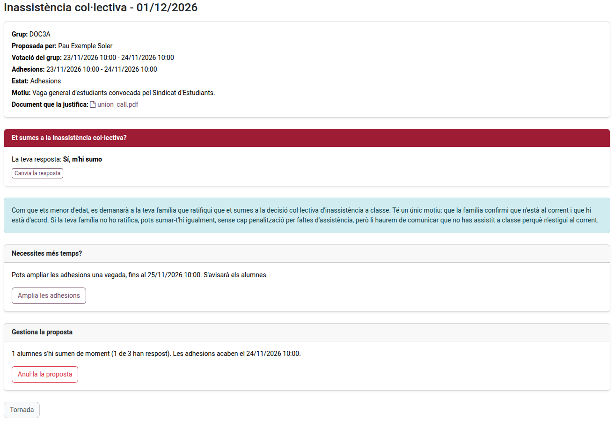

[Català](manual-vagues.md) | [Castellano](../../es/families/manual-vagues.md) | [English](../../en/families/manual-vagues.md)

---

# Inassistències col·lectives

El teu grup pot decidir al portal si fa una inassistència col·lectiva un dia concret (per exemple, arran d'una convocatòria de vaga d'un sindicat d'estudiants), i cada alumne diu si s'hi suma. Els alumnes que s'hi sumen no consten al passi de llista d'aquell dia: no hi falten ni hi assisteixen.

**Són dues fases separades.** Que el grup hi voti a favor és només el primer pas: no vol dir que hi participis. Després, cada alumne diu personalment si s'hi suma, i qui no respon no s'hi suma: aquell dia ha d'anar a classe, i les faltes compten amb normalitat.

És una decisió col·lectiva d'inassistència a classe de l'alumnat a partir de 3r d'ESO, comunicada prèviament a la direcció del centre. Ningú no la pot revocar, tampoc la família: el centre només n'informa. Es demana a la família d'un alumne menor d'edat que n'acusi rebuda al portal i que digui si hi està d'acord.

---

## Qui fa què

| Qui | Què fa |
|-----|--------|
| El delegat o el sotsdelegat del grup | Proposa la votació, n'explica el motiu i hi adjunta el document que la justifica |
| Cada alumne del grup amb accés al portal | Vota si el grup fa la inassistència col·lectiva i, si la fa, diu si s'hi suma |
| La família d'un alumne menor que s'hi suma | N'acusa rebuda al portal i diu «hi estic d'acord» o «no hi estic d'acord»: no canvia la decisió de l'alumne |
| El tutor del grup | Rep un avís de cada pas i pot aturar la proposta si té un defecte de forma |
| El cap d'estudis | Rep l'acta i valida la inassistència col·lectiva o no |

Només poden proposar una inassistència col·lectiva els grups que el centre permet (a partir de 3r d'ESO, batxillerat i formació professional).

---

## El calendari

La proposta té dues fases: primer el grup vota si fa la inassistència col·lectiva i després cada alumne diu si s'hi suma. Cada fase dura **24 hores** per defecte, i el cap d'estudis ha de rebre l'acta com a mínim **48 hores** abans de la inassistència col·lectiva. Per tant, amb la configuració per defecte, **una inassistència col·lectiva s'ha de proposar amb uns quatre dies lectius d'antelació**.

El centre decideix com es compten les hores, i el formulari t'ho explica:

- Normalment, són **hores reals**, però els dies que el teu grup no té classe (caps de setmana, festius i vacances) no compten: una fase que comença divendres a les 9:00 acaba dilluns a les 9:00 (durant el cap de setmana també pots respondre).
- El recompte comença **quan la proposes**, i els correus surten de seguida, o **quan el correu arriba al teu grup**: durant les classes o, si s'envia fora de l'horari, a l'inici de les següents.
- El centre també pot comptar només les **hores de classe** del teu grup: llavors el calendari és més llarg.
- La votació acaba abans si els vots que falten ja no poden canviar el resultat.

Abans d'enviar-la, el formulari et mostra el calendari exacte, com es compten les hores i el primer dia possible de la inassistència col·lectiva.

**Un dia més proper.** Si les dues fases no hi caben senceres abans de l'antelació, però sí una part de l'adhesió (almenys 5 minuts), la pots proposar igualment: el formulari t'indica a partir de quin dia, i **la fase d'adhesió serà més curta**. Un cop proposada, la seva pàgina t'avisa: la fase d'adhesió individual durarà com a màxim tantes hores en comptes de 24. Si la votació del grup acaba abans perquè la majoria ja ha decidit, la fase d'adhesió s'allarga amb el temps guanyat, fins a les 24 hores habituals.

---

## Proposar la votació (delegat o sotsdelegat)

1. Al portal, obre **Inassistències col·lectives** (targeta de la pàgina d'inici, o a la barra superior) i fes clic a **Proposar una inassistència col·lectiva**.
2. Tria el **Dia de la inassistència col·lectiva**. Ha de ser un dia lectiu, i no abans del primer dia que t'indica el formulari.
3. Escriu el **Motiu**: per què el grup no vol assistir a classe aquell dia (per exemple «Per una educació pública accessible i de qualitat per a tota la ciutadania»). Surt als avisos i als correus de tot el grup.
4. Adjunta el **Document que la justifica** (un o més fitxers): la convocatòria d'un sindicat d'estudiants, l'acta de l'assemblea del grup o qualsevol document que expliqui la decisió.

Tots dos són obligatoris: sense un motiu i un document no pots proposar la votació.
5. Fes clic a **Proposa la votació**.

El teu grup rep de seguida un correu per votar. Només hi pot haver una proposta per grup i dia.

Mentre la proposta està en votació o en adhesions, la seva pàgina et mostra quants alumnes han respost, i **Anul·la la proposta** l'anul·la. Una proposta anul·lada desapareix per al grup.

---

## Votar (tot l'alumnat)

La pàgina d'inici del portal t'avisa quan el teu grup està votant. Obre la proposta i respon **El grup fa una inassistència col·lectiva aquest dia?**: **Sí**, **No** o **M'abstinc**, i fes clic a **Enviar**. Una finestra et confirma que el vot s'ha desat.

- La votació és **anònima**: només es guarda el recompte, mai qui ha votat què.
- Votes **una sola vegada**: després no es pot canviar.
- El grup hi dona suport quan hi ha més vots a favor que en contra entre els vots emesos (un empat no ho decideix).
- **Votar a favor no vol dir sumar-s'hi**: si el grup hi vota a favor, després cada alumne diu personalment si s'hi suma.

Si el grup no hi vota a favor, la proposta es tanca i aquell dia s'espera tothom a classe.

Un alumne que no tenia accés al portal quan es va fer la proposta surt a l'acta i no vota, però, si el grup hi vota a favor i obté l'accés mentre l'adhesió és oberta, pot dir si s'hi suma: rep el correu en aquell moment.

---

## Sumar-s'hi (tot l'alumnat)

Si el grup hi vota a favor, comença la segona fase, personal: reps un correu que t'explica què has de fer i què passa segons la teva resposta, i la proposta et pregunta **Et sumes a la inassistència col·lectiva?** Respon **Sí, m'hi sumo** o **No** i fes clic a **Enviar**. Una finestra et confirma la resposta, i el formulari es tanca i la mostra. Pots canviar-la fins que acabin les adhesions amb **Canvia la resposta**.

- **Si t'hi sumes**, el teu nom surt a l'acta que rep el cap d'estudis.
- Les classes d'aquell dia no et compten com a faltes: no consten al passi de llista. Si la inassistència col·lectiva no es valida, sí que hi compten.
- **Si no t'hi sumes, o no respons** abans que acabin les adhesions, aquell dia has d'anar a classe, i si no hi vas les faltes compten amb normalitat.
- **Si ets menor d'edat**, es demana a la teva família que acusi rebuda al portal i digui si està d'acord que t'hi sumes, mentre durin les adhesions. Ningú no pot revocar la teva decisió. Si no diu que hi està d'acord, se l'informa de cada classe a què no assisteixis aquell dia, a títol informatiu. La pàgina et diu què ha respost la teva família.

---

## Ampliar les adhesions (delegat o sotsdelegat)

Si les adhesions estan a punt d'acabar, o ja han acabat, i l'alumnat necessita més temps, obre la pàgina de la proposta i fes clic a **Amplia les adhesions**. Les adhesions duren una fase més (el mateix temps que cada fase a la configuració del centre), o menys si el cap d'estudis no rebria l'acta a temps: s'amplien tant com es pot. Es compta des del final de les adhesions, o des d'ara si ja han acabat. S'avisa tot l'alumnat.

- **Només ho pots fer una vegada.** El tutor del grup, i qui té per sobre, poden ampliar-les més vegades.
- Si les adhesions ja havien acabat, la proposta torna a estar oberta i l'acta arriba al cap d'estudis quan es tanqui de nou.
- No sempre és possible: el cap d'estudis ha de rebre l'acta amb l'antelació prevista abans de la inassistència col·lectiva. El botó només apareix quan ho és.

---

## Acusar rebuda (família d'un alumne menor d'edat)

Quan el vostre fill o filla (menor de 18 anys aquell dia) diu que se suma a una decisió col·lectiva d'inassistència a classe, rebeu un correu de seguida. Al portal, la pàgina d'inici us n'avisa: feu clic a **Respon**, o obriu **Inassistències col·lectives**.

Per a cada inassistència col·lectiva, feu clic a **Hi estic d'acord** o **No hi estic d'acord**. Una finestra us confirma la resposta, i la pàgina la mostra. Podeu canviar-la amb **Canvia la resposta** fins que acabin les adhesions (la pàgina us diu fins quan).

- Respondre només indica al centre que heu rebut l'avís i si hi esteu d'acord. És una decisió col·lectiva dels alumnes que ningú no pot revocar, i les classes d'aquell dia no compten com a faltes. **Un cop respost, no cal que feu res més**: la resta és automàtic.
- Si no dieu que hi esteu d'acord, o no responeu a temps, rebreu un avís de cada classe a què no assisteixi el vostre fill o filla aquell dia, només a títol informatiu. Si dieu que no hi esteu d'acord, el vostre fill o filla també en rep un avís, i un altre si després canvieu a «Hi estic d'acord».
- Per respondre necessiteu accés al portal. Si no en teniu, demaneu-lo al centre amb temps.
- Quan la inassistència col·lectiva es valida, rebeu un correu informatiu. Si, en canvi, la proposta s'avorta o no es valida, també se us avisa.

---

## Després de les adhesions

L'acta arriba al cap d'estudis, que decideix si valida la inassistència col·lectiva:

- **Validada**: els alumnes que s'hi sumen continuen sense constar al passi de llista d'aquell dia. Se n'avisa tot l'alumnat, i també la família de cada alumne menor que s'hi suma.
- **No validada**: les classes d'aquell dia dels alumnes que s'hi sumen compten com a faltes. Se n'avisa tot l'alumnat, amb el motiu.

Mentrestant, el tutor del grup pot **avortar** la proposta mentre està en votació o en adhesions, només per un defecte de forma (per exemple, si el document adjunt no la justifica). Se n'avisa tot l'alumnat, amb el motiu.

L'acta (PDF) és a la pàgina de la proposta un cop tancada.

### Què vol dir cada estat

| Estat | Significat |
|-------|-----------|
| **En votació** | El grup vota si fa la inassistència col·lectiva |
| **Adhesions** | El grup hi ha votat a favor: ara cada alumne diu si s'hi suma (qui no respon, no s'hi suma) |
| **Tancada** | El cap d'estudis té l'acta i decideix |
| **Validada** | Els qui s'hi sumen no consten al passi de llista d'aquell dia |
| **Avortada** | El tutor ha aturat la proposta, amb un motiu |
| **No validada** | El cap d'estudis no l'ha validat, amb un motiu |
| **Anul·lada** | El delegat l'ha anul·lat |

---

[← Tornar als manuals de famílies](index.md)
