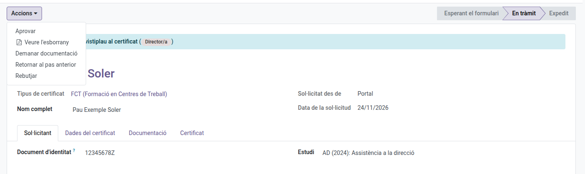
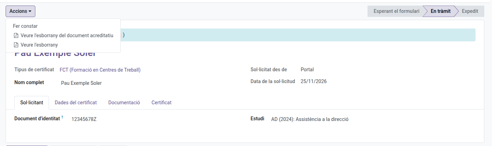

[Català](certificates.md) | [Castellano](../../es/head_of_studies/certificates.md) | [English](../../en/head_of_studies/certificates.md)

---

# Certificats: donar el vistiplau

Dona el vistiplau als certificats que secretaria ha expedit. En donar-lo, EMS genera el PDF i l'envia a la persona sol·licitant.

**Rol necessari:** el càrrec de director o directora.

---

## Quan et toca a tu

Després que secretaria expedeix un certificat, l'últim pas del circuit és el teu: el trobes com a tasca al teu resum diari i a **Gestió acadèmica → Certificats**, amb el filtre **Pendents de mi**.

---

## Donar el vistiplau

1. Obre la sol·licitud.
2. Comprova les dades de les pestanyes **Sol·licitant**, **Dades del certificat** i **Documentació**. **Accions → Veure l'esborrany** mostra com serà el certificat, marcat com a **ESBORRANY**.
3. Obre **Accions → Aprovar** i confirma.

EMS:

- hi posa el segell **Vistiplau**;
- genera el PDF del certificat, amb els segells de secretaria i de direcció i, al final, les pàgines del conveni;
- l'envia per correu a la persona sol·licitant, que també el pot descarregar des del portal o des de l'enllaç.

El PDF és a la pestanya **Certificat** de la sol·licitud.

---

Si has expedit tu mateix el certificat (per exemple, com a administrador), no hi pots donar el vistiplau: ho ha de fer una altra persona.

---

## Fer constar en lloc de donar el vistiplau

Mentre el certificat encara no s'ha expedit, el pots **fer constar** tu: EMS no genera un certificat, sinó un **document acreditatiu** amb el mateix text, on diu que **fas constar** el que s'hi indica, signat només per tu.

1. Obre la sol·licitud (treu el filtre **Pendents de mi** si encara no és al teu pas).
2. **Accions → Veure l'esborrany del document acreditatiu** mostra com quedarà, marcat com a **ESBORRANY**.
3. Obre **Accions → Fer constar** i confirma.

Cal que hi hagi totes les dades i tota la documentació obligatòries; si en falta alguna, EMS t'indica quina i no el genera.

EMS:

- li dona un número propi (per exemple `DACR-2026-27-0001`) i hi posa el teu segell;
- genera el PDF, amb les pàgines del conveni al final;
- l'envia per correu a la persona sol·licitant i tanca la sol·licitud.

---

## Si alguna cosa no és correcta

- **Accions → Retornar al pas anterior** — torna la sol·licitud a secretaria amb el motiu; se'n desfà el segell.
- **Accions → Demanar documentació** — demana a la persona sol·licitant el que falti.
- **Accions → Rebutjar** — si el certificat no es pot expedir; la persona sol·licitant en rep el motiu per correu.

També pots consultar totes les sol·licituds de certificat del centre traient el filtre **Pendents de mi**.
