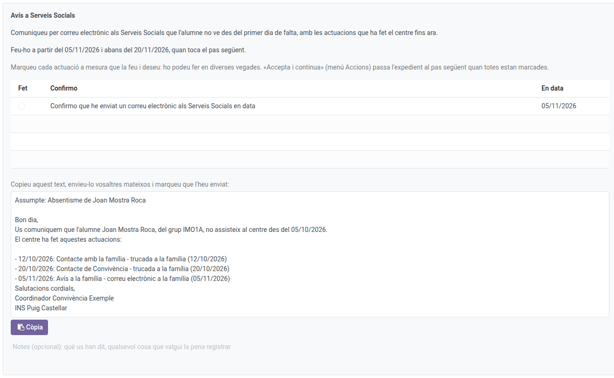
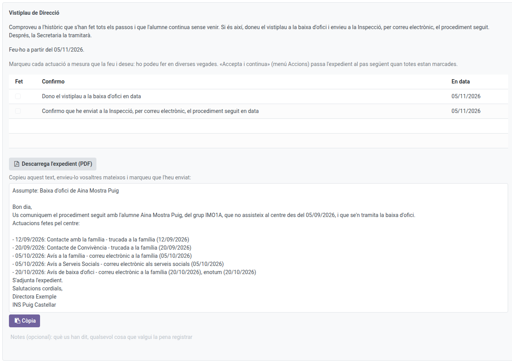
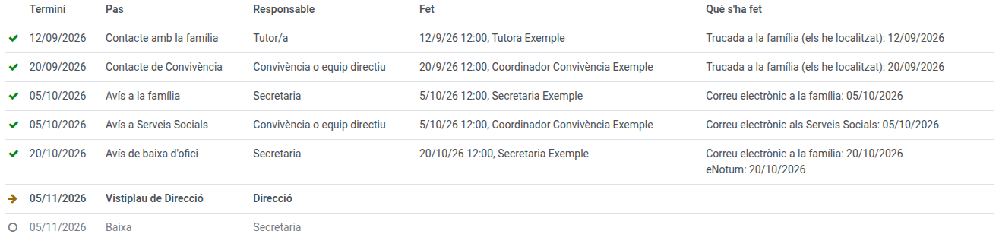

[Català](ex-officio-withdrawal.md) | [Castellano](../../es/head_of_studies/ex-officio-withdrawal.md) | [English](../../en/head_of_studies/ex-officio-withdrawal.md)

---

# Baixa d'ofici: Direcció, prefectura d'estudis i Convivència

Aquesta guia explica què fan en un expedient de baixa d'ofici la direcció (el vistiplau), la prefectura d'estudis (seguiment i decisions en nom del tutor) i Convivència o l'equip directiu (els passos del circuit d'obligatòria).

**Rol necessari:** director/a, cap d'estudis o cap d'estudis adjunt; coordinador/a de convivència per als seus passos (també l'Administrador)

---

## Índex

1. [On trobar els expedients](#on-trobar-els-expedients)
2. [Què pot fer la prefectura d'estudis](#què-pot-fer-la-prefectura-destudis)
3. [Els passos de Convivència (obligatòria)](#els-passos-de-convivència-obligatòria)
4. [El vistiplau de Direcció](#el-vistiplau-de-direcció)
5. [L'historial i l'expedient en PDF](#lhistorial-i-lexpedient-en-pdf)

---

## On trobar els expedients

Navega a: **Gestió acadèmica → Baixes d'ofici**. Hi veus tots els expedients del centre, amb el pas en què és cadascun. Com comencen i què fa el tutor ho explica el [manual del tutor](../tutors/ex-officio-withdrawal.md); els passos de Secretaria, el [de Secretaria](../secretary/ex-officio-withdrawal.md).

---

## Què pot fer la prefectura d'estudis

El cap d'estudis i el cap d'estudis adjunt poden fer el que fa el tutor en qualsevol expedient: iniciar o descartar una proposta, fer el pas del tutor i revisar els passis de llista que diuen una altra cosa. En canvi, només poden **obrir** un expedient nou (Sol·licita la baixa d'ofici) per a l'alumnat dels tutors que tenen per sota.

---

## Els passos de Convivència (obligatòria)

Al circuit d'obligatòria, el coordinador de convivència del tutor (o l'equip directiu) té dos passos:

- **Contacte de Convivència, al cap de 15 dies:** una trucada a la família, amb els botons **Els he localitzat** / **No els he localitzat**, com el tutor.
- **Avís a Serveis Socials, al cap d'un mes:** l'expedient prepara el text de l'avís, amb les actuacions fetes fins ara. Copia'l amb **Copia el text**, envia'l tu mateix per correu i marca que l'has enviat.

Quan tot està marcat, **Accions → Accepta i continua**.

---

## El vistiplau de Direcció

Quan s'acaba el termini (15 dies lectius o 2 mesos), Direcció rep la tasca. Comprova a l'historial que s'han fet tots els passos i que l'alumne continua sense venir:

- **Donar el vistiplau:** marca **Dono el vistiplau a la baixa d'ofici** i accepta el pas. L'alumne passa a **Baixa prevista** (deixa de sortir als passis de llista) i Secretaria en tramita la baixa.
  - A obligatòria, cal enviar també el procediment a la Inspecció: descarrega l'expedient amb **Descarrega l'expedient (PDF)**, copia el text preparat, envia-ho tu mateix per correu i marca que ho has enviat.
- **No donar-lo:** si l'alumne ha tornat o ha justificat les faltes, **Accions → Tanca sense baixa**, amb el motiu i una nota. L'expedient es tanca.

---

## L'historial i l'expedient en PDF

L'**Històric** de cada expedient mostra tots els passos: quan tocava cadascun, qui el va fer i quan, i què es va marcar. Els passos pendents surten en gris.

Quan l'expedient s'ha acabat (amb la baixa o cancel·lat), **Accions → Imprimeix l'expedient** en genera el PDF, sempre en la llengua del centre.
