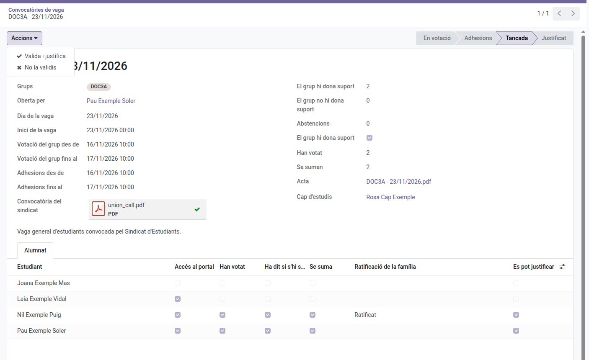

[Català](student-walkout.md) | [Castellano](../../es/head_of_studies/student-walkout.md) | [English](../../en/head_of_studies/student-walkout.md)

---

# Vagues d'estudiants: validar-les

L'alumnat convoca i vota les seves vagues al portal, i el tutor del grup vetlla per la convocatòria. Tu reps l'acta quan es tanca i decideixes si la valides: validar-la justifica la falta dels qui s'hi sumen. Com hi participen l'alumnat i les famílies es pot llegir al [manual de famílies](../families/manual-vagues.md), i la part del tutor al [manual de tutors](../tutors/student-walkout.md).

No s'ha de confondre amb els **Strikes** (Convivència), el registre disciplinari, ni amb l'informe de vaga del personal.

---

## Què reps

- **Res quan s'obre una convocatòria**: hi vetlla el tutor.
- **Un avís al teu resum diari** quan un tutor (o algú per sobre seu) avorta una convocatòria, amb el motiu.
- **L'acta, per correu**, quan la convocatòria es tanca: com a mínim 48 hores lectives abans de la vaga (per defecte), amb el recompte de vots i els alumnes que s'hi sumen. Si s'ha de justificar la falta d'algú, també reps la tasca **Justificar la vaga d'estudiants**.

L'acta arriba al cap d'estudis o al cap d'estudis adjunt per sobre del tutor del grup; d'un grup sense tutor, a tots els caps d'estudis i caps d'estudis adjunts.

---

## Validar-la

Obre la convocatòria des del correu o des d'**Assistència dels estudiants > Convocatòries de vaga**.

- **Accions > Valida i justifica**: crea un justificant de tot el dia de la vaga per als alumnes a qui es pot justificar la falta, i l'obre. Són els majors d'edat que s'hi sumen i els menors la família dels quals ho ha ratificat (Decret 102/2010, article 24.2: la columna **Es pot justificar** de la pestanya **Alumnat**). Si un alumne ja tenia un justificant aquell dia, se'l salta i queda anotat a la convocatòria. Se n'avisa tot l'alumnat del grup, la família de cada alumne menor amb la falta justificada, i el tutor.
- **Accions > No la validis**: tria un motiu; no es justifica la falta de ningú. Se n'avisa tot l'alumnat, el tutor i les famílies a qui es va demanar que ho ratifiquessin.
- **Accions > Desfés la validació** (en una convocatòria validada): esborra el justificant, de manera que les faltes deixen d'estar justificades. Se n'avisa l'alumnat, les famílies i el tutor, amb el motiu.

Els motius surten d'**Assistència dels estudiants > Configuració > Convocatòries de vaga > Motius de rebuig**, els mateixos que fa servir el tutor per avortar una convocatòria. Els pots afegir, canviar de nom o reordenar; «Altres» demana detalls.

---

## Configuració

Un administrador la defineix a **Ajustos > Convocatòries de vaga**:

- **Nivells i cursos**: quins nivells (i, si cal, quins cursos) poden convocar una vaga. Per defecte, a partir de 3r d'ESO, batxillerat i formació professional.
- **Calendari**: quant dura cada fase i amb quanta antelació has de rebre l'acta abans de la vaga, en hores lectives (24 i 48 per defecte). Cada convocatòria manté els valors amb què es va obrir.

---

[← Tornar als manuals de cap d'estudis](index.md)
