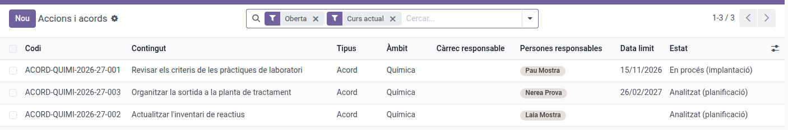
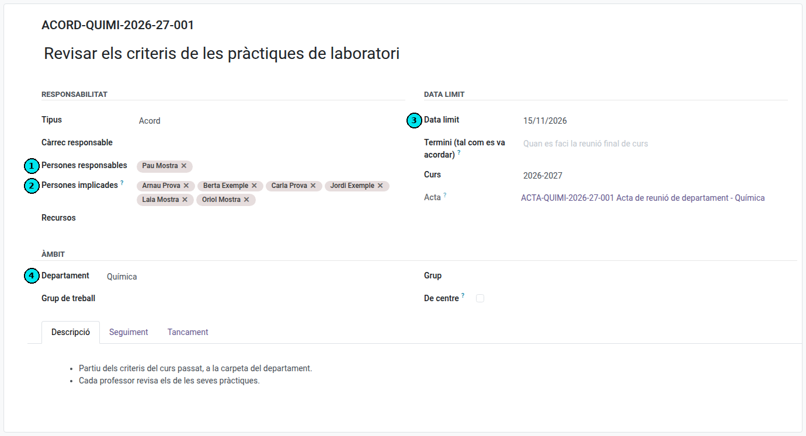
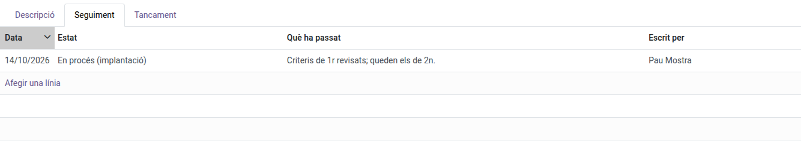
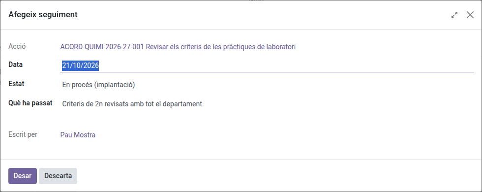

[Català](actions.md) | [Castellano](../../es/quality/actions.md) | [English](../../en/quality/actions.md)

---

# Accions i acords

Un **acord de reunió** i una **acció de millora** són el mateix: algú es compromet a fer alguna cosa,
per a una data, i algú n'ha de fer el seguiment. Per això a l'EMS són la mateixa pantalla:
**Qualitat → Accions i acords**.

Hi trobareu en un sol lloc **què tinc pendent i per quan**.

---

## Com s'obre la pantalla

Amb dos filtres ja aplicats: **Oberta** i **Curs actual**. Traieu-ne un i veureu també les tancades o
les de cursos anteriors.

Altres filtres útils: **Vençudes** (passades de termini i encara obertes), i per tipus: acords de
reunió, accions de millora, o correctives i preventives.

## Qui veu i qui modifica un acord

Un acord distingeix tres maneres d'estar-hi:

- **Qui en gestiona el contingut** (què s'ha acordat, l'àmbit, els responsables, les persones
  implicades, el termini): la cadena de comandament del departament o del tutor del grup (cap de
  departament o de seminari, cap d'estudis o cap d'estudis adjunt, director) i, mentre l'acta no està
  aprovada, qui la redacta o la valida. Una acció que no surt de cap acta, també qui la va crear.
- **Les persones responsables** i qui ocupa el **càrrec responsable**: en porten l'avanç. Hi afegeixen
  entrades de seguiment amb **Accions → Afegeix seguiment** i n'escriuen la **descripció** (com s'ha
  de dur a terme: enllaços, instruccions), però no canvien el que es va acordar. La seva
  cadena de comandament també ho pot fer en el seu lloc. Pot ser responsable qualsevol persona, tingui
  càrrec o no.
- **Les persones implicades**: les que han de fer alguna cosa per l'acord (per exemple, tot el
  departament actualitza les programacions). El poden llegir, amb el seu seguiment, i reben un avís
  cada vegada que s'hi afegeix una entrada.

També el poden llegir els qui poden llegir l'acta de la qual surt o les del seu àmbit. La **comissió
de qualitat**, la **coordinació de qualitat** i l'**administrador** els veuen i modifiquen tots.

Si obriu un acord que no podeu modificar, s'obre en mode de només lectura.

## Crear un acord

1. Botó **Nou**.
2. Poseu-hi l'assumpte: què s'ha acordat.
3. Indiqueu el **tipus**. Per un acord de reunió, deixeu-hi *Acord*.
4. Indiqueu el **càrrec responsable** i, si cal, les **persones responsables**. Es poden posar les dues
   coses: el registre del centre sovint diu "Equip directiu i caps de departament" o "una persona més
   voluntaris", i això no s'ha de perdre.
5. Indiqueu l'**àmbit**: departament, grup de treball, grup, o *De centre* per als acords de claustre.
   L'àmbit és el que numera el codi.
6. El **termini**: poseu-hi una data si la teniu. Si l'acord deia "quan es faci la reunió final de curs",
   escriviu-ho al camp **Termini (tal com es va acordar)** i deixeu la data buida.
7. Deseu. El **codi** s'assigna sol: `ACORD-<àmbit>-<curs>-<número>`.

(1) Les persones responsables, que en porten l'avanç; (2) les persones implicades, que només el llegeixen i reben els avisos; (3) la data límit i (4) l'àmbit.

## El codi i la numeració

El comptador és **per àmbit i per curs**, així que els acords d'un departament van seguits: si a la
llista d'un departament hi ha el 003 i el 005, hi falta el 004 i es veu. Per això no hi ha un número
global.

## L'estat no s'edita: es deriva del seguiment

L'estat d'un acord **no es tria en un desplegable**. Surt de la darrera entrada de seguiment:

| Situació | Estat |
|---|---|
| Sense responsable ni termini | Nou (pendent) |
| Amb responsable o termini, però sense cap seguiment | Analitzat (planificació) |
| Amb seguiment | L'estat de la darrera entrada |

Per fer avançar un acord, doncs, s'hi afegeix una entrada de seguiment a la pestanya **Seguiment**: la
data, en quin estat queda i què ha passat. Això és deliberat: obliga a deixar escrit **per què** ha
canviat, que és exactament el que us demanaran en una auditoria.

Una persona responsable afegeix el seguiment amb **Afegeix seguiment**, sense poder canviar el que es va acordar.

## Tancar un acord

Afegiu una entrada de seguiment amb estat **Tancat (finalitzat)** i expliqueu-hi com s'ha resolt. A la
pestanya **Tancament** hi podeu deixar abans els criteris: quan es considerarà finalitzat i com es
mesurarà l'eficàcia.
