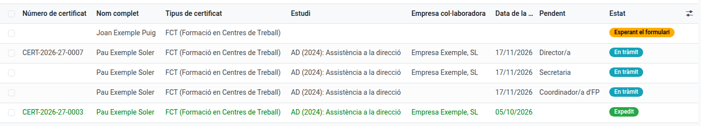
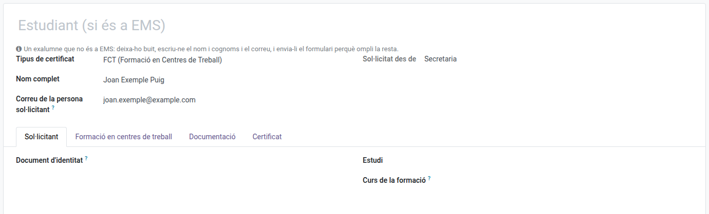
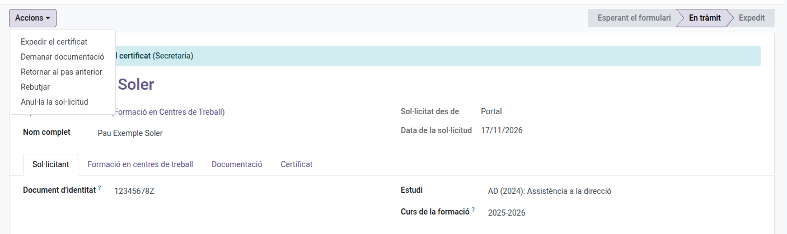

[Català](certificates.md) | [Castellano](../../es/secretary/certificates.md) | [English](../../en/secretary/certificates.md)

---

# Certificats: registrar, expedir i fer el seguiment de les sol·licituds

Registra les sol·licituds de certificat que arriben a secretaria (per exemple, d'un exalumne), expedeix els certificats i fes el seguiment de totes les sol·licituds.

**Rol necessari:** Secretaria. Per expedir un certificat cal ocupar el càrrec de secretari o secretària.

---

## Com funciona una sol·licitud

Cada certificat és d'un **tipus** (per exemple, *FCT (Formació en Centres de Treball)*), i cada tipus té el seu **circuit d'aprovació**: els passos que fa cada càrrec, per ordre. El del certificat de FCT és:

1. **Completar les dades** — el coordinador o coordinadora d'FP completa l'empresa, el període, les hores i el conveni.
2. **Expedir el certificat** — secretaria l'expedeix: rep el número (per exemple `CERT-2026-27-0001`) i el segell d'EMS.
3. **Donar el vistiplau** — el director o directora hi dona el vistiplau. Es genera el PDF i s'envia per correu a la persona sol·licitant.

Cada pas és una tasca per a qui ocupa el càrrec, que la troba al seu resum diari i al filtre **Pendents de mi**.

Una sol·licitud pot arribar de dues maneres:

- **Des del portal:** l'alumnat actual (o la seva família) la fa des del portal i entra directament al primer pas.
- **Des de secretaria:** la registres tu, normalment per a un exalumne, que no té accés al portal.

---

## Accés

Navega a: **Gestió acadèmica → Certificats**. La llista s'obre amb el filtre **Pendents de mi**; treu-lo per veure totes les sol·licituds. La columna **Pendent** indica de quin càrrec és el pas actual.

---

## Registrar la sol·licitud d'un exalumne

1. Fes clic a **Nou**.
2. Tria el **Tipus de certificat**.
3. Si l'exalumne és a EMS, tria'l a **Estudiant (si és a EMS)**: les seves dades s'omplen soles. Si no hi és, deixa-ho buit i escriu-ne el **Nom complet** i el **Correu de la persona sol·licitant**.
4. Desa.
5. Obre **Accions → Enviar formulari**. L'exalumne rep un correu amb un enllaç al formulari, on omple les dades que falten i adjunta la documentació que tingui, sense iniciar sessió.

Si ja tens totes les dades obligatòries (pestanya **Sol·licitant**: document d'identitat, estudi i curs de la formació), **Enviar formulari** també passa la sol·licitud al primer pas. L'exalumne encara pot completar o corregir les seves dades des de l'enllaç fins que algú del centre canviï la sol·licitud o hi faci alguna acció.

Si la sol·licitud t'arriba en paper i no cal enviar res, omple totes les dades i fes clic a **Accions → Iniciar la sol·licitud**.

L'estudi ha de ser d'un dels nivells del tipus de certificat (per al de FCT, CFGM o CFGS): el desplegable només mostra aquests.

---

## Expedir un certificat

1. Obre la sol·licitud des del filtre **Pendents de mi**.
2. Comprova les dades de les pestanyes **Sol·licitant** i **Formació en centres de treball**.
3. A la pestanya **Documentació**, comprova que tots els documents obligatoris (en verd) tenen fitxers.
4. Obre **Accions → Expedir el certificat** i confirma.

Si falta alguna dada o algun document obligatori, EMS t'ho indica i no deixa expedir-lo.

### Expedir-lo sense esperar els passos anteriors

De vegades ja tens totes les dades i documents d'una sol·licitud que encara és en un pas anterior (per exemple, esperant que el coordinador d'FP completi la formació en centres de treball). No cal que esperis:

1. Obre la sol·licitud. Encara no surt a **Pendents de mi**: treu aquest filtre per trobar-la.
2. Completa el que falti a les pestanyes **Sol·licitant** i **Formació en centres de treball**, i adjunta els documents obligatoris a **Documentació**.
3. Obre **Accions → Expedir ara** i confirma que tens totes les dades i documents obligatoris.

Els passos anteriors se salten i les seves tasques pendents es tanquen, i l'historial de la sol·licitud registra qui els ha saltat. El certificat rep el número i el teu segell, i passa a l'aprovació de la direcció com sempre. Es fan les mateixes comprovacions que quan l'expedeixes al seu pas: si falta alguna cosa obligatòria, EMS t'indica què i no l'expedeix. El botó també és disponible en una sol·licitud que acabes de registrar, abans d'enviar el formulari o d'iniciar-la.

---

## Altres accions

Al menú **Accions** de la sol·licitud:

- **Demanar documentació** — escriu què falta; la persona sol·licitant ho rep per correu amb un enllaç per respondre i adjuntar-ho. Quan respon, la sol·licitud torna al seu pas.
- **Documentació rebuda** — si la documentació t'arriba per una altra via (en paper, per correu), torna la sol·licitud al seu pas.
- **Retornar al pas anterior** — escriu el motiu; qui va fer el pas anterior el torna a tenir pendent.
- **Rebutjar** — escriu el motiu; la persona sol·licitant el rep per correu.
- **Anul·la la sol·licitud** — només abans d'expedir el certificat (per exemple, si és duplicada). Una sol·licitud anul·lada es pot **Reobrir**.

La pestanya **Certificat** conté el PDF expedit i els segells (qui va fer cada pas i quan).

---

## Documentació

La pestanya **Documentació** té:

- **Documentació obligatòria** — els documents que exigeix el tipus de certificat (per al de FCT, el **Conveni de FCT**). La columna **L'adjunta** indica qui els pot adjuntar. Obre la línia per adjuntar-hi fitxers (PDF o fotos de les pàgines).
- **Altra documentació** — qualsevol altre fitxer, opcional. No s'afegeix al certificat.

El PDF del certificat inclou al final les pàgines dels documents obligatoris marcats per afegir-los al certificat.

---

## Empreses col·laboradores

Les empreses on l'alumnat fa la formació són a **Comunitat Educativa → Empreses col·laboradores**. Des de la pestanya **Formació en centres de treball** d'una sol·licitud se'n pot triar una o crear-la amb el botó **Crear empresa**, a partir del nom i el NIF que va escriure l'alumne.
