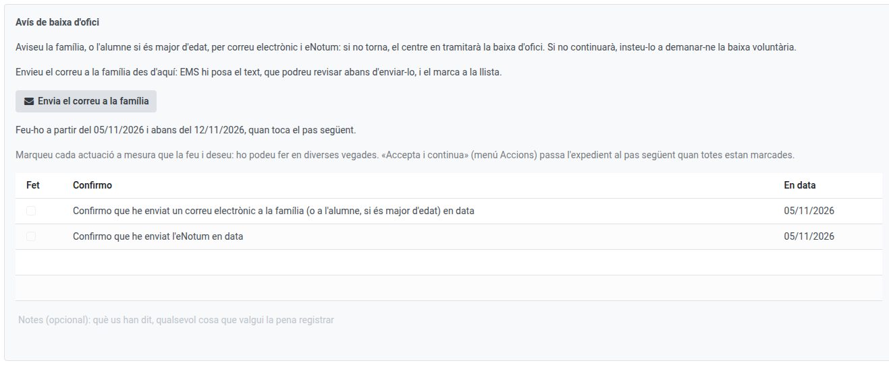
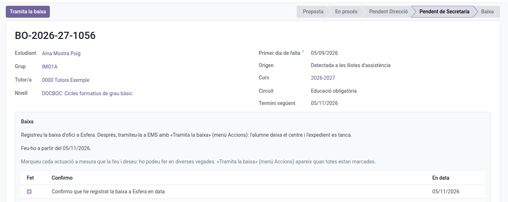

[Català](ex-officio-withdrawal.md) | [Castellano](../../es/secretary/ex-officio-withdrawal.md) | [English](../../en/secretary/ex-officio-withdrawal.md)

---

# Baixa d'ofici: els passos de Secretaria

Aquesta guia explica els passos que fa Secretaria en un expedient de baixa d'ofici: els avisos a la família i, quan Direcció ha donat el vistiplau, la tramitació de la baixa.

**Rol necessari:** Secretaria (també l'Administrador)

---

## Índex

1. [On trobar els expedients](#on-trobar-els-expedients)
2. [Els avisos a la família](#els-avisos-a-la-família)
3. [Tramitar la baixa](#tramitar-la-baixa)

---

## On trobar els expedients

Navega a: **Gestió acadèmica → Baixes d'ofici**. Hi veus tots els expedients del centre. Quan un pas és teu, reps la tasca el dia que toca i l'expedient et mostra què has de fer i fins quan; als altres passos només veus de qui és el torn.

Com comença un expedient i què fan el tutor i Direcció ho expliquen el [manual del tutor](../tutors/ex-officio-withdrawal.md) i el [de Direcció](../head_of_studies/ex-officio-withdrawal.md).

---

## Els avisos a la família

Segons el circuit, Secretaria avisa la família:

- **Postobligatòria, al 10è dia lectiu (Avís de baixa d'ofici):** correu a la família i eNotum: si l'alumne no torna, el centre en tramitarà la baixa d'ofici.
- **Obligatòria, al cap d'un mes (Avís a la família) i d'un mes i mig (Avís de baixa d'ofici):** el correu i, a l'últim, l'eNotum.

Per enviar el correu, fes clic a **Envia el correu a la família**: EMS hi posa el text, que pots revisar abans d'enviar-lo, i el marca a la llista amb la data. L'eNotum el fas fora d'EMS i el marques tu, amb el dia que el vas enviar. Quan tot està marcat, **Accions → Accepta i continua**.

---

## Tramitar la baixa

Quan Direcció ha donat el vistiplau, l'alumne passa a **Baixa prevista** (deixa de sortir als passis de llista) i t'arriba l'últim pas:

1. Registra la baixa a Esfera, fora d'EMS, i marca-ho a la llista.
2. A postobligatòria, també la registres a SAGA i envies l'eNotum (marca-ho igual) i el correu de baixa feta a la família, amb **Envia el correu a la família**.
3. Fes clic a **Tramita la baixa**: s'obre l'assistent de baixa ja omplert com a baixa d'ofici. En aplicar-lo, l'alumne deixa el centre i l'expedient es tanca.

Si l'alumne demana la baixa voluntària mentre l'expedient està obert, tramita-la com sempre ([Marcar una graduació i tramitar una baixa](graduation-withdrawal.md)): l'expedient es tanca sol.
