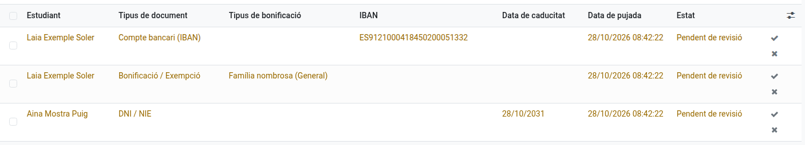
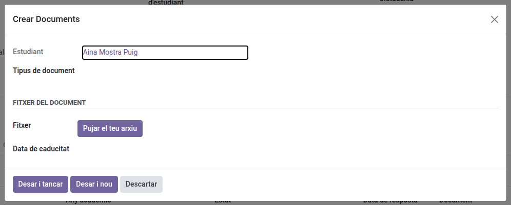
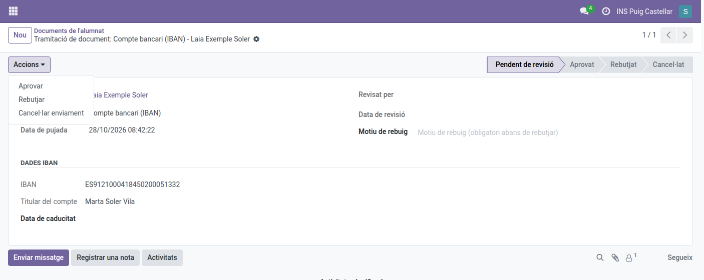

[Català](student-documents.md) | [Castellano](../../es/secretary/student-documents.md) | [English](../../en/secretary/student-documents.md)

---

# Revisar els documents dels alumnes

Aquesta guia explica com revisar els documents que envien alumnes i famílies — DNI/NIE, targeta sanitària, IBAN i justificants de bonificacions/exempcions — i què passa quan aproves, rebutges o reobres un document.

---

## Contingut

1. [On es revisen els documents](#on-es-revisen-els-documents)
2. [Afegir un document que la família ha enviat per correu](#afegir-un-document-que-la-família-ha-enviat-per-correu)
3. [Aprovar, rebutjar, cancel·lar](#aprovar-rebutjar-cancellar)
4. [Què fa aprovar un IBAN](#què-fa-aprovar-un-iban)
5. [Què fa aprovar un document de benefici](#què-fa-aprovar-un-document-de-benefici)
6. [Notificacions](#notificacions)
7. [Descarregar les credencials de Google](#descarregar-les-credencials-de-google)

---

## On es revisen els documents

Vés a **Gestió acadèmica > Documents d'alumnes**. La llista s'obre mostrant només les tramitacions **Pendents** per defecte (treu el filtre per veure-les totes). Aquesta és l'única pantalla on es revisen els documents. La llista de la fitxa de l'alumne (secció **Documentació** de la pestanya **Secretaria**) mostra els seus documents i serveix per afegir-ne de nous (vegeu la secció següent).

## Afegir un document que la família ha enviat per correu

Quan una família no aconsegueix pujar un document des del portal i us l'envia per correu (DNI, targeta sanitària, IBAN, justificant d'una bonificació...), el podeu registrar vosaltres a la fitxa de l'alumne:

1. Obre la fitxa de l'alumne i vés a la pestanya **Secretaria**.
2. A la secció **Documentació**, clica **Afegir una línia**.
3. Tria el **Tipus de document** i omple'l:
   - **Compte bancari (IBAN):** l'IBAN, el titular del compte i, si escau, la data de caducitat.
   - **Bonificació / Exempció:** el tipus de bonificació i el fitxer del justificant.
   - **Qualsevol altre tipus:** el fitxer (el PDF o la imatge que us han enviat) i, si escau, la data de caducitat.
4. Clica **Desar i tancar** i desa la fitxa de l'alumne.

El document queda **aprovat** directament, perquè ja l'heu revisat vosaltres: no genera cap tasca de revisió ni envia cap correu a la família. Té els mateixos efectes que aprovar-lo (un IBAN passa a ser el compte bancari actiu de l'alumne, una bonificació s'afegeix als seus beneficis) i substitueix el document aprovat anterior del mateix tipus. Un cop desat, el tipus, el fitxer i les dades ja no es poden canviar: si cal corregir-lo, afegiu-ne un de nou.

## Aprovar, rebutjar, cancel·lar

- **Aprovar** (✓ des de la llista, o el desplegable **Accions** de la fitxa): marca el document com a revisat i aplica els seus efectes (vegeu més avall). Si ja hi havia un altre document del mateix tipus aprovat per a aquest alumne, s'elimina automàticament — només es conserva l'últim aprovat.
- **Rebutjar** (✗ des de la llista, o el desplegable **Accions**): escriu primer el motiu (al camp **Motiu de rebuig**) — un sol clic a Rebutjar tanca immediatament la tramitació, no hi ha cap pas de confirmació separat.
- **Cancel·lar enviament**: al desplegable **Accions** de la fitxa, quan cal retirar una tramitació sense marcar-la com a rebutjada (per exemple, es va pujar per error).
- **Reobrir per a revisió**: disponible en un document aprovat o rebutjat, per si cal revisar una decisió — reobre la revisió (s'assigna una nova tasca als revisors).

## Què fa aprovar un IBAN

Aprovar un document d'IBAN el marca com el compte bancari actiu de l'alumne: qualsevol altre compte que tingués es desactiva, i aquest queda marcat com a utilitzable per a pagaments per domiciliació. Si el mateix IBAN ja estava registrat (inactiu), es reactiva amb el nom del titular actualitzat en lloc de crear-ne un duplicat.

Només pots tenir **una tramitació d'IBAN pendent** per alumne alhora — una segona queda bloquejada fins que la primera s'aprova, es rebutja o es cancel·la.

## Què fa aprovar un document de benefici

Aprovar un document de bonificació/exempció crea l'entrada corresponent als beneficis de l'alumne (vegeu [Gestió de contactes d'alumnat i família](student-contacts.md#bonificacions-i-exempcions)), substituint qualsevol benefici anterior del **mateix** tipus — un alumne pot tenir diversos beneficis actius de tipus diferents alhora (per exemple, família nombrosa **i** una beca), de manera que aprovar-ne un tipus mai n'elimina un altre no relacionat.

## Notificacions

L'alumne rep un correu quan el seu document s'aprova o es rebutja. Els revisors (configurats a *Gestió acadèmica > Configuració > Matrícula > Assignació de tasques*) reben una tasca pendent en lloc d'un correu per cada nova tramitació pendent — consulta les teves Activitats per veure "Review document: ...".

## Descarregar les credencials de Google

Per descarregar de cop el PDF de credencials de Google de diversos alumnes: a **Comunitat Educativa → Estudiants**, en vista de llista, marca els alumnes, obre **Accions** i clica **Descarregar credencials de Google**. Es descarrega un ZIP amb un PDF per alumne.

---

[← Tornar a l'índex de Secretaria](index.md)
