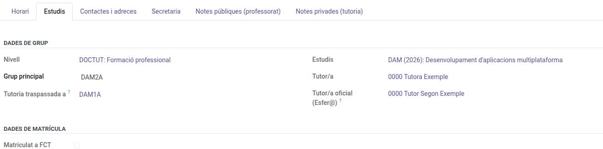

[Català](tutorship-transfer.md) | [Castellano](../../es/secretary/tutorship-transfer.md) | [English](../../en/secretary/tutorship-transfer.md)

---

# Traspassar la tutoria d'un alumne

De vegades, un alumne matriculat a 2n amb assignatures de 1r pendents es dona de baixa de totes les de 2n i només cursa les de 1r. A Esfer@ continua al seu grup de 2n, amb el seu tutor, que hi continua posant les notes. A EMS, però, el seguiment passa al tutor de 1r: la família, les faltes, els strikes, les inassistències col·lectives i el resum diari. Traspassar la tutoria serveix per registrar-ho.

**Rol necessari:** secretaria

---

## Com es traspassa la tutoria

1. Obriu la fitxa de l'alumne (**Comunitat Educativa → Estudiants → Llistat d'estudiants**).
2. Aneu a la pestanya **Estudis**.
3. A **Tutoria traspassada a**, trieu el grup al qual assisteix ara l'alumne (per exemple, el grup de 1r). Només s'ofereixen grups del mateix estudi de l'alumne: d'SMX2A a SMX1C, mai a DAW2A. Deixeu el **Grup principal** tal com està: és el grup d'Esfer@.
4. Deseu. Ara **Tutor/a** mostra el tutor del grup nou i **Tutor/a oficial (Esfer@)**, el del grup principal.

Per desfer-ho, buideu **Tutoria traspassada a** i deseu.

## Què canvia

- El tutor nou troba l'alumne entre el seu alumnat (**El meu alumnat**) i pot gestionar-ne les dades i les de la família, com amb qualsevol alumne del seu grup. Rep les incidències d'assistència de l'alumne, els avisos de strikes i la resta d'avisos de tutor.
- L'alumne participa en les inassistències col·lectives del grup al qual s'ha traspassat la tutoria.
- El tutor oficial conserva el que va per grup: les sessions d'avaluació i l'expedient del seu grup. Deixa de gestionar les dades de l'alumne i de rebre'n avisos.
- El grup principal, la matrícula i la declaració d'horari no canvien.

## L'horari de l'alumne

L'horari mostra les assignatures en què està matriculat l'alumne. Perquè només hi aparegui la tutoria de 1r, doneu de baixa la tutoria de 2n (amb la resta d'assignatures de 2n) i matriculeu l'alumne a la tutoria de 1r, al grup de 1r.

## Quan s'acaba

El traspàs s'acaba sol quan canvia el curs, quan l'alumne deixa el centre i quan el seu grup principal passa a ser el grup al qual s'havia traspassat la tutoria o un grup d'un altre estudi.

---

[← Tornar als manuals de secretaria](index.md)
