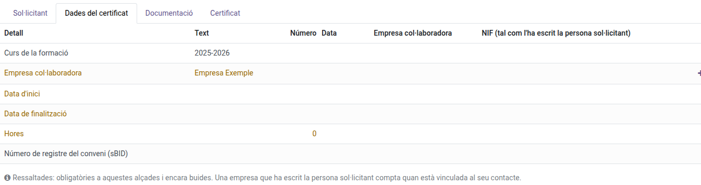
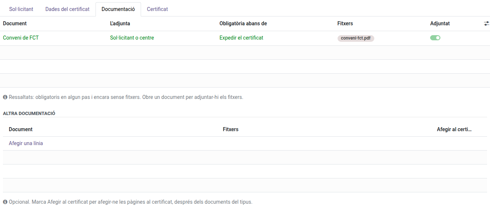

[Català](certificates.md) | [Castellano](../../es/teachers/certificates.md) | [English](../../en/teachers/certificates.md)

---

# Certificats de FCT: completar la formació (coordinació d'FP)

Completa les dades de la formació en centres de treball de les sol·licituds de certificat de FCT i passa-les a secretaria perquè les expedeixi.

**Rol necessari:** el càrrec de coordinador o coordinadora d'FP. Si un administrador posa un altre càrrec en el circuit d'un tipus de certificat, qui l'ocupa fa el seu pas de la mateixa manera.

---

## Quan et toca a tu

Quan l'alumne (o secretaria, per a un exalumne) envia la sol·licitud, el primer pas és teu: la trobes com a tasca al teu resum diari i a **Gestió acadèmica → Certificats**, amb el filtre **Pendents de mi**.

L'alumne pot haver escrit el nom i el NIF de l'empresa i haver adjuntat el conveni, però sovint no ho té tot: el teu pas és completar-ho.

Mentre no facis cap canvi, l'alumne encara pot completar o corregir les seves dades des de l'enllaç. Quan hi fas qualsevol canvi o acció, el formulari de l'alumne es tanca.

---

## Completar la formació

1. Obre la sol·licitud.
2. A la pestanya **Dades del certificat**, cada línia és una dada del certificat: el nom, una **Indicació** del que cal escriure i com, i el **Valor**. Fes clic a una línia per emplenar-la: s'obre una finestra amb el camp de la dada, i **Desar i tancar** la guarda.
   - A **Empresa col·laboradora**, tria l'empresa. Si no existeix i l'alumne en va escriure el nom, fes clic a **Crear empresa** a la finestra: es crea amb el nom i el NIF que va escriure (si ja n'hi ha una amb el mateix NIF, es vincula aquesta).
   - Omple **Data d'inici**, **Data de finalització**, **Hores** i el **Número de registre del conveni (sBID)**. La data de finalització no pot ser anterior a la d'inici.
3. A la pestanya **Documentació**, comprova el **Conveni de FCT**. Si no hi és, obre la línia, adjunta'l (PDF o fotos de les pàgines) i desa.
4. Obre **Accions → Fet: enviar al pas següent**. La sol·licitud passa a secretaria.

Sense l'empresa, les dates i les hores, EMS no deixa passar la sol·licitud al pas següent: les línies que hi falten surten ressaltades.

---

## Si falta informació

- **Accions → Demanar documentació** — escriu què necessites; la persona sol·licitant ho rep per correu amb un enllaç per respondre i adjuntar documents. Quan respon, la sol·licitud torna a tu.
- **Accions → Rebutjar** — si el certificat no es pot expedir; escriu-ne el motiu, que la persona sol·licitant rep per correu.

Si secretaria o direcció et retornen la sol·licitud, el motiu surt a dalt del formulari.

---

## Empreses col·laboradores

A **Comunitat Educativa → Empreses col·laboradores** hi ha les empreses on l'alumnat fa la formació. Pots crear-ne i editar-ne les dades (NIF, adreça, contactes com el tutor de l'empresa).
