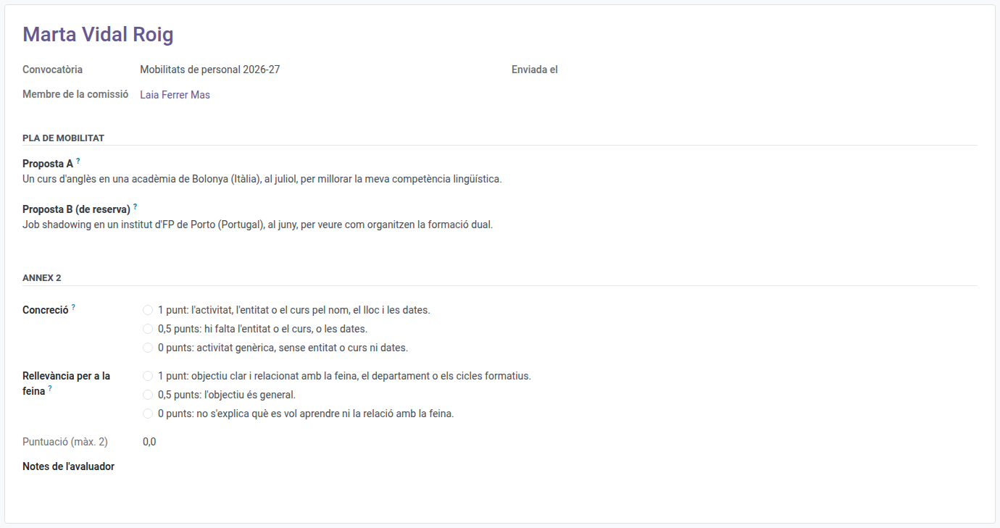

[Català](erasmus-plan-ratings.md) | [Castellano](../../es/teachers/erasmus-plan-ratings.md) | [English](../../en/teachers/erasmus-plan-ratings.md)

---

# Valorar plans de mobilitat Erasmus+

Com a membre de la comissió de la convocatòria Erasmus+ del personal, valores a l'EMS el pla de mobilitat de cada persona candidata amb la rúbrica de la convocatòria.

**Qui:** els membres de la comissió que l'equip Erasmus afegeix a la convocatòria (la direcció i els caps de departament i de seminari).

---

## 1. Trobar els plans

Quan l'equip Erasmus envia els plans a la comissió, reps una tasca a l'EMS per a cadascun, que venç el termini per corregir puntuacions de la convocatòria (dues setmanes després del tancament). Surt al resum diari de tasques pendents fins que la facis. Al menú **Erasmus+** tens **La meva participació > Plans per valorar**: els plans que tens assignats.

Cada valoració mostra en pantalla el **pla de mobilitat** de la persona candidata, tal com el va escriure al formulari de sol·licitud: la proposta A (la principal) i la proposta B (per si la A no es pot fer), amb les seves paraules, cadascuna amb l'activitat, l'entitat o el curs, on, quan i què vol aprendre, sota el seu títol i a tota l'amplada. Valora les dues propostes juntes, amb una sola puntuació. No veus res més de la sol·licitud. La difusió no es valora: és la mateixa obligació per a tothom.

## 2. Valorar la rúbrica

Per a cada aspecte, tria la descripció que s'ajusta més al pla: són les de l'annex 2 de la convocatòria, i cadascuna comença amb els punts que dona (1, 0,5 o 0).

| Aspecte | 1 punt | 0,5 punts | 0 punts |
|---|---|---|---|
| Concreció | L'activitat, l'entitat o el curs pel nom, el lloc i les dates | Hi falta l'entitat o el curs, o les dates | Activitat genèrica, sense entitat o curs ni dates |
| Rellevància per a la feina | Objectiu clar i relacionat amb la feina, el departament o els cicles formatius | L'objectiu és general | No s'explica què es vol aprendre ni la relació amb la feina |

Pots escriure les teves notes a **Notes de l'avaluador**.

## 3. Enviar-la

Fes clic a **Accions > Enviar**, o a **Accions > Envia i següent** per enviar-la i obrir el següent pla que encara has de valorar. Fins al **termini per corregir puntuacions** de la convocatòria la pots **Reobrir** i canviar; després, si hi ha un error, avisa l'equip Erasmus.

**Si et presentes a la convocatòria, o tens un conflicte d'interessos amb una persona candidata**, no valores: avisa l'equip Erasmus, que registrarà l'abstenció: la valoració surt com a *Abstenció*. La puntuació del pla és la mitjana de la resta de membres.

**La teva valoració és independent:** com a membre de la direcció pots obrir les sol·licituds del personal, però la pestanya **Baremació** indica que els punts estan ocults fins que no s'han valorat tots els plans de la convocatòria, de manera que mai no veus la mitjana dels altres membres abans de donar la teva.

---

[← Tornar als manuals del professorat](index.md)
