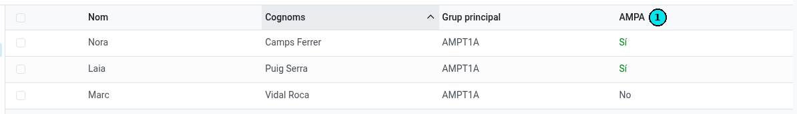
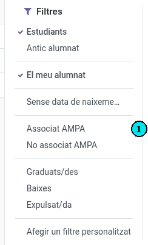

[Català](ampa.md) | [Castellano](../../es/tutors/ampa.md) | [English](../../en/tutors/ampa.md)

---

# Socis de l'AMPA del teu alumnat

Pots veure quins dels alumnes que tutoritzes són socis de l'AMPA i fer-ne la llista, tant dels que en són com dels que no.

**Rol necessari:** Tutor. El teu cap de seminari, el teu cap de departament i el teu cap d'estudis també ho veuen per al teu alumnat, i la direcció per al de tots els tutors. La secretaria i l'administració ho veuen per a tot l'alumnat del centre.

---

## Qui és soci de l'AMPA

Un alumne és soci de l'AMPA quan la seva matrícula confirmada del curs actual inclou la **quota de l'AMPA** i se n'ha **cobrat el primer termini**, que és on es factura la quota.

La quota es paga una vegada per família: si un germà és soci (comparteix un familiar amb l'alumne), l'alumne també ho és.

## Veure-ho a la llista d'estudiants

1. Obre **Comunitat Educativa → Estudiants** i passa a la vista de llista.
2. La columna **AMPA** **(1)** diu **Sí** o **No** per a cada alumne.

Si no veus la columna, activa-la al selector de columnes (la icona de la dreta de la capçalera de la llista).

La columna queda buida per als alumnes que no són del teu alumnat ni de la teva àrea.

## Fer la llista dels socis o dels que no ho són

1. Obre el menú de filtres del cercador (la fletxa de la dreta).
2. Tria **Associat AMPA** **(1)** per veure només els socis, o **No associat AMPA** per veure els que no ho són.

Els filtres es combinen amb **El meu alumnat** i amb el panell de grups de l'esquerra: per exemple, selecciona el teu grup al panell i aplica **No associat AMPA**.

## Veure-ho a la fitxa de l'alumne

A la fitxa de l'alumne, al costat de **Beneficis**, l'etiqueta **AMPA** diu **Sí** o **No**.

## Si una família diu que ja ha pagat

L'alumne surt com a soci quan el cobrament del primer termini està registrat. Si una família diu que ha pagat i l'alumne surt amb **No**, adreça-la a la secretaria.

---

[← Tornar a l'índex de tutors](index.md)
