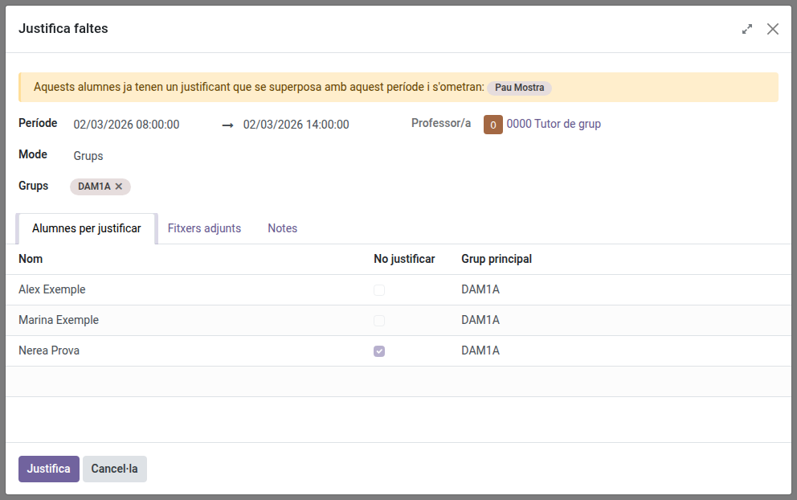
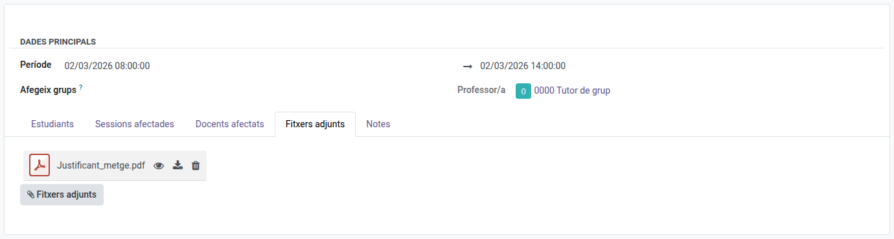
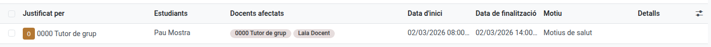

[Català](attendance-justifications.md) | [Castellano](../../es/tutors/attendance-justifications.md) | [English](../../en/tutors/attendance-justifications.md)

---

# Justificar les faltes del teu alumnat

Un justificant cobreix un període (data i hora d'inici i de fi) d'un o de diversos alumnes: un alumne amb hora al metge, o un grup sencer en vaga o en un concurs. Totes les faltes d'aquell període passen a **Falta justificada**, les hagi posat qualsevol docent, i cada **Retard greu** (que compta com a falta) passa a **Retard lleu**. El justificant té un sol motiu i un sol conjunt de fitxers adjunts, compartits per tots els seus alumnes.

Llevat que el centre ho permeti a la seva configuració, una justificació és l'única manera de justificar una falta: el professorat no pot marcar un alumne com a Falta justificada en passar llista.

**Rol necessari:** Tutor

---

## Registrar un justificant

1. Ves a **Assistència dels estudiants → Justificants** i clica **Nou**.
2. A **Motiu**, tria per què (per defecte, **Motius de salut**). Després:
    - Per a la majoria de motius, indica la data i l'hora d'inici i de fi a **Període**.
    - Per a una **Vaga**, tria el **Dia**: el justificant cobreix tota la jornada de l'alumne.
    - Per a **Altres**, descriu-lo a **Detalls**, que només apareix per a aquest motiu.
3. Afegeix-hi els alumnes, a la pestanya **Estudiants**:
    - **Un grup sencer:** tria'l a **Afegeix grups**. S'afegeixen a la llista tots els seus alumnes, amb el nom i el grup principal de cadascun. Pots afegir diversos grups, un rere l'altre.
    - **Un o més alumnes:** clica **Afegir una línia** i tria'ls (en pots marcar diversos alhora).

    Només hi surten els teus grups i els seus alumnes.
4. Treu de la llista, amb la creu (×), qui no s'hagi de justificar (per exemple, en una vaga, els alumnes que no han signat el document).
5. Si vols, adjunta el document a la pestanya **Fitxers adjunts** i afegeix un comentari a **Notes**.
6. Desa. Les faltes del període de tots els alumnes de la llista passen a **Falta justificada**, sigui quin sigui el docent que les va posar, i els seus retards greus a **Retard lleu**.

La pestanya **Sessions afectades** mostra, per a cada alumne, les sessions del període en què tenia una falta o un retard greu.

Al passi de llista, les línies justificades mostren un escut i el docent ja no les pot canviar. La seva nota indica qui les ha justificat ("Falta justificada per: ..." o "Retard greu justificat per: ...").

Un alumne no pot tenir dos justificants amb períodes que se superposin. Quan afegeixes un grup, els alumnes que ja en tenen un no s'afegeixen, i un missatge t'indica quins són. Si n'afegeixes algun manualment, un avís groc l'indica: treu-lo de la llista per poder desar.

### Dies que encara no han arribat

El període pot incloure dies futurs (per exemple, un ingrés hospitalari previst). Quan un docent passi llista en una sessió d'aquell període, l'alumne ja hi sortirà com a **Falta justificada**, i la sessió s'afegirà a les **Sessions afectades** del justificant.

---

## Adjuntar el document

També pots adjuntar fitxers a un justificant després de crear-lo:

1. Obre el justificant des de la llista de **Justificants**.
2. A la pestanya **Fitxers adjunts**, clica el botó **Fitxers adjunts** i tria el fitxer (per exemple, l'informe mèdic). En pots triar diversos alhora; cadascun es diu com el seu fitxer.
3. Desa el justificant.

Amb la icona de l'ull previsualitzes el fitxer sense sortir de l'EMS (PDF, imatges i fitxers de text); amb la icona de descàrrega el descarregues; amb la paperera l'esborres quan desis el justificant. A la pestanya **Notes** pots afegir-hi un comentari.

Els fitxers adjunts els pot obrir tothom qui pot veure el justificant: el professorat de les sessions afectades, la Prefectura d'Estudis i l'administració acadèmica.

---

## Consultar, modificar o esborrar un justificant

**Assistència dels estudiants → Justificants** mostra els justificants del teu alumnat, amb els docents de les sessions afectades.

- **Canviar el període o el motiu:** obre el justificant, modifica el **Període** (o el **Dia**, en una vaga) o el **Motiu** i desa. Les faltes que en queden fora tornen a **Falta** (o a **Retard greu**, si ho eren) i les noves queden justificades.
- **Afegir-hi o treure'n alumnes:** afegeix-los o treu-los a la pestanya **Estudiants** i desa. Les faltes d'un alumne que treus tornen a **Falta** (o a **Retard greu**).
- **Esborrar-lo:** les faltes que cobria tornen a **Falta**, i els retards a **Retard greu**.

Un justificant que inclou alumnes de grups dels quals no ets tutor només el pot modificar o esborrar qui en sigui responsable de tots (la Prefectura d'Estudis o l'administració acadèmica). El pots obrir igualment.

La llista mostra el motiu i els detalls de cada justificant. Pots cercar-hi per alumne, per grup o per motiu, i agrupar-la per motiu.

---

[← Tornar als manuals de Tutors](index.md)
