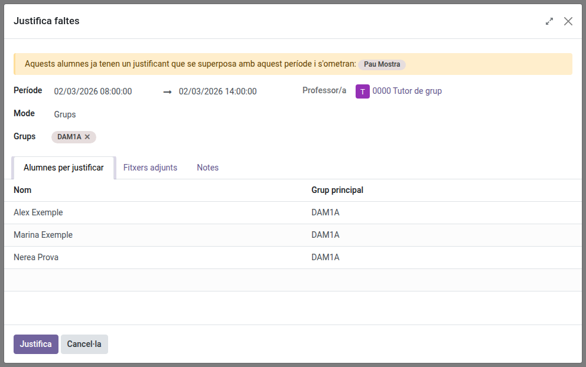
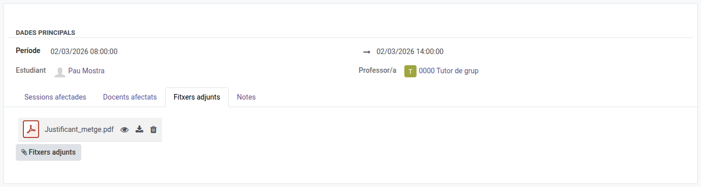
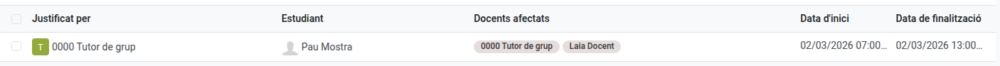

[Català](attendance-justifications.md) | [Castellano](../../es/tutors/attendance-justifications.md) | [English](../../en/tutors/attendance-justifications.md)

---

# Justificar les faltes del teu alumnat

Un justificant cobreix un període (data i hora d'inici i de fi) d'un alumne del teu grup. Totes les faltes d'aquell període passen a **Falta justificada**, les hagi posat qualsevol docent, i tots els **Retard greu** (que compten com a falta) passen a **Retard lleu**.

Llevat que el centre ho permeti a la seva configuració, una justificació és l'única manera de justificar una falta: el professorat no pot marcar un alumne com a Falta justificada en passar llista.

**Rol necessari:** Tutor

---

## Registrar un justificant

Pots justificar un alumne, diversos o grups sencers alhora (per exemple, per a una sortida d'un grup).

1. Ves a **Assistència dels estudiants → Justificants** i clica **Nou**. S'obre la finestra **Justifica faltes**.
2. A **Període**, indica la data i l'hora d'inici i de fi.
3. A **Mode**, tria com els selecciones:
    - **Estudiants**: tria un o més alumnes a **Estudiants**.
    - **Grups**: tria un o més grups a **Grups**. Es justifiquen tots els alumnes d'aquests grups.

    Només hi surten els teus grups i els seus alumnes.
4. La pestanya **Alumnes per justificar** mostra qui es justificarà. Si algun ja té un justificant que se superposa amb el període, un avís groc l'indica: se l'ometrà.
5. Si vols, adjunta el document a la pestanya **Fitxers adjunts** (cada alumne en rep una còpia) i afegeix un comentari a **Notes**.
6. Clica **Justifica**. EMS crea un justificant per a cada alumne: les seves faltes del període passen a **Falta justificada**, sigui quin sigui el docent que les va posar, i els seus retards greus a **Retard lleu**. Un missatge t'indica quants alumnes s'han justificat i quins s'han omès.

Cada justificant mostra, a la pestanya **Sessions afectades**, les sessions del període en què l'alumne tenia una falta o un retard greu.

Al passi de llista, les línies justificades mostren un escut i el docent ja no les pot canviar. La seva nota indica qui les ha justificat ("Falta justificada per: ..." o "Retard greu justificat per: ...").

Un alumne no pot tenir dos justificants amb períodes que se superposin.

### Dies que encara no han arribat

El període pot incloure dies futurs (per exemple, un ingrés hospitalari previst). Quan un docent passi llista en una sessió d'aquell període, l'alumne ja hi sortirà com a **Falta justificada**, i la sessió s'afegirà a les **Sessions afectades** del justificant.

---

## Adjuntar el document

També pots adjuntar fitxers a un justificant després de crear-lo:

1. Obre el justificant des de la llista de **Justificants**.
2. A la pestanya **Fitxers adjunts**, clica el botó **Fitxers adjunts** i tria el fitxer (per exemple, l'informe mèdic). En pots triar diversos alhora; cadascun es diu com el seu fitxer.
3. Desa el justificant.

Amb la icona de l'ull previsualitzes el fitxer sense sortir de l'EMS (PDF, imatges i fitxers de text); amb la icona de descàrrega el descarregues; amb la paperera l'esborres quan desis el justificant. A la pestanya **Notes** pots afegir-hi un comentari.

Els fitxers adjunts els pot obrir tothom qui pot veure el justificant: el professorat de les sessions afectades, la Prefectura d'Estudis i l'administració acadèmica.

---

## Consultar, modificar o esborrar un justificant

**Assistència dels estudiants → Justificants** mostra els justificants del teu alumnat, amb els docents de les sessions afectades.

- **Canviar el període:** obre el justificant, modifica el **Període** i desa. Les faltes que en queden fora tornen a **Falta** (o a **Retard greu**, si ho eren) i les noves queden justificades.
- **Esborrar-lo:** les faltes que cobria tornen a **Falta**, i els retards a **Retard greu**.
- L'**Estudiant** no es pot canviar un cop desat: esborra el justificant i crea'n un de nou.

---

[← Tornar als manuals de Tutors](index.md)
