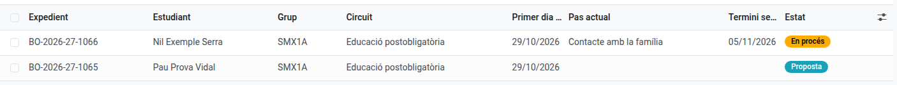
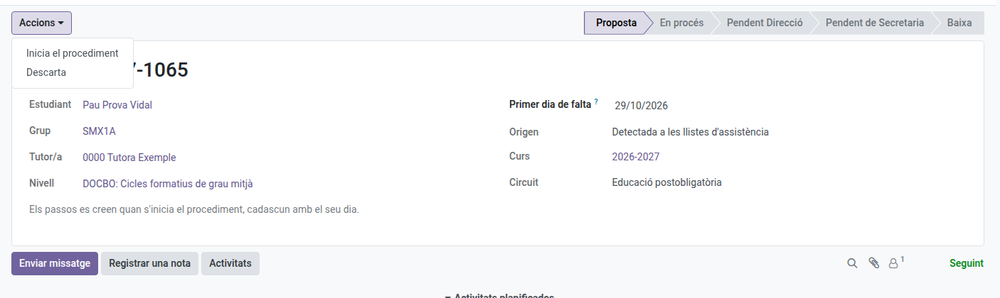
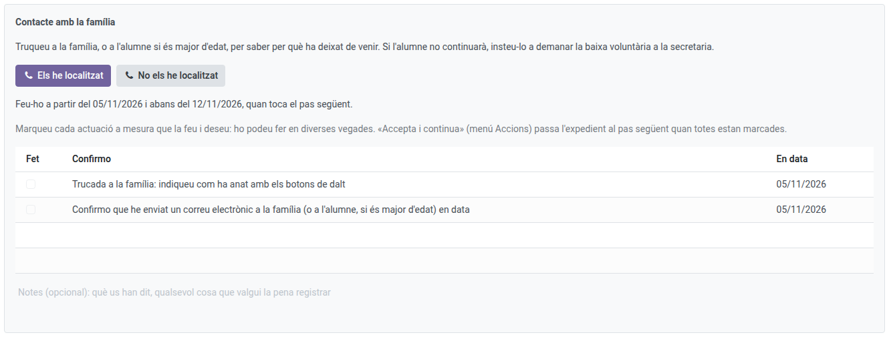
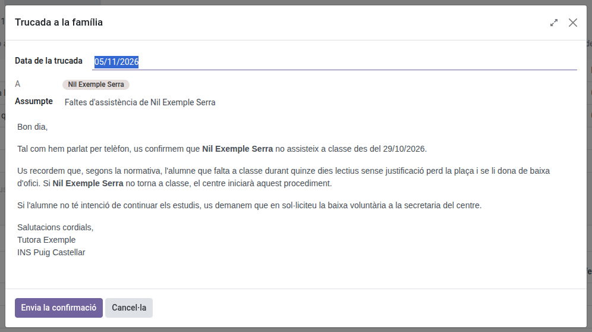
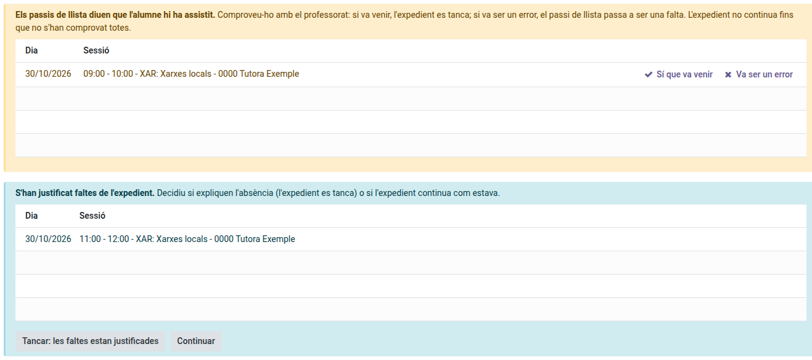

[Català](ex-officio-withdrawal.md) | [Castellano](../../es/tutors/ex-officio-withdrawal.md) | [English](../../en/tutors/ex-officio-withdrawal.md)

---

# Baixa d'ofici d'un alumne

Aquesta guia explica què has de fer quan un alumne teu deixa de venir a classe: com arriba la proposta de baixa d'ofici, com la inicies o la descartes, com fas el teu pas (la trucada a la família i, si cal, el correu) i què passa si els passis de llista diuen una altra cosa mentre l'expedient està obert.

**Rol necessari:** tutor/a de l'alumne (també el cap de departament o de seminari i el cap d'estudis per sobre teu, Direcció i l'Administrador)

---

## Índex

1. [Per a què serveix](#per-a-què-serveix)
2. [On trobar els expedients](#on-trobar-els-expedients)
3. [La proposta](#la-proposta)
4. [El teu pas: contacte amb la família](#el-teu-pas-contacte-amb-la-família)
5. [Si els passis de llista diuen una altra cosa](#si-els-passis-de-llista-diuen-una-altra-cosa)
6. [Què passa després](#què-passa-després)

---

## Per a què serveix

Un alumne que deixa de venir al centre perd la plaça al cap d'un termini. EMS obre un **expedient** que segueix pas a pas el protocol del centre, amb qui ha fet cada pas i quan:

- **Postobligatòria** (CFGM, CFGS, cursos d'especialització, PFI): 15 dies lectius sense venir. Al 5è dia et toca a tu; al 10è, a Secretaria; al 15è, Direcció dona el vistiplau i Secretaria tramita la baixa.
- **Obligatòria** (CFGB): 2 mesos naturals, amb una trucada teva la primera setmana, una de Convivència al cap de 15 dies, els avisos de Secretaria i Serveis Socials al cap d'un mes, l'avís de baixa al cap d'un mes i mig i el vistiplau de Direcció al cap de 2 mesos.

Cada pas et dona una **tasca** el dia que toca, que veus al teu resum diari.

---

## On trobar els expedients

Navega a: **Gestió acadèmica → Baixes d'ofici**. Hi veus els expedients del teu alumnat, el pas en què és cadascun i quan acaba el termini següent.

---

## La proposta

Una proposta arriba de dues maneres:

- **La detecta EMS:** quan un alumne acumula 5 dies lectius seguits en què ha faltat sense justificar a tots els passis de llista. Els dies sense passi de llista o amb faltes justificades no compten ni tallen el compte; qualsevol assistència o retard el torna a començar.
- **La demanes tu:** a la fitxa de l'alumne, **Accions → Sol·licita la baixa d'ofici**, i hi indiques el primer dia de falta.

Rebràs la tasca de decidir-la. Obre l'expedient i, al menú **Accions**:

- **Inicia el procediment:** es creen els passos amb els seus dies.
- **Descarta:** si l'alumne té un motiu (per exemple, una malaltia), escriu-lo i la proposta es tanca. Només es tornarà a proposar si torna a faltar 5 dies seguits més endavant.

---

## El teu pas: contacte amb la família

El dia que toca, l'expedient et mostra què has de fer i fins quan. Truca a la família (o a l'alumne, si és major d'edat) i digues com ha anat amb els botons:

- **Els he localitzat** o **No els he localitzat:** s'obre una finestra amb el dia de la trucada i, a postobligatòria, el correu que EMS ha preparat per a la família (una confirmació o un avís), que pots revisar abans d'enviar-lo.
- **Ho tornaré a intentar demà** (si no els has localitzat): no s'envia res i el pas passa al dia lectiu següent.

La trucada i el correu queden marcats sols a la llista, amb la data, i el text enviat es guarda a l'historial de l'expedient. Quan tot està marcat, **Accions → Accepta i continua** passa l'expedient al pas següent.

---

## Si els passis de llista diuen una altra cosa

Mentre l'expedient està obert (també si encara és una proposta), EMS revisa els passis de llista dels dies de l'expedient un cop acabada cada sessió:

- **L'alumne hi consta com a present** (o amb retard): l'expedient s'atura i reps la tasca **Comprovar una assistència**. Comprova-ho amb el professorat i fes clic a **Sí que va venir** (l'expedient es tanca: l'alumne ha tornat) o **Va ser un error** (aquell passi de llista passa a falta, amb una nota). Si el professor corregeix ell mateix el passi de llista, l'avís desapareix sol.
- **S'han justificat faltes de l'expedient:** reps la tasca **Revisar faltes justificades**. Decideix si expliquen l'absència (**Tancar: les faltes estan justificades**) o si l'expedient continua com estava (**Continuar**). Això no atura l'expedient.

---

## Què passa després

Quan acceptes el teu pas, l'expedient passa al responsable següent (Convivència, Secretaria o Direcció), que rep la seva tasca el dia que toca. Tu continues veient l'expedient i el seu **Històric**, amb cada pas fet, qui el va fer i quan.

Si l'alumne demana la baixa voluntària o és expulsat, l'expedient es tanca sol.
