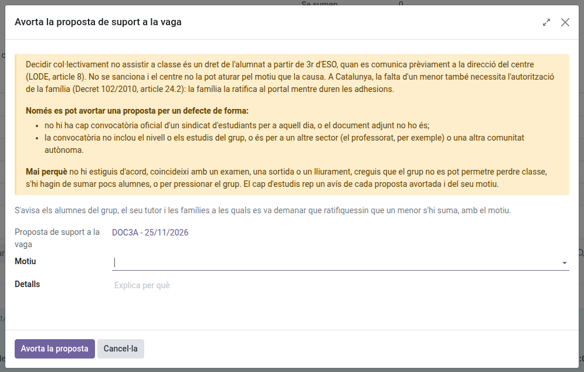

[Català](student-walkout.md) | [Castellano](../../es/tutors/student-walkout.md) | [English](../../en/tutors/student-walkout.md)

---

# Vagues d'estudiants: vetllar per la proposta del teu grup

Quan el delegat del teu grup proposa al portal que el grup doni suport a una vaga, tu vetlles per la proposta: reps un avís de cada pas i la pots aturar si té un defecte de forma. El cap d'estudis només hi intervé al final, per validar-la o no. Com hi participen l'alumnat i les famílies es pot llegir al [manual de famílies](../families/manual-vagues.md).

No s'ha de confondre amb els **Strikes** (Convivència), el registre disciplinari.

---

## Què et notifica

Reps un correu, alhora que el teu grup, cada vegada que passa alguna cosa:

| Quan | Què diu el correu |
|------|-------------------|
| El delegat proposa la votació | Qui l'ha proposada, per a quin dia, i fins quan vota el grup |
| El grup hi dona suport | El recompte de vots, i fins quan cada alumne diu si s'hi suma |
| La proposta es tanca | Si el grup hi dona suport i quants alumnes s'hi sumen |
| El cap d'estudis la valida | Que la falta dels qui s'hi sumen està justificada |
| S'avorta o no es valida | Qui ho ha fet, i el motiu |

Si ets tutor d'un grup desdoblat, se n'avisa cada cotutor. Un grup sense tutor ho rep el cap d'estudis i el cap d'estudis adjunt.

---

## Consultar una proposta

**Assistència dels estudiants > Vagues d'alumnes** mostra les propostes dels teus grups. El formulari mostra el calendari, la convocatòria del sindicat, el recompte de vots i, a la pestanya **Alumnat**, qui ha votat (mai què), qui s'hi suma i la ratificació de la família dels alumnes menors d'edat.

Un alumne menor que s'hi suma necessita que la seva família ho ratifiqui al portal mentre duren les adhesions (Decret 102/2010, article 24.2): sense la ratificació, la seva falta no es justifica. La columna **Es pot justificar** et diu a qui es justificarà la falta si la vaga es valida.

---

## Avortar una proposta

Mentre el grup vota o hi ha adhesions, pots aturar la proposta: **Accions > Avorta la proposta**. Tria un **Motiu** (i explica'l a **Detalls** si el motiu ho demana) i fes clic a **Avorta la proposta**.

**Només per un defecte de forma.** Decidir col·lectivament no assistir a classe és un dret de l'alumnat a partir de 3r d'ESO (LODE, article 8): el centre no la pot aturar pel motiu que la causa. La pots avortar quan:

- no hi ha cap convocatòria oficial d'un sindicat d'estudiants per a aquell dia, o el document adjunt no ho és;
- la convocatòria no inclou el nivell o els estudis del grup, o és per a un altre sector (el professorat, per exemple) o una altra comunitat autònoma.

Mai perquè no hi estiguis d'acord, coincideixi amb un examen, una sortida o un lliurament, creguis que el grup no es pot permetre perdre classe, o s'hi hagin de sumar pocs alumnes.

Se n'avisa l'alumnat del grup, amb el motiu, i el cap d'estudis rep un avís de cada proposta avortada al seu resum diari. Un cop tancada la proposta, només decideix el cap d'estudis.

També la poden avortar els qui són per sobre teu a la jerarquia (cap de departament o de seminari, cap d'estudis o cap d'estudis adjunt, direcció) i l'administrador.

---

[← Tornar als manuals de tutors](index.md)
