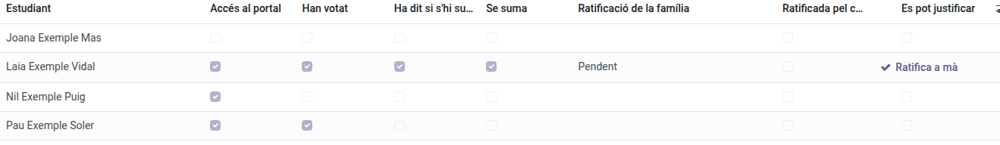
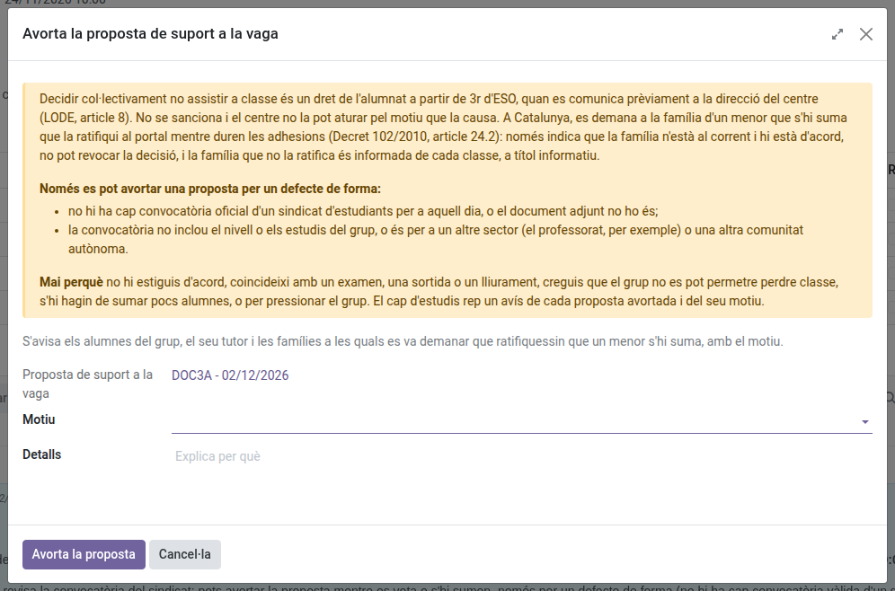

[Català](student-walkout.md) | [Castellano](../../es/tutors/student-walkout.md) | [English](../../en/tutors/student-walkout.md)

---

# Inassistències col·lectives: vetllar per la proposta del teu grup

Quan el delegat del teu grup proposa al portal que el grup faci una inassistència col·lectiva, tu vetlles per la proposta: reps un avís de cada pas i la pots aturar si té un defecte de forma. El cap d'estudis només hi intervé al final, per validar-la o no. Com hi participen l'alumnat i les famílies es pot llegir al [manual de famílies](../families/manual-inassistències col·lectives.md).

No s'ha de confondre amb els **Strikes** (Convivència), el registre disciplinari.

---

## Què et notifica

Reps un correu, alhora que el teu grup, cada vegada que passa alguna cosa:

| Quan | Què diu el correu |
|------|-------------------|
| El delegat proposa la votació | Qui l'ha proposada, per a quin dia, i fins quan vota el grup |
| El grup hi dona suport | El recompte de vots, i fins quan cada alumne diu si s'hi suma |
| S'amplien les adhesions | Fins quan cada alumne pot dir ara si s'hi suma; fins llavors encara pots avortar la proposta |
| La proposta es tanca | Si el grup hi dona suport i quants alumnes s'hi sumen |
| El cap d'estudis la valida | Que la inassistència col·lectiva està validada: els qui s'hi sumen continuen sense constar al passi de llista d'aquell dia |
| S'avorta o no es valida | Qui ho ha fet, i el motiu |

Si ets tutor d'un grup desdoblat, se n'avisa cada cotutor. Un grup sense tutor ho rep el cap d'estudis i el cap d'estudis adjunt.

Els correus t'arriben quan arriben al teu grup: de seguida si el centre compta les hores des del moment de la proposta (sigui l'hora que sigui) i, si no, durant les classes del grup o a l'inici de les següents.

---

## Consultar una proposta

**Assistència dels estudiants > Inassistències col·lectives** mostra les propostes dels teus grups. El formulari mostra el calendari, el motiu, el document que la justifica, el recompte de vots i, a la pestanya **Alumnat**, qui ha votat (mai què), qui s'hi suma i la ratificació de la família dels alumnes menors d'edat.

A la família d'un alumne menor que s'hi suma se li demana al portal, mentre duren les adhesions, que n'acusi rebuda i que digui si hi està d'acord. La resposta només indica al centre que la família n'ha estat informada: és una decisió col·lectiva dels alumnes que ningú no pot revocar, tampoc la família.

**El passi de llista del dia de la inassistència col·lectiva.** Quan es tanquen les adhesions i el grup la fa, els alumnes que s'hi sumen surten en gris al passi de llista d'aquell dia, com a «No ha d'assistir: inassistència col·lectiva»: no hi falten ni hi assisteixen, i no cal justificar res. Si un alumne menor s'hi suma i la família no ha dit que hi està d'acord, l'etiqueta ho indica i la família rep, a títol informatiu, l'avís de cada classe a què no assisteix. Si l'alumne ve a classe, el professor el torna a posar a la llista; si s'ha equivocat i el torna a treure, recupera el motiu «inassistència col·lectiva» (i l'avís a la família). Si la inassistència col·lectiva no es valida, aquelles classes compten com a faltes.

Si la família d'un menor no pot utilitzar el portal i et comunica (a tu o al centre) que n'ha rebut l'avís i hi està d'acord, fes clic a **La família hi està d'acord (a mà)** a la fila d'aquest alumne de la pestanya **Alumnat** i confirma-ho. Ho pots fer des que els alumnes s'hi sumen fins que la cap d'estudis valida la inassistència col·lectiva, només per a famílies que no han respost (mai per anul·lar un «no hi estic d'acord»). La fila mostra qui ho ha marcat i el canvi queda registrat al xat.

---

## Avortar una proposta

Mentre el grup vota o hi ha adhesions, pots aturar la proposta: **Accions > Avorta la proposta**. Tria un **Motiu** (i explica'l a **Detalls** si el motiu ho demana) i fes clic a **Avorta la proposta**.

**Només per un defecte de forma.** Decidir col·lectivament no assistir a classe és un dret de l'alumnat a partir de 3r d'ESO (LODE, article 8): el centre no la pot aturar pel motiu que la causa. La pots avortar quan:

- el document adjunt no justifica la proposta (no explica per què el grup fa la inassistència col·lectiva, o és d'un altre dia). Pot ser la convocatòria d'un sindicat d'estudiants, l'acta de l'assemblea del grup o qualsevol document que expliqui la decisió.

Mai perquè no hi estiguis d'acord amb la causa, amb qui la convoca o amb on es convoca (un sindicat, una assemblea, un altre sector o un altre territori), coincideixi amb un examen, una sortida o un lliurament, creguis que el grup no es pot permetre perdre classe, o s'hi hagin de sumar pocs alumnes.

Se n'avisa l'alumnat del grup, amb el motiu, i el cap d'estudis rep un avís de cada proposta avortada al seu resum diari. Un cop tancada la proposta, només decideix el cap d'estudis.

També la poden avortar els qui són per sobre teu a la jerarquia (cap de departament o de seminari, cap d'estudis o cap d'estudis adjunt, direcció) i l'administrador.

Una proposta avortada ja no compta: el grup en pot fer una altra per al mateix dia.

---

## Ampliar les adhesions

Si l'alumnat necessita més temps per dir si s'hi suma, **Accions > Amplia les adhesions** li dona una fase més (el temps fixat per a cada fase a la configuració del centre), o menys si el cap d'estudis no rebria l'acta a temps: tant com es pot. Es compta des del final de les adhesions, o des d'ara si ja han acabat. Ho pots fer en qualsevol moment i tantes vegades com calgui, mentre el cap d'estudis encara rebi l'acta amb l'antelació prevista abans de la inassistència col·lectiva: quan no és possible, l'acció no apareix. S'avisa tot l'alumnat.

- El delegat i el sotsdelegat poden ampliar-les una vegada pel seu compte, des del portal.
- Si la proposta ja s'havia tancat, es torna a obrir: l'acta que va arribar al cap d'estudis es retira (en rep un avís al resum diari) i se n'envia una de nova quan es tanqui de nou.
- Només es poden ampliar les propostes a les quals el grup dona suport: una a la qual el grup no ha donat suport, una d'avortada o una ja validada no.

---

[← Tornar als manuals de tutors](index.md)
