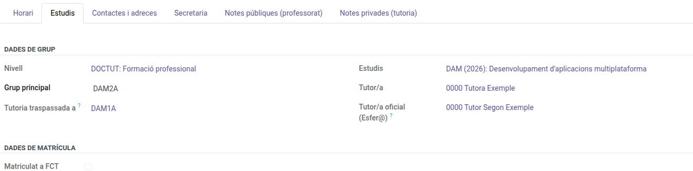

[Català](tutorship-transfer.md) | [Castellano](../../es/tutors/tutorship-transfer.md) | [English](../../en/tutors/tutorship-transfer.md)

---

# Traspassar la tutoria d'un alumne

De vegades, un alumne matriculat a 2n amb assignatures de 1r pendents es dona de baixa de totes les de 2n i només cursa les de 1r. Llavors la secretaria (o el cap d'estudis) pot traspassar-ne la tutoria al grup de 1r: l'alumne continua al seu grup de 2n a Esfer@, però el seguiment passa a vosaltres, el tutor de 1r.

**Rol necessari:** tutor

---

## Si sou el tutor nou (el del grup al qual s'ha traspassat la tutoria)

- L'alumne apareix entre el vostre alumnat (**El meu alumnat**) i en gestioneu les dades i les de la família com amb qualsevol alumne del vostre grup.
- Rebeu les seves incidències d'assistència al resum diari, els avisos de strikes i la resta d'avisos de tutor.
- Participa en les inassistències col·lectives del vostre grup.
- A la pestanya **Estudis** de la fitxa, **Tutoria traspassada a** mostra el vostre grup, **Tutor/a** us mostra a vosaltres i **Tutor/a oficial (Esfer@)**, el tutor del seu grup principal. No podeu canviar el traspàs: demaneu-ho a la secretaria.

## Si sou el tutor oficial (el del grup principal de l'alumne)

Continueu posant-li les notes: les sessions d'avaluació i l'expedient van per grup, i l'alumne continua al vostre. Deixeu de gestionar-ne les dades i de rebre'n avisos: ara és feina del tutor nou.

El traspàs s'acaba sol quan canvia el curs.

---

[← Tornar als manuals de tutors](index.md)
