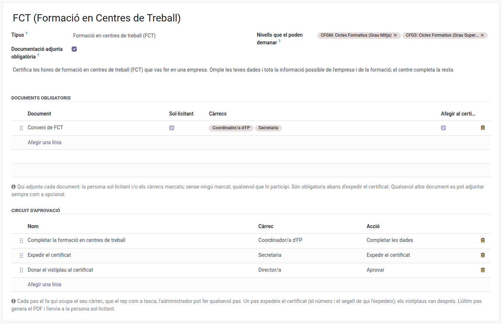

[Català](../../ca/admin/certificate-types.md) | [Castellano](../../es/admin/certificate-types.md) | [English](certificate-types.md)

---

# Certificate types and approval circuits

Configure which certificates students may request, which documentation they require and who does each step until they are issued.

**Required role:** Administrator.

---

## Access

Navigate to: **Academic management → Configuration → Certificates → Certificate types**.

EMS includes the **FCT (Formació en Centres de Treball)** type. Your changes to it are kept when EMS is upgraded.

---

## The type's fields

- **Kind** — what it certifies, and so which details the request asks for and what the certificate says.
- **Levels that may request it** — current students of these levels may request it from the portal, and the request only accepts studies of these levels. Left empty, the type is not offered on the portal and its requests are only registered by the secretariat.
- **Description** — what the applicant reads above the form.

---

## Required attached documentation

Tick **Required attached documentation** and add a line per document that must be attached before the certificate is issued:

- **Document** — the document's name (for example, *FCT agreement*).
- **Applicant** — the applicant may attach it from the portal or from the link.
- **Positions** — whoever holds these positions may attach it (only positions of the circuit can be chosen).
- **Add to the certificate** — the document's pages are appended to the certificate's PDF.

With neither **Applicant** nor any position ticked, anyone taking part may attach it. The administrator always can.

Besides the required documents, any request takes optional **Other documentation**, which is not added to the certificate.

---

## Approval circuit

Each line is a step, in order:

- **Name** — what whoever does the step sees.
- **Post** — whoever holds it gets the task and does the step. Positions and their holders are configured in [Positions](teacher-roles.md).
- **Action**:
  - **Complete the data** — completes the information and hands the request on.
  - **Issue the certificate** — gives the certificate its number and the issuing stamp.
  - **Approve** — adds the approval stamp.

The circuit must have exactly one **Issue the certificate** step, and the **Approve** steps go after it. The last step generates the PDF and sends it to the applicant.

The administrator may do any step of any request.
