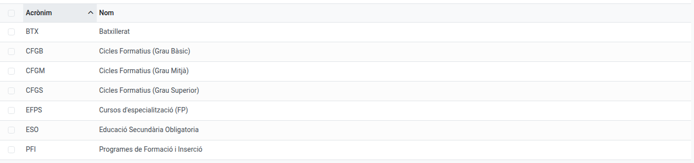

[Català](../../ca/admin/curriculum-levels.md) | [Castellano](../../es/admin/curriculum-levels.md) | [English](curriculum-levels.md)

---

# Levels

Levels represent the different **educational stages** or **study cycles** of the institution (e.g., Secondary Education, VET, Baccalaureate). They form the top of the curriculum hierarchy: each Level groups related Studies, which in turn group Class Groups.

**Required role:** Administrator

---

## Access

Navigate to: **Educational Community → Configuration → Curriculum → Levels**

---

## View All Levels

Opening the menu shows a list of all levels sorted alphabetically by acronym. Each row displays the acronym and the full name.

---

## Create a Level

1. Click **New**.
2. Fill in the required fields:
   - **Acronym** *(required)*: Short code used across the system (e.g., `BTX`, `CFGM`).
   - **Name** *(required)*: Full descriptive name (e.g., `Batxillerat`, `Cicles Formatius Grau Mitjà`).
3. The **Educational stage** (compulsory or post-compulsory education) is read-only: the regulation sets it, and EMS keeps it for the official levels. Which levels allow convalidations is set in [Convalidation settings](convalidation-settings.md#levels-that-allow-convalidations).
4. Optionally, add free-form notes in the **Notes** tab.
5. Click **Save** (or use the breadcrumb to navigate away — Odoo saves automatically).

> The **Studies** tab shows all studies linked to this level. Studies are managed from their own menu (**Configuration → Curriculum → Studies**) and cannot be added directly from the level form.

---

## Edit a Level

1. Open the level from the list.
2. Click any field to edit it inline, or click **Edit** if required.
3. Make your changes.
4. Click **Save**.

---

## Archive or Delete a Level

A level that is no longer offered is archived, not deleted: its studies, groups and students keep it.

1. Open the level (or select it in the list).
2. Click the **Action** menu (⚙) and select **Archive**.

An archived level no longer appears in lists or selectors, but everything that already uses it keeps showing it. To see it again, open the search options (▾ at the right of the search box) and choose the **Archived** filter; open it and use **Action** (⚙) → **Unarchive** to restore it.

You can only **Delete** a level that nothing uses yet (for example, one created by mistake). If anything uses it, EMS refuses and tells you what uses it.

---

[← Back to Administrator index](index.md)
