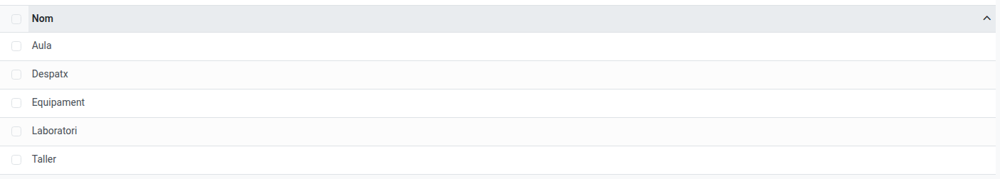
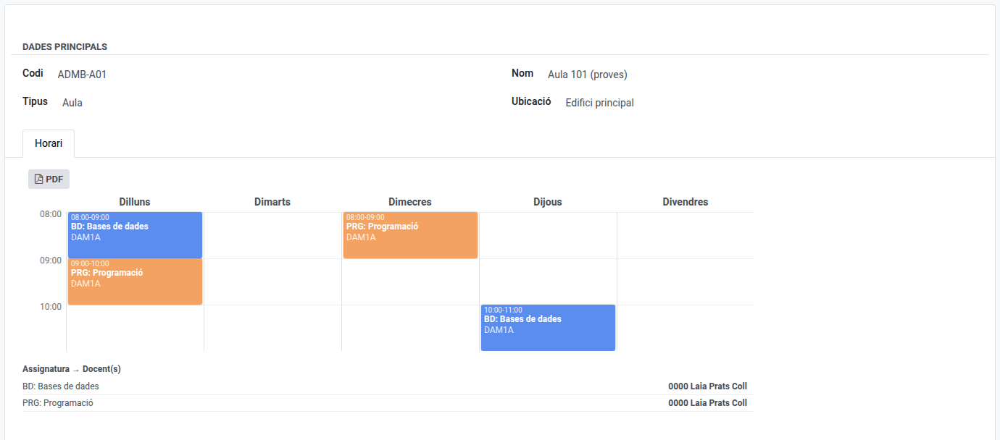

[Català](../../ca/admin/facilities.md) | [Castellano](../../es/admin/facilities.md) | [English](facilities.md)

---

# Spaces and Space Types

Spaces are the centre's physical rooms (classrooms, labs, workshops...), each assigned to a **Type** and a **Location** (site/building). They're used throughout the app wherever a session, group, minute or schedule slot needs a room. Each space also has its own weekly **occupation schedule** — see [A Classroom's Occupation Schedule](space-schedule.md).

**Required role:** Administrator (Teachers and Secretary can view a space, but not create/edit/delete one).

---

## Access

- **Space Types**: **Educational Community → Configuration → Spaces → Types**
- **Spaces**: **Educational Community → Spaces → Space list**

---

## Create a Space Type

1. Click **New**.
2. Fill in the **Name** (e.g. "Classroom", "Computer Lab").
3. Click **Save**.

---

## Create a Space

1. Click **New**. The **Type** and **Location** already come pre-filled with "Classroom" and "Main building" — change them if this space is different.
2. Fill in:
   - **Code** *(required)*: must be unique within its Location — the same code can be reused across different sites.
   - **Name** *(required)*.
   - **Type** *(required)*: pick a Space Type.
   - **Location** *(required)*: which site/building this space belongs to.
3. Click **Save**.

A **Schedule** tab and a chatter (for internal notes, messages and activities) are available once the space is created.

---

## Edit, Archive or Delete

Open the record from its list, edit any field, and save. A space (or space type) that no longer exists is archived, not deleted: its past sessions, schedules and reservations keep it, and an archived space is no longer offered when looking for a free room.

1. Open the space or space type (or select it in the list).
2. Click the **Action** menu (⚙) and select **Archive**.

An archived space no longer appears in lists or selectors, but everything that already uses it keeps showing it. To see it again, open the search options (▾ at the right of the search box) and choose the **Archived** filter; open it and use **Action** (⚙) → **Unarchive** to restore it.

You can only **Delete** a space or space type that nothing uses yet (for example, one created by mistake). If anything uses it, EMS refuses and tells you what uses it.

---

[← Back to Administrator index](index.md)
