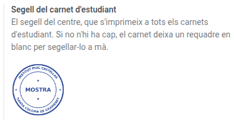
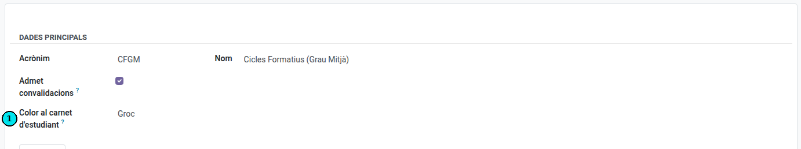

[Català](../../ca/admin/student-card-settings.md) | [Castellano](../../es/admin/student-card-settings.md) | [English](student-card-settings.md)

---

# Setting up the student card

The centre's stamp and each level's colour on the student card are set up here. How to print the cards is explained in [Printing student cards](../secretary/student-card.md).

**Required role:** Administrator (the stamp is uploaded from **Settings**, which only the system administrator sees).

---

## Uploading the centre's stamp

1. Go to **Settings → EMS Management → Center Data**.
2. In **Student card stamp**, upload the stamp's image.
3. Save.

Use a PNG image with a transparent background, so the stamp doesn't cover the rest of the card. From then on, the stamp is printed on every card. If you remove it, the cards are printed again with an empty box to stamp by hand.

---

## Changing a level's colour

Each level is shown on the card in a block of its own soft colour. The official levels already have one: ESO blue, BTX lavender, CFGB peach, CFGM yellow, CFGS cyan, EFPS sand and PFI orchid. A new level is grey until you pick one.

1. Go to **Educational Community → Configuration → Curriculum → Levels** and open the level.
2. In **Student card colour**, pick one of the colours on the list.
3. Save.

Pick one clearly different from the other levels'. Red and green are not on the list: the card uses them to show whether the student may leave the centre.

---

[← Back to index](index.md)
