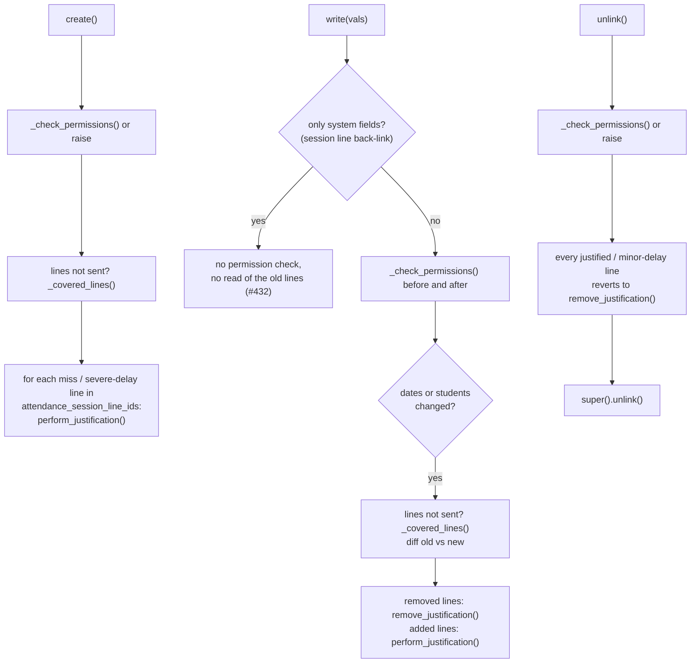

# Technical Reference: `ems.attendance_justification`

## Overview

An `ems.attendance_justification` is a tutor-entered proof-of-attendance covering a
date/time range for **one or several students** (`student_ids`, issue #795): one student's
medical appointment, or a whole group on strike or at a competition, with a single comment
and a single set of files. It retroactively re-marks any `miss` line of those
students within that range as `justified` and any `delayed_severe` line (a severe delay,
which counts as an absence) as `delayed` (a minor delay, issue #578), and going forward acts
as a *prevision*: a new session created within its range gets each covered student's line
pre-filled as justified instead of the usual default status. See
[`attendance_session.md`](attendance_session.md#_auto_populate_lines-continuation-vs-fresh-roll-call)
for how the prevision side is consumed (`get_current_justification_by_student()`, a dict
student id → justification built once per session, from a single `sudo()` search).

**Module file:** `models/attendance/attendance_justification.py` (`EmsAttendanceJustification`)

---

## Reasons (`ems.attendance_justification_reason`)

Every justification has a `reason_id` (required, `ondelete='restrict'`), picked from a catalog the
EMS administrator and the Heads of Studies maintain under **Student's Attendances → Configuration →
Justifications → Reasons** (`models/attendance/attendance_justification_reason.py`, same shape as
`ems.convalidation.rejection_reason`: `name` translatable, `sequence` with a drag handle, `active`).
The first reason by sequence is the default (`_default_reason_id()`). Two flags drive the form, so
the behaviour never depends on a reason's name or xmlid:

| Flag | Effect on the justification |
|------|-----------------------------|
| `requires_details` | The `details` field is shown and required (`_check_details`); picking another reason clears it. Seeded on "Other reasons". |
| `full_day` | The form shows a single `day` instead of the period. `day` is a non-stored compute (the local date of `start_date`) whose inverse, and `_onchange_day()`, set the period to that whole local day (`_day_period()`: 00:00 to 23:59:59 in the company's timezone, stored as naive UTC). Both only act for a full-day reason, since the client sends `day` back on every save. `_check_full_day` refuses any other period; `create()` also accepts `day` alone (the NOT NULL dates can't wait for the inverse). Seeded on "Student walkout" (`ems.attendance_justification_reason_walkout`). |

The seed (`data/main/ems.attendance_justification_reason.xml`) is `noupdate="1"`: the centre
reorders, renames and adds reasons from the app, and an upgrade must not undo it. It holds: Health
reasons (default), Student walkout, Expulsion from the centre, Attendance at an authorised activity
outside the centre, Family reasons, Unavoidable duty, Official exam, Other reasons. The English
names "Student walkout" and "Other reasons" avoid the existing translations of "Strike" (a
coexistence strike, `ems.strike`) and "Other". The walkout calls justify with this reason
(`student_walkout.md`).

The free `notes` (their own tab, as before) stay apart from the details. The list shows
`reason_id` and `details`; the search view filters and groups by reason.

---

## Permissions: every student, not any

`_user_may_justify(students)` holds for an administrator (or superuser mode), or for someone
acting as tutor (`ems.base.user_acts_as_tutor()`, i.e. the tutor or anyone above them in
`tutor_scope_user_ids`, issue #483) of **every** student; it is checked once per distinct
tutor, so a whole group costs one check. `_check_permissions(message)` raises a `UserError`
otherwise, and is called from:

| Where | Students checked |
|-------|------------------|
| `create()` | the new justification's |
| `write()` of any field but the system ones (`SYSTEM_FIELDS`: `attendance_session_line_ids`, `session_teacher_ids`) | before the write (the students taken out) and after it (the ones added) |
| `unlink()` | the justification's |

The reason, details and files are shared by every student, so changing them needs the right over all of
them, like adding or removing one. A tutor therefore only ever creates justifications for their
own students; one mixing groups of different tutors is managed by whoever is above all of them
(Head of Studies/Deputy, Director) or an administrator. `default_get()` still refuses to open an
empty form for anyone who is neither an administrator nor a tutor, and `get_view()` removes New,
Edit and Delete from the list and form for them (`ems.base.view_without_operations()`, the same
per-user post-processing as the enrollment screens of issue #654): a teacher without tutorship only
reads the justifications covering their sessions.

Reading is wider: `rule_attendance_justification_teacher_tutor` grants a tutor read access when
**any** student is theirs (`student_ids.tutor_id.tutor_scope_user_ids`), and
`rule_attendance_justification_teacher_own_read` the justifying and affected teachers (see below).
That rule has `perm_write`/`perm_unlink` off on purpose: the check above is the gate.

---

## The form (issue #795)

The list's **New** opens the form itself. It replaces the "Justify absences" assistant of issues
#656/#763 (one justification per student, with a copy of the comment and files each), removed
together with its line model.

| Field | Notes |
|-------|-------|
| `student_ids` | `Many2many` (`ems_attendance_justification_student_rel`), required. Listed with each student's main group; "Add a line" opens the multi-select picker, the cross (×) removes one. |
| `add_group_ids` | Non-stored helper. `_onchange_add_group_ids()` adds every student of the groups picked (`main_group_id`), except those already holding an overlapping justification, which it names in an onchange warning, then clears itself. |
| `student_domain` / `group_domain` | `Char` computes, the pickers' domains: an administrator, every student (and main group); anyone else, those of the groups they act as tutor of. Text, because for an administrator the ids would be the whole centre. |
| `overlap_student_ids` | Non-stored compute: the listed students who already hold an overlapping justification, shown as a yellow notice (saving would fail on `_check_time_overlap`). |
| `student_summary` | The student's name, or "N students": the list's column, instead of up to 30 tags per row. Also the first part of `display_name` ("N students (from 09:00 to 11:00)"). |

The search view filters by student and by main group (`student_ids.main_group_id`).

---

## Fields

| Field | Type | Notes |
|-------|------|-------|
| `attendance_session_line_ids` | `Many2many → ems.attendance_session_line` | The lines of every student the period covers. Deliberately M2m, not M2o-inverse — a plain M2o on the line side would delete the status entries themselves when the justification's filters change, per the code's own NOTE. |
| `session_teacher_ids` | computed + stored, `readonly=False` | Every teacher (template or session) touched by the linked lines — an editable compute (same pattern as `product.template.ems_study_ids`, see [`enrollment_product_extension.md`](../enrollment/enrollment_product_extension.md)), used for `ir.rule` permission filtering. |
| `attachment_ids` | `Many2many → ir.attachment` | The "Attached files" tab (`ems_attachments` widget, `ems.attachment_mixin`), one set for every student, see below. |

---

## Finding the covered lines

`_justifiable_lines(students, start_date, end_date)` is the one place that finds the session lines
a period covers: a single search for all the students, grouped per student afterwards, so a
justification of a group of 30 costs one query, not 30. `_covered_lines()` unions them for the
justification's own students; it feeds the form's onchange (the "Affected sessions" preview, one
column per student) and `create()`/`write()` when the caller did not send the lines.

---

## `_check_time_overlap`

`@api.constrains('student_ids', 'start_date', 'end_date')`: rejects an empty student list,
`start_date >= end_date`, and any overlap with another justification sharing **a student**
(`_overlapping_students()`, one `sudo()` search per justification: an overlap the user cannot read,
another tutor's, still counts). The error names the students in conflict. A session line links one
justification only (`attendance_justification_id`), which is why a student can't be in two
overlapping ones.

---

## `create()` / `write()` / `unlink()`: syncing with session lines



`perform_justification(vals, prevision=False)` and `remove_justification(line)` return a
plain **vals dict**, never write directly — callers decide when/how to apply it.
`perform_justification` always takes plain line vals: an existing line is normalized first
with `ems.attendance_session_line._justification_vals()` (this file's own `create()`/`write()`),
while `attendance_session.py`'s `_auto_populate_lines()` passes a not-yet-created line's initial
values as a *prevision*.

| Line status before | After `perform_justification()` | After `remove_justification()` |
|--------------------|---------------------------------|--------------------------------|
| `miss` (or any status, for a prevision) | `justified` | `miss` |
| `delayed_severe` (not a prevision) | `delayed` | `delayed_severe` |

`remove_justification()` tells the two apart by the line's current status (`delayed` means it
was a justified severe delay). Either way the line keeps `attendance_justification_id`/
`attendance_prevision_id`, which is what locks it in the roll-call widget. The resulting
`notes` are prefixed with `PREVISION_CAPTION`/`JUSTIFICATION_CAPTION`/`SEVERE_DELAY_CAPTION`
(`_lt`-lazy-translated module constants) plus the acting teacher's name, so the roll-call
always shows *who* justified/expected the absence and *why* it says so. The form's onchange
lists `miss`, `delayed_severe` and `justified` lines in the range, plus `delayed` lines that
already carry a justification (so a date change keeps the ones it still covers).

---

## The `session_teacher_ids` back-link and why it needs `sudo()`

`rule_attendance_justification_teacher_own_read` (`security/rules/attendance.xml`) grants a
teacher read access to a justification when they appear in its `session_teacher_ids`. That
field is a stored compute over `attendance_session_line_ids`, so a teacher only becomes able
to read the justification **after** one of their own session lines has been linked to it.

The link itself is written by `EmsAttendanceSessionLine.create()`
(`attendance_session.py`), when a line is created carrying an `attendance_prevision_id`:

```python
line.attendance_prevision_id.sudo().attendance_session_line_ids = [(4, line.id)]
```

The `sudo()` is load-bearing, not defensive tidiness. Without it the acting teacher has to
write the very link that would grant them access, and `write()`'s override reads
`attendance_session_line_ids` on the way through — a read the record rules reject for a
teacher who is neither the student's tutor nor the justification's author. The result is a
chicken-and-egg `AccessError` that aborts the whole transaction, so the session is never
created and the slot cannot be rolled at all (issue #432). The back-link is system-driven
bookkeeping, not a user action, which is what makes `sudo()` the correct answer here — the
same reasoning as `get_current_justifications()`, which is already sudo.

For the same reason `write()` builds its `old_lines_map` (the old-vs-new line diff) only
when `start_date`/`end_date`/`student_ids` are actually in `vals`, the single branch that consumes
it, and skips the permission check for a write of `SYSTEM_FIELDS` only.
Reading `attendance_session_line_ids` enforces the record rules, so doing it unconditionally
put a permission check in front of every unrelated write.

---

## Attached files

The "Attached files" tab uses the shared `ems.attachment_mixin` + `ems_attachments` widget (see
[`attachments.md`](../shared/attachments.md)): the tutor uploads straight from the tab, every
file is tied to the justification so whoever can read it can open the file (issue #553), and a
removed file is deleted on save.

---

## Tutors and sessions taught by other teachers

A student's absences are spread across sessions taught by several teachers, but
`rule_attendance_session_teacher_own` only lets a teacher read the session headers (and
`rule_attendance_schedule_teacher_*` the schedules) they teach or created. A tutor
justifying an absence therefore works with session lines whose headers they cannot read.
Session **lines** themselves are readable by every teacher
(`rule_attendance_session_line_teacher_all_read`) and writable by the student's tutor
(`rule_attendance_session_line_teacher_tutor`); only the header side needs `sudo()`, in
exactly two places:

| Where | What runs as `sudo()` | Why |
|-------|----------------------|-----|
| `_justifiable_lines()` (the form's onchange, `create()`/`write()`) | The search for the students' miss/justified lines within the period, and the session start/end dates compared against it. Only when `_user_may_justify()` holds for every student; anyone else searches with their own rules. | The domain filters on `attendance_session_id.date`, so the header rules would silently drop every other teacher's session: the justification would be saved and those absences left unjustified, with no error. The lines found are still written back with the user's own rights. |
| `EmsAttendanceSessionLine._compute_display_name()` | Reading the session header's label (`schedule \| date \| space`). | The affected-sessions list shows each line's `display_name`; without it the tutor gets an `AccessError` opening the justification as soon as another teacher's line is linked. The label is all that is exposed: the tutor still cannot open, list or edit those sessions. |

Record rules were deliberately not widened instead (a tutor read rule on headers and
schedules): that would also list other teachers' sessions under Attendances > History
for every tutor. Issue #469.

---

## Fixed in this pass (2026-07-28)

**Real bug found and fixed:** `student_id`'s domain was
`"[('contact_type', '=', 'student')"` — missing its closing `]`, invalid Python/domain
syntax. Domains on relational fields are evaluated **client-side** (the Many2one picker
widget), never enforced by the ORM itself, so no `TransactionCase` test could ever have
caught this — it would only surface as a broken student picker in the actual browser form.
Fixed to `"[('contact_type', '=', 'student')]"`; regression test
(`test_student_ids_domain_is_valid_syntax`) parses the domain string with `ast.literal_eval`
to guard against this exact class of typo recurring silently. Two previously-untranslated
`ValidationError`s (`_check_time_overlap`'s two raises — one a plain string, one an f-string)
wrapped in `_()`, with new `ca_ES`/`es_ES` `.po` blocks.

Class renamed `ems_attendance_justification` → `EmsAttendanceJustification`. Whole file was
tab-indented — normalized to spaces. Loop variable `rec`/`record` → `justification`
throughout (and `ol`/`nl` → `old_line`/`new_line` in `write()`).
`super(ems_attendance_justification, self).write(vals)` simplified to `super().write(vals)`.

New `TestAttendanceJustificationPermissionsAndSync` test class (7 tests: tutor-only
create/write/unlink gating, auto-justify-on-create, un-justify-on-unlink,
`session_teacher_ids`) plus 4 new tests in the existing `TestAttendanceJustification` class
(start-after-end, `display_name`, the domain-syntax regression) — the existing 2 tests only
covered `_check_time_overlap`'s overlap branch.

---

## Migration 18.0.0.47.0 (issue #795)

`post-migrate.py` copies the old `student_id` into the student list (the column still exists in
post-migrate; Odoo drops it at the end of the upgrade), then `merge_batch_justifications()` turns
each batch the assistant created into one justification (after `move_notes_to_details()`, which
moves every justification's notes to its details and leaves the notes empty: the field stays, in
its own tab, for any further comment). A batch is every justification sharing
teacher, period, notes, `create_uid` and `create_date`: the assistant created them in one
`create()`, so they share the transaction's timestamp, which justifications created one by one
never do. The oldest is kept and receives the others' students, session line links (both
`attendance_justification_id` and `attendance_prevision_id`), affected teachers and files (a copy
with the same name and checksum as one it already has is deleted); the rest are deleted in SQL,
never through `unlink()`, which would unjustify their lines. Finally every justification gets the
reason "Other reasons" (its old notes being its details), before Odoo adds the NOT NULL on
`reason_id` at the end of the upgrade. Covered by
`test_migration_merges_each_batch_into_one_justification`.
