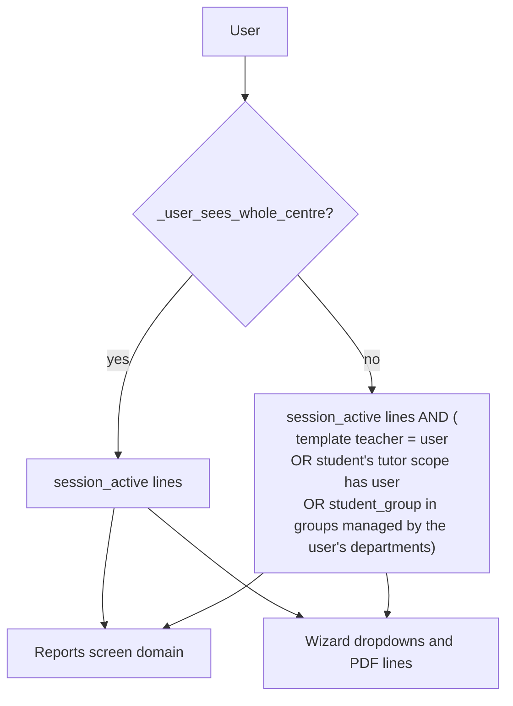

# Technical Reference: Attendance reports

## Overview

Two ways to consult `ems.attendance_session_line`, which always show the same data:

- the **Attendance reports** screen (pivot/graph), opened from **Attendance → Reports** and from the
  **Attendance** button of a student's form;
- three printable PDF reports (by group, by student, by subject), driven by a **single wizard**
  (`ems.attendance_report_wizard`) with a `report_type` selector, opened from that screen's print button
  (and its ⚙ Actions menu).

Both take what the user may consult from one method, `ems.attendance_session_line._get_reports_domain()`
(issue #633). Before that, the screen and the wizard decided it each on their own (the wizard from
`ems.teaching`, the screen from the attendance templates), and Guidance could read every student's
attendance on the screen but only pick its own pupils in the wizard.

**Module files:** `models/attendance/attendance_reports.py` (wizard + report data models),
`models/attendance/attendance_session.py` (scope and stored fields on `ems.attendance_session_line`),
`views/attendance/attendance_reports/{wizard,menu,analysis_views}.xml`,
`reports/attendance/{group,student,subject}.xml` + `reports/attendance/templates/{sumary_table,details_table,detail_section}.xml`,
`static/src/views/attendance_report_analysis/` (pivot/graph extensions, lazy-loaded),
`static/src/js/backend/attendance_report_print.js` + `attendance_report_analysis_cog_menu.js` +
`static/src/xml/backend/attendance_report_analysis_cog_menu.xml`.

---

## Scope: who sees what

`_get_reports_domain()` returns the lines of the current course (`session_active`) and, unless the user sees
the whole centre, only those reached through the chain of command, never by role alone:

| Who | Lines | Mechanism |
|---|---|---|
| Teacher | The subjects they teach: the attendance templates they are a teacher of. A roll-call taken on guard duty or as a substitute belongs to the template's teacher, not to whoever took it | `('template_teacher_ids.user_id', '=', uid)` |
| Tutor | Every subject of their students | `('student_id.tutor_id.tutor_scope_user_ids', '=', uid)`; a student's tutor is their main group's (`res.partner.tutor_id`) |
| Department / Seminar Chief | The students of the tutors below them, plus every student of the studies their department manages | The tutor scope above walks `parent_id` up from the tutor (issue #483); `('student_group_id', 'in', <groups managed by the user's departments>)` (issue #622) |
| Head of Studies / Deputy | The same two ways: the tutors below them, and the studies of their area (the area is a top-level department they manage; `child_of` covers the departments under it) | As above |
| Director, administrator, Guidance, Coexistence, Secretariat | The whole centre | `_user_sees_whole_centre()` |

`_user_sees_whole_centre()` checks `ems.group_director` (the academic administrator implies it),
`ems.group_orientation`, `ems.group_coexistence`, `ems.group_secretary` and `ems.group_secretary_admin`.
It deliberately does **not** check `ems.group_student_data_reader`: the Head of Studies implies it to read
every student's file (issue #448), but their attendance reports cover their own area.

The managed groups come from two shared helpers: `hr.department._headed_by(users)` (the departments the
users chief as Department Chief or Seminar Chief) and `ems.group._managed_by_departments_domain(departments)`
(the groups whose study, or whose main groups' study for a reinforcement group, is managed by one of those
departments or a sub-department). Both are also used by the notices' department scope
(`notice_department_scope.py`). The group ids are resolved under `sudo()`, so the group and study record
rules never narrow them.

This is the same "two ways" criterion the guard duty board uses to decide who manages an absence
(`ems.course._is_absence_manager`): the absent teacher's chain of command, and the chiefs of the department
managing the group. A study with no managing department (`ems.study.managing_department_id` empty) is only
reached through the tutors' chain.



---

## Data model

```mermaid
erDiagram
    ems_attendance_template ||--o{ ems_attendance_schedule : "attendance_schedule_ids"
    ems_attendance_schedule ||--o{ resource_calendar_attendance : "calendar_attendance_ids"
    ems_attendance_schedule ||--o{ ems_attendance_session_header : "attendance_session_ids"
    ems_attendance_session_header ||--o{ ems_attendance_session_line : "attendance_session_id"
    ems_attendance_session_line }o--|| ems_attendance_status : "status_id"
    ems_attendance_session_line }o--o| res_partner : "student_id"
    ems_attendance_report_wizard ..> ems_attendance_session_line : "_get_scope_lines()"
```

Stored fields on `ems.attendance_session_line`, so the screen can group and filter without joins and without
going through the session header's record rules (a teacher only reads their own headers):

- `date`, `level_id`, `study_ids`, `group_ids`, `subject_id`: related to the session. The related Many2many
  fields need their own explicit `relation`/`column1`/`column2`.
- `student_group_id`: the **student's own group when the roll-call was taken** (`student_id.main_group_id`,
  depends on `student_id` only). Reports filter and group by it, never by the session's `group_ids`: a session
  shared by several groups would put each of its students under every one of them. A later group change
  only moves the following roll-calls.
- `session_active`: related to the session's `active`. The course transition archives every outgoing
  session, so it means "current course". Filtering on the `attendance_session_id.active` path instead would
  apply the header's record rules.
- `topic` and `subject_label` (issue #633), see below.
- `absence_rate` (`100.0` for an absence-category status, else `0.0`, `aggregator="avg"`, so the average is
  a percentage) and `strike_count` (stored so it can be a measure).

### Topic: a subject split into parts taught apart

A schedule block (`resource.calendar.attendance`) can carry a free-text `topic` (issue #428): a CFGB module
taught in parts by different teachers (e.g. *Ciències aplicades I*: Physical Education and Maths;
*Comunicació i ciències socials I*: English and Catalan/Spanish). For attendance, each topic is a subject of
its own:

- `ems.attendance_template.topic` is part of the template's identity. The schedule sync keys templates by
  `_sync_key(subject_id, topic, group_ids)` (then splits by teacher set), so two topics of one subject make
  two templates, even with the same teacher and group. `hr.employee._teaching_entries_from_calendar()` puts
  the block's topic in each entry, and `topic` is one of `resource.calendar.attendance._SYNC_TRIGGER_FIELDS`,
  so changing it regenerates the template. The uniqueness check (`_check_unique_teaching_assignment`)
  includes it too. `ems.attendance_template.find_self_conflicts()` deliberately keeps comparing by
  (subject, groups): a changed topic in the same slot is an update of the class, not a double booking.
- The template's `topic` is set when the sync creates it and never changes afterwards (it is in
  `_LOCKED_FIELDS`). A changed topic archives the old template and creates a new one, so the sessions
  already taken keep the topic they were taken under. The field is a stored compute **with no
  dependencies**: Odoo only runs it when the column is created, filling the existing templates from the
  blocks linked to them (`ems.attendance_schedule.calendar_attendance_ids`, the inverse of the blocks'
  `attendance_schedule_id`). Templates created before that link existed (2026-08-11) get no topic until
  their next sync. It is `readonly=False` only so that the value `create()` receives is kept instead of
  recomputed; `_LOCKED_FIELDS` forbids editing it.
- `ems.attendance_session_header.topic` and `ems.attendance_session_line.topic` are stored related fields.
  `ems.attendance_session_line.subject_label` (stored compute) is `ems.subject._label_with_topic(topic)`:
  `"ACR: Name - Topic"`, or the subject's display name alone. The same helper builds the template's display
  name and the schedules' labels (`resource.calendar.attendance.get_subject_display_label()`).

---

## Attendance reports screen (pivot/graph)

`action_attendance_report_analysis` opens the lines in `pivot,graph` (pivot first), with no list view. It is
only reached through `ems.attendance_session_line._get_reports_action()`, called by:

- `action_attendance_reports_open`, the **Attendance → Reports** menu's `ir.actions.server` (its `groups_id`
  lets it run without write access on the model);
- `res.partner.action_view_attendance_reports()`, the **Attendance** button of a student's form (issue #519),
  which names the action after the student, adds a removable **Student** facet
  (`search_default_student_id`) and drops **My subjects**, so the user sees every subject of that student
  within their scope.

`_get_reports_action()` reads the act_window (`sudo().read()`), sets `domain = _get_reports_domain()` (a
Python list: the read act_window domain is a raw string), `context['pivot_measures'] = ['absence_rate',
'strike_count', '__count']`, `context['graph_measure'] = 'absence_rate'` and `context['active_test'] = True`,
and, for whoever doesn't see the whole centre, turns on the removable **My subjects** filter
(`[('template_teacher_ids.user_id', '=', uid)]`).

- **Pivot:** rows `subject_label` → `student_id`, measures `absence_rate`, `strike_count`, `__count`.
  `disable_linking="1"`: a cell click opens nothing (it used to open the bare lines in a default list). It
  always loads collapsed; reaching subject → student takes the **Expand all** button twice (no custom
  auto-expand JS).
- **Graph:** grouped by `subject_label`, `disable_linking="1"` too (a bar click opened the same list). The graph shows one measure at a time, and its default is the
  **last** `type="measure"` field of the arch (`graph_arch_parser.js`), so `absence_rate` is declared last;
  `graph_measure` alone did not decide the first paint.
- **Search:** filters on student, group (`student_group_id`), subject, status, **My subjects** and date;
  group-bys on group, subject (`subject_label`), student, status and date.
- **Students removed from the roll-call never count (issue #628):** removing a student archives their line.
  A button's result inherits the context of the screen it is clicked on, and the students' list runs with
  `active_test: False`, so every read path forces it back on (`_get_reports_action()`'s context, the
  wizard's `_get_scope_lines()`/`_get_scope_values()`, the year record's `_attendance_rates()`).
- **Print button:** both views have a `js_class` (`ems_attendance_report_pivot`, `ems_attendance_report_graph`,
  `static/src/views/attendance_report_analysis/`) that only swaps the toolbar (`buttonTemplate`, a primary
  inherit of `web.PivotView.Buttons`/`web.GraphView.Buttons` adding a printer button last) and the
  renderer, which is what renders that toolbar and so holds the click handler
  (`usePrintAttendanceReport()`, `static/src/js/backend/attendance_report_print.js`, shared with the ⚙
  entry). Odoo 18 lazy-loads the pivot and graph views (`web.assets_backend_lazy`), so these files are
  declared in that bundle in `__manifest__.py` (`ems/static/src/views/**`), not in `web.assets_backend`:
  there `@web/views/pivot/...` is undefined and the whole module fails to load. `View` loads the lazy
  bundle whenever a `js_class` isn't registered yet, so the screen works on first open.
- The ⚙ Actions menu entry (`attendance_report_analysis_cog_menu.js`), kept besides the button, matches the screen by
  `searchModel.resModel === "ems.attendance_session_line"` and a pivot/graph `viewType`, not by action id: the
  menu's action is the server action, while the screen runs the act_window it returns.

---

## PDF wizard

One `ems.attendance_report_wizard` with `report_type` (`group` / `student` / `subject`); only the fields of
the chosen type are shown and required. Every list it offers and every line it prints comes from the scope
above:

- `_get_scope_lines(domain, date_range)`: `search(_get_reports_domain() + domain [+ dates])` as the user,
  with `active_test=True`, returned under `sudo()`. The scope is already decided by the domain; the `sudo()`
  is what lets the PDF read the session's date and teacher when another teacher took it.
- `_get_scope_values(field, domain)`: the distinct values of one field over the scope (`_read_group`), for
  the dropdowns: `allowed_student_ids` (`student_id`), `allowed_group_ids` (`student_group_id`, or, by
  subject, the groups having the chosen subject) and the options of `subject_label`
  (`_selection_subject_label()`).

| Report | Selection | Lines |
|---|---|---|
| By student | `student_id` | `_get_student_lines()`: that student's lines in scope |
| By group | `group_id` | `_get_group_lines()`: `student_group_id` = the group, with a student |
| By subject | `subject_label` (a `Selection` of the labels in scope) + `group_ids` (prefilled with every group having it, removable) | `_get_subject_lines()`: `subject_label` = the choice, `student_group_id` in the groups, with a student |

- **From/To prefill:** each selection's onchange fills the dates with the first and last `date` of its own
  lines (date range off).
- **Prefill from the screen's filters:** the print button (and the ⚙ entry) pass the active search facets
  on `student_id`, `student_group_id` and `subject_id` as `ems_report_<field>` context keys
  (`attendance_report_print.js`; a facet with several values or free text is ignored).
  `_defaults_from_search()`, called by `default_get()`, turns them into the report they point at:
  student → by student; subject → by subject (its label when it has a single one in scope, otherwise the
  user picks the topic), the groups narrowed to the group facet if any (`_onchange_subject_label`); group
  alone → by group. The form's first onchange runs every default's onchange, so the dates fill as when
  picked by hand. From a student's form (its `search_default_student_id` facet) this gives that student's
  report.
- **Nothing is taken from the client.** The 3 `ir.actions.report` have `model = ems.attendance_report_wizard`
  and `print()` calls `report_action(self)` with no `data`; the report data models
  (`report.ems.attendance_report_{group,student,subject}`) browse the wizard and recompute its lines. A value
  sent by hand outside the dropdowns (another student, a subject label out of scope) only ever reaches the
  lines in scope, i.e. none. `subject_label`'s dynamic options are not validated by Odoo on save, which is
  why the domain, not the selection, is the guarantee.
- **No `data`, for the file name:** with `data` the web client downloads through the "particular report"
  route, which always names the file after the report and ignores `print_report_name`. Through the docids
  route, `print_report_name = object.get_report_filename()` gives `<report name>_<student|group|subject>`,
  spaces as `_` and without the subject label's `:`.
- **Report data:** the 3 models share `_build_report_values(env, docids, group_key)`; by group and by student
  group the per-dimension sections by `subject_label`, by subject by student. Strikes are searched in the
  lines' environment, the same ones the screen counts as `strike_count`.
- **Details/Strikes sections:** `detail_status_ids` (default: absence-category statuses) decides which
  lines are listed one by one; `include_strikes` (default on) adds the strikes table; `detail_status_warning`
  shows an inline alert when the selection goes beyond the default (a long period × many statuses made the
  PDF fail in wkhtmltopdf). The summary percentages always count every line. The shared section template is
  `ems.attendance_template_detail_section`.
- **`default_get()` seeds `allowed_*`:** a compute depending only on the context (`uid`) isn't reliably run on
  a freshly opened wizard, so the dropdowns would come up empty.
- **Student-less lines:** a hard-deleted student leaves lines with `student_id = NULL`; the by-group and
  by-subject reports filter `('student_id', '!=', False)`, otherwise they would render a blank row.
- **QWeb gotcha:** `t-field` cannot go on a `<td>` (`QWeb widgets do not work correctly on 'td' elements`);
  wrap it in a `<span>`. Every report table row carries `page-break-inside: avoid`.

---

## Views

| View | File |
|---|---|
| PDF wizard form | `views/attendance/attendance_reports/wizard.xml` |
| Pivot/graph/search | `views/attendance/attendance_reports/analysis_views.xml` |
| Actions, `Attendance → Reports` menu, `action_attendance_reports_open` | `views/attendance/attendance_reports/menu.xml` |
| PDF templates | `reports/attendance/{group,student,subject,session}.xml` + `reports/attendance/templates/{sumary_table,details_table,detail_section}.xml` |
| Print button (pivot/graph `js_class`) | `static/src/views/attendance_report_analysis/attendance_report_analysis_views.{js,xml}` |
| ⚙ Actions entry | `static/src/js/backend/attendance_report_analysis_cog_menu.js` + `static/src/xml/backend/attendance_report_analysis_cog_menu.xml` |

## Access control

| Role | PDF wizard (`ems.attendance_report_wizard`) | Lines shown (screen and PDFs) |
|---|:---:|---|
| Teacher | read/write/create | Their own subjects (**My subjects** on by default) |
| Tutor | read/write/create | Plus every subject of their students |
| Department / Seminar Chief | read/write/create | Plus the students of the tutors below them and of the studies their department manages |
| Head of Studies / Deputy | read/write/create | Plus the students of the tutors below them and of the studies of their area |
| Director, administrator | read/write/create | Whole centre |
| Guidance, Coexistence | read/write/create (as teachers: the post is a teaching one) | Whole centre |
| Secretary (+ admin) | read/write/create | Whole centre |

The record rules on the lines are not what narrows this down: every teacher can read every line
(`rule_attendance_session_line_teacher_all_read`, needed to justify absences). The scope is the domain
above, applied identically by both screens.

## Testing

- `tests/test_attendance_reports.py`:
  - `TestAttendanceReportScopeLadder`: the chain of command for every profile (teacher, teacher on guard
    duty, tutor, chief above the tutor, chief of the managing department and of another one, Head of Studies
    of the area and of another area, Director, Guidance, Coexistence, Secretariat); the **parity test**, for
    each profile, that the wizard's students, groups and subjects are those of the lines on the screen and
    that the by-student PDFs of the offered students add up to exactly those lines; the three PDFs printed by
    Guidance, Coexistence and Secretariat; current course only; guard-duty roll-calls belong to the template's
    teacher.
  - `TestAttendanceReportWizards`, `TestAttendanceStudentReportScope`, `TestAttendanceGroupSubjectReportScope`,
    `TestAttendanceReportsAnalysisScope`: dropdowns, prefills, printing, file names, detail sections, the
    stored fields, the screen's actions, archived lines (issue #628).
- `tests/test_attendance_template.py` (`TestEmployeeSyncScheduleFromCalendar`): two topics of one subject make
  two templates; no topic changes nothing; a changed topic keeps the old sessions' label.
- `tests/test_attendance_reports_tour.py` + `static/tests/tours/attendance_reports_tour.js`: the wizard through
  its 3 types (the subject picked by its "subject - topic" label), the screen (pivot rows with the topic, a
  cell click opening nothing, the print button in the pivot and the graph, measures, ⚙ entry), the by-student wizard as a plain teacher and as a tutor, the tutor's screen and
  PDFs, and the student form's **Attendance** button.
- `tests/test_access_matrix.py`: the wizard's ACL for teachers and Secretariat.
