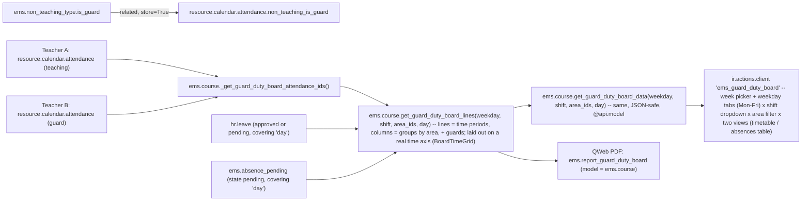
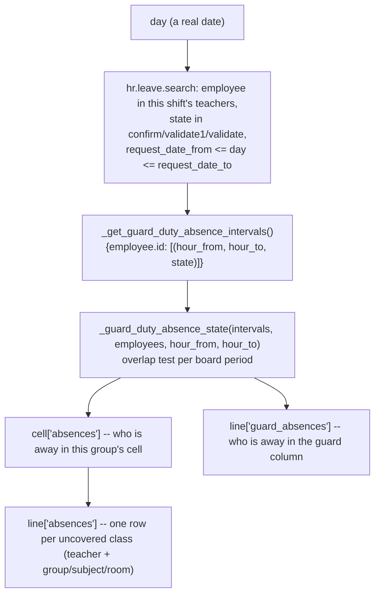
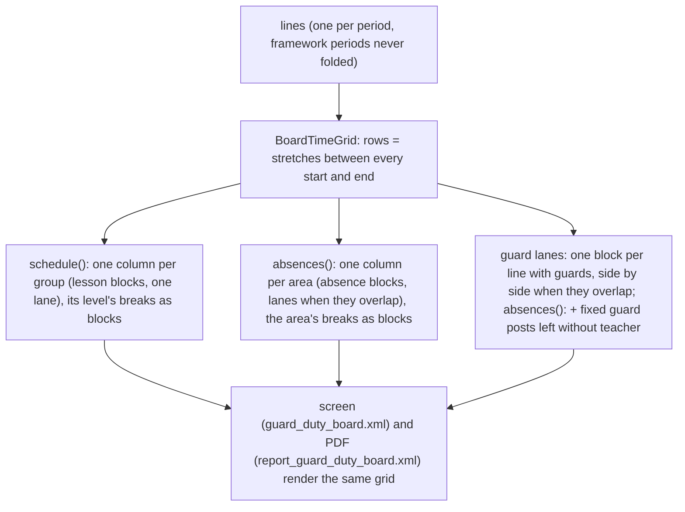
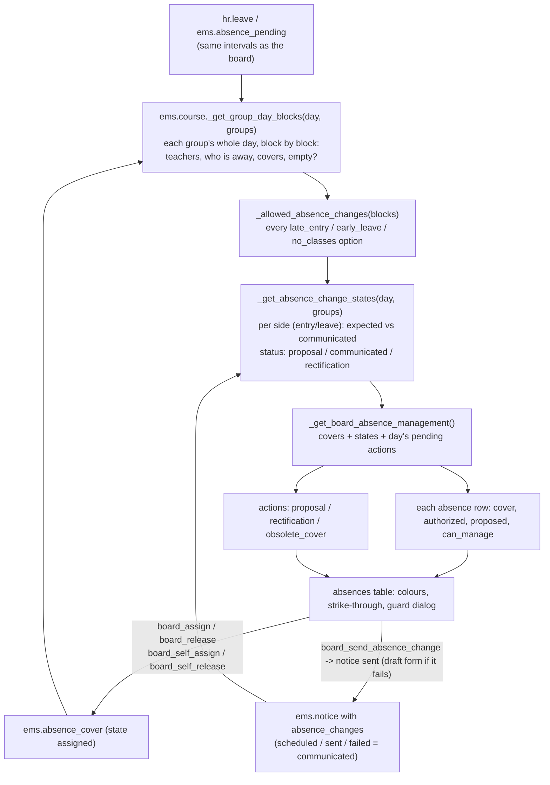
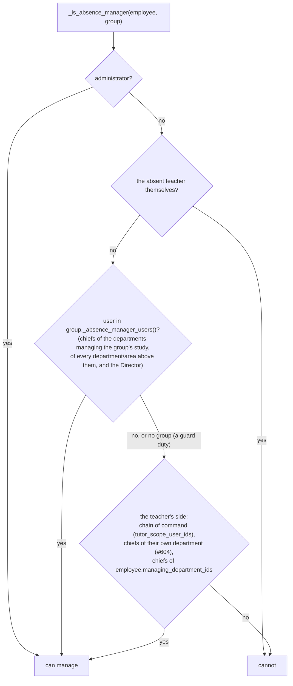

# Technical Reference: Guard Duty Schedule Board

## Overview

Every teacher's own weekly working schedule can already carry a "Guard" slot — one
configurable `ems.non_teaching_type` reason among others (see [Non-teaching types](../employees/non_teaching_type.md)),
assigned to a period the same way as a break or a coordination meeting (see
[Teacher working schedules & schedule frameworks](../employees/working_schedule.md)). What
was missing was a way to consult that information **across** teachers: for a given weekday,
who is teaching where, and who is on guard duty, in each time block. This board is a
read-only, centre-wide aggregation answering exactly that — no new data is captured, it only
re-reads what already lives on every teacher's own `resource.calendar.attendance` rows.

**No dedicated model.** An earlier version introduced a `ems.guard_duty_board` `TransientModel`
wizard, opened via a dynamic `ir.actions.server`. That was replaced (2026-08-31) once it caused
a real, user-visible problem: the URL bar showed a raw `ems.guard_duty_board/<id>` instead of a
stable `action-<xmlid>` like every other EMS screen, because Odoo can only put a real xmlid in
the URL for a *statically declared* action — a server action that returns a dynamically-built
`act_window` dict has no xmlid of its own to show. The board's methods now live directly on
`ems.course` instead (a real, always-existing model every teacher already has read access to —
see "Access control" below), and the screen itself is a plain `ir.actions.client`, both
addressable by a real, stable URL.

## Model changes

**`ems.non_teaching_type`** (`models/employees/non_teaching_type.py`):
- `is_guard` (Boolean) — marks a non-teaching reason as counting toward guard duty on this
  board. Seeded `True` on the "Guard" row (`data/main/ems.non_teaching_type.csv`, code `G`).
  Data-driven, same pattern as `is_break`/`is_fixed` — a centre could in principle flag more
  than one reason as `is_guard` (e.g. a "corridor guard" split from a "break guard"), the
  board doesn't assume there is exactly one.

**`resource.calendar.attendance`** (`ems_working_schedule_assignation`, `models/employees/working_schedule.py`):
- `non_teaching_is_guard` (Boolean, `related="non_teaching.is_guard"`, `store=True`) —
  mirrors the pre-existing `non_teaching_is_break` field. Used server-side by
  `get_guard_duty_board_lines()` (below) to single out a guard row without a separate
  `ems.non_teaching_type` fetch.

**`ems.course`** (extended, `models/attendance/guard_duty_board.py`,
`_inherit = ['ems.course', 'ems.schedule_report_mixin']` — same "extend in place" pattern as
`ems_working_schedule`/`resource.calendar` and `ems_group_schedule`/`ems.group`):
- `_get_guard_duty_board_attendance_ids()` — every non-framework calendar's Mon-Fri
  attendance row, across every teacher. Same aggregation idea as
  `ems.group._compute_schedule_attendance_ids` (see [Group Schedule](../contacts/group_schedule.md)),
  generalized from "this group" to "the whole centre" — deliberately **not** filtered by
  `calendar_id.course_id`, mirroring that same precedent: a course-transitioned-out
  calendar/attendance row is archived (`active=False`), so the plain `search()` already only
  returns the current course's real, active schedules, and this also stays correct for a
  legacy calendar whose `course_id` was never backfilled. `self` (the course the method is
  called on) is purely informational here — the query itself never filters by it.
  Also filters `calendar_id.active = True` explicitly (added 2026-09-01, see
  `plans/course_transition_stale_teacher_assignments.md`) — a real-world case surfaced a
  departed/reassigned teacher's non-teaching rows (guard duty, a coordination meeting) still
  `active=True` on an already-archived, prior-year calendar, since `_apply_calendar_rollover()`
  never counted them as "teaching left" and (at the time) nothing archived them once the
  calendar itself retired. `ems_working_schedule.action_archive()` now cascades to its own
  `attendance_ids` (see `course_transition_wizard.md`), which fixes this at the source going
  forward — the explicit filter here stays anyway as defense-in-depth, not redundant with it.
  Also filters `calendar_id.employee_id != False` (added 2026-09-08) — excludes any calendar
  that isn't a specific teacher's own personal working schedule, concretely Odoo's own generic
  default calendar ("Standard 40 hours/week", auto-created with Mon-Fri 8-12/13-17 rows the
  first time anything needs `res.company.resource_calendar_id` and nothing real has been
  configured yet). That calendar is never `is_framework=True`, so the check above alone doesn't
  exclude it; on a clean install with no real schedules yet it silently leaked into this
  aggregation and its generic 8-12 block absorbed narrower real periods into itself (found via
  CI, which installs clean — this box's own long-lived dev DB never had that generic calendar
  to begin with, which is why the bug never showed up locally).
- `get_guard_duty_board_lines(weekday, shift, area_ids=None, day=None)` — instance method, `self.ensure_one()`, called
  on a real `ems.course` record (the PDF template calls it on each of `docs`). For one weekday
  (`'0'`-`'4'`) and one shift (`'morning'`/`'afternoon'`, `SHIFT_HOURS` mirroring `ems.group`'s
  own constant), returns `{'groups': [...], 'areas': {...}, 'lines': [...], 'schedule_grid':
  {...}, 'absence_grid': {...}, 'actions': [...]}`:
  - `groups` — every `ems.group` actually taught in that weekday/shift slice, sorted by area, then
    by name — these become the table's columns (`areas`: each group's area, see "A real time
    axis" below, which also describes the two grids).
  - `lines` — one row per distinct `(hour_from, hour_to)` period, each with one `cells` entry
    per group (`entries`: the teaching `resource.calendar.attendance` record(s) there;
    `teachers`: every co-teacher, deduped, since a co-taught slot has one attendance row per
    teacher and naively picking just the first would silently drop the rest) plus a `guards`
    recordset (every `non_teaching_is_guard` entry in that period). A guard slot has no
    `group_ids` of its own, so it can never occupy a group's cell — it's always reported
    through `guards` instead, never as an extra column.
  - **A period fully contained in another period is folded into it, not given its own row**
    (`_merge_absorbed_periods()`, module-level helper, fixed 2026-09-07 — issue #410). Found in
    production as a guard-duty slot ending `13:25-14:00` (a teacher's own personal schedule
    ending that block 25 minutes early) sitting right next to a colleague's `13:25-14:25` guard
    for the same start time — before the fix, `periods` was a plain set of every distinct
    `(hour_from, hour_to)` tuple across `entries`, so two conceptually-the-same periods with a
    different `hour_to` rendered as two rows, the shorter one nearly (for a guard) or entirely
    (for any other non-teaching entry — it's neither a `teaching_entries` cell nor a
    `guard_entries` row, since it has no group and isn't `non_teaching_is_guard`) empty.
    `_merge_absorbed_periods(periods)` groups periods into `{period: [period, *absorbed]}` —
    one entry per period that keeps a row, mapping to every period (its own bounds plus any it
    absorbed) whose `cells`/`guards` fold into that row. Containment uses `HOUR_EPSILON` (see
    [shared/schedule_report_mixin.md](../shared/schedule_report_mixin.md)) for the same reason
    `hr.employee._get_derived_break_entries` needs it — two periods meant to represent the same
    moment can differ by a hair's-width float remainder. A period with no containing period
    (e.g. a genuinely isolated 35-minute coordination slot with nothing else running at the same
    time) keeps its own row exactly as before — the merge only removes a row when another,
    larger period's range actually covers it. A period of some schedule framework (a lesson or a break of
    some level) is never absorbed - see "A real time axis" below (issue #637).
  - **A period left with no teaching cell and no guard, after the merge above, is dropped
    entirely** (developer follow-up, 2026-09-07) — `if not guards and not any(cell['entries']
    for cell in cells): continue`. Found on the Wednesday coordination-time slots
    (`13:25-14:00`/`14:00-15:00`): once the merge above stopped duplicating rows, these two
    genuinely had nothing to show (every teacher is in a coordination duty or the meeting itself,
    nobody's on guard through it) — a bare time range with no subject and no guard name is not
    useful information, so it no longer renders at all. A period with a guard but no teaching
    (the normal shape of most guard slots) is unaffected — only a period with **neither** is
    dropped.
  - Reuses `_format_report_time` from `ems.schedule_report_mixin` (still the reason this class
    mixes it in) — but deliberately **not** `_report_color_key`/`REPORT_COLOR_PALETTE`, unlike
    the teacher/group schedule PDFs. An earlier version did colour each cell by subject the same
    way those do; removed per developer feedback (2026-09-01) — with every group already its
    own column and the subject spelled out as a short `acronym` in the cell, a colour wash per
    subject added visual noise without adding information the plain grid didn't already convey.
    No colour anywhere on the board at all now, not even the guard-duty badge — see "Client
    action" and "PDF report" below for the full history of that. Recordset-based — used
    server-side (Python) only, by the PDF template.
- `get_guard_duty_board_data(weekday, shift)` — `@api.model`. Resolves "the current course"
  itself via `self.env.company.get_current_course_or_raise()` rather than taking a course
  argument, so the JS client action never needs to know or guess an `ems.course` id — matches
  `_get_guard_duty_board_attendance_ids()`'s own course-agnostic scoping. Thin JSON-safe
  wrapper around `get_guard_duty_board_lines()` (plain dicts/strings/ids instead of
  recordsets — `subject` is the short `acronym`, e.g. "MP 0440", not the full `display_name`,
  to keep cells compact; `teachers` is a plain list of display names) — see "Client action"
  below for why a JSON-safe RPC call is needed at all instead of reading a prefetched field.
- `get_current_course_data()` — `@api.model`, returns `{'id': ..., 'name': ...}` for the
  current course. Used by the client action to label the page and to supply the PDF button's
  own `active_ids` (the page has no bound record of its own to read that from). Also called
  through `res.company.get_current_course_or_raise()`, so it's the first of the two methods to
  raise a friendly `ValidationError` (surfaced as the client action's own error dialog) if no
  "Current course" has ever been configured — a real scenario on a freshly installed instance
  before an admin visits Settings for the first time, not just a test-DB gap. Bug fixed
  2026-09-01: both methods used to read `current_course_id` unguarded, crashing with a raw
  `ValueError: Expected singleton: ems.course()` instead.

## Absences on the board

**The problem this solves.** A guard-duty period is only worth planning if you know which
classes are actually going to be left without a teacher. That information lives in `hr.leave`
(see [Staff absences](../employees/absence.md)) and nothing joined the two: the board answered
"who is on guard on a Tuesday", never "who is missing on Tuesday the 15th".

**Weekday vs date — why the screen needed a week picker first.** The timetable repeats by
weekday; an absence happens on a real date. There is no way to resolve one from the other, so
`get_guard_duty_board_lines()`/`get_guard_duty_board_data()` take an optional `day`, and the
client action grew a date input and week navigation to supply it. **Without a date the board
behaves exactly as it did before** — every absence structure comes back empty — which is what
keeps every weekday-only caller working unchanged.

**Two states, never one.** `ABSENCE_STATES` maps hr_holidays' states onto the only two
distinctions that matter to whoever assigns guards: `validate` → `'approved'` (a fact to plan
around), `confirm`/`validate1` → `'pending'` (a request nobody has decided on yet). The two
pre-approval states are collapsed deliberately — "waiting for the first approver" vs "the
second" changes nothing here. Refused and cancelled requests are not in the mapping at all,
which is what keeps them off the board entirely. When the same teacher has both an approved and
a pending absence overlapping one period, approved wins: the period needs covering either way,
and reporting it as merely requested would understate it.

**Co-taught classes: listed, but marked as covered.** Every row of `line['absences']` carries
`covered`, from `_guard_duty_is_co_taught(cell_entries, teacher, absences)`: true when another
teacher of the same cell (same group, same period) is not away and teaches in the same room as
the absent one. The row is still there, so the board says who is missing, but it is struck
through (`.o_guard_board_absence_covered` on screen, `.gdb-absence-covered` in the PDF) because
nobody needs to cover it. On screen every struck-through line, whatever the reason (co-taught, a
guard sent, a timetable change communicated), carries an info icon on its left, and the whole line answers like it: its reason
(`struckReason()`) shows as a tooltip on hover and in a popover on click - a plain `title` was only
found by whoever happened to hover, which most teachers never do. A line struck out because a guard
was sent stays editable by whoever organises the absence: its popover also offers "Change or remove
the guard", which opens the assignment dialog. The room check is what keeps a group split
across two rooms (each teacher with half of it) from being marked covered: the absent teacher's
half has nobody. On this centre's data every shared slot is same room and same subject, i.e.
genuine co-teaching. A co-teacher away for any part of the period does not cover, the same
overlap test `_guard_duty_absence_state` uses.

**Expected absences are pending absences too.** An `ems.absence_pending` entry the
teacher's chief, the Head of Studies or their Deputy entered on the teacher's behalf (see
[Expected absences](../employees/absence.md#expected-absences)) is added as a
`'pending'` interval while its own state is `pending`, clipped to the requested day in the
company's timezone by `_get_local_hours()`. Once the teacher files the real absence the entry is
linked to it and ignored here for good: only the teacher's own request counts, with its own range
and state, whatever becomes of it.

**Whole day vs part of one.** The interval is read from `request_unit_hours` rather than
`ems_full_day`: it is the field that actually decides whether `request_hour_from`/`_to` carry
anything (see `hr.leave._compute_request_unit_hours` and EMS's override of it), and a multi-day
request is a whole day on each of its days however it was filled in. A whole day becomes
`(0.0, 24.0)` so it compares against a board period exactly like a partial one does — no special
case anywhere downstream. Arriving an hour late therefore marks the 9-10 lesson and leaves the
11-12 one alone.

**An absent regular guard is a subtraction, not an addition.** A teacher who is away during a
period they were on a regular guard duty for has no class of their own for anybody to cover —
they are simply one fewer person available to cover somebody else's. That is why `guard_absences`
is reported separately from `absences`: the guard column marks them, and no row appears in the
"what needs covering" list. A guard duty that is **not** regular (WC, break...) is the exception,
see "Guard duties that are not regular" below.

**Confidentiality.** The absence search runs `sudo()` — same justification
`ems.attendance_session_header.get_guard_sessions()` already carries for reading schedules that
are not the reader's own: whoever reads this board legitimately needs to know a colleague is not
coming. Only **the fact and the interval** are ever exposed. The absence type, its reason and
its attachments never leave the model, so the confidentiality rule described in
[Staff absences](../employees/absence.md) is not weakened by this screen.

## Access control

| Action | `ems.group_teacher` (every teacher) | `ems.group_department_chief` and above |
|--------|:---:|:---:|
| Open the board | Yes | Yes |
| Call `get_guard_duty_board_lines()` / `get_guard_duty_board_data()` | Yes | Yes |
| Export the board to PDF | Yes | Yes |

**No new `ir.model.access.csv` rows at all.** `ems.access_ems_course_teacher` already grants
`ems.group_teacher` read access to `ems.course` — since the board's methods live there now
(rather than on a dedicated model that would have needed its own ACL), every teacher can
already call them. No `sudo()` is used anywhere in `_get_guard_duty_board_attendance_ids()`
either, and none is needed: base Odoo's own `resource` module already grants `base.group_user`
(every internal user, so every teacher) plain read access to
`resource.calendar`/`resource.calendar.attendance`, with no `ir.rule` narrowing it further —
see [Group Schedule](../contacts/group_schedule.md)'s own "Access control" section, which
documents this same fact for its identical aggregation. Colleagues' schedules were never
actually access-restricted at the model level; only the "Working Schedules" *menu* (admin
configuration screen, `resource.calendar` records with `is_framework=False`, write access
still `ems.group_department_chief`-only) was.

## Menu

`views/attendance/guard_duty_board/menu.xml` — `action_guard_duty_board` is a plain
`ir.actions.client` (`tag="ems_guard_duty_board"`), not bound to any model or record — see the
class docstring in `models/attendance/guard_duty_board.py` for why this replaced an earlier
`TransientModel` + dynamic server-action design. `<menuitem>` sits directly under
`hr_attendance.menu_hr_attendance_root` ("Employee Attendances", already visible to
`ems.group_teacher`, see `views/attendance/menu.xml`), a sibling of the "Attendance" submenu
(which itself groups Overview/Correction Requests/Management) and "Time off" — deliberately not
under "Working Schedules" (`menu_work_locations`), which only Head of Studies/Direction can see.

## Client action

`static/src/js/backend/guard_duty_board.js` (`GuardDutyBoard`, registered as
`registry.category("actions").add("ems_guard_duty_board", GuardDutyBoard)`, `static props =
["*"]` — the standard shape for a top-level `ir.actions.client` component, same convention as
`attendance_session_view.js`'s `AttendanceSessionView`) + matching `.xml` template
(`static/src/xml/backend/guard_duty_board.xml`) and CSS
(`static/src/css/backend/guard_duty_board.css`, `o_guard_board_*` classes). `onWillStart` first
calls `get_current_course_data()` (to label the page and remember the course id for the PDF
button), then loads the initially-active day/shift. `useState({ activeDay, activeShift, board,
loading, courseId, courseName })` drives the weekday tabs (Mon-Fri) plus a **shift `<select>`**
(Morning/Afternoon) — a dropdown, not a second row of tabs, and not both shifts stacked on one
page: morning and afternoon are different shifts (see `ems.group.shift`) and a school's real
bell schedule made the two stacked together too dense to read at a glance (developer feedback,
2026-08-31). Only one `<table>` (the active day + active shift) is ever rendered from
`state.board`.

**The `<h1>` title is a `get title()` getter, not a literal string in the template (issue #442,
fixed 2026-09-11).** The template used to build it inline (`t-esc="state.courseName ? 'Guard
duty schedule (' + state.courseName + ')' : 'Guard duty schedule'"`) — a plain JS string
concatenation the i18n extractor never sees, so it always rendered in English regardless of the
viewer's own language, unlike every other label on this screen. `get title()` calls `_t()`
instead (`_t("Guard duty schedule (%s)", this.state.courseName)` / `_t("Guard duty schedule")`),
and the template just does `t-esc="title"`.

**A week, not just a weekday.** `state.weekStart` holds the Monday of the shown week, and the
weekday tabs render their own day of the month alongside their name, so the tab strip doubles
as that week's calendar. The toolbar carries `‹ ›` week navigation plus a native
`<input type="date">`; picking any date moves the whole week and lands on that date's own
weekday tab. Three helpers at the top of the file keep this honest: `toIsoDate()` formats from
the browser's **local** calendar fields, deliberately not `toISOString()` (which converts to UTC
first and so returns the previous day for anyone east of Greenwich during the evening — the
board's date is a calendar day, never an instant); `fromIsoDate()` parses one back; `mondayOf()`
maps any date onto its week's Monday, with a weekend belonging to the week it closes, which is
also what makes picking a Saturday in the date input land on a real, showable weekday.

**Two views of the same payload, no extra round trip.** `state.activeView` switches between the
absences table (`table`, first and the default since 2026-10-07: it is the one the centre works from
day to day) and the timetable (`schedule`). The absences table (`table`, labelled "Absences table" on screen -
renamed from "Guard duty table" per issue #442, since the tab is about who's missing, not the
board as a whole), rendered as `nav-pills` in the
toolbar rather than a second row of `nav-tabs`, so they never compete visually with the weekday
tabs above them. Both come in the *same* already-fetched payload — the server sends `cells`,
`guards` and `absences` on every line (see "Absences on the board" above) and both views already
laid out on its real time axis (`schedule_grid`/`absence_grid`, see "A real time axis" below), so
switching view is a pure re-render. Every teacher arrives as `{name, absence}` rather than a bare name,
which is what lets both views mark absences the same way without matching names back against a
separate list; `absenceClass()` maps that to `o_guard_board_absent` (bold red, an absence that
is going to happen) or `o_guard_board_absent_pending` (lighter italic, still awaiting its
approver). That red is the only colour left anywhere on the board — everything else was
deliberately stripped back to plain text and thin borders (developer feedback, 2026-09-01), so
nothing competes with it.

**The absences table is not stretched across the window.** Bootstrap's own `.table { width: 100%
}` spread its few columns over the full width of a wide screen and left the content adrift in
empty cell (developer feedback, 2026-09-08: "queda demasiado disperso en la pantalla").
`.o_guard_board_duty_table` overrides `width` to `auto`, so `table-layout: fixed` sizes the table
to the literal sum of its `<col>` widths (100px of time, 400px per area, 170px per guard lane),
and `margin: 0 auto` centres it when there is room to spare. The wrapper keeps its own
`overflow-x: auto`, so a narrow window, or a centre with many areas, scrolls rather than squeezing
the columns. Each absence stays on **one line** — teacher and the class to cover side by side,
never wrapped (developer feedback, 2026-09-08: "elimina el salto de línea aunque quede una columna
un poco más ancha"); the `text-overflow: ellipsis` alongside `white-space: nowrap` is there so a
longer name degrades by being clipped rather than by spilling over the next column. Both are
regression-tested in `guard_duty_board_tour.js`: the table is centred whenever it is narrower
than its wrapper, and no absence row wraps onto a second line (measured against its own computed
`line-height`, not a hardcoded pixel height).

**Where the planner was survives leaving the board (2026-10-07).** `navigationState` (date, shift,
view, areas) is published with `props.updateActionState()`, so the router keeps it in the URL's
query string (`?date=...&shift=...&view=...&areas=...`), and handed back through
`useSetupAction({ getLocalState })`. `restoreNavigation()` applies, over the defaults below, either
`props.state` (coming back through the breadcrumbs) or `action.context.params` (the URL: browser
back button, reload, a shared link), ignoring anything invalid. Opening the board from the menu
carries neither, so it still starts at "now". `absence_coverage_tour.js` checks both ways back from
a notice (and fails without the restore).

**Opens on today's own day/shift, not always Monday/Morning.** `getDefaultDayAndShift()`
(top of the file) reads the browser's own `Date()` — "now" here means the *viewer's* wall-clock
time, not the server's — and maps `Date.getDay()` (0=Sunday..6=Saturday) onto the board's own
weekday index (0=Monday..4=Friday); a weekend defaults to Monday (the board has no weekend
concept at all, every table is keyed to a Mon-Fri `dayofweek`). The shift threshold (`>=15:00`
→ afternoon) is a hand-kept copy of `SHIFT_HOURS`'s own boundary in
`models/attendance/guard_duty_board.py` — added per developer feedback (2026-09-01): "cuando
entro en la sección... por defecto tendría que estar viendo el que toca". Regression-tested in
`guard_duty_board_tour.js` by computing the same expected day/shift independently in the test
itself (against the real clock the test happens to run at) and asserting the board's initial
state matches — not a fixed "Monday" assumption, which the rest of that same tour still relies
on for its own (date-independent) fixture-data assertions, reached by explicitly switching back
to Monday/Morning right after this check.

**The data is fetched via RPC (`ems.course.get_guard_duty_board_data()`), one weekday/shift at a
time.** An early version instead read a form field's own prefetched sub-records client-side
(the same approach `schedule_grid_readonly_field.js` uses for its own, much smaller, per-group/
per-student aggregation) — this broke in practice: the web client silently caps how many sub-records a
relational field fetches for rendering, and a centre-wide aggregation easily exceeds that cap
(several hundred rows for a real school), so only whichever weekday happened to load first
(in practice, Monday) ever showed real data — every other tab rendered empty, even though the
server-side PDF (which reads the same recordset directly over the ORM, no such cap) always
showed the full week. `setActiveDay()`/`onShiftChange()` both call the same `loadBoard()`,
which re-fetches exactly the currently active day+shift pair.

**No cell colouring.** An earlier version painted each occupied cell's background with the
same per-subject colour the teacher/group schedule PDFs use
(`ems.schedule_report_mixin.REPORT_COLOR_PALETTE`), with white text on top
(`.o_guard_board_cell_occupied`). Removed per developer feedback (2026-09-01): "quita los
colores de background de la tabla... a ver como queda" — with every group already its own
column and the subject spelled out as a short acronym, the colour wash was noise, not signal.
The Guard duty column's own light background tint went too, for the same "no background colour
anywhere in the table" reading of that request. First pass deliberately kept one exception —
the guard-duty badge itself (`.o_guard_board_guard_badge`, a fixed orange fill) — reasoning
that it was the actual "who is on duty" signal the column exists to surface, not a whole-cell/
whole-column wash. The developer asked for that gone too on a second pass, same day: "quitar
el color de fondo de los nombres de las personas que están de guardia" — so `.o_guard_board_guard_badge`
now has **no** `background-color`/`color` overrides at all, just a thin `1px solid #ccc` border
(purely to keep several names in the same cell visually separated from each other, not a
colour). Applied identically to the PDF (see "PDF report" below) — same reasoning throughout,
verified against a real generated PDF at each pass.

**One deliberate, narrower exception (developer request, 2026-09-11, and issue #637):** a break
block - a group's or an area's own break, or a break-time guard - carries a 4px `border-left`
(`#8a6240`, the exact same brown `schedule_grid.css`'s `.o_schedule_grid_entry_break` already
uses for a break block on the teacher's own Schedule tab, so the same colour reads as "patio" on
both screens). This does not reopen the decision above: it is a border, not a background fill,
and it marks a *kind of block* (break time), never a person's name or a subject the way the
removed washes did. It is a real `border-left`, not an inset `box-shadow`: Bootstrap paints its
own cell `box-shadow` over an inset one, which is why an earlier attempt never showed.

**Why a table, not the existing absolute-positioned grid:** `schedule_grid_field.js`/
`schedule_grid_readonly_field.js` position entries by pixel offset within one weekday column, at
most a handful of genuinely overlapping blocks side by side (see the read-only widget's own
`layoutOverlappingBlocks` column-split, added for a student's own schedule — a single teacher
still can't be in two places at once, but a group or a student can have a handful of concurrent
entries). A centre-wide board is a different scale of the same problem — many dozens of groups
run in parallel at any given hour, not a handful — so instead of a 5-day-column grid, this renders
weekday **tabs** (one day
visible at a time) and, within a day, a genuine `<table>` whose **columns are the groups**
taught in that shift and whose **rows are stretches of time** - see "A real time axis" below.

**Column widths are fixed, not content-driven — deliberately.** Each group column shares one
identical CSS width (`.o_guard_board_col_group`) via an explicit `<colgroup>` combined with
`table-layout: fixed` on the `<table>`; the Time block (first) column and each guard lane get
their own fixed widths (`.o_guard_board_col_time`, `.o_guard_board_col_lane`). Two things this fixes, both found during manual review (2026-08-31):
1. A first attempt used `table-layout: auto` with `min-width`/`max-width` hints instead — this
   let *each* shift's table auto-size its own columns from its own content, so Morning and
   Afternoon (or one weekday vs. another) never lined up the same way, and one abnormally long
   cell (e.g. an unlinked "Pending teacher (email@...)" placeholder) could still noticeably
   skew a single column's width relative to the rest.
2. Auto-layout sizing also under-reported the table's true rendered width to the wrapping
   `
`'s own `scrollWidth` calculation in practice, so the scrollbar existed but couldn't
   actually be dragged all the way to reveal the last column. `table-layout: fixed` with
   `<col>`-defined widths removes that ambiguity — the table's total width is the literal sum
   of the declared column widths, so `overflow-x: auto` always has an exact width to scroll
   against. Regression-tested in `guard_duty_board_tour.js` (scrolls the wrapper to its
   reported max and asserts the last header cell is then fully within the wrapper's visible
   bounds).

**Per-day toolbar** (shift `<select>` + PDF button) sits right under the weekday tabs, so
switching days always shows that day's own controls — matches "one PDF per day" (below), not a
single page-wide PDF button for the whole week.

**Page layout: the root needs an explicit height, or neither scroll axis works at all.** This
is a plain `ir.actions.client` page (no `<sheet>`/form chrome to inherit sizing from), and
Odoo's own action container clips whatever the mounted component doesn't explicitly claim — an
early version's bare, height-less root div meant a table taller (or wider) than the viewport
was just cut off with **no scrollbar on either axis** (developer feedback, 2026-08-31), not a
squeezed-but-scrollable one. Fixed the same way `attendance_session_view.css`'s `.ems-av-root`
already does it: `.o_guard_board` gets `height: 100%; display: flex; flex-direction: column`,
the title/tabs/toolbar sit in a fixed-height `.o_guard_board_header`, and only
`.o_guard_board_content` (`flex: 1 1 auto; overflow-y: auto`) scrolls vertically — with
`.o_guard_board_table_wrap`'s own `overflow-x: auto` still handling horizontal scroll inside
that, so a vertical drag can never also scroll sideways. Both axes are regression-tested in
`guard_duty_board_tour.js` the same way: scroll to the reported max, assert the true end
(rightmost column / bottom row) is then actually visible.

## PDF report (`ems.report_guard_duty_board`)

`reports/attendance/report_guard_duty_board.xml` — a `qweb-pdf` `ir.actions.report` on
`ems.course` (not the removed `ems.guard_duty_board`). Not bound to the generic Print menu (no
`binding_type`/`binding_model_id`) — triggered only from the client action's own **PDF**
button, same as `ems.report_working_schedule`/`ems.report_group_schedule`.

**Landscape A3, not the site default (portrait A4).** `paperformat_id` points at a new,
reusable `ems.paperformat_a3_landscape` (`report.paperformat`, same file) — same margins/dpi/
`css_margins` as base Odoo's own default `paperformat_euro`, only `format`/`orientation`
differ. Needed because this board is wide (one column per group, easily a dozen or more):
under the site-default portrait A4, every group column was cramped even after the fixed-width
pass below. Landscape A4 alone (the first attempt, 2026-09-01) still felt too tight in
practice per developer feedback after seeing it rendered — moved to A3 (420×297mm usable vs.
A4's 297×210mm) for real breathing room. Not named guard-duty-specific, since any future EMS
report facing the same "wide grid" shape (a school-wide timetable, say) can reference this
same paperformat record instead of each defining its own — verified by generating a real PDF
against this dev DB's own data at each step, same way the column-width bug below was
originally caught.

**One PDF per day AND per shift — not the whole week, not both shifts.** `onPdfClick()` calls
`actionService.doAction("ems.action_report_guard_duty_board", { additionalContext: {
active_ids: [this.state.courseId], guard_duty_weekday: String(this.state.activeDay),
guard_duty_shift: this.state.activeShift } })` — the extra `guard_duty_weekday`/`guard_duty_shift`
context keys are what scope the report down to whichever day tab and shift dropdown value were
active. The template reads both via `course.env.context.get(...)` (there is no bare `context`
name bound inside a QWeb report template — `additionalContext` merges into the calling env's
own context, which every record obtained from `docs` already carries) and loops just that one
day/shift; if a key is absent (defensive fallback only — no other caller omits either) it falls
back to all 5 weekdays and/or both shifts, one `
` per weekday (standard QWeb
pagination). For whichever day(s)/shift(s) it renders, the template calls
`course.get_guard_duty_board_lines(weekday, shift, ...)` directly (Python-side, unlike the client
action's own JSON RPC) and renders the very same grid the screen does (`schedule_grid`/
`absence_grid`, see "A real time axis" below: same stretches, rowspans, lanes and break blocks),
with the subject `acronym` and every co-teacher. No colour anywhere, same as the live screen — see the "No cell colouring" note
above for the full history (including the guard-duty badge itself losing its fill on a second
developer pass the same day).

**Column widths are fixed here too — `<colgroup>` + `table-layout: fixed`, mirroring the live
screen** (`.gdb-col-time`/`.gdb-col-group`/`.gdb-col-guard`: 85/115/160px, the last one per guard
lane, and the absences table's area columns `width: auto`, sized for A3
landscape's own usable width — see the class comment in the template for the exact figure —
not simply carried over from the live screen's 90/130/190px, nor from the original A4-sized
60/75/110px attempt). **A bigger page alone does not widen a `table-layout: fixed` table** —
found switching this report from A4 to A3 (2026-09-01, developer feedback: "sigue saliendo
todo muy apretado" even after landscape A4): the paperformat change alone did nothing visible,
because the `<col>` widths are absolute pixel values independent of the page they're printed
on — a bigger page just adds blank margin around the same-sized table unless the column widths
are *also* widened to use the extra room. One thing the live screen didn't need but the PDF
did: `overflow-wrap`/`word-break: break-word` on every cell's text spans
(`.gdb-cell-subject`/`.gdb-cell-teacher`/`.gdb-cell-room`/`.gdb-guard-badge`). Confirmed by
generating a real PDF against this dev DB's own data (2026-08-31): without it, one long
unbroken string (an unlinked "Pending teacher (email@...)" placeholder — no spaces to wrap at)
still forced that one column — and, via `border-collapse`, every row sharing it — visibly wider
than the rest, even under `table-layout: fixed`. With word-breaking allowed, the same content
wraps onto multiple lines within its declared column width instead.

**The PDF prints what the screen shows, absences included.** The board's PDF button passes
`guard_duty_date` alongside the `guard_duty_weekday`/`guard_duty_shift` context keys it already
sent, and the template forwards it to `get_guard_duty_board_lines(..., day=...)` and marks
absent teachers with `.gdb-absent`/`.gdb-absent-pending` — the same two-state distinction, and
the same single accent colour, as the live screen. A cuadrante handed out on paper to assign the
day's guards is no use without them. Omitting the key (any other caller) still prints the plain
timetable.

**The PDF prints whichever of the two tabs is on screen (issue #442).** `onPdfClick()` also
forwards `guard_duty_view: this.state.activeView` (`'schedule'` or `'table'`), and the template
reads it as `requested_view` (falsy/absent = `'schedule'`, same fallback convention as every other
`guard_duty_*` context key here) to render `schedule_grid` or `absence_grid`. The absence line and
the guard badges are sub-templates of their own (`ems.report_guard_duty_board_absence`,
`ems.report_guard_duty_board_guards`, plus `ems.report_guard_duty_board_break` for a break block),
shared by both views. The page's own `<h1>` title also switches between "Guard Duty Schedule -" and
"Absences Table -" so the printed heading never contradicts what's actually below it.

## A real time axis (issue #637)

**The problem.** Each area keeps its own time framework: on this centre's data ESO/BTX have their
break at 10:00-10:25 and 12:25-12:40, vocational training at 11:00-11:25 and 18:00-18:20, and their
lessons start and end at different times. One row per period, with a shorter period folded into
whichever longer one contained it (#410), mixed them up: the ESO break (10:00-10:25) folded into a
VET lesson (10:00-11:00) and its break guards were listed against that lesson, as if they could
cover it, while no break showed as such. The developer asked for a board "understandable without
the level filters" (issue #637).

**Framework periods never fold.** `_merge_absorbed_periods(periods, fixed=...)` takes every
period of every schedule framework of the shift (`_get_guard_duty_board_framework_periods()`:
lessons and breaks) and never absorbs one of them: a level's break is a block of its own. Only a
teacher's own shortened period (the #410 case, e.g. 13:25-14:00 inside 13:25-14:25) still folds.
This is what fixes the guards: a break guard has its own line, so it is never offered against a
lesson that merely spans its break.

**`BoardTimeGrid`** (module-level class, `models/attendance/guard_duty_board.py`) lays both views
out once, from the board's lines, and `get_guard_duty_board_lines()` returns them as
`schedule_grid`/`absence_grid` (passed through as-is to the JSON payload: only ints, strings and
booleans). The screen and the PDF only render them - no layout logic on either side, so they can
never disagree.
- **Rows** are the stretches between every distinct start and end time of the shift's lines
  (`HOUR_EPSILON`-tolerant), so a 10:25-11:25 lesson spans the 10:25-11:00 and 11:00-11:25
  stretches when another area has a boundary at 11:00. Each row carries its `minutes`; the screen
  makes a longer stretch a taller row, so the grid reads like a clock. It also carries its own
  bounds, `hour_from`/`hour_to` (float hours), for the current-time line below.
- **Current-time line (issue #647):** on both tabs, a dotted red line crosses the whole table at the
  current time. `nowLinePosition()` (`guard_duty_board.js`) finds the row whose
  `hour_from`/`hour_to` hold "now" and how far into it (0 to 1); "now" is `serverNow()`, the
  server's clock in the company's timezone (see [`timezones.md`](../shared/timezones.md)), and the
  line is only shown when the board's date is today and a row holds it (not on the other shift,
  before the first block or after the last). `placeNowLine()` then measures that `<tr>` in the DOM
  (rows have different heights, breaks included) and places one absolutely positioned
  `.o_guard_board_now_line` (`pointer-events: none`) inside the table's wrapper, which is
  `position: relative` and scrolls sideways with the table. It runs after every render
  (`useEffect`), on a window resize (a centred table moves) and once a minute (`setInterval`,
  cleared on unmount), writing only the line's own style: nothing is re-rendered to move it, and
  no cell does any work for it. The PDF has no line.
- **A slot** is either `{'empty': True}`, a block where an item starts (its `rowspan`, its own
  `label` - the item's real time, shown in every block so a cell reads on its own among many
  columns - and `line`, the index of its line in `lines`), or nothing under a block's rowspan.
  A lesson slot adds its `column`; an absences slot its `absences` (indexes into its line's
  `absences`); a guard slot `guards: True`, `is_break` and, in the absences table, `posts`.
- **Lanes:** `_lay_lanes()` puts items that overlap in time side by side, as few lanes as needed.
  A group column keeps one lane (a group has one lesson at a time); an area column of the absences
  table and the guard column grow lanes when two of their blocks overlap (the ESO break guard and a
  10:00-11:00 VET guard). The header's `colspan` follows.
- **Breaks:** `_lay_breaks()` fills a column's own breaks (its group's level framework, or the
  union of an area's groups') into its first lane as blocks of their own (`is_break` + `label`)
  wherever nothing else is scheduled, so an empty-looking gap reads as "Patio". A guard block is
  marked `is_break` from its line.
- **Fixed guard posts:** an absence row with no group (a WC or break guard whose teacher is away,
  issue #606) belongs to no area, so the absences table lists it under the guards of its own block,
  in the guard column (`posts`), not in an area column.

**Columns grouped by area.** `get_guard_duty_board_lines()` sorts `groups` by area name, then
group name (groups with no area last), and returns `areas` (`{group id: area}`,
`_guard_duty_group_areas()`: the top-level department above the department that manages the
group's study, or its main groups' studies for a reinforcement group - the same
`ems.group.managing_department_ids` that decides who organises its absences). The timetable heads
each area's groups with a band (`grid['areas']`, with its `colspan`) and draws a thicker rule
between areas; the absences table has one column per area. A group whose study has no managing
department falls under "Other groups".

**Why the layout lives on the server.** The screen built it in JS at first; the PDF needed the same
layout, and a second copy in QWeb/Python would have been the same logic twice (CLAUDE.md's DRY
rule). The client only resolves a slot's `line` index against `state.board.lines` to reach the
cell, guard or absence data it already renders (`slotAbsences()`), and keeps every interaction
(clicks, popovers, dialogs) exactly as before.

**Performance (issue #637).** On this centre's real timetable (~75 groups in the morning) the RPC
took 1.6s in `odoo shell` (14-17s on the dev service, which runs under `debugpy`). Now ~0.15-0.2s
cold, thanks to three rules applied throughout the file:
- **Index, don't filter per cell:** `_entries_by_group()` indexes the shift's lessons once by group
  and period; a cell (and a group's day block) is a dict lookup instead of a `filtered()` over every
  lesson of the shift (rows x groups x lessons, ~200k lambda calls).
- **Filter in SQL:** `_get_guard_duty_board_attendance_ids(domain)` adds the weekday, shift hours,
  groups or guard type to its search, instead of fetching the whole centre's rows and filtering them
  in Python - it is called several times per load (management, guard candidates, needed blocks).
- **Batch the reads:** the indexed recordsets keep the shift's prefetch (`with_prefetch()`), and
  `get_guard_duty_board_data()` reads every name on the board in one batch: read cell by cell, each
  employee was fetched on its own, every fetch paying `hr.employee`'s per-read field access check.

## Area filter (issue #637)

Replaces the level filter (issue #390), which the timetable on a real time axis made unnecessary to
read the board, but which planners still want to narrow it down to their own area. An area is a
top-level department (`hr.department.is_top_level`) that manages some study, itself or through one
of its departments (`_get_guard_duty_board_area_records()`; ASP manages none, so it is never
offered). Areas map onto time frameworks on this centre's data: ESO/BTX share one, every VET level
another.

- **Groups:** with `area_ids` set, `groups` and the lines' teaching periods only come from groups
  in those areas. A reinforcement group follows its main groups' area, so - unlike with the level
  filter, where it had no level and never matched - it shows under its area.
- **Guards:** shown on whichever line their period falls in, whatever they teach (developer
  feedback, 2026-09-07, still in force: *"no tenemos forma de saber si un docente es de un nivel o
  de otro, pero es indiferente, porque está de guardia y eso es lo que manda"*). A guard on a
  period of another area's framework only (its break, say) is left out: it has no line here and
  must not fold into one of this area's lines that merely spans it. A period both areas share
  (8:00-9:00) is this area's too.
- **Break guards of the selected area:** no lesson runs during its break, so
  `_get_guard_duty_board_break_lines()` gives them a "Patio" line of their own (the frameworks of
  the selected areas' groups' levels).
- **Every area checked = no filter:** `area_ids` covering every area is normalized to "All areas",
  since a filtered view only builds its lines from teaching periods.
- **`is_break`** marks a line whose period falls inside some framework's break **and** where no
  group has a class: the second half keeps a period right when another area is teaching through
  that break (confirmed against this dev DB, see the method's own docstring).

**Client:** `state.activeAreaIds` (empty = "All areas") + `state.areas` (`get_guard_duty_board_areas()`,
fetched once `onWillStart`), a Bootstrap dropdown with one checkbox per area
(`o_guard_board_area_dropdown`/`o_guard_board_area_menu`; a native multi-`<select>` would need
ctrl/cmd-click, which is not discoverable). Toggling a checkbox re-runs `loadBoard()`. The URL
keeps the selection (`?areas=...`), and the PDF button forwards it as `guard_duty_area_ids`, which
the report passes to `get_guard_duty_board_lines(..., area_ids=...)`.

**Area names:** `data/custom/hr.department.csv` seeds the three areas in English only (a CSV row
carries no translations, and `data/custom` is frozen after its first load). `_translate_area_names()`
(`__init__.py`, from `post_init_hook` and `migrations/18.0.0.38.0/post-migrate.py`) adds Catalan and
Spanish (ESO / BTX, FP, PAS) to an area still named as the CSV left it, for a language nobody has
filled in yet.

## Managing absences from the board (issues #539, #571, #581, #605)

The absences table is also where an absence gets organised, not just read. Three decisions are
taken from it, all of them manually (nothing is ever sent or changed on its own):

1. **Send a guard** to a class left without its teacher, with a message for them (#571).
2. **Tell the families** that the students can come in later, leave earlier or have no classes,
   when the empty lessons are at the start or the end of the group's day (#539). Once told, those
   lessons need no guard and are struck out (#581).
3. **Apply an internal arrangement** instead of a guard (#605, #645): the board detects how the
   teachers of the group (and of the groups sharing lessons with it) could swap or move their
   lessons, in chains, so that the students lose as few lessons as possible and nobody has to cover
   the class; anything else can be recorded by hand.
4. **Undo what an absence that changed afterwards made unnecessary or wrong**: release a guard who
   is no longer needed, or send a correction for a notice that no longer matches (a sent notice
   can never be taken back).

### Keyed by teacher, date, period and group - never by the absence record

`ems.absence_cover` (`models/attendance/absence_coverage.py`) stores the absent teacher, the date,
the period (`hour_from`/`hour_to`, the board row's own bounds), the group, the guard and the
message; the timetable change lives on the `ems.notice` itself (`absence_date`,
`absence_group_id`, `absence_changes`, `models/communications/notice_absence_change.py`). Neither
points at an `hr.leave` or an
`ems.absence_pending`. That is what makes an expected absence and the request the teacher files
afterwards (which takes its place, see [Expected absences](../employees/absence.md#expected-absences))
behave as one absence: whatever was organised on the expected one still matches the same
teacher, date, period and group, so nothing is redone, and the days or hours the request adds
come up as new, uncovered rows. Whatever the request no longer covers shows up as a pending action
instead (below).

### Late entry, early leave, no classes

`_get_group_day_blocks()` reads each group's **whole day** (both shifts: a group starts its day at
its first lesson and ends it at its last), one block per period, merged the same way the board's
rows are. A block is **empty** when every teacher in it is away and no guard covers it: a
co-teacher who is in, the other half of a split group, an optional subject with its own teacher or
a guard already sent all mean somebody is with the students. `_allowed_absence_changes()` then
lists, per side, every change the run of empty blocks allows, from the smallest to the largest: at
the start of the day, starting at the `hour_from` of the 2nd, 3rd... block up to the first
non-empty one; at the end, leaving at the `hour_to` of the block before the last, the one before
that... up to the last non-empty one; a day with every block empty also allows no classes. The
largest option is `'expected'` (the dashed row tag and the default); the smaller ones exist because
the planner may tell the families about only part of it and send a guard to the rest. Pending
absences count as much as approved ones: the planner sees the state on the row and decides.

### A longer break

`_allowed_absence_changes(blocks, breaks)` also gets the group's level's break periods for that
weekday (`_get_guard_duty_board_break_periods([level])`; none for a group without a level). A break
that falls between two of the group's lessons is its own side (`BoardBreakSide.key()`,
`break@<from>-<to>`), whose options are every `('long_break', start, end)` combination of the break
itself extended back over the empty lessons right before it and/or forward over those right after
it - as long as a non-empty lesson remains further out on that side. A run of empty lessons that
reaches the start or the end of the day is a late entry or an early leave instead, never a longer
break, so "coming in after the break" and "going home at the break" stay what they are. A break
change carries its span (`('long_break', from, to)` in the notice's `absence_changes`); the
correction back is `('normal_break', from, to)`. A free lesson in the middle of the day that is not
next to a break is not proposed (developer decision, 2026-10-07): it is covered with a guard.

### What was communicated, and the sides of the day

A change belongs to one side of the day: `late_entry`, `no_classes` and `normal_entry` to the
start, `early_leave` and `normal_leave` to the end (`CHANGE_SIDES`), `long_break` and `normal_break`
to the break they overlap (`_change_side()`).

A notice can tell several changes, at most one per side (#652: an accepted arrangement plan sends
one notice per group with every change it brings). They are stored on the notice as a JSON list,
`absence_changes`, each change as the same tuple the options use (`[type, hour]`, or `[type, from,
to]` for a break), in the order of the day (start, breaks, end); `_absence_change_tuples()` reads
them back. A JSON list rather than a child model, like the students' notice's `arrangement_lessons`
(#649): the changes are only ever written with their notice and read with it, never searched on
their own, and a list needs no access rules of its own to stay in step with the notice's three
levels of access (a child model would need its own copy of every `rule_notice_*`). The form shows
them in one line (`absence_change_label`, `_absence_changes_label()`). Notices created before #652
had one change in three columns of their own; migration `18.0.0.38.1` (`post-migrate.py`) moved
each one into a one-item list.

Per side, `_get_absence_change_states()` reads every change of the day's notices once, oldest
notice first, and compares the allowed options with the change on that side of the latest notice
that left the draft state (`COMMUNICATED_NOTICE_STATES`: a scheduled notice is on its way, a failed
one reached at least part of its recipients). The `normal_*` types are the correction back to the
usual timetable, so they communicate "no change". A correction is always about one side: a
rectification of a notice that told several changes is a new notice with one change, the other
sides keeping what was told.

| Allowed options | Communicated | Status | Options offered |
|---|---|---|---|
| none | none | - | - |
| some | none | `proposal` | every allowed option, the largest by default |
| any | one of the allowed options | `communicated` | - (its rows struck out) |
| any | anything else | `rectification` | every allowed option and `normal_<side>`, the largest allowed (or normal) by default |

Communicating a smaller option than the largest is the planner's decision and is never nagged
about: the lessons beyond it simply stay on the table to be covered. Likewise, an absence that grows
after the notice keeps the notice valid - the new lesson is one more to cover. Only telling the
families more than the absences now allow (they shrank, were refused or cancelled, or the timetable
changed) asks for a correction. `board_send_absence_change()` (**Send notice** / **Send correction**)
prepares the notice (`_board_absence_change_draft()`) and sends it at once (#652), with the same
fallback as an accepted plan: one that cannot be sent stays a draft and opens with the reason. It accepts any option of the side's
current state and refuses anything else. A draft notice for one of the options is reused
(`'draft'`, the option being `'draft_change'`): the box then offers **Open draft** instead of the
selector. Rows whose period falls inside the communicated window (`_change_window_contains`)
carry `authorized` and are struck out; rows inside an expected window nobody has communicated yet
carry `proposed`, shown as a dashed tag.

**Only changes still to come are offered (issue #599).** On the board's own day, an option whose
time has come (`_change_start()`: the hour a late entry, early leave or longer break starts; the
group's first lesson for `no_classes`/`normal_entry`; its last one for `normal_leave`) is dropped
from `options` before anything else, so `expected`, the row tags and the box only ever show what
can still reach the families in time; with nothing left, the side has no status. A communicated
change whose time has come is settled (`communicated`, no correction proposed): a correction would
arrive too late. `_board_day_hour()` gives the company-time hour of `day` (None for a day still to
come, so nothing is dropped; past every lesson for a day already over), and since
`_board_absence_change_draft()` validates against the same states, it refuses an option that went
past while the board stayed open.

### Guard assignment

`board_assign()` re-validates everything on the server: the user manages the absent teacher, the
day is not over, the class still needs a guard (`_get_needed_absence_block()`: the teacher is away
then, it is not co-taught, and it is outside every communicated window) and the guard is a
candidate (`_get_guard_candidates()`, see below). Assigning someone else releases the previous
guard of the part they cover; assigning the same guard again updates the message and re-sends it.
One assigned guard per part of a class (`_check_one_guard_per_class` refuses two overlapping
covers), but one guard can cover several classes.

**Partial covers (issue #637).** With areas on different time frameworks, a guard's duty may only
overlap part of a class (an ESO 10:25-11:25 lesson against a VET 10:00-11:00 guard). `_guard_spans()`
gives each candidate the part they would cover: their regular guard duty (a WC or break guard is
needed where they are, see "Guard duties that are not regular") clipped to the class, consecutive
duties joined, the longest piece otherwise, dropping a guard away or with a group through an
internal arrangement during it. It runs no query: the board calls it once per line with the
shift's regular guard rows, absence intervals and covers it already holds (`line['guard_spans']`),
and `_get_guard_candidates()` wraps it for the board actions with its own SQL-filtered search.
`board_assign()` creates the cover for that part only (the server recomputes it, never trusting
the client) and only withdraws the covers overlapping it, so several guards can each cover part of
one class. A row carries `covers` (sorted) and `missing` (`_uncovered_periods()`, empty without any
cover); it is resolved, struck out, only once nothing is missing, and arrangement options are only
offered while no guard covers any of it. The dialog lists the whole-class candidates first, then the
partial ones with their part, and every current cover with its own "Remove assignment".

The guard is told through `message_notify()` on the cover (Odoo inbox or email, per their own
notification preference), in their own language, with the date, time, group, subject, room, absent
teacher and the planner's message. `board_release()` sends the matching "no longer needed" message.

### Covers per guard (issue #600)

So whoever plans the guards can share the covers out fairly, every guard in
`get_guard_duty_board_data()` (`lines[].guards`) and every candidate (`lines[].guard_candidates`)
carries `cover_count`: how many times that teacher has been sent to cover during the current
course. `_guard_cover_counts(guards)` counts it in one `_read_group` over `ems.absence_cover`, for
every guard of the shown day and shift, grouped by guard, day, room and period: covers of one guard in the
same room in the same period of the same day count once (issue #629), since two groups put
together in one room are a single guard, while two groups in two rooms are two, and so are two
periods in a row with the same group. A cover with no room
(a guard duty, a class with none on the timetable) always counts by itself. What counts: `state = 'assigned'` only (a released cover was never
done), `date` within the course's `date_range()`, covers already planned for a coming day included
(an assignment for tomorrow is work already given to that guard, and assigning one makes the number
go up straight away). Every teacher reads the board, and `ems.absence_cover` is readable to them, so
no `sudo()` is needed. The screen shows it as a small number after the name on both views' guard
badges (`.o_guard_board_guard_count`, plain like the WC tag) and in the guard dialog's options
(`"Name (N covered this course)"`). The PDF does not print it: it is a planning aid, not part of
the timetable posted on the wall.

### Guard duties that are not regular (issue #606)

Not every guard duty is the same: a regular guard (`G`) waits to be sent wherever needed, while a
WC or break guard (`GWC`, `GB`) is a post that must be manned. `ems.non_teaching_type.is_regular_guard`
(seeded `True` only on `G`, data-driven like `is_guard`) tells them apart, and decides two things:

- **Who covers.** `_get_guard_candidates()` only returns teachers on a regular guard duty in the
  period (and not away), and `get_guard_duty_board_data()`'s `guard_candidates` uses the same
  rule. Before #606 only a WC guard was excluded, by its `GWC` code; a break guard is now excluded
  too. `WC_GUARD_CODE` is still used, only to tag a WC guard "(WC)" on the board and its PDF.
- **What needs covering.** When the teacher of a guard duty that is not regular is away in a
  board period, `_board_duty_rows()` adds one row per absent guard to that period's `absences`
  (both the main rows and the area filter's dedicated break rows): `group` is empty, `duty` is
  the `ems.non_teaching_type`, `label` its name (what the screen and the PDF show where a class
  shows its group), no subject or room, never `covered` (co-teaching does not apply) and never
  `authorized`/`proposed` (a timetable change notice concerns a group's classes, not a guard
  post). The JSON payload sends `duty_id` alongside `group_id` (`False` for a duty row).

`ems.absence_cover` therefore covers either a class (`group_id`) or a guard duty (`duty_id`),
exactly one of the two (`class_or_duty` SQL constraint; both `ondelete='restrict'`, as the former
required `group_id` was). Its `display_name` is the group's or the duty's name, which the guard's
notification, the release action's label and the dialog's title use. The duty-specific parts:

- `board_assign()`/`board_self_assign()` take an optional `duty_id` (passed as a keyword by the
  client) with `group_id` falsy. `_check_board_assignable()` then checks
  `ems.course._get_needed_duty_entry(day, duty, absent, hour_from, hour_to)`: the absent teacher
  still has that non-regular guard duty in the period on their timetable that day, and is still
  away then. The rest (manager check, day not past, guard among the candidates, one guard per
  duty via `_check_one_guard_per_class`) is shared with classes.
- `_get_board_absence_management()` uses `_get_needed_duty_entry()` too to find a duty cover that
  is no longer needed (`obsolete_cover`).
- The notification says "cover this guard duty" and lists "Guard duty: <name>" instead of the
  group; the board's tooltips and the struck line's reason say "guard duty" instead of "class".
- Cover counts (#600) count duty covers like class covers: both are work given to that guard.

### Self-assignment

A teacher on guard duty may take a class still left without anybody themselves (#601), without
being in the absent teacher's chain of command: `board_self_assign()` runs the same checks as
`board_assign()` (`_check_board_assignable()`: day not over, class still needed, the current user's
employee a guard candidate) and also refuses a class whose part the guard would cover already has
a guard - changing someone else's assignment stays with the planner. A guard whose duty only
overlaps part of the class takes that part (issue #637). Nobody is notified: the board shows it. The cover's
`assigned_by_id` is the guard's own user, which is what `is_self_assigned` (non-stored) reads.
`board_self_release()` lets that same user leave it again, silently, and only a cover they took
themselves: one a planner sent them to is the planner's to release. The planner can still change
or release a self-assigned guard as any other. The board sends `can_self_assign` (the user is a
candidate in the row and their part is free and editable), `self_label` (that part) and
`self_cover_id` (the cover they took themselves, to leave it) per absence row; a
manager's own dialog takes precedence when both apply.

### Internal arrangements (#605, #645)

The other way of resolving a class: no guard is sent because the teachers rearrange themselves.
The board **detects** the arrangements the timetable allows and proposes them as **plans**: short
chains of steps that can be applied whole or in part. What it cannot work out is recorded by hand.

| Step / `arrangement_type` | What happens | Notice to the families |
|---|---|---|
| `swap` | Another teacher B of the group, free now, teaches now; the absent teacher A teaches B's lesson with the group later that day | No |
| `move` | A teacher B, free now, brings one of their lessons with the group into the gap; the lesson they leave is a new gap, which another step can fill | Only when the last gap is left free (start or end of the day, or next to a break) |
| notice | The families are told the group comes in later, leaves earlier or has a longer break | It is the notice |
| `manual` | Anything else, described by hand (two groups joined for the same subject, a teacher of another group...), with the teacher involved if any | No |

An example of a chain: a teacher teaching two groups together is away at the first lesson of
their afternoon and at the one before last. Each group's teacher of the next two hours, on guard
during the first one, brings their lessons forward; a teacher on guard right after them brings in
the last lesson of the day, which they teach both groups; both groups leave one lesson earlier. No
guard, one notice per group.

#### Finding the plans (`ArrangementPlanner`, `models/attendance/arrangement_planner.py`)

A plain Python class, like `BoardTimeGrid`: no query, so it can try many combinations.
`ems.course._arrangement_planner(context, groups)` feeds it what `_arrangement_context()` already
read once per board load (the weekday's timetable, indexed by teacher; absences; covers).

- **Linked groups** (`_linked_groups()`): the plans of a group cover every group sharing a lesson
  with it that day, directly or through another one: moving a shared lesson changes all their days.
  Plans are cached per set of linked groups (`context['plans']`), whatever the number of rows.
- **State**: each group's day block by block (from `_get_group_day_blocks()`): its teachers, those
  away or whose lesson went elsewhere, and whether something already fills it (a guard, an
  arrangement in effect or still waiting for its notice).
- **Steps** from a state (`_steps()`): into every gap (an empty block), a **move** of a lesson of
  a teacher free then (`_is_free_for_arrangement()`: not away, no class of their own, no guard duty
  that is not regular, not covering anything else), when every group of that lesson has that gap;
  or a **swap** detected by `_get_arrangement_options()` (never a shared lesson). Nobody's working
  day may get longer (`schedule_shift()`, developer decision 2026-10-10), counting all their steps.
- **Evaluation** (`_evaluate()`): `_allowed_absence_changes()` on the simulated day gives, per
  side, the largest change still to come (`_change_start()` against `_board_day_hour()`); a side the
  families were already told about keeps its change and gets no new notice. The score, lower is
  better:
  1. lessons the students lose;
  2. of those, hours they spend in the centre without class (a guard, or a longer break);
  3. of those, the ones needing a guard;
  4. notices to the families;
  5. teachers who move a lesson;
  6. runs of a teacher's lessons with a group cut in two (two hours of a subject in a row are
     kept together: bringing both hours forward wins over bringing only the second one);
  7. changes to somebody's entry or exit time.
- **Search** (`plans()`): a beam search, at most `MAX_MOVES` (4) steps, `BEAM` (30) states per
  depth. Only plans no worse than leaving the day as it is in criteria 1-4 are kept, never one that
  merely adds steps to another one that does as well, and one per resulting day (a swap seen from
  each of its two absences is one plan). The best 3 are shown.
- **Dependencies** (`_plan()`): a move into a gap another step left needs that step; a notice needs
  the moves whose lessons it frees the group from.

Measured on a real centre's timetable (`odoo shell`, cold): ~55 ms for the plans of two linked
groups, ~0.3 s for both shifts of the whole board.

`_arrangement_plan_records()` turns a plan into records, its steps ordered by time (never before a
step they need), one notice step per change told to every group it applies to, and each teacher's
entry/exit changes on their last step. `_arrangement_plan_data()` is its JSON: "Proposal N:", one
sentence per step, `depends` (indexes) and the `payload` the server needs to apply it.

#### Where they show

Only to whoever may organise the absence (`can_manage`) and only for a class still left without
anybody (`_board_row_arrangement_plans()`): on every row a plan resolves (`_plan_resolves()`: a
step fills it, or one of its notices frees the group from it) - as a tag and at the top of its
dialog - and once per plan in the "Proposals for the absences" box, under its groups' section
(`_arrangement_plan_actions()`, action type `arrangement_plan`; see "Pending actions"). Each plan is a block: its title and, indented below it, one line
per step with its checkbox on the left (`GuardArrangementPlan`,
`static/src/js/backend/guard_arrangement_plan.js`), all checked by default. Unchecking a step
unchecks those that need it, checking one checks what it needs (`toggledPlanSelection()`).
In the box, a plan's **Apply the checked steps** button sits on the right
(`.o_guard_board_plan_actions`), in the same column as the buttons of the proposal rows: every
action button of the boxes above the table shares one width (`.o_guard_board_action_button`,
`guard_duty_board.css`), so they line up whatever their label.

#### Applying (`ems.absence_cover.board_apply_plan(day, steps)`)

`steps` are the checked steps' payloads, in the plan's order. The server builds the planner again
for the day as it is now and checks the subset (`ArrangementPlanner.check()`): each step still
possible with the earlier ones applied, each notice one of the changes the resulting day allows on
a side nobody was told about. So a stale screen, or a step kept without one it needs, is refused.
Then:

- A **move** creates, per group of the lesson, one `ems.absence_cover` (`cover_type =
  'arrangement'`, `arrangement_type = 'move'`) per teacher whose class in the gap it fills
  (`_board_create_move()`): the absent teacher, or the teacher whose lesson an earlier step moved.
  `guard_employee_id` = who moves, `vacated_hour_from/_to` = their lesson.
- The **notice** steps become **one notice per group** (#652, `_create_absence_change_notice()`
  with every change the kept steps bring to that group: a later entry, an earlier leave, a longer
  break), never one notice for several groups, so each stays addressed to its own group
  (`_check_absence_change_recipients`). It links (`notice_id`) the moves whose lessons it frees the
  group from: they only count once it is sent (`is_effective`). A draft prepared earlier for those
  same changes (one sent alone with **Send notice** that could not be sent, or the draft of a plan
  that could not be sent) is replaced: what waited for it now waits for the new notice, and it is deleted.
- A **swap** is applied as `board_arrange()` applies it (`_board_arrange_cover()`, without the
  students' notice, prepared once below); `board_arrange()` itself only takes swaps and manual
  arrangements.
- Every cover is checked with `_check_cover_manager()` (below); any failure rolls everything back.
- **Sent at once** (`_board_send_notices()`, `ems.notice._send_or_keep_draft()`): checking a notice
  step is the confirmation, so the families' notices are sent right away (`action_send()`, as from
  the form), and the moves waiting for them are in effect at once. The teachers whose lessons move
  are told once afterwards, for every move in effect (`_notify_arrangements()`; the notice's own
  state hook is skipped with the `ems_skip_arrangement_notify` context key, so nobody gets one
  message per notice or per cover).
- Every group whose lessons a move or a swap changes gets a notice to its **students** (#649,
  below), sent at once too.
- **When a notice cannot be sent** (`action_send()` raises a `UserError`: no recipients, a sender
  without an email address...), the attempt is rolled back to a savepoint and the notice stays a
  draft, untouched; so do the moves waiting for it, which the box shows as `pending_arrangement`
  with **Open draft**. The result's `notice_action` is the form of the first notice left in draft
  (the families' first) and `notice_error` the reason, which the board shows before opening it.
  When the planner sends it from the form, the moves take effect and the state hook tells the
  teachers (once each). Withdrawing one of those moves deletes the draft, and with it every move
  of the group still waiting for it (`ondelete='cascade'`): none of them was ever in effect, so the
  plan is simply applied again. Every failure is logged at `INFO`.
- `board_arrange()` sends the students' notice of a swap the same way, with the same fallback.

#### Telling the students which lessons change time (#649)

A move or a swap changes when the group has a subject, which the families' notice (only about when
the group starts or finishes) never says. So every swap and every move, in effect or still waiting
for the families' notice, is told to the group's **students only**, in an
`ems.notice` of its own (`models/communications/notice_arrangement.py`), separate from the families'
one since its recipients are different:

- **One per group and day** (`arrangement_group_id`, `arrangement_date`), listing every lesson of
  the group that changes time that day (`_arrangement_moved_lessons()`: in a move, the teacher's
  lesson left free, now in the gap; in a swap, that same one plus the absent teacher's lesson, now
  where the other one was), with its subject (read once from the timetable) and both time spans.
  `arrangement_lessons` stores what the notice tells: `[subject id, teacher id, usual from, usual
  to, new from, new to]` per lesson.
- **Sent when the arrangement is accepted, never waited for.** `board_apply_plan()` and
  `board_arrange()` send the drafts `_sync_arrangement_notices()` returns (#652), with the same
  fallback as the families' notice: one that cannot be sent stays a draft and opens. The
  arrangement is in effect regardless (`is_effective` only follows `notice_id`, the families'
  notice); `student_notice_id` on each cover (`ondelete='set null'`) only points at the draft, or at
  the last notice sent, for the record.
- **Kept up to date** by `_sync_arrangement_notices(pairs)`, called by `board_arrange()`,
  `board_apply_plan()`, `_board_withdraw()` (a released or replaced arrangement) and when a
  families' draft is deleted (its waiting moves cascade with it, `ems.notice.unlink()`). Per group
  and day it compares the lessons that change time now with what the last notice that left the
  draft state told (`COMMUNICATED_NOTICE_STATES`):
  - nothing told yet: the draft is created, rewritten when its lessons change (only then, so the
    planner's own edits survive any other board action) or deleted when nothing changes any more;
  - already told and still true: no draft (one left over is deleted);
  - already told and no longer true: a **correction** draft ("Correction: ..."), listing the
    lessons that change time now and those back at their usual time. A correction that
    withdrawing or releasing an arrangement prepares (`_board_withdraw()`, or deleting a families'
    draft) stays a draft to review: nobody accepted anything new, so nothing is sent on their
    behalf. Only accepting an arrangement sends.
- **Who**: a new notice belongs to the user who applied or withdrew the arrangement (they send it,
  or review and send a correction, like the families' one); an existing draft, possibly someone else's, is updated or
  deleted as superuser, since every caller has already checked the user organises these absences
  (`_check_cover_manager()`). `_check_arrangement_recipients` keeps it addressed to the group's
  students (`recipient_type = 'students'`, student lines of that group only), and the form locks its
  groups and recipients. The board's side logic (`_get_absence_change_states()`,
  `CHANGE_TYPES`/`CHANGE_SIDES`) never reads these notices: they have no `absence_changes`.

#### A lesson moved without a notice is a class to cover

A move whose lesson is not freed by a notice leaves the group without anybody then.
`_board_cell_arrangements()` returns those teachers as `freed` (`{teacher: cover}`), and
`get_guard_duty_board_lines()` gives them a row of their own: `state = 'moved'` (red, not bold:
they are not away), the tag "Lesson moved to HH:MM" (`moved`; the PDF prints it too). The row is
managed like any other: a guard, a manual arrangement, or another plan - which is how a planner
who kept only part of a plan, or who changes their mind later, carries on. `_get_needed_absence_block()`
already treats a `moved` teacher as away.

**Who manages it** (`_original_absent()`): the teacher whose lesson moved is not the absence; the
class really comes from the absent teacher whose gap the move filled (along the whole chain). Row
`can_manage`, pending actions and every board action (`board_assign`, `board_arrange`,
`board_release`, `board_apply_plan`) check the managers of that teacher (`_check_cover_manager()`).

#### A shared lesson moved for several groups

One decision, several covers (one per group). `_with_siblings()` finds the others: same date, same
teacher, overlapping lesson left free and overlapping gap. Withdrawing one (`_board_withdraw()`)
withdraws them all, and `_is_cover_still_needed()` finds the remaining ones no longer valid if one of
the lesson's groups lost its cover (its draft notice was deleted, say). Each group's cover follows
its own notice: the families of each group are told separately.

#### What the board shows once an arrangement is in effect

- **The day as it really is**: in `_get_group_day_blocks()` B counts as away (`'moved'`) at their
  other lesson; in a swap that block has the absent teacher. The timetable tab and the PDF show it
  per cell (`moved` struck out, `substitutes` added).
- **A move in effect with its notice says both things on its row** (`arrangement_change`, #623).
- **Nobody believes a busy teacher is free**: `_arrangement_busy()` (struck out of the guard column,
  never a guard candidate, not self-assignable).
- **Notifications** when it takes effect and when it is withdrawn (`_notify_arrangement()`, through
  `_notify_arrangements()` so that each teacher is told once per lesson of theirs that moves,
  whatever the number of covers - groups, absent teachers - of that move); for a move, its teacher's
  whole day with every lesson of theirs moved that day (`_cover_schedule_changes()`).
- **No longer valid** (`_is_cover_still_needed()`): shown under **Guards no longer needed** with
  **Remove arrangement**.

### Pending actions

`_get_board_absence_management()` lists the day's decisions that belong to no single row, shown
above the table in two boxes, and only sent to whoever can act on them (`can_manage`: to any other
teacher they are noise, and the struck-out rows already say what was decided):

- **Proposals for the absences** (`o_guard_board_arrangements`): one section per group together
  with the groups sharing lessons with it that day (`_board_action_sections()`, the action's
  `section_key`/`section_title`; the same sets of groups the arrangement plans work on). In each
  section: first what is waiting (`pending_arrangement`, an arrangement waiting for its notice, and
  `rectification`, a notice to correct), then the arrangement plans (`arrangement_plan`,
  "Proposal 1:", "Proposal 2:"...) and last, numbered after them, **Only tell the families**: the
  `proposal` of each group and side, with a selector of its options (sending the notice strikes
  those lessons off, so no guard has to cover them; a shorter change leaves the rest to a guard).
- **Guards no longer needed** (an `obsolete_cover` for every guard of the shift whose class
  `_get_needed_absence_block()` no longer finds: the absence was refused, cancelled or shrunk, the
  families were told the students stay at home, or a co-teacher is now in).

Nothing is released or sent until the planner presses the button; doing it automatically, behind a
setting, is planned in `plans/absence_management_automation.md`.

### Colours

`_board_cover_colors(lines)` gives colour indexes (`COVER_COLOR_COUNT` = 8) once for the whole
shift, not per line (issue #637): a guard can cover part of a class on another line than their own
guard block, and both must match. The colour belongs to the class covered (developer decision): every
guard covering one class shares it, and a guard covering several classes joins them under one
colour, since their badge can only have one (a union-find over classes and guards). Groups are
coloured in time order, greedily: a group never takes the colour of another overlapping it in time -
their classes, or the guard blocks their badges show in -, while one overlapping nobody may reuse a
colour, so the palette only runs short with more groups at the same time than colours. The screen
uses `o_guard_board_cover_N`, the PDF `gdb-cover-N`, with the same palette. This is the board's one
deliberate use of background colour (see "No cell colouring" above): it pairs two things the
planner must match at a glance, which plain text can't do.

**Whole or partial: the border.** On top of the colour, a solid bar means a whole class covered and
a thin dotted one a partial cover (`o_guard_board_cover_partial`/`gdb-cover-partial`): on the row
while a part is still `missing`, on a guard's tag when their cover is partial, and on a guard's badge
when any of their covers is (`line['partial_guard_ids']`, computed with the colours). Dotted and 2px
rather than dashed: a 4px dashed bar draws as big blocks (developer feedback).

### Who can manage

`_is_absence_manager(employee, group=None)`: whoever answers for the students who lose the class,
or for the teacher who is away (issue #622). Both sides add up; nothing takes a right away.

- **The students**: `ems.study.managing_department_id` says which department a study's students
  belong to; `ems.group.managing_department_ids` (non-stored) is its study's or, for a
  reinforcement group (no study), those of its main groups' studies (`parent_group_ids`).
  `ems.group._absence_manager_users()` are the Department Chief and Seminar Chief of those
  departments and of every department or area they hang from (`hr.department._chief_users()`),
  plus the Director. A Foreign Languages teacher's lesson with a Computer Science group can be
  organised by the Computer Science chiefs, her lesson with an Administration group by the
  Administration ones. A group whose study names no department (every ESO/BTX group, since their
  departments are by subject) adds nobody; a guard duty has no group at all.
- **The teacher**, always: their chain of command - their Seminar Chief or Department Chief, then
  up through the Head of Studies to the Director - via `hr.employee.tutor_scope_user_ids` minus the
  employee's own user (see "Permission/approval escalation" in `CLAUDE.md`). Or the responsibility
  for the department the teacher belongs to (issue #604): whoever heads it or leads it as Seminar
  Chief, or heads a department or area it hangs from (`headed_department_ids`/
  `seminar_department_ids`, `child_of`); that is what reaches the management team (e.g. the
  Secretary), who report to the Director, out of their department's chain. Or the chiefs of the
  departments named on the employee's form, `hr.employee.managing_department_ids` ("Also managed
  by the departments", below Manager): for a teacher who in practice works for another department
  or area than the one they belong to (an ESO/BTX language teacher assigned to the vocational
  families), whose fixed guard duties would otherwise only be reachable by their nominal chain. It
  does not touch `parent_id` or who approves their absences.

Never every holder of those roles centre-wide, and never the absent teacher. The administrator
(`base.group_system` or `ems.group_academic_admin`) always can: they sit above Direction although,
not being a teacher, they appear nowhere in the hierarchy. A timetable change concerns several
teachers at once; any of their managers for that group may act on it. Every teacher still sees who
covers what and what was communicated; rows only offer their click to whoever may use them
(`can_manage`, resolved per teacher and group), the action boxes only reach them, and the server
checks again. Restricting who may act (e.g. only the Head of Studies in ESO/BTX) is issue #602.

`ems.study.managing_department_id` is edited on the study's form (the administrator only, like the
rest of the study). Existing installations got it from migration `18.0.0.36.2`, new ones from
`post_init_hook`, both through `ems.study._backfill_managing_department()`: the department whose
teachers give more than half of the study's groups' classes (`ems.teaching`), which matches how the
vocational families work and leaves ESO/BTX blank.

| Action | Any teacher | Whoever manages the class (above) |
|---|:---:|:---:|
| See assigned guards, colours, struck rows, pending actions | Yes | Yes |
| Assign / change / release a guard (`board_assign`, `board_release`) | No | Yes |
| Take a free class themselves / leave one they took (`board_self_assign`, `board_self_release`) | Only a guard on duty then | Same |
| See and apply detected arrangements, record a manual one, remove one (`board_arrange`, `board_release`) | No | Yes |
| Send a timetable change or correction (`board_send_absence_change`) | No | Yes |
| Send that notice | No | Yes (own notice) |

Department and Seminar chiefs use Communications > Notices limited to the groups their department
teaches or manages (see the access table in [notice.md](../communications/notice.md)); a
timetable-change notice is one of those.
`_check_absence_change_recipients` keeps it addressed to its own group's students and families,
and the form locks its groups; `_check_arrangement_recipients` does the same for the notice to the
students about moved lessons (#649), which the user who applies the arrangement creates and sends
too. Accepting a plan or a swap sends both notices as that user (#652): a department chief sends
the notices of the groups they manage, and one they may not send (someone else's draft reused,
say) simply stays a draft. `ems.absence_cover` is read-only to every teacher
(`ems.access_ems_absence_cover_teacher`): every write goes through the board methods above,
which check who manages the class and then write with `sudo()`.

### Dates

The day comes from the board (a calendar date); the server refuses to manage a day before
`ems.datetime_utils.get_local_today()` - what is over is over.

## Related docs

- [Non-teaching types](../employees/non_teaching_type.md)
- [Teacher working schedules & schedule frameworks](../employees/working_schedule.md)
- [Group Schedule](../contacts/group_schedule.md) — the aggregation precedent this board generalizes
- [shared/schedule_report_mixin.md](../shared/schedule_report_mixin.md)
- [Staff absences](../employees/absence.md) — where the absences drawn on this board come from
