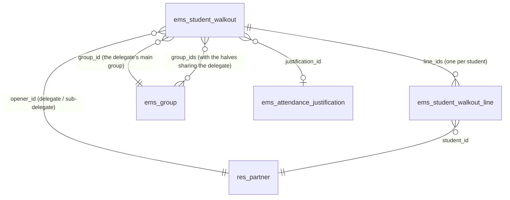
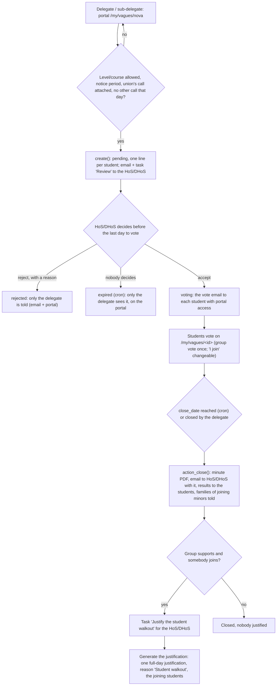

# Technical Reference: `ems.student_walkout`

## Overview

A **student walkout** is a strike called by a students' union ("convocatòria de vaga"). The group's
delegate or sub-delegate opens a walkout call from the portal, attaching the union's call. The
group's Head of Studies / Deputy Head of Studies reviews it first: they reject it with a reason
(only the delegate is told, so a misuse of the tool reaches nobody else) or accept it. Once
accepted, every student of the group with portal access votes, logged in, on two questions:

1. whether the group supports the walkout (anonymous: only the count is kept);
2. whether they join it themselves (by name; it can be changed until the vote closes).

When the vote closes the call produces its minute (a PDF in the centre language), sent to the
group's Head of Studies / Deputy Head of Studies, who gets a task to justify the walkout day and a
button that creates one attendance justification of that whole day for the students who join.
The group's vote decides: if it does not support the walkout, nobody is justified.

**Naming.** In English the feature is always *walkout*, never *strike*: `ems.strike` is the
disciplinary record (Coexistence → Strikes). Catalan and Spanish say "vaga"/"huelga".

**Module files:** `models/attendance/student_walkout.py` (`ems.student_walkout`,
`ems.student_walkout.line`, the `res.partner` portal helpers), `models/curriculum/level.py` (which
levels may call one), `controllers/portal_student_walkout.py`, `views/portal/portal_student_walkout.xml`,
`views/attendance/student_walkout/`, `views/settings/walkout_levels.xml`,
`reports/attendance/report_student_walkout.xml`, `mails/attendance/student_walkout.xml`.

---

## Data model

### `ems.student_walkout`

| Field | Type | Notes |
|-------|------|-------|
| `name` | `Char` (computed, stored) | "Group - date" |
| `group_id` / `group_ids` | `Many2one` / `Many2many → ems.group` | The opener's main group, and every half of a split group sharing that delegate or sub-delegate |
| `opener_id` | `Many2one → res.partner` | The delegate or sub-delegate who opened it |
| `course_id` | `Many2one → ems.course` | The current course when opened |
| `walkout_date` | `Date` | The walkout day |
| `close_date` | `Date` | The day the vote closes: open until the end of the day before; the hourly cron closes it in the first hour of that day |
| `notes` | `Text` | What the delegate says about it |
| `attachment_ids` | `Many2many → ir.attachment` | The union's call: at least one file |
| `state` | `Selection` | `pending` → `voting` → `closed` → `justified`; or `rejected`, `expired` (nobody decided by the last day to vote), `cancelled` (by the delegate) |
| `head_of_studies_id` | `Many2one → hr.employee` | Who reviews it and gets the minute |
| `decided_by_id` / `decision_datetime` | `Many2one → res.users` / `Datetime` | Who accepted or rejected it, and when |
| `rejection_reason_id` / `rejection_details` | `Many2one → ems.student_walkout.rejection_reason` / `Text` | Why it was rejected; details are required for a reason with `requires_details` ("Other reasons") |
| `group_yes_count` / `group_no_count` / `group_abstain_count` | `Integer` | The anonymous group vote: only these counters, never who voted what |
| `group_supports` | `Boolean` (computed) | More yes than no among the votes cast (a tie does not support) |
| `joining_student_ids` | `Many2many` (computed) | The students whose line says they join |
| `pdf_attachment_id` | `Many2one → ir.attachment` | The minute, rendered on closing |
| `justification_id` | `Many2one → ems.attendance_justification` | Created by *Generate the justification* |

### `ems.student_walkout.line`

| Field | Type | Notes |
|-------|------|-------|
| `walkout_id`, `student_id` | `Many2one` | One line per student of `group_ids` when the call is opened |
| `has_portal` | `Boolean` | Whether the student had portal access then; only they vote |
| `voted` | `Boolean` | The group vote was cast (it never says which way) |
| `joins` | `Boolean` | Joins the walkout (by name; changeable until the vote closes) |
| `vote_date` | `Datetime` | Last answer |

**Anonymity and concurrency.** The group vote only adds one to a counter of the call
(`_ems_portal_vote`) and marks the line as `voted`, so nothing links a student to their answer. Two
answers at the same time update the same rows: PostgreSQL refuses the second one (Odoo runs in
REPEATABLE READ) and Odoo retries the request, so no vote is lost or counted twice.

### `ems.student_walkout.rejection_reason`

The catalog the Head of Studies picks from (Student's Attendances → Configuration → Student walkouts
→ Rejection reasons; academic administrators and Heads of Studies), like the justification reasons:
`name` (translatable), `sequence`, `active`, `requires_details`. Seeded with `noupdate="1"` (the
centre edits it): no official call that day, the attached document is not a valid call, the call
does not include the group's level or studies, another sector (not students), another autonomous
community, duplicate call, and "Other reasons" (`requires_details`). The rejection is made from
`ems.student_walkout.reject.wizard`.

---

## Who may open a call: levels and courses

An allowlist on `ems.level` (empty = nobody), edited in Settings → *Student walkouts* → *Levels
and courses* (an editable list of the levels):

| Field | Meaning |
|-------|---------|
| `walkout_allowed` | The level's groups may call a walkout |
| `walkout_course_from` / `walkout_course_to` | Optional limits on the group's `course` (empty = no limit) |

`ems.group._ems_walkout_allowed()` applies them. Seeded once, by level acronym, from the law
(LODE art. 8: the collective decision not to attend is recognised from the 3rd year of ESO): ESO
from the 3rd year, and BTX, CFGB, CFGM, CFGS and EFPS in full (`ems.level._ems_seed_walkout_levels()`,
from `post_init_hook` and `migrations/18.0.0.48.0/post-migrate.py`). It is not catalog data
(`data/cat/`), so an upgrade never undoes the centre's choice.

## Notice period

`res.company.walkout_notice_days` (Settings, default 2), counted in days, never hours, against the
company's local today (`get_local_today()`):

- a call can only be opened if `walkout_date − today >= walkout_notice_days`;
- `today < close_date <= walkout_date − walkout_notice_days` (the portal proposes the latest one).

So the Head of Studies always gets the minute with the full notice period ahead.

---

## Flow

- **Open** (`ems.student_walkout._ems_portal_open(partner, vals, files)`): the partner must be a
  student with portal access who is the delegate or sub-delegate of their main group, and that group
  must be allowed (`_ems_walkout_allowed()`). Lines for every active student of `group_ids`. The call
  is `pending`: the Head of Studies gets an email at once (`ems.email_template_student_walkout_review`)
  and a quiet task "Review the student walkout call" due the last day to vote (`_ems_request_review`).
  Nobody in the group sees it yet, except its delegate (`res.partner._ems_walkout_calls`).
- **Accept** (`action_accept()`, Actions dropdown) / **Reject** (`action_open_reject_wizard()` →
  `_ems_reject(reason, details)`): Head of Studies / Deputy / Director in the tutor scope of the
  group's tutor, or an administrator (`_ems_user_may_decide`). Accepting sends the vote email
  (`ems.email_template_student_walkout_call`) to each student with portal access; rejecting tells only
  the opener (`ems.email_template_student_walkout_rejected`). Either way the review task is done.
- **Expire** (the hourly cron): a call still `pending` on its close date becomes `expired`, its task
  removed; only the delegate sees it, on the portal.
- **Student emails during school hours.** Every email to students (vote, result, rejection) goes
  through `_ems_mail_students`, which sets `mail.mail.scheduled_date` (Odoo's own mail queue sends
  it then) to `ems.group._ems_school_send_time()` of the student's main group: now during its
  classes, otherwise the start of its next classes, skipping weekends, public holidays and school
  breaks (`resource.calendar.leaves._ems_holiday_dates`). The group's day is from its first to its
  last class of that weekday in its schedule (`resource.calendar.attendance.group_ids`): one search
  per group, not one per student. A group with no schedule gets it at once. Staff emails (review,
  minute) and the families' are sent at once.
- **Vote** (`_ems_portal_vote(partner, group_vote, joins)`): only while `voting` and before
  `close_date`; `group_vote` in yes/no/abstain counts once, `joins` can be changed afterwards.
- **Close** (`action_close()`, from the hourly cron `_cron_ems_close_due()`, in the first hour of the close day, or the
  delegate's *Close now*): renders the minute (`ems.report_student_walkout`, centre language) and
  stores it, emails it to the Head of Studies / Deputy Head of Studies right away
  (`ems.email_template_student_walkout_head`: urgent, the walkout is days away, so not in the daily
  summary), schedules the quiet task when there is something to justify, emails the result to the
  students, and tells the family of each joining minor (`res.partner._ems_notification_recipients()`
  rule: a minor's family, or an adult's who authorized sharing). The Head of Studies is
  `group.tutor_id.find_head_of_studies()`; failing that, the academic administrators.
- **Cancel** (`_ems_portal_cancel(partner)`): the opener or the group's delegates, while pending or voting.
- **Generate the justification** (`action_generate_justification()`): Head of Studies / Deputy /
  Director in the tutor scope of every joining student, or an administrator. Creates an
  `ems.attendance_justification` with `ems.attendance_justification_reason_walkout`, the walkout day
  and the joining students not already justified that day (the ones skipped are noted in the
  chatter), marks the task as done and moves the call to `justified`.

---

## Access control

Portal users have no ACL on these models: the controller works with `sudo()` and always takes the
student from the logged-in user (`request.env.user.partner_id`, `contact_type == 'student'`; a
family never acts here).

| Role | Read | Accept / reject, generate the justification | Rejection reasons |
|------|:----:|:--------------------------:|:--:|
| Tutor (and the chain above, `tutor_scope_user_ids`) | ✓ (their groups) | — | read |
| Head of Studies / Deputy Head of Studies / Director | ✓ (their branch, tutor scope) | ✓ | read, write, create |
| Administrator (`ems.group_academic_admin`, `base.group_system`) | ✓ (all) | ✓ | all |

Nobody edits a call or its lines by hand in the backend: they come from the portal.
