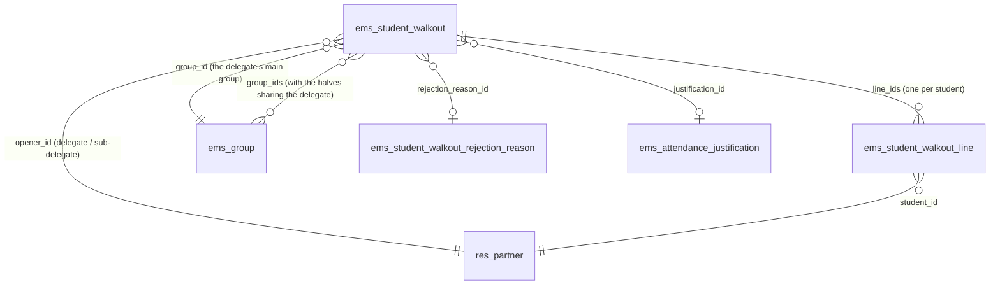
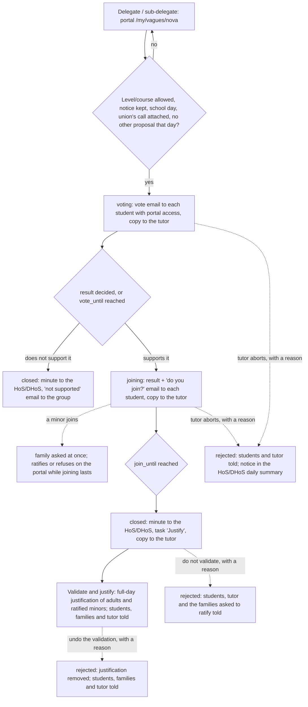

# Technical Reference: `ems.student_walkout`

## Overview

A **student walkout** is a strike called by a students' union ("vaga"/"huelga"). A group's delegate
or sub-delegate **proposes** from the portal that the group supports a walkout called by a union, attaching the
union's call, with no review first. *Call* (convocatòria) always means the union's document; the record this model
holds, which the group votes on, is the **proposal** to support the walkout:

1. every student of the group with portal access votes whether the group supports the walkout
   (anonymous: only the counts are kept);
2. if it does, each student says whether they join it (by name, changeable until the phase ends);
3. the minute (a PDF in the centre language) goes to the group's Head of Studies / Deputy Head of
   Studies at least the notice before the walkout, and they **validate** it (one attendance
   justification of the walkout day for the students who join) or **do not validate** it.

The **group's tutor watches over the proposal**: they get a copy of every email the group gets and may
**abort** it, with a reason, while it is voted or joined, only for a formal defect (the abort
wizard explains which reasons are lawful). The Head of Studies hears nothing until the minute,
except a notice in their daily summary when a proposal is aborted. **The family of a minor who joins
must ratify it** (Decret 102/2010, article 24.2: a minor's collective absence needs the family's
authorization): it is asked at once and answers on the portal while joining lasts; a minor whose
family has not ratified it (refused, did not answer, or has no portal access) is not justified.
Other families hear nothing until the proposal is validated.

**Naming.** In English the feature is always *walkout*, never *strike*: `ems.strike` is the
disciplinary record (Coexistence → Strikes). Catalan and Spanish say "vaga"/"huelga".

**Module files:** `models/attendance/student_walkout.py` (`ems.student_walkout`, its lines, the
rejection reasons and the reject wizard), `models/attendance/student_walkout_partner.py` (the
`res.partner` portal helpers), `models/contacts/group.py` (`_ems_walkout_allowed`,
`_ems_school_send_time`), `models/shared/datetime_utils.py` (school hours),
`models/curriculum/level.py` (which levels may propose one), `models/settings/company.py` (the calendar settings),
`controllers/portal_student_walkout.py`, `views/portal/portal_student_walkout.xml`,
`views/attendance/student_walkout/`, `views/settings/walkout_levels.xml`,
`reports/attendance/report_student_walkout.xml`, `mails/attendance/student_walkout.xml`.

---

## The calendar

Counted in **school hours**: every hour of a school day (a weekday that is no public holiday nor
school break, `resource.calendar.leaves._ems_school_days`, the same set the ex officio
withdrawal and the Erasmus+ deadlines count with), the night included, and no hour of a
weekend, holiday or break. 24 school hours from a Friday at 13:00 end on the Monday at 13:00
(`ems.datetime_utils.ems_add_school_hours()` / `ems_school_hours_between()`, on the centre's wall
clock). Not Odoo's `resource.calendar.plan_hours()`: it counts the working hours of a schedule (a
teacher's classes, say), while a school hour here is any hour of a school day, the night included,
and only public holidays and school breaks are taken out. Two settings (Settings → *Student Walkout Settings* → *Calendar*, `res.company`) set it,
and each proposal keeps the values it was made with (`phase_hours`, `notice_hours`):

| Setting | Default | Meaning |
|---------|---------|---------|
| `walkout_phase_hours` | 24 | How long the group vote lasts, and then the joining |
| `walkout_notice_hours` | 48 | How long before the walkout (its 00:00) the Head of Studies gets the minute |

| Phase | State | From | Until |
|-------|-------|------|-------|
| The group votes whether it supports it | `voting` | `vote_start`: when the email reaches the group | `vote_until` = `vote_start` + phase, or earlier once the result is decided |
| Each student says whether they join | `joining` | `join_start`: when the result email reaches the group | `join_until` = `join_start` + phase |
| The minute goes to the Head of Studies | `closed` | `join_until` (or the vote's end, if not supported) | — |

**A phase starts when its email reaches the students** (`_ems_send_moment`: now during the group's
classes, otherwise the start of its next ones, the latest of a split group's halves; see "Student
emails during school hours" below). A vote proposed on Friday at 20:00 runs from Monday 8:00 to
Tuesday 8:00. The portal lets students answer before the start too (e.g. over the weekend):
`_ems_phase_open()` only checks the end.

**Notice.** When opening, `_ems_projected_calendar()` works out the worst case (the vote taking its
whole phase) and `_ems_check_request_date()` requires at least `notice_hours` school hours from that
`join_until` to the walkout's 00:00, and the walkout day to be a school day. With the defaults, a
proposal made on Monday at 10:00 votes until Tuesday 10:00, joins until Wednesday 10:00, and its first
possible walkout day is the next Monday (Friday would only give 38 school hours). The portal form
shows that calendar and the first possible day (`_ems_first_walkout_day()`) before sending.

**The vote ends early** (`_ems_vote_decided()`, after each vote) once the votes still to come cannot
change the result: everybody voted, more yes than no plus the votes to come, or yes plus the votes
to come no more than no (a tie does not support it). The joining starts then, so the minute only
ever comes earlier than projected.

**Deadlines.** Each phase change wakes the cron `_cron_ems_walkout_deadlines()` exactly at its end
(`ir.cron._trigger(at=...)`); its hourly run is only the safety net. It ends a vote past
`vote_until` and closes a joining past `join_until`.

---

## Data model

### `ems.student_walkout`

| Field | Type | Notes |
|-------|------|-------|
| `name` | `Char` (computed, stored) | "Group - date", the date in the centre's language (`res.company._ems_centre_env()`) whoever opens it: it also names the minute |
| `group_id` / `group_ids` | `Many2one` / `Many2many → ems.group` | The opener's main group, and every half of a split group sharing that delegate or sub-delegate |
| `opener_id` | `Many2one → res.partner` | The delegate or sub-delegate who proposed it |
| `course_id` | `Many2one → ems.course` | The current course when proposed |
| `walkout_date` / `walkout_start` | `Date` / `Datetime` (computed) | The walkout day (the only date the delegate gives), and its 00:00 in the centre |
| `phase_hours` / `notice_hours` | `Integer` | The settings when it was opened |
| `vote_start` / `vote_until` / `join_start` / `join_until` | `Datetime` | The calendar above; the joining ones once it starts |
| `notes` | `Text` | The reason the delegate gives (which union calls it and why), labelled "Reason"; required to propose it |
| `attachment_ids` | `Many2many → ir.attachment` | The union's call: at least one file |
| `state` | `Selection` | `voting` → `joining` → `closed` → `justified`; or `rejected`, `cancelled` (by the delegate). A group vote that does not support it goes from `voting` to `closed` |
| `head_of_studies_id` | `Many2one → hr.employee` | Who gets the minute |
| `rejected_by_id` / `rejected_datetime` | `Many2one → res.users` / `Datetime` | Who aborted it or did not validate it, and when |
| `rejection_reason_id` / `rejection_details` | `Many2one → ems.student_walkout.rejection_reason` / `Text` | Why; details are required for a reason with `requires_details` ("Other reasons") |
| `rejected_from_state` | `Selection` | `voting`/`joining`: aborted; `closed`: not validated; `justified`: validation undone |
| `can_abort` / `can_reject` | `Boolean` (computed per user) | Whether the user may abort it / not validate it (`_ems_user_may_abort` / `_ems_user_may_reject`) |
| `group_yes_count` / `group_no_count` / `group_abstain_count` | `Integer` | The anonymous group vote: only these counters, never who voted what |
| `group_supports` | `Boolean` (computed) | More yes than no among the votes cast (a tie does not support it) |
| `joining_student_ids` | `Many2many` (computed) | The students whose line says they join |
| `justifiable_student_ids` | `Many2many` (computed) | Those who join and can be justified: adults, and minors whose family ratified it |
| `pdf_attachment_id` | `Many2one → ir.attachment` | The minute, rendered on closing |
| `justification_id` | `Many2one → ems.attendance_justification` | Created by *Validate and justify* |

### `ems.student_walkout.line`

| Field | Type | Notes |
|-------|------|-------|
| `walkout_id`, `student_id` | `Many2one` | One line per student of `group_ids` when the vote is proposed |
| `has_portal` | `Boolean` | Whether the student had portal access then; only they answer |
| `voted` / `vote_date` | `Boolean` / `Datetime` | The group vote was cast (it never says which way) |
| `join_answered` / `joins` / `join_date` | `Boolean` / `Boolean` / `Datetime` | Whether they said if they join, and what |
| `needs_ratification` / `ratification` | `Boolean` / `Selection` (`pending`, `ratified`, `refused`) | A minor on the walkout day (no birth date counts as a minor) who joins needs the family's ratification |
| `ratified_by_id` / `ratification_date` | `Many2one → res.partner` / `Datetime` | The family contact who answered, and when |
| `justifiable` | `Boolean` (computed) | Joins and, if a minor, the family ratified it |

**Anonymity and concurrency.** The group vote only adds one to a counter of the proposal
(`_ems_portal_vote`) and marks the line as `voted`, so nothing links a student to their answer. Two
answers at the same time update the same rows: PostgreSQL refuses the second one (Odoo runs in
REPEATABLE READ) and Odoo retries the request, so no vote is lost or counted twice.

### `ems.student_walkout.rejection_reason`

One catalog for aborting and for not validating (Student's Attendances → Configuration → Student
walkouts → Rejection reasons; academic administrators and Heads of Studies), like the justification
reasons: `name` (translatable), `sequence`, `active`, `requires_details`. Seeded with
`noupdate="1"` (the centre edits it) with the formal defects only: no official call that day, the
attached document is not a valid call, the call does not include the group's level or studies,
another sector (not students), another autonomous community, and "Other reasons"
(`requires_details`). A duplicate proposal or one made by someone who is not the delegate cannot
happen (the portal refuses both), so they are not reasons. Both are done from
`ems.student_walkout.reject.wizard`; while aborting, it shows what the law allows (LODE art. 8: the
centre cannot stop a walkout because of its cause, only for a formal defect) and what it does not
(disagreeing with the cause, an exam or an outing that day, low attendance, putting pressure on the
group).

---

## Who may propose one: levels and courses

An allowlist on `ems.level` (empty = nobody), edited in Settings → *Student Walkout Settings* →
*Levels and courses*: a dialog (`ems.walkout.levels.wizard`, `models/settings/walkout_levels_wizard.py`)
listing every level, which writes only these three fields, with sudo, so that whoever enters
Settings can save it without being given write access to the levels (like the convalidation
levels):

| Field | Meaning |
|-------|---------|
| `walkout_allowed` | The level's groups may propose supporting a walkout |
| `walkout_course_from` / `walkout_course_to` | Optional limits on the group's `course` (empty = no limit) |

`ems.group._ems_walkout_allowed()` applies them. Seeded once, by level acronym, from the law
(LODE art. 8: the collective decision not to attend is recognised from the 3rd year of ESO): ESO
from the 3rd year, and BTX, CFGB, CFGM, CFGS and EFPS in full (`ems.level._ems_seed_walkout_levels()`,
from `post_init_hook` and `migrations/18.0.0.49.0/post-migrate.py`). It is not catalog data
(`data/cat/`), so an upgrade never undoes the centre's choice.

---

## Flow

- **Propose** (`_ems_portal_open(partner, vals, files)`): the partner must be a student with portal
  access who is the delegate or sub-delegate of their main group, and that group must be allowed.
  Lines for every active student of `group_ids`. The vote starts at once (`_ems_start_voting`):
  each student with portal access gets `email_template_student_walkout_call`, and the tutor a copy.
- **Tutor's copy** (`_ems_mail_tutors(event)`): `email_template_student_walkout_tutor`, one template
  whose text depends on `ctx['walkout_event']` (`call`, `join`, `closed`, `validated`, `rejected`),
  scheduled for when the group's email reaches it. To the users of `group_ids.tutor_id` (co-tutors
  of a split group too; `_ems_tutor_users`); with no tutor, to the Head of Studies. An email, not a
  daily-summary notice: a phase lasts one school day and the tutor must be able to act within it.
- **Group vote** (`_ems_portal_vote(partner, group_vote)`): once per student, yes/no/abstain. When
  it ends (`_ems_end_group_vote`): if the group supports it, `joining` (its own phase from when the
  email reaches the group), and each student gets
  `email_template_student_walkout_join` (the result and that they can join until `join_until`);
  otherwise the proposal closes and each student gets `email_template_student_walkout_result`.
- **Join** (`_ems_portal_join(partner, joins)`): while `joining`, changeable. A minor on the walkout
  day (`_ems_is_minor`; no birth date counts as a minor) who joins gets `needs_ratification` and
  `ratification = 'pending'`, and their family is asked at once
  (`email_template_student_walkout_ratify`, not tied to school hours). Withdrawing clears it;
  joining again asks again.
- **Ratify** (`_ems_portal_ratify(family, line, ratifies)`, portal `/my/vagues`, POST
  `/my/vagues/ratifica/<line>`): a family contact of the student (`_ems_family_contacts`) with portal
  access, only while `joining` (until `join_until`), changeable meanwhile. A refusal is told to the
  student (`email_template_student_walkout_ratification_refused`). A family with no portal access
  cannot ratify: that minor is not justified. The family sees the lines it was asked about
  (`res.partner._ems_walkout_family_lines`) and a banner on the portal home while one is pending.
- **Close** (`_ems_close`): renders the minute (`ems.report_student_walkout`, centre language), emails
  it to the Head of Studies right away (`email_template_student_walkout_head`: the walkout is a few
  days off, so not in the daily summary) and, when the group supports it and somebody joins,
  schedules the quiet task "Justify the student walkout"; the tutor gets a copy. The families are
  not told yet. The Head of Studies (`_ems_head_users`) is `group.tutor_id.find_head_of_studies()`;
  with no tutor, every Head and Deputy Head of Studies; failing that, the academic administrators.
- **Abort** (`action_open_reject_wizard()` → `_ems_reject(reason, details)`) while `voting` or
  `joining` (`ABORTABLE_STATES`): `_ems_user_may_abort`, i.e. an administrator, or the tutor of any
  of `group_ids` or the chain above them (`user_acts_as_tutor`: Department or Seminar Chief, Head or
  Deputy Head of Studies, Director); with no tutor, any Head of Studies. Every student with portal
  access gets `email_template_student_walkout_rejected` and still sees the proposal and the reason on
  the portal; the tutor gets a copy; the Head of Studies a notice in their daily summary
  (`_ems_notify_aborted`, `ems.info_notice`).
- **Do not validate / undo the validation** (same wizard and method) while `closed` or `justified`
  (`VALIDATION_STATES`): `_ems_user_may_reject`, whoever may validate it. The students and the tutor
  are told, and so are the families that heard of it (`_ems_family_lines`: the ones asked to
  ratify and, when undoing a validation, the adults' families told of it), with
  `email_template_student_walkout_family_rejected`, whose text depends on `rejected_from_state`
  (aborted, not validated, validation withdrawn). The same goes for an abort. A
  justification already generated is deleted (as the user rejecting it: its absences go back to
  unjustified), and the justify task is removed.
- **Cancel** (`_ems_portal_cancel(partner)`): the opener or the group's delegates, while voting or
  joining; the group no longer sees it. Nobody closes a phase by hand.
- **Validate and justify** (`action_generate_justification()`): Head of Studies / Deputy /
  Director in the tutor scope of every joining student, or an administrator. Creates an
  `ems.attendance_justification` with `ems.attendance_justification_reason_walkout`, the walkout day
  and the justifiable students (adults, and minors whose family ratified it) not already justified
  that day (the ones skipped are noted in the chatter), marks the task as done and moves the proposal to
  `justified`. The task only exists when somebody can be justified. Then every student with portal
  access gets `email_template_student_walkout_validated` (whether their absence is justified or
  they are expected in class), the family of each justified minor (or adult sharing with it)
  `email_template_student_walkout_family`, and the tutor a copy.
- **Student emails during school hours.** Every email to students goes through
  `_ems_mail_students`, which sets `mail.mail.scheduled_date` (Odoo's own mail queue sends it then)
  to `ems.group._ems_school_send_time()` of the student's main group: now during its classes,
  otherwise the start of its next classes, skipping weekends, public holidays and school breaks
  (`resource.calendar.leaves._ems_holiday_dates`). The group's day is from its first to its last
  class of that weekday in its schedule (`resource.calendar.attendance.group_ids`): one search per
  group, not one per student. A group with no schedule gets it at once. The tutor's copy waits for
  the same moment; the minute and the family emails are sent at once.

---

## Access control

Portal users have no ACL on these models: the controller works with `sudo()` and always takes the
student from the logged-in user (`request.env.user.partner_id`, `contact_type == 'student'`). A
family only ratifies, for the lines of its own children it was asked about.

| Role | Read | Abort (voting, joining) | Validate, do not validate, undo | Rejection reasons |
|------|:----:|:--:|:--:|:--:|
| Tutor, Department / Seminar Chief (the chain above, `tutor_scope_user_ids`) | ✓ (their groups) | ✓ | — | read |
| Head of Studies / Deputy Head of Studies / Director | ✓ (their branch, tutor scope; every group with no tutor) | ✓ | ✓ | read, write, create |
| Administrator (`ems.group_academic_admin`, `base.group_system`) | ✓ (all) | ✓ | ✓ | all |

Reading comes from the record rules `rule_student_walkout_tutor_scope` and, for a group with no
tutor, `rule_student_walkout_no_tutor` (Heads of Studies). The wizard is open to every teacher; who
may act is checked in `_ems_check_reject`, and the proposal is written with `sudo()` afterwards.

**The administrator is at the top** (`ems.base.get_user_is_top_admin()`: `base.group_system` or
`ems.group_academic_admin`): both abort, validate and undo, outside the hierarchy. The system
administrator has no rights on `ems.attendance_justification` of their own, so for them the walkout
creates and removes its justification as the superuser (`_ems_justifications()`, `with_user`, since
the justification's own checks read `env.user`), and the form stays on the proposal instead of opening
the justification.

Nobody edits a proposal or its lines by hand in the backend: they come from the portal and the
proposal's own methods.
