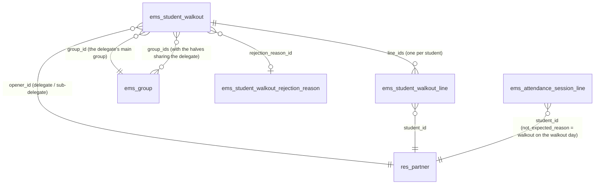
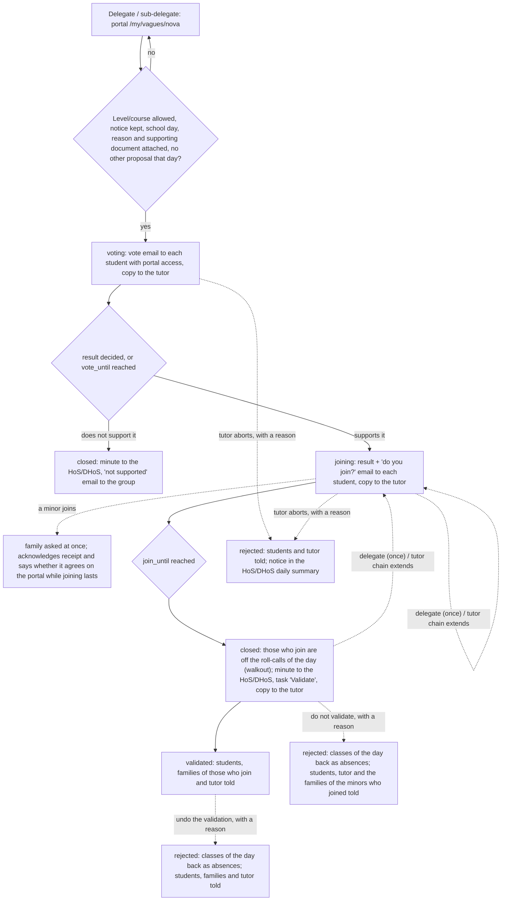

# Technical Reference: `ems.student_walkout`

## Overview

A **student walkout** is a collective decision of a group not to attend class on a given day (LODE,
article 8), often after a students' union calls a strike. A group's delegate or sub-delegate **proposes**
it from the portal, with no review first, giving the **reason** (shown in every banner and email of the
group) and attaching a **supporting document**: a union's call, the minute of the group's assembly or any
document that explains the decision (issue #844: before it, only a union's call). Both are required. The
record this model holds, which the group votes on, is the **proposal**:

1. every student of the group with portal access when the proposal is made votes whether the group
   supports the walkout (anonymous: only the counts are kept);
2. if it does, each student says whether they join it (by name, changeable until the phase ends),
   also one who got portal access after the proposal; a student who does not answer does not join;
3. the minute (a PDF in the centre language) goes to the group's Head of Studies / Deputy Head of
   Studies at least the notice before the walkout, and they **validate** it or **do not validate** it.

**Every student who joins is off the roll-calls of the walkout day** (issue #844): from the moment joining
closes with the group's support, their session lines of that day are archived with the reason
`walkout` ("not required to attend: student walkout"), the #644 mechanism the expected withdrawal and
the convalidation already use. Neither an absence nor a presence, and **nothing is justified**: the
walkout creates no `ems.attendance_justification`. Not validating it, or undoing the validation, turns
those classes into regular absences.

The **group's tutor watches over the proposal**: they get a copy of every email the group gets and may
**abort** it, with a reason, while it is voted or joined, only for a formal defect (the abort
wizard explains which reasons are lawful). The Head of Studies hears nothing until the minute,
except a notice in their daily summary when a proposal is aborted. **The family of a minor who joins
is asked to acknowledge receipt and to say whether it agrees** (it is no authorisation: the exercise
of the right needs none, LODE art. 8 and STS 5389/2014): it is asked at once and answers "I agree" or
"I do not agree" on the portal while joining lasts, or the tutor (or whoever is above them) marks it
by hand for a family that cannot use the portal. The answer **only says the family knows and
agrees**: it is a collective decision of the students that nobody can revoke, the family included,
and it changes nothing in the roll-calls. What it does change: the family of a minor who joins
**without having said it agrees** (does not agree, did not answer, or has no portal access) is told of each class of the day, for information only, through the
usual attendance notice (see "The roll-calls of the walkout day"). Other families hear nothing until
the proposal is validated.

**Banners and emails carry the reason.** The portal home banners (vote pending, joining open, a family
asked for its answer) and the students' vote email quote `notes` in full ("because of: «...»"); it is at
most 2,000 characters.

**Wording in Catalan and Spanish** (everywhere: portal, emails, the minute, staff screens, settings and
manuals): the students' decision is never a "vaga"/"huelga" but a "decisió col·lectiva d'inassistència a
classe" / "decisión colectiva de inasistencia a clase" (short form for titles, menus, buttons and labels:
"inassistència col·lectiva" / "inasistencia colectiva"); only what a union calls stays a "convocatòria de
vaga" / "convocatoria de huelga". The texts for students and families never speak of "the right to strike"
(the abort wizard's legal text, for staff, does). Two things keep "vaga"/"huelga" because they are real
strikes: the staff strike report (`ems.staff_walkout_report`) and the justification reason
`attendance_justification_reason_walkout` (a strike day justified by hand); where a `.po` block was
shared with them it is split by reference. English keeps *walkout*.

**Naming.** In English the feature is always *walkout*, never *strike*: `ems.strike` is the
disciplinary record (Coexistence → Strikes). Catalan and Spanish say "vaga"/"huelga".

**Module files:** `models/attendance/student_walkout.py` (`ems.student_walkout`, its lines, the
rejection reasons and the reject wizard), `models/attendance/student_walkout_partner.py` (the
`res.partner` portal helpers), `models/contacts/student_walkout_attendance.py` (the `walkout` reason of
the roll-call and its notice; in `contacts/` because it extends `_ems_not_expected_reasons`, which
`withdrawal_expected.py` defines), `models/contacts/group.py` (`_ems_walkout_allowed`,
`_ems_class_windows`, `_ems_school_send_time`), `models/shared/datetime_utils.py` (counting hours over school days),
`models/curriculum/level.py` (which levels may propose one), `models/settings/company.py` (the calendar settings),
`controllers/portal_student_walkout.py`, `views/portal/portal_student_walkout.xml`,
`views/attendance/student_walkout/`, `views/settings/walkout_levels.xml`,
`reports/attendance/report_student_walkout.xml`, `mails/attendance/student_walkout.xml`.

---

## The calendar

Each phase (the group vote, then the joining) lasts `phase_hours`, and the Head of Studies must get
the minute at least `notice_hours` before the walkout's 00:00. How those hours are counted is set in
Settings → *Student Walkout Settings* → *Calendar* (`res.company`, issue #828), and each proposal
keeps the values it was made with (stored on the proposal):

| Setting (`res.company`) | Proposal field | Default | Meaning |
|---------|---------|---------|---------|
| `walkout_phase_hours` | `phase_hours` | 24 | How long the group vote lasts, and then the joining |
| `walkout_notice_hours` | `notice_hours` | 48 | How long before the walkout (its 00:00) the Head of Studies gets the minute |
| `walkout_hours_kind` | `hours_kind` | `real` | `real`: 60 real minutes, any time of the day. `school`: only the group's class hours |
| `walkout_count_from` | `count_from` | `email` (upgrade), `proposal` (new installation) | Real hours only. `proposal`: from the moment of the proposal, emails sent at once. `email`: when the group receives the email within its schedule |
| `walkout_count_days_off` | `count_days_off` | off | Real hours only. On: the days the group has no class (weekends, public holidays, school breaks) count like any other |

The `walkout_count_from` field default (`email`) is today's behaviour, so an installation upgrading
into this version keeps it with no migration; `post_init_hook` sets `proposal` on a new installation
(the same pattern as `strike_family_notification_mode`). Proposals opened before issue #828 got the
column defaults (`real`, `email`, off), i.e. the count they were made with.

What each combination counts (`_ems_add_hours()` / `_ems_hours_between()`, both reading a **plan**
built once per calendar by `_ems_plan(groups, rule)`: the rule, each group's class windows and their
union):

| Kind | Days without class | Count | Function |
|------|------|------|------|
| Real | not counted (default) | every hour of a school day, the night included, none of a weekend, public holiday or school break: 24 hours from a Friday 13:00 end on Monday 13:00 | `ems.datetime_utils.ems_add_school_hours()` / `ems_school_hours_between()` with no windows |
| Real | counted | plain clock time: 24 hours from a Friday 9:00 end on Saturday 9:00 | `moment + timedelta(hours=...)` |
| School | (never) | only the group's class hours on school days: with class from 8:00 to 15:00, 24 hours from Monday 9:00 end on Thursday 12:00 | the same functions with `windows` = the groups' class windows |

A school day is a weekday that is no public holiday nor school break
(`resource.calendar.leaves._ems_school_days`, the same set the ex officio withdrawal and the
Erasmus+ deadlines count with), always counted on the centre's wall clock. A group's class windows
(`ems.group._ems_class_windows()`) are, per weekday, from its first class to its last one in its
schedule (`resource.calendar.attendance.group_ids`), the union for the halves of a split group; a
group with no schedule counts every hour of its school days even with school hours. Not Odoo's
`resource.calendar.plan_hours()`: it counts the working hours of one `resource.calendar` with its
own leaves, while this needs the union of several groups' slots, the centre's school days and, for
the default, every hour of a school day (the night included), which no calendar describes.

| Phase | State | From | Until |
|-------|-------|------|-------|
| The group votes whether it supports it | `voting` | `vote_start`: the proposal, or when the email reaches the group | `vote_until` = `vote_start` + phase, or earlier once the result is decided |
| Each student says whether they join | `joining` | `join_start`: the vote's end, or when the result email reaches the group | `join_until` = `join_start` + phase |
| The minute goes to the Head of Studies | `closed` | `join_until` (or the vote's end, if not supported) | — |

**When a phase starts** (`_ems_phase` → `_ems_send_moment(plan, moment)`). With real hours counted
from the proposal (`_ems_sends_at_once()`), at that very moment, and every email of the proposal to
the students and the tutor leaves at once, whatever the time: the one exception to "Student emails
during school hours" below. Otherwise, when its email reaches the students: now during the group's
classes, otherwise the start of its next ones (`ems.datetime_utils.ems_class_send_moment()`, the
latest of a split group's halves). A vote proposed on Friday at 20:00 then runs from Monday 8:00 to
Tuesday 8:00. With school hours that is the same as counting from the proposal, since no hour counts
before the first class. The portal lets students answer before the start too (e.g. over the
weekend): `_ems_phase_open()` only checks the end.

**A shortened joining (issue #838).** The joining does not need its whole phase to fit before the notice: it lasts
`phase_hours`, or, if the minute would then reach the Head of Studies too late, the longest part of it that keeps the
notice (`_ems_longest_end()`, bisection over minutes, the same helper as the extension below), at least
`MIN_PHASE_MINUTES` (5). It is worked out **when the joining starts** (`_ems_end_group_vote`), so a vote that ends
early leaves it more time, up to the phase. When opening, `_ems_check_request_date()` only needs the worst case
(the vote taking its whole phase) to leave those 5 minutes (`_ems_join_until_for(calendar, day)`); a proposal that
needs the cut is created and the delegate is warned on its page (`_ems_worst_join_hours()`, alert
`o_ems_walkout_join_cut`, only for the delegates while voting), not asked to confirm. `_ems_first_walkout_day()`
gives the first day with both phases whole, or with `shortened=True` the earliest one; the form's minimum date is the
latter and says until which day the joining is shorter. The settings example adds the earliest day when it differs.

**Notice.** When opening, `_ems_projected_calendar()` works out the worst case (the vote taking its
whole phase) and `_ems_check_request_date()` requires the minute to reach the Head of Studies at least `notice_hours`, counted in the
same way as the phases, before the walkout's 00:00 (with the joining cut if needed, see above), and the walkout day
to be a school day. With phases of 24 hours, 48 of notice and today's count (real hours from the email), a proposal
made on Monday at 10:00 votes until Tuesday 10:00, joins until Wednesday 10:00, and its first
possible walkout day is the next Monday (Friday would only give 38 hours). With 24 hours of notice
and real hours from the proposal, a proposal made on Monday at any time can be for Friday. The
portal form shows that calendar, the first possible day (`_ems_first_walkout_day()`) and what the
count means (`_ems_count_description(rule)`, also in the "too late" error) before sending.

**The example in the settings** (`res.config.settings.walkout_calendar_example` →
`_ems_sample_html()`). A read-only text that changes with every control, before saving: a sample
group with class from 8:00 to 15:00, Monday to Friday, proposing on the next Friday at 17:00 (after
its classes, so that every combination gives a different calendar), with when its vote ends, when
the joining ends (the latest the minute reaches the Head of Studies) and the first possible walkout
day, plus `_ems_count_description()`. `_ems_sample_calendar()` runs the very same `_ems_plan` /
`_ems_projected_calendar` / `_ems_first_walkout_day` as a real proposal; only the class windows and
the school days (every weekday, so the example never depends on this year's holidays) are the
sample's, passed in the plan (`group_windows`, `school_days`).

**The vote ends early** (`_ems_vote_decided()`, after each vote) once the votes still to come cannot
change the result: everybody voted, more yes than no plus the votes to come, or yes plus the votes
to come no more than no (a tie does not support it). The joining starts then, so the minute only
ever comes earlier than projected.

**Deadlines.** Each phase change wakes the cron `_cron_ems_walkout_deadlines()` exactly at its end
(`ir.cron._trigger(at=...)`); its hourly run is only the safety net. It ends a vote past
`vote_until` and closes a joining past `join_until`.

---

## Data model

### `ems.student_walkout`

| Field | Type | Notes |
|-------|------|-------|
| `name` | `Char` (computed, stored) | "Group - date", the date in the centre's language (`res.company._ems_centre_env()`) whoever opens it: it also names the minute |
| `group_id` / `group_ids` | `Many2one` / `Many2many → ems.group` | The opener's main group, and every half of a split group sharing that delegate or sub-delegate |
| `opener_id` | `Many2one → res.partner` | The delegate or sub-delegate who proposed it |
| `course_id` | `Many2one → ems.course` | The current course when proposed |
| `walkout_date` / `walkout_start` | `Date` / `Datetime` (computed) | The walkout day (the only date the delegate gives), and its 00:00 in the centre |
| `phase_hours` / `notice_hours` | `Integer` | The settings when it was opened |
| `hours_kind` / `count_from` / `count_days_off` | `Selection` / `Selection` / `Boolean` | How its hours are counted, from the settings when it was opened (issue #828) |
| `vote_start` / `vote_until` / `join_start` / `join_until` | `Datetime` | The calendar above; the joining ones once it starts |
| `notes` | `Text` | The reason the delegate gives (why the walkout is called), labelled "Reason"; required to propose it |
| `attachment_ids` | `Many2many → ir.attachment` | The supporting document (a union's call, the group's assembly minute...): at least one file |
| `state` | `Selection` | `voting` → `joining` → `closed` → `validated`; or `rejected`, `cancelled` (by the delegate). A group vote that does not support it goes from `voting` to `closed` |
| `head_of_studies_id` | `Many2one → hr.employee` | Who gets the minute |
| `rejected_by_id` / `rejected_datetime` | `Many2one → res.users` / `Datetime` | Who aborted it or did not validate it, and when |
| `rejection_reason_id` / `rejection_details` | `Many2one → ems.student_walkout.rejection_reason` / `Text` | Why; details are required for a reason with `requires_details` ("Other reasons") |
| `delegate_extended` | `Boolean` | The delegates already used their one extension of the joining (issue #838) |
| `can_extend` | `Boolean` (computed per user) | Whether the user may extend the joining and it is possible (`_ems_user_may_abort` and `_ems_extension()`) |
| `rejected_from_state` | `Selection` | `voting`/`joining`: aborted; `closed`: not validated; `validated`: validation undone |
| `can_abort` / `can_reject` / `can_validate` | `Boolean` (computed per user) | Whether the user may abort it / not validate it / validate it (`_ems_user_may_abort` / `_ems_user_may_reject` / `_ems_user_may_validate`) |
| `group_yes_count` / `group_no_count` / `group_abstain_count` | `Integer` | The anonymous group vote: only these counters, never who voted what |
| `group_supports` | `Boolean` (computed) | More yes than no among the votes cast (a tie does not support it) |
| `group_vote_result` | `Selection` (computed) | What the screens show of the vote: `pending` while it is open (`group_supports` alone is true with the first yes), then `supports` / `does_not_support`; empty when aborted or cancelled before it ended |
| `vote_phase_state` / `join_phase_state` | `Selection` (computed) | Where each phase is (the form's "Phase 1" and "Phase 2" blocks): in progress, closed, aborted; the joining also `waiting` (the vote is open) or `not_opened` (the group does not support it) |
| `vote_progress` / `join_progress` / `join_answered_progress` | `Char` (computed) | "x / y": voted of may vote; join of students; answered of students |
| `family_agrees_count` / `family_disagrees_count` / `family_pending_count` | `Integer` (computed) | Of the minors who join, the families that agree, do not agree or have not answered |
| `joining_student_ids` | `Many2many` (computed) | The students whose line says they join |
| `pdf_attachment_id` | `Many2one → ir.attachment` | The minute, rendered on closing |

### `ems.student_walkout.line`

| Field | Type | Notes |
|-------|------|-------|
| `walkout_id`, `student_id` | `Many2one` | One line per student of `group_ids` when the vote is proposed |
| `has_portal` | `Boolean` | Whether the student had portal access when the proposal was made: the group vote's electorate (`voter_count`). Joining is open to every line (issue #830) |
| `voted` / `vote_date` | `Boolean` / `Datetime` | The group vote was cast (it never says which way) |
| `join_answered` / `joins` / `join_date` | `Boolean` / `Boolean` / `Datetime` | Whether they said if they join, and what |
| `needs_ratification` / `ratification` | `Boolean` / `Selection` (`pending`, `ratified`, `refused`) | The family of a minor on the walkout day (no birth date counts as a minor) who joins is asked to acknowledge receipt and say whether it agrees: informative only (`ratified` = "Agrees", `refused` = "Does not agree"; the keys keep the old names) |
| `ratified_by_id` / `ratification_date` | `Many2one → res.partner` / `Datetime` | Who answered (the family contact, or the staff member who marked it by hand), and when |
| `ratified_manually` / `can_ratify_manually` | `Boolean` / `Boolean` (computed, per user) | Marked by hand by the centre (issue #840); whether the current user may do it now |

**Anonymity and concurrency.** The group vote only adds one to a counter of the proposal
(`_ems_portal_vote`) and marks the line as `voted`, so nothing links a student to their answer. Two
answers at the same time update the same rows: PostgreSQL refuses the second one (Odoo runs in
REPEATABLE READ) and Odoo retries the request, so no vote is lost or counted twice.

### `ems.student_walkout.rejection_reason`

One catalog for aborting and for not validating (Student's Attendances → Configuration → Student
walkouts → Rejection reasons; academic administrators and Heads of Studies), like the justification
reasons: `name` (translatable), `sequence`, `active`, `requires_details`. Seeded with
`noupdate="1"` (the centre edits it) with the formal defects only: the attached document does not
support the proposal, and "Other reasons" (`requires_details`). Only the procedure is judged (a
protest shown by a document, a group from 3rd of ESO, notice in time), never who calls it, which
sector or which territory: "the call does not include the group's level or studies", "the call is
for another sector" and "the call is for another autonomous community" were archived by issue #844
(migration 18.0.0.50.0; the proposals already rejected with one keep it). "No official call of a students' union" was archived by issue #844 (any
document may support a walkout now), and "the attached document is not a valid call" renamed; the
migration leaves a reason the centre had renamed as it is. A duplicate proposal or one made by someone who is not the delegate cannot
happen (the portal refuses both), so they are not reasons. Both are done from
`ems.student_walkout.reject.wizard`; while aborting, it shows what the law allows (LODE art. 8: the
centre cannot stop a walkout because of its cause, only for a formal defect) and what it does not
(disagreeing with the cause, an exam or an outing that day, low attendance, putting pressure on the
group).

---

## Who may propose one: levels and courses

An allowlist on `ems.level` (empty = nobody), edited in Settings → *Student Walkout Settings* →
*Levels and courses*: a dialog (`ems.walkout.levels.wizard`, `models/settings/walkout_levels_wizard.py`)
listing every level, which writes only these three fields, with sudo, so that whoever enters
Settings can save it without being given write access to the levels (like the convalidation
levels):

| Field | Meaning |
|-------|---------|
| `walkout_allowed` | The level's groups may propose supporting a walkout |
| `walkout_course_from` / `walkout_course_to` | Optional limits on the group's `course` (empty = no limit) |

`ems.group._ems_walkout_allowed()` applies them. Seeded once, by level acronym, from the law
(LODE art. 8: the collective decision not to attend is recognised from the 3rd year of ESO): ESO
from the 3rd year, and BTX, CFGB, CFGM, CFGS and EFPS in full (`ems.level._ems_seed_walkout_levels()`,
from `post_init_hook` and `migrations/18.0.0.49.0/post-migrate.py`). It is not catalog data
(`data/cat/`), so an upgrade never undoes the centre's choice.

---

## Flow

- **Propose** (`_ems_portal_open(partner, vals, files)`): the partner must be a student with portal
  access who is the delegate or sub-delegate of their main group, and that group must be allowed.
  Lines for every active student of `group_ids`. The vote starts at once (`_ems_start_voting`):
  each student with portal access gets `email_template_student_walkout_call`, and the tutor a copy.
- **Tutor's copy** (`_ems_mail_tutors(event)`): `email_template_student_walkout_tutor`, one template
  whose text depends on `ctx['walkout_event']` (`call`, `join`, `closed`, `validated`, `rejected`),
  scheduled for when the group's email reaches it (at once when counting from the proposal). To the users of `group_ids.tutor_id` (co-tutors
  of a split group too; `_ems_tutor_users`); with no tutor, to the Head of Studies. An email, not a
  daily-summary notice: a phase lasts one school day and the tutor must be able to act within it.
- **Group vote** (`_ems_portal_vote(partner, group_vote)`): once per student, yes/no/abstain. When
  it ends (`_ems_end_group_vote`): if the group supports it, `joining` (its own phase from when the
  email reaches the group), and each student gets
  `email_template_student_walkout_join`. Issue #852: some students took the group's support for their
  own joining, so this email names both phases ("only the first step"), says what to do before
  `join_until` and what each answer means: joining, the day's classes are off the roll-calls and the
  name is in the minute; not joining **or not answering** (`joins` is only true after an explicit yes,
  `join_answered` stays false), the student is expected in class and absences count as usual. The vote
  email, the "joining extended" email (it also reaches who already answered: they need do nothing),
  the portal's vote and join cards, home banner and result, and the minute say "voted in favour" for
  the group vote, never "decided";
  otherwise the proposal closes and each student gets `email_template_student_walkout_result`.
  The joining email goes to every student of the call with portal access at that moment
  (`_ems_joining_lines`), not only to the vote's electorate.
- **Join** (`_ems_portal_join(partner, joins)`): while `joining`, changeable. Any student of the
  call answers, also one without portal access when the proposal was made (`has_portal` only limits
  the group vote, whose majority is counted over a fixed electorate; joining is each student's own
  decision, issue #830). A student given portal access while joining is open
  (`portal.wizard.user.action_grant_access` → `_ems_portal_access_granted`) gets the joining email
  at once if they have not answered yet. A minor on the walkout
  day (`_ems_is_minor`; no birth date counts as a minor) who joins gets `needs_ratification` and
  `ratification = 'pending'`, and their family is asked at once
  (`email_template_student_walkout_ratify`, not tied to school hours). Withdrawing clears it;
  joining again asks again. The emails and the portal say that it is a collective decision nobody can
  revoke, that the classes of that day do not count as absences and, to the family, that once
  answered there is nothing else to do.
- **Answer** (`_ems_portal_ratify(family, line, ratifies)`; `ratifies` is "I agree", portal `/my/vagues`, POST
  `/my/vagues/ratifica/<line>`): a family contact of the student (`_ems_family_contacts`) with portal
  access, only while `joining` (until `join_until`), changeable meanwhile. A "does not agree" is told to the
  student, for information (`email_template_student_walkout_ratification_refused`: their family will be
  told of each class they miss that day); a family that then agrees is told to the student too
  (`email_template_student_walkout_ratification_agreed`: no absence will be notified). A family with no portal access cannot answer, unless the
  centre marks it by hand (next item). The family sees the lines it was asked about
  (`res.partner._ems_walkout_family_lines`) and a banner on the portal home while one is pending.
- **Family agrees (by hand)** (`ems.student_walkout.line.action_ratify_manually()`, issue #840): for a family that
  cannot use the portal and asks the centre. Whoever may abort the proposal (`_ems_user_may_abort`:
  tutor, the chain above them, administrator) marks a `pending` answer of a minor who joins, from
  joining until the Head of Studies validates (`joining` or `closed`). A family's "does not agree" is never
  overridden. It sets `ratification = 'ratified'`, `ratified_by_id` = the staff member's contact,
  `ratified_manually` and logs it in the walkout's chatter; the family answering on the portal later,
  or the student withdrawing, clears `ratified_manually`. The button sits on the form's Students tab.
  Marked once the roll-calls of the day exist, their pending notice to the family is withdrawn
  (`_ems_refresh_walkout_notices`).
- **Saved, on the portal** (issue #844): after voting, saying whether one joins, extending or answering as a family,
  the controller redirects with `?saved=<vote|join|extend|ratified|refused>` and the page pops up what
  was saved and what comes next (`ems.portal_student_walkout_saved_modal`, opened on load by the
  public widget `static/src/js/frontend/walkout_saved_modal.js`, which also drops `saved` from the
  address). Once answered, the joining form and the family's buttons are folded under the answer, with
  a "Change my answer" button (Bootstrap collapse) while joining lasts.
- **Close** (`_ems_close`): renders the minute (`ems.report_student_walkout`, centre language), emails
  it to the Head of Studies right away (`email_template_student_walkout_head`: the walkout is a few
  days off, so not in the daily summary) and, when the group supports it and somebody joins,
  schedules the quiet task "Validate the student walkout"; the tutor gets a copy. The families are
  not told yet. Every student who joins is taken off the roll-calls of the day
  (`_ems_apply_walkout_lines`, see below). The Head of Studies (`_ems_head_users`) is `group.tutor_id.find_head_of_studies()`;
  with no tutor, every Head and Deputy Head of Studies; failing that, the academic administrators.
- **Extend the joining** (issue #838): only the joining, never the group vote. A proposal the group supports can be
  extended while `joining` or once `closed`. `_ems_extension()` gives the new `join_until`: one phase
  (`phase_hours`, the same setting as every phase, no setting of its own), or the longest part of it that keeps the notice (bisection over minutes), from the later of the current
  `join_until` and the moment the email reaches the group (`_ems_send_moment`), counted like the phases; it is
  `False` when the state does not allow it or not even a minute more keeps the notice (so the buttons only exist
  when it is possible; a proposal for the first possible day gets a full extension, then a shorter one, then none). The delegates (`_ems_is_manager`) extend it **once** from the portal
  (`_ems_portal_extend`, POST `/my/vagues/<id>/amplia`, `delegate_extended`); the tutor chain and the administrators
  (`_ems_user_may_abort`) as often as they want, from **Actions > Extend the joining** (`action_extend_joining`).
  Both go through `_ems_extend_joining()`: a `closed` proposal goes back to `joining` (its minute and its validate
  task are removed, `closed_datetime` cleared, and the Head of Studies gets a notice in their daily summary,
  `_ems_notify_heads`), the deadlines cron is woken for the new end, every student with portal access gets
  `email_template_student_walkout_join_extended` and the tutor a copy (event `extended`). When it closes again
  `_ems_close()` renders and sends a new minute and syncs the roll-calls: whoever withdrew meanwhile is back on
  them. Families asked for their answer have until the new end.
- **Abort** (`action_open_reject_wizard()` → `_ems_reject(reason, details)`) while `voting` or
  `joining` (`ABORTABLE_STATES`): `_ems_user_may_abort`, i.e. an administrator, or the tutor of any
  of `group_ids` or the chain above them (`user_acts_as_tutor`: Department or Seminar Chief, Head or
  Deputy Head of Studies, Director); with no tutor, any Head of Studies. Every student with portal
  access gets `email_template_student_walkout_rejected` and still sees the proposal and the reason on
  the portal; the tutor gets a copy; the Head of Studies a notice in their daily summary
  (`_ems_notify_aborted`, `ems.info_notice`).
- **Do not validate / undo the validation** (same wizard and method) while `closed` or `validated`
  (`VALIDATION_STATES`): `_ems_user_may_reject`, whoever may validate it. The students and the tutor
  are told, and so are the families that heard of it (`_ems_family_lines`: the ones asked for
  their answer and, when undoing a validation, the adults' families told of it), with
  `email_template_student_walkout_family_rejected`, whose text depends on `rejected_from_state`
  (aborted, not validated, validation withdrawn). The same goes for an abort. The classes of the
  walkout day of those who join become regular absences (`_ems_restore_walkout_lines` →
  `res.partner._ems_restore_not_expected_lines`, without telling the families of past days), and the
  validate task is removed.
- **Cancel** (`_ems_portal_cancel(partner)`): the opener or the group's delegates, while voting or
  joining; the group no longer sees it. Nobody closes a phase by hand.
- **Validate** (`action_validate()`): Head of Studies / Deputy / Director in the tutor scope of every
  joining student (`_ems_user_may_validate`, the same rule as justifying them), or an administrator.
  Justifies nothing: it marks the task as done and moves the proposal to `validated`. The task only
  exists when somebody joins. Then every student with portal access gets
  `email_template_student_walkout_validated`, the family of each minor who joins (agreeing or not) and
  of each adult who joins and shares with it `email_template_student_walkout_family` (for information,
  nothing to do), and the tutor a copy. The justification reason `attendance_justification_reason_walkout`
  stays in the catalog for justifications made by hand (e.g. a whole group's strike day, issue #795).
- **Student emails during school hours.** Every email to students goes through
  `_ems_mail_students`, which sets `mail.mail.scheduled_date` (Odoo's own mail queue sends it then)
  to `ems.group._ems_school_send_time()` of the student's main group (unless the proposal counts
  real hours from the proposal, see "When a phase starts"): now during its classes,
  otherwise the start of its next classes, skipping weekends, public holidays and school breaks
  (`resource.calendar.leaves._ems_holiday_dates`). The group's day is from its first to its last
  class of that weekday in its schedule (`resource.calendar.attendance.group_ids`): one search per
  group, not one per student. A group with no schedule gets it at once. The tutor's copy waits for
  the same moment; the minute and the family emails are sent at once.

---

## The roll-calls of the walkout day (issue #844)

| Moment | What happens to the session lines of the walkout day | Method |
|--------|------|------|
| Joining closes, the group supports it | Lines already taken of every student who joins: archived with `not_expected_reason = 'walkout'` (not those with strikes); lines of students who no longer join (after an extension): back on the roll-call | `ems.student_walkout._ems_apply_walkout_lines()` |
| A roll-call of that day is taken afterwards | The student starts off it with the reason | `res.partner._ems_not_expected_reasons()` (override in `student_walkout_attendance.py`, one search per roster) |
| The teacher puts a student back (they came) | Active, reason cleared | `ems.attendance_session_line.write()` (#644) |
| The teacher removes them again (put back by mistake) | Any reason that still applies comes back with it (also an expected withdrawal or a convalidation), and so does its notice | `write()` → `_ems_current_not_expected_vals()` |
| Not validated, or validation undone | Back on the roll-call as absences, families of past days not emailed | `_ems_restore_walkout_lines()` |

**Who is told.** Archived lines are left out of reports and notifications (#537), with one exception:
a line off the roll-call for a walkout its student joins as a **minor whose family has not said it
agrees** is notifiable (`ems.attendance_session_line.status_is_notificable()` →
`_ems_unratified_walkout_lines()`, one search per day). The session's creation collects its archived
lines too, so the notice is created with the usual delay and cancelled or rectified like any absence's
when the teacher puts the student back. `ems.attendance_issue_status.not_expected_reason` keeps a copy
of the reason, and `mail_attendance_issue_status_family` / `_student` then say, for information only,
that the student did not attend that class because they joined the collective decision not to attend
class of their group, that the school must tell the families of minors, and that it is neither an
absence nor a sanction. The tutor's daily summary shows it as such. The roll-call label adds "the
family has not said it agrees: it will be told", so the teacher knows.

**Cost.** Creating a session adds one indexed search on `ems_student_walkout_line` (by student, joined
to its walkout's date and state) for the whole roster, plus one more per day when there are archived
walkout lines to check; closing a walkout, two searches on the session lines of its day for the whole
call, then one write per line found (a group of 30 with 6 classes: at most 180 writes, once).

---

## Access control

The **Student walkouts** menu (Student's Attendances) is shown only to who can read a call: `ems.group_tutor` (which Department or Seminar Chief, Head or Deputy Head of Studies and Director imply) and the administrators. A teacher who tutors no group would only see an empty list (issue #840).

Portal users have no ACL on these models: the controller works with `sudo()` and always takes the
student from the logged-in user (`request.env.user.partner_id`, `contact_type == 'student'`). A
family only answers, for the lines of its own children it was asked about.

| Role | Read | Abort (voting, joining) | Validate, do not validate, undo | Rejection reasons |
|------|:----:|:--:|:--:|:--:|
| Tutor, Department / Seminar Chief (the chain above, `tutor_scope_user_ids`) | ✓ (their groups) | ✓ (and extend the joining) | — | read |
| Head of Studies / Deputy Head of Studies / Director | ✓ (their branch, tutor scope; every group with no tutor) | ✓ | ✓ | read, write, create |
| Administrator (`ems.group_academic_admin`, `base.group_system`) | ✓ (all) | ✓ | ✓ | all |

Reading comes from the record rules `rule_student_walkout_tutor_scope` and, for a group with no
tutor, `rule_student_walkout_no_tutor` (Heads of Studies). The wizard is open to every teacher; who
may act is checked in `_ems_check_reject`, and the proposal is written with `sudo()` afterwards.

**The administrator is at the top** (`ems.base.get_user_is_top_admin()`: `base.group_system` or
`ems.group_academic_admin`): both abort, validate and undo, outside the hierarchy.

Nobody edits a proposal or its lines by hand in the backend: they come from the portal and the
proposal's own methods.
